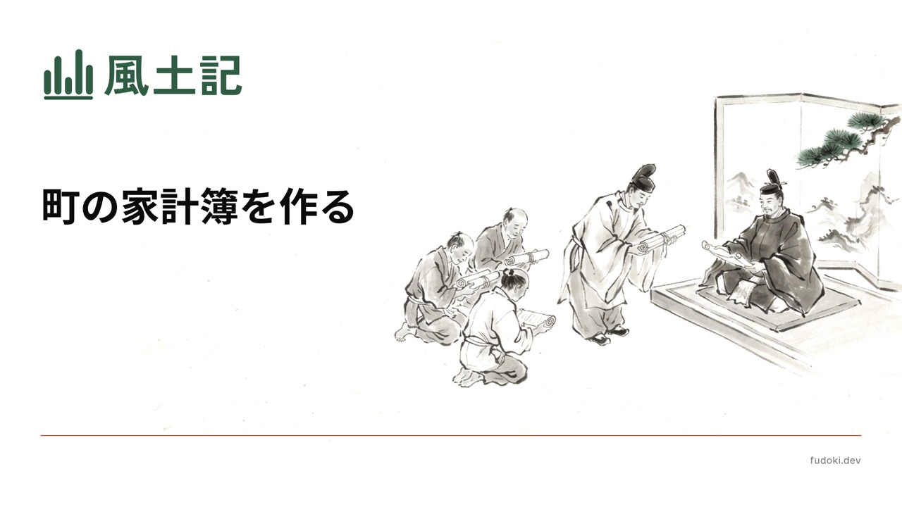

[](https://github.com/fudoki-hensansitu/fudoki/actions/workflows/verify.yml)
[-blue)](#license)

[ドキュメント](https://docs.fudoki.dev/) · [MCP で使う](https://docs.fudoki.dev/mcp) · [REST で使う](https://docs.fudoki.dev/rest) · [データの読み方](https://docs.fudoki.dev/data)

**あなたの街の家計簿をオープンに。**

自治体の予算・決算は公開されているのに、PDF か自治体ごとに形の違う CSV なので、「この市はこの事業にいくら使っているか」を機械で引けず、市や年をまたいで比べることも事実上できない。
風土記は、日本の地方自治体の**歳出の予算・決算額を事業の単位まで**構造化し、AI からそのまま問い合わせられるデータとして配る。
デジタル庁のダッシュボードが目的別・性質別まで出している以上、欠けているのは**粒度**と**横断性**の2つで、風土記はそこだけを埋める。

## QuickStart

MCP に対応した AI クライアントに `https://api.fudoki.dev/mcp` を登録する。認証は要らない。Claude Code なら次のとおり。

```bash
claude mcp add --transport http fudoki https://api.fudoki.dev/mcp
```

登録したら、会話で頼む。

> 武蔵野市の 2025 年度の決算で、金額の大きい目を 5 件出して、COFOG の分類と出典の URL も添えて

目の名前・金額と出典の URL が返れば使えている。Cursor・Codex などの登録方法と REST での使い方は[ドキュメント](https://docs.fudoki.dev/)にある。

## Features

- **事業の単位まで 🔍**: 款・項・目と、その下の事業・節・備考の内訳まで金額を引ける。
- **自治体・年度をまたいで比べる 🗾**: 科目体系の違う自治体どうしを同じ物差しで比べられるよう、目に COFOG（政府支出の機能別分類）を付けている。
- **出典に戻れる 📄**: すべての行が出典の資料名・公開 URL・SHA-256 を指し、PDF なら金額が印字された頁と位置まで辿れる。
- **出典の値と風土記の判断を分ける 🧭**: 款・項・目の金額は出典の値のまま。COFOG の分類など出典にない対応は、列の説明で判断と分かるようにしている。

## 開発

前提: [mise](https://mise.jdx.dev/)。出典と取り込み表の全量を復元するには、非公開 R2 の読取権限も要る。

```bash
mise install
bun install --frozen-lockfile
uv sync --frozen

bun run --cwd pipeline ingestion:check   # 取り込みの宣言・選定・fingerprint を検査
bun run typecheck:all
bun run test
```

いずれも終了コード 0 で終われば環境は整っている。パイプラインの工程と実行手順は [pipeline skill](.agents/skills/pipeline/SKILL.md)、構造と用語は [AGENTS.md](AGENTS.md)、設計上の決定は [docs/adr/](docs/adr/) にある。自治体を足すときは [pipeline/source_selection/](pipeline/source_selection/) から始める。

## License

ライセンスは1つでは表せないので、層ごとに分けている。

| 層 | 誰のものか | ライセンス |
|---|---|---|
| コード（`pipeline/` `packages/` `apps/`） | 風土記 | [MIT](LICENSE) |
| 風土記の判断（COFOG 分類列・科目や事業名の対応） | 風土記 | 配布物の descriptor で列ごとに宣言する（CC BY 4.0 の予定） |
| 出典・取り込み表・配布明細の出典由来の列 | **各自治体** | 各出典の利用条件 |
