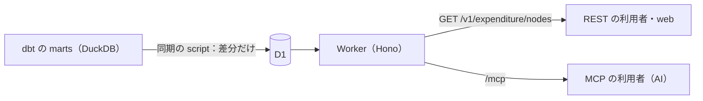

# ADR 0022: 提供用データは Worker と D1 から、一つの操作定義で REST と MCP に出す

状態: 採用（2026-10-11）。未実装

提供用データ（marts）の歳出の木を Cloudflare D1 に載せ、Cloudflare Workers（Workers Paid）が `https://api.fudoki.dev` で REST と MCP の両方を返す。操作は一度だけ定義し、Hono の REST の route と MCP の tool の両方に登録する。問い合わせは Google AIP の List と Get に従い、絞り込みは AIP-160 の filter の文字列で受ける。生 SQL と集計の操作は持たない。主な利用者は MCP 経由の AI で、問い合わせは絞り込みが中心になる。この規模（slice の3団体で約1.5万行、全国でも1年度・1資料区分で約850万行）なら、D1 と Worker だけの最小構成で足りる。

## 操作と入力の検査

操作は次の3つで、REST と MCP で入力・出力・説明が同じである。

- 木のノードの一覧（AIP-132 の List）: `filter`・`order_by`・`page_size`・`page_token` を受ける。団体の比較は、科目の軸の款・項・目のノードを `node_kind` で絞って行う。`page_size` が上限（1000）を超えたときは、AIP-132 に従って上限に丸める。
- ノード一つの取得（Get）: ノードと、軸ごとの子を返す。詳細は、比較で見つけた目から木を辿って読む。
- 列の説明の取得: `_models.yml` の列の説明と、filter に使える列を返す。

filter は AIP-160 の構文木にしてから、許可した列・演算子だけを通し、値を bind した SQL に組み立て直す。文字列を SQL に連結しない。最上位の `AND` の項が次の2つを満たさない問い合わせは、400 を返す。

- `document_kind` を `=` で一つに絞る。
- `fiscal_year` を5年以内に絞る。AIP-160 には `IN` がないので、`fiscal_year = 2025`、`fiscal_year` の `=` を `OR` でつないだもの（5つまで）、`fiscal_year >= 2021 AND fiscal_year <= 2025` のような幅5年以内の範囲のどれかで書く。

理由は次のとおりである。

- `document_kind` を必須にするのは、提供する金額の意味が資料区分ごとに違う（決算は支出済額、当初予算は当初予算額、補正予算は増減額）ためである。意味の違う金額が同じ応答に混ざると、利用者が区別せずに足すおそれがある。
- `fiscal_year` を絞るのは、1回の問い合わせで走査する行の範囲に上限を付け、D1 の読み取りの課金を抑えるためである。1年に限らず5年まで許すのは、年をまたいだ比較を1回の問い合わせでできるようにするためである。

応答には、結果の行が指す原典だけを `origins` として一度だけ付ける。原典の資料名・URL・SHA-256 を行ごとに繰り返すと、AI に返すトークンが行数に比例して増えるためである。

## データの形

D1 には、資料区分ごとの木の表（`settlement_expenditure_node` など）を `document_kind` の列を付けて一つの表にまとめたものと、`origin` の表を載せる。marts の `node_id` は資料区分を含まないので、同じ科目の決算と当初予算で同じ値になり得る。そのため D1 での一意キー・親の参照・Get の識別子は、`(document_kind, node_id)` にする。補正予算は今は扱わない。

比較用のビュー `settlement_expenditure_moku` は D1 に載せず、目の比較はノードの一覧を `node_kind` で絞って行う。ビューは marts に残し、dbt の検査と団体ごとの配布に使う。

API の filter は結合を持たないので、ノードの行に所属する款・項の名前（`kan_name`・`kou_name`）を marts で加える。API 側で親を辿ると、名前の辿り方が dbt と API の2か所に分かれるためである。

金額の和は API では求めず、利用者が絞った行を足す。和が正しくなる条件は、列の説明で渡す。

- 款・項・目の金額は原典に印字された値で、比較に和は要らない。
- COFOG で比べるときは、`cofog_code` の前方一致で目を集めて足す。`assigned` の目には COFOG のコードが一つだけ付くので、二重計上は起きない。
- division のコードだけを持つ目は、配下のどの group に属するかが決まっていない。たとえば `10.2*` の和には、`10` 止まりの目を含めない。
- 同じ団体・年度・資料区分・会計の目について、COFOG の全 division の和と、`unclassifiable` と `out-of-scope` の目の和を足すと、歳出の総額になる。

## 公開と費用の上限

認証なしで公開する。費用の増幅は、リクエストの数よりも D1 が走査する行の数で起きる。たとえば部分一致の filter は、最悪の場合、絞った範囲の全行を走査する。今の約1.5万行を、1つの IP が毎秒10回、30日間走査し続けると、約3,900億行になる。これは Workers Paid に含まれる250億行を超える。このため流量の制限だけに頼らず、次を組み合わせる。

- WAF の rate limiting rule で、IP あたり100回/10秒に制限する。Worker の前で弾くので、弾いた分は課金されない。Free プランの period は10秒だけなので、毎秒10回は10秒あたりの量で表す。データセンターごとに数えるので、厳密な上限ではない。
- 必須の filter（`document_kind`・`fiscal_year`）と index で、1回あたりに走査する行を抑える。index は、団体の比較に使う `(document_kind, fiscal_year, jurisdiction_code, node_kind)`、COFOG の比較に使う `(document_kind, fiscal_year, cofog_code)`、子を辿る `(document_kind, parent_node_id)` の3つにする。index を増やすと、同期で行を書くたびに index の分の書き込みも増えるので、問い合わせの形が増えるまで足さない。
- `limits.cpu_ms` で、1回あたりの CPU を絞る。
- kill switch を持つ。Worker の先頭でフラグを読み、立っていれば 503 を返す。予算超過の通知だけでは、リクエストの処理と課金は止まらないためである。
- Budget alerts を、月の予算の50%と80%に設定する。

キャッシュは持たない。必要になれば、GET のまま CDN に載せられる。

## 更新は D1 の実際の状態との差分で行う

dbt build の後に、同期の script を手元で手動で実行する。D1 に書き込むための Cloudflare の API トークンは mise + age で管理する。script は団体・年度・資料区分をパーティションとし、内容のハッシュが変わったパーティションについてだけ、D1 の行と warehouse の行を比べる。消えた行を削除し、新しい行と変わった行を UPSERT し、最後にそのパーティションのハッシュを更新する。書き込むのは変わった行と、その index だけである。

比べる相手を D1 の行にするのは、前回の同期が途中で失敗していても、ずれを残さないためである。ローカルに覚えた前回の状態と比べると、失敗した回の分が食い違ったまま残る。この性質は次の条件のもとで成り立つ。

- 書き込むのは同期の script だけで、同時に2つ以上実行しない。パーティションのハッシュは保存した値なので、別の経路で行が変わると、ハッシュと行が食い違ったまま変化なしと判定される。
- `row_hash` は公開する全列を決まった順序と表現（NULL・型を含む）で連結したものから計算し、パーティションのハッシュは主キーの順に並べた `(主キー, row_hash)` から計算する。どちらにもスキーマの版を含める。これにより、スキーマを変えると全行が書き直しの対象になる。
- パーティションの集合は、warehouse と D1 の和集合で比べる。D1 にだけあるパーティションは、収録から外れたものとして削除する。
- `origin` も同じ方法で同期する。新しい原典はノードより先に入れ、どのノードからも参照されなくなった原典はノードの後に消す。
- 一つのパーティションの変更が D1 の1回の batch に収まれば、その batch はトランザクションなので、全部反映されるか、まったく反映されないかのどちらかになる。D1 には、1文あたりの bind の数と SQL の長さに上限がある。収まらない場合は複数の batch に分け、ハッシュの更新を最後にする。この場合、同期の途中では、利用者が一部だけ反映された状態を読み得る。それが問題になったら、別の世代に投入してから切り替える方式に変える。

script は warehouse を読むので `pipeline/` に置き、D1 のスキーマと migration は `apps/api` に置く。公開 app は `pipeline/` を import しないという境界を保つためである。

## 依存

REST の route と OpenAPI 3.1 の文書は `@hono/zod-openapi` で作り、MCP は `@modelcontextprotocol/sdk` を `@hono/mcp` で同じ Hono に載せる。

AIP-160 の構文解析は自前で書く。使うのは文法の一部（比較の演算子、`AND`・`OR`・`NOT`、括弧、文字列の先頭か末尾の `*` による前方一致・後方一致・部分一致）だけで、ほかの構文（`:` の has、関数、フィールドの辿り）は受け付けない。既存の実装を入れても、許可リストでほとんどの構文を弾くことになり、受け付ける範囲は自前の構文解析と変わらない。

## Considered Options

- **AIP-160 の既存の実装（`onesixty` など）を使う**: 文法の全体を解析できる。使うのは一部だけで、定番と言える実装もなく、配布物と公開ソースの一致も確かめられていないため採用しない。
- **公開 R2 に団体ごとの Parquet を置き、利用者の手元の MCP の DuckDB で読む**: サーバー側の計算が要らない。claude.ai の web やモバイルからは使えず、利用者のインストールが要るため採用しない。団体ごとの配布物は [ADR 0004](0004-package-per-jurisdiction.md) に従って別に扱い、形式は未決とする。
- **Basin SQL（旧 R2 SQL）の前に Worker を置く**: スキャン量の課金で大規模に伸ばせる。この規模では Iceberg の登録とトークンの代理が増えるだけで、得るものがない。D1 の1データベースの上限（10GB）が問題になったら見直す。
- **Workers 上の DuckDB-WASM**: dbt と同じ方言で書ける。wasm の大きさが Worker の上限にほぼ収まらないため採用しない。
- **生 SQL を受ける**: AI は SQL が得意である。しかし D1 には読み取り専用の接続がなく、SQL の構文で SELECT だけを許す検査が要る。親と子、別の軸の末端を混ぜた和も止められない。さらに、表の構造がそのまま公開の契約になる。比較を款・項・目に限ると絞り込みだけで足りるため、採用しない。
- **group_by と sum を持つ JSON の問い合わせ**: COFOG の合計を API で出せる。比べる対象は数行の目なので、利用者が足せば済む。集計の言語を育てる費用に見合わないため採用しない。
- **COFOG の合計の表を marts に作る**: 利用者の足し算が要らなくなる。代わりに、階層の違う合計の行を足す誤りが新たに起き得るため、今は作らない。
- **HTTP の QUERY メソッドで body に問い合わせを入れる**: 問い合わせを body で送る必要がなくなったので、GET にした。
- **oRPC で RPC を持つ・forge で MCP を生成する**: RPC の利用者はいない。forge は OpenAPI から SDK・CLI・文書を作る道具で、MCP は生成しない。npm にも公開されていない。外部向けの SDK が必要になれば、出力した OpenAPI を渡せる。
- **変わったパーティションを丸ごと入れ替える**: 実装はより単純で、費用の差はわずかである。名前を一つ直しただけでパーティションの全行を書き直すため、行単位の差分にした。

## Consequences

- パイプライン側で、marts の木の表に `kan_name`・`kou_name` を加える。
- 公開の契約は、操作の入力・出力と filter に使える列である。D1 の表の構造は契約に含めない。
- [ADR 0010](0010-monorepo-data-storage.md) が後段に送っていた配布・検索の方式のうち、問い合わせの配信をこの ADR で決める。団体ごとの配布物の形式と、原典ごとの利用条件の扱いは引き続き未決である。
- `apps/api` は一時的に HTTP 500 を返す状態から、この構成に置き換わる。公開する前に、solo-product skill の公開前の確認（入口の数え上げ、workers.dev と preview URL の無効化）を行う。
