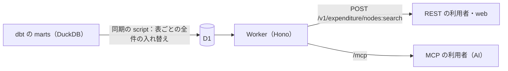

# ADR 0022: 提供用データは Worker と D1 から、一つの操作定義で REST と MCP に出す

状態: 採用（2026-10-11）。2026-10-12 改訂・実装

提供用データ（marts）の歳出の木を Cloudflare D1 に載せ、Cloudflare Workers（Workers Paid）が `https://api.fudoki.dev` で REST と MCP の両方を返す。操作は一度だけ定義し、Hono の REST の route と MCP の tool の両方に登録する。検索は AIP-136 の custom method（`:search`）として POST し、条件は構造化した JSON で受ける。Get は AIP-131 に従う。生 SQL と集計の操作は持たない。主な利用者は MCP 経由の AI で、問い合わせは絞り込みが中心になる。この規模（決算10自治体・当初予算2自治体で約3.8万行、全国でも1年度・1資料区分で約850万行）なら、D1 と Worker だけの最小構成で足りる。

## 操作と入力の検査

操作は次の3つで、REST と MCP で入力・出力・説明が同じである。

- 木のノードの検索（`search_expenditure_nodes`。REST は `POST /v1/expenditure/nodes:search`、body は MCP の tool の引数と同じ JSON）: `document_kind`・`fiscal_year`・`where`・`order_by`・`page_size`・`page_token` を受ける。未知のキーは 400 にする。自治体の比較は、科目の軸の款・項・目のノードを `where` の `node_kind` で絞って行う。
- ノード一つの取得（Get。`GET /v1/expenditure/nodes/{document_kind}/{node_id}`）: ノードと、軸ごとの子を返す。子にも `page_size` の上限と `page_token` を適用する。`node_id` は小文字 16 進 64 文字で検査する。詳細は、比較で見つけた目から木を辿って読む。
- 列の説明の取得: `_models.yml` の列の説明と、`where`・`order_by` に使える列、検索の入力の例を返す。

検索の入力は zod の schema で表し、REST の OpenAPI と MCP の inputSchema の両方がここから出る。

- `document_kind`（必須）: 受け付ける値の enum。表の選択に使う。値は `pipeline/source_selection/schema.ts` の語彙のうち、marts に木の表がある `settlement` と `initial` で、ほかの値は表ができたときに受け付ける。
- `fiscal_year`（必須）: `{min, max}`。1〜9999 の整数で、`max - min` は4以下（5年以内）。
- `where`（任意）: キーは選んだ表の列（`fiscal_year` を除く）。列の型ごとの条件を持つ。string は `eq`・`not_eq`（各100個まで）・`prefix`・`suffix`・`contains`（各200文字まで）・`is_null`、integer は `eq`・`not_eq`・`min`・`max`・`is_null`、number は `min`・`max`・`is_null`、boolean は `eq`。列どうしは AND、`eq` の配列の中は OR（IN）で、列をまたぐ OR と NOT は持たない。条件のキーは1つ以上必要で、未知のキーは 400 にする。bind する値の総数は、D1 の1文の上限（100）から LIMIT と OFFSET の分を引いた90までで、超えたら 400 にする。
- `order_by`（任意）: `{column, desc}` を5個まで。列は許可した列の enum で、末尾に `node_id` を足して順序を決める。
- `page_size`（1〜1000、既定100）・`page_token`（512文字まで）。

SQL の列名は許可した列の enum からだけ作り、値はすべて bind する。文字列を SQL に連結しない。`prefix`・`suffix`・`contains` は GLOB に組み立て、特殊文字（`*`・`?`・`[`）は escape する。SQLite の LIKE は既定で index を使わず、GLOB の前方一致は BINARY の index の範囲検索になる。GLOB は `eq` と同じく大文字小文字を区別する。リクエストの body は 16KB までにする。

`document_kind` と `fiscal_year` を必須にする理由は次のとおりである。

- `document_kind` を必須にするのは、提供する金額の意味が資料区分ごとに違う（たとえば決算は支出済額、当初予算は当初予算額）ためである。意味の違う金額が同じ応答に混ざると、利用者が区別せずに足すおそれがある。
- `fiscal_year` を絞るのは、1回の問い合わせで走査する行の範囲に上限を付け、D1 の読み取りの課金を抑えるためである。1年に限らず5年まで許すのは、年をまたいだ比較を1回の問い合わせでできるようにするためである。

必須の条件を、文字列の構文の検査ではなく型で表す。入力の検査は schema の1か所で、範囲を展開するループも持たない。JSON.parse が重複キーを後勝ちで上書きして消した値は検査しない。検査するのは解析後の値で、`__proto__` は解析後に残っていれば 400 にする。重複キーを弾くには JSON の構文解析を自前で持つことになり、攻撃面が増えるためである（prototype の汚染も SQL への到達も無い）。`page_token` の位置は100,000までで、次の位置が上限を超えるときは `next_page_token` を返さず、条件を絞って問い合わせてもらう。

`page_token` は offset と問い合わせの指紋である。指紋は入力を正規化した JSON（キーの順に依らず、`page_size` と `page_token` を除く）から計算する。後ろのページほど走査が増えるが、今の規模では許容する。

応答には、結果の行が指す出典だけを `origins` として一度だけ付ける。出典の資料名・URL・SHA-256 を行ごとに繰り返すと、AI に返すトークンが行数に比例して増えるためである。

## データの形

D1 の表は marts と同名・同列の1対1にする（`settlement_expenditure_node`・`initial_expenditure_node`・`origin`）。`document_kind` の列は足さず、入力の `document_kind` で表を選ぶ。問い合わせは必ず資料区分一つに絞るので、一つにまとめる利点がなく、marts に無い列が増えるためである。Get の識別子は `(document_kind, node_id)` で、表を選んだ後は `node_id` で引く。補正予算は今は扱わない。

列・型は warehouse、説明は `_models.yml` から生成した `apps/api/src/columns.json` が API の許可列になる。marts の列はすべて公開する。marts は利用者が使う列を確定した最終モデルで、出さない列は intermediate に置く。marts に列を足せば、次の同期で D1 と API に出る。marts は仮置きで列も行も大きく増えるため、手書きの列一覧や migration を持たない。

比較用のビュー `settlement_expenditure_moku` は D1 に載せず、目の比較はノードの一覧を `node_kind` で絞って行う。ビューは marts に残し、dbt の検査と自治体ごとの配布に使う。

API の検索は結合を持たないので、ノードの行に所属する款・項の名前（`kan_name`・`kou_name`）を marts に持つ。款の番号は自治体ごとに違うので、款・項の名前で目を絞れるようにするためである。API 側で親を辿ると、名前の辿り方が dbt と API の2か所に分かれる。

金額の和は API では求めず、利用者が絞った行を足す。和が正しくなる条件は、列の説明で渡す。

- 款・項・目の金額は出典に印字された値で、比較に和は要らない。
- COFOG で比べるときは、`cofog_code` の前方一致で目を集めて足す。`assigned` の目には COFOG のコードが一つだけ付くので、二重計上は起きない。
- division のコードだけを持つ目は、配下のどの group に属するかが決まっていない。たとえば `10.2*` の和には、`10` 止まりの目を含めない。
- 同じ自治体・年度・資料区分・会計の目について、COFOG の全 division の和と、`unclassifiable` と `out-of-scope` の目の和を足すと、歳出の総額になる。すべての目がこの3つの状態のどれかを持つことは、dbt の検査 `fiscal_cofog_covers_moku` が保証する。

## 公開と費用の上限

認証なしで公開する。費用の増幅は、リクエストの数よりも D1 が走査する行の数で起きる。たとえば `contains` は、最悪の場合、絞った範囲の全行を走査する。1回の最悪は1つの木の表の全行で、決算では21,059行になる。これを1つの IP が20回/10秒（毎秒2回）で30日間走査し続けると、21,059×2×2,592,000 で約1,100億行になる。Workers Paid に含まれる250億行を超える約850億行が課金され、約$85 になる。100回/10秒なら約5,500億行・約$520 になるので、20回/10秒に絞る。このため流量の制限だけに頼らず、次を組み合わせる。

- WAF の rate limiting rule で、IP あたり20回/10秒に制限する。AI が普通に使う頻度（1秒に2回程度）は通る。Worker の前で弾くので、弾いた分は課金されない。Free プランの period は10秒だけなので、毎秒2回は10秒あたりの量で表す。データセンターごとに数えるので、厳密な上限ではない。Free プランのルールはホスト名を条件にできない（パスと Verified Bot だけ）ので、D1 を読む API の入口のパス（`/v1/` で始まるものと `/mcp`）で絞る。web と docs はこれらのパスを持たないので、実質的に `api.fudoki.dev` だけにかかる。ゾーン全体にかけると、web を公開したとき1ページで何十回もリクエストするブラウザを弾く。Free のルールは1つだけなので、既定の漏えい済み認証情報のルール（ログインの無いこのゾーンでは守るものが無い）と置き換えた。
- MCP は JSON-RPC の batch（最上位が配列の要求）を受けない。1回の HTTP で検索を何十件も実行でき、WAF の回数の制限が増幅されるためである。単一の要求だけを受け、body は実際に読んだバイト数で 16KB までにする。
- 必須の入力（`document_kind`・`fiscal_year`）と index で、1回あたりに走査する行を抑える。表は資料区分ごとに分かれているので、index は `document_kind` を含めない。自治体の比較に使う `(fiscal_year, jurisdiction_code, node_kind)`、COFOG の比較に使う `(fiscal_year, cofog_code)`、子を辿る `(parent_node_id)` の3つにする。index を増やすと、同期で行を書くたびに index の分の書き込みも増えるので、問い合わせの形が増えるまで足さない。
- `limits.cpu_ms` で、1回あたりの CPU を絞る。
- kill switch を持つ。Worker の先頭で D1 の `control` 表の `serving` を読み、`on` 以外なら 503 を返す。migration は `control` だけである。予算超過の通知だけでは、リクエストの処理と課金は止まらないためである。kill switch の読み取りは1リクエストあたり `control` の1行で、1回の問い合わせの走査（最悪で約2.1万行）に比べて無視できるため、費用の見積もりには含めない。
- アカウント全体の Budget alert（従量課金の合計が $1 を超えたら通知）を使う。通知はしきい値ごとに月1回なので、ふだんの従量課金が $1 を超える月が出てきたら、異常に気づく用にもう1段上のしきい値を足す。

今は決算が1年度分しか無いので、`fiscal_year` の必須条件は走査を減らさない。1回の最悪は1つの木の表の全行である。上の見積もりのとおり、20回/10秒に張り付く1つの IP で月に約$85 になり得る。実際の上限は、予算の通知と kill switch の運用で決まる。

この見積もりは机上の値なので、本番では応答の D1 の `meta.rows_read` を見て、問い合わせの形ごとの実際の走査行数で確かめる。

キャッシュは持たない。必要になれば、GET のまま CDN に載せられる。

Worker の observability を有効にし（`headSamplingRate: 1`）、要求ごとの CPU 時間（`limits.cpuMs` に対する余裕）とエラーをログで見る。Workers Paid の Workers Logs は月 2,000 万件が含まれ、超過は 100 万件あたり $0.60 である（保持は7日。2026年12月1日から Cloudflare Observability の料金に移る）。今の利用の量なら含まれる量に収まる見込みで、デプロイ後の実測で確かめる。WAF の rate limit は IP ごと（データセンターごと）なので、ログの総量の上限にはならない。総量の異常は従来の Budget alert（$1）で気づき、kill switch で止める（超過の単価は小さい）。2026年12月1日に料金の体系が変わるので、そのときにアカウント全体のログの量と保存量を見て見積もりを見直し、必要なら `headSamplingRate` を下げる。トレースは有効にしない。

## 更新は表ごとの全件の入れ替えで行う

dbt build の後に、同期の script を手元で手動で実行する。まず前回の失敗の残骸 `<表>__new`・`<表>__old` を捨て、表ごとに `<表>__new` へ全件を入れる。次に `__new` の全行を読み戻し、warehouse の同じ行と主キーで突き合わせて全列を比べる。3表とも合えば、1つの batch で drop・rename・index の作成を行う。合わなければ入れ替えずに失敗する。

D1 は warehouse から作り直せる写しなので、同期の可用性は担保しない。失敗したら同期を流し直す。失敗した同期の途中や後では、API がエラーを返したり表の世代が混ざったりし得る。中断時の自動復旧は持たない。Cloudflare の公式文書は、REST の query/raw に複数文を渡したときの原子性を保証していない。

- 書き込むのは同期の script だけで、同時に2つ以上実行しない（`__new` が衝突する）。
- D1 への書き込みは cf の OAuth で行い、API トークンは作らない（R2 の保存と同じ）。
- 全件でも今は約3.8万行×（表＋index 3）の書き込みで、Workers Paid の月5,000万行に対して小さい。行数が全国規模に近づき書き込みの費用が効いてきたら、行単位の差分に戻すことを検討する。

script は warehouse を読むので `pipeline/` に置き、D1 の migration と API は `apps/api` に置く。公開 app は `pipeline/` を import しないという境界を保つためである。

## D1 の容量

slice の3自治体の木を SQLite に入れ、3つの index を張って測ると、1行あたり約485バイトだった。全国の1年度・1資料区分（約850万行）では約4.1GB になり、D1 の1データベースの上限（10GB）には、年度と資料区分の組で2つ分ほどしか入らない。収録が自治体の数十の規模のうちは1つのデータベースで足りる。データベースが 8GB を超えそうになったら、年度ごとにデータベースを分け、5年をまたぐ問い合わせは Worker が複数のデータベースに分けて引く。

## 依存

Worker のビルドは cf と `@cloudflare/vite-plugin` で行い、wrangler は使わない。

REST の route と OpenAPI 3.1 の文書は `@hono/zod-openapi` で作り、MCP は `@modelcontextprotocol/server`（v2 の SDK）の `createMcpHandler` を同じ Hono の `/mcp` から呼ぶ（`@modelcontextprotocol/sdk` と `@hono/mcp` は使わない）。

- **規格**: MCP の 2026-07-28 の規格（initialize の握手も `Mcp-Session-Id` も無く、要求ごとに `_meta` の envelope と `MCP-Protocol-Version`・`Mcp-Method` のヘッダを付ける。`server/discover` で能力を返す）を話す。2025 年代の client（現行の Claude など）は `legacy: 'stateless'` で、要求ごとに新しい server を作って捌く。この経路の応答は SDK の都合で JSON ではなく SSE（`event: message` の `data:`）で返る。
- **状態**: Workers は要求をまたいで状態を持てないので、handler と server は要求ごとに作る。body の検査（Content-Type・実バイト数 16KB・UTF-8・`__proto__`・batch の拒否）は Hono 側で済ませ、parse 済みの値を `parsedBody` で渡す。
- **tool の注釈**: すべての tool は D1 の読み取りだけなので、`title`（操作の summary）と `readOnlyHint: true`・`destructiveHint: false`・`idempotentHint: true`・`openWorldHint: false` を MCP の登録の箇所で一括して付ける。
- **outputSchema を宣言する**: 各 operation の `output`（zod）から tool の `outputSchema` を出し、成功時は `structuredContent` に結果の object を返す。`content` の text は同じ JSON の写しで、`structuredContent` を読めない client のためのもの（MCP の SHOULD）。二重に読まないのは client の責任とする。ただし描画 tool（`render_expenditure_view`）だけは例外で、text を「描画を実行した」旨の一文にし、データは `structuredContent` だけで返す。AI は先に呼んだデータ tool の結果で同じデータを読んでおり、写しを返すと会話の文脈に約10万字が重複して載るため（tool の説明文で、回答に使うデータは先に呼んだデータ tool の結果と伝える）。MCP Apps に対応しない client では、描画 tool の text にデータが入らない。減る重さは client で違い、text しか読めない client では重複が丸ごと消えるが、`structuredContent` もモデルに出す host では、描画 tool のデータは `structuredContent` 経由で文脈に残る。エラーは従来どおり `isError` と text だけで、`structuredContent` は付けない。応答の形は outputSchema が正本で、tool の説明文には schema で表せないこと（何のための tool か、いつ使うか、足してはいけない金額、sum_rules への誘導）だけを書く。フィールドの意味は zod の `.describe()` で schema 側に置く。SDK は `structuredContent` を outputSchema で検証するので、marts の列と `columns.json` のずれは実行時にも検出され、テストでも全 operation の応答を `output` に通して落とす。output の zod は `strictObject` にする（`object` は未知のキーを黙って落とし、JSON Schema の `additionalProperties: false` と食い違うため）。さらに、`tools/list` の outputSchema を本物の JSON Schema の validator に通して、client が見る `structuredContent` を検査する。
- **共通の schema は $defs に一度だけ**: `Node`・`Origin` と where の条件（`StringCondition` など）は zod の `.meta({ id })` で名前を付け、JSON Schema では `$defs` と `$ref` にする。33 列に同じ条件の schema が繰り返し出るのを避け、`tools/list` の応答は約 24,000 字（outputSchema なし）から約 15,100 字（outputSchema あり）になった。OpenAPI では components に出る。
- **Origin では絞らない**: 2026-07-28 の規格は不正な Origin に 403 を求めるが、これは主にローカルの server を DNS rebinding から守るための規則である。この API は認証なしで誰でも読める公開の読み取り専用なので、どの Origin も正当とみなす。curl などは Origin を付けずに送れるので、絞っても守りは増えない。
- **長い接続は持たない**: `subscriptions/listen` は Hono 側で 400 にする（Workers で SSE を開いたままにできず、通知の元も無い）。`tools.listChanged` は false にする。
- **初回の CPU**: SDK v2 は内部の schema を初回の要求で作るため、module scope で `preloadSchemas()` を呼び、要求ごとの CPU（`limits.cpuMs`）から外す。bun での冷えた初回の CPU は、v1 が tools/list 59ms・tools/call 55ms、v2（対策後）が 62ms・76ms だった。workerd での実測はデプロイ後に確かめる。

## Considered Options

- **AIP-160 の filter 文字列で受ける（当初の決定）**: Google AIP の List の形に揃う。しかし自前の構文解析が攻撃面になり、範囲を年ごとに展開するループが、巨大な年の値で止まらない穴が実際に出た。AI は独自の文法を書くより、JSON Schema の引数を正確に埋める。必須の条件も型で表せる。失うのは列をまたぐ OR と NOT で、2回の問い合わせで代えられる。REST を POST にしたので、GET のまま CDN に載せる余地は失う（今はキャッシュを持たない）。
- **AIP-160 の既存の実装（`onesixty` など）を使う**: 文法の全体を解析できる。使うのは一部だけで、定番と言える実装もなく、配布物と公開ソースの一致も確かめられていないため採用しない。構造化した入力にしたので、構文解析そのものが要らない。
- **公開 R2 に自治体ごとの Parquet を置き、利用者の手元の MCP の DuckDB で読む**: サーバー側の計算が要らない。claude.ai の web やモバイルからは使えず、利用者のインストールが要るため採用しない。自治体ごとの配布物は [ADR 0004](0004-package-per-jurisdiction.md) に従って別に扱い、形式は未決とする。
- **Basin SQL（旧 R2 SQL）の前に Worker を置く**: スキャン量の課金で大規模に伸ばせる。この規模では Iceberg の登録とトークンの代理が増えるだけで、得るものがない。D1 の容量が足りなくなったら見直す。
- **Workers 上の DuckDB-WASM**: dbt と同じ方言で書ける。wasm の大きさが Worker の上限にほぼ収まらないため採用しない。
- **生 SQL を受ける**: AI は SQL が得意である。しかし D1 には読み取り専用の接続がなく、SQL の構文で SELECT だけを許す検査が要る。親と子、別の軸の末端を混ぜた和も止められない。さらに、表の構造がそのまま公開の契約になる。比較を款・項・目に限ると絞り込みだけで足りるため、採用しない。
- **group_by と sum を持つ JSON の問い合わせ**: COFOG の合計を API で出せる。比べる対象は数行の目なので、利用者が足せば済む。集計の言語を育てる費用に見合わないため採用しない。
- **COFOG の合計の表を marts に作る**: 利用者の足し算が要らなくなる。代わりに、階層の違う合計の行を足す誤りが新たに起き得るため、今は作らない。
- **HTTP の QUERY メソッドで body に問い合わせを入れる**: 安全で冪等な読み取りを body 付きで表せる。しかし QUERY は標準化の途中で、Hono・OpenAPI 3.1・多くのクライアントが扱えないため採用しない。構造化した入力を body で送るので POST（`:search`）にした。
- **oRPC で RPC を持つ・forge で MCP を生成する**: RPC の利用者はいない。forge は OpenAPI から SDK・CLI・文書を作る道具で、MCP は生成しない。npm にも公開されていない。外部向けの SDK が必要になれば、出力した OpenAPI を渡せる。
- **変わったパーティションだけ行単位の差分で同期する（当初の決定）**: 前回の同期の失敗にも強い。しかし marts の列が変わるたびにスキーマの版が上がり全行を書き直すので、列が頻繁に変わる今は差分の利点が出ない。手書きの列一覧と migration も要る。そのため全件の入れ替えにした。
- **木の表を `document_kind` 付きで一つにまとめる（当初の決定）**: 問い合わせは必ず資料区分一つに絞るのでまとめる利点が無く、marts に無い列が増えるため、1対1にした。

## Consequences

- marts の木の表に `kan_name`・`kou_name` を加えた。marts の列を足せば、次の同期で D1 と API に出る。
- 公開の契約は、操作の入力・出力と `where`・`order_by` に使える列である。列は marts と同じなので、marts の列の変更は契約の変更になる。
- [ADR 0010](0010-monorepo-data-storage.md) が後段に送っていた配布・検索の方式のうち、問い合わせの配信をこの ADR で決める。自治体ごとの配布物の形式と、出典ごとの利用条件の扱いは引き続き未決である。
- `apps/api` は一時的に HTTP 500 を返す状態から、この構成に置き換わった。公開する前に、到達できる入口（custom domain・workers.dev・preview URL・version URL）を数え上げ、`api.fudoki.dev` 以外を無効にする。
