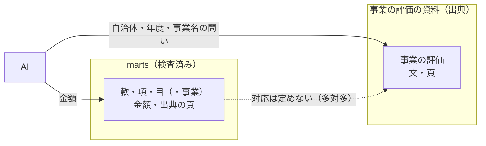

# 事業名で事業の評価を引く

## Problem

風土記は、事業（款・項・目と備考の事業）の金額を出典と照合して配っている。しかし金額だけでは、その事業がうまくいったのか、目標に届かなかったのか、停滞しているのかが分からない。自治体はそれを事務事業評価や主要施策の成果説明書で公表しているが、資料の名前・様式・置き場は自治体ごとに違う。決算書の科目と評価の資料の事業は、名前も粒度も一致しない。そのため、ある事業の評価を知るには、資料を探して人が読むしかない。

## 導出

Story の「支出を事業の単位で見る」「数字が怪しいと思ったときに、出典と合っているか・注意点が無いかを確かめる」を支える。金額の背景にある事業の成否と今後の方向を、出典の引用で確かめられるようにする。

## Overview

利用者は MCP 経由の AI である。AI は、自治体・年度を指定し、事業名やその言い換えを問いにして、事業の評価の資料から作った検索を引く。検索は出典の所在（資料・頁）と軽微な抜粋を候補として返し、AI が抜粋と出典の該当頁を読んで、どれが目的の事業の評価かを判断する。頁の本文は返さない（両区の利用条件が無断の転載を禁じているため）。検索は上位の候補に正解を含めればよく、一番上で当てることは求めない。金額は検査済みの marts から取り、評価の資料の中の数字は答えの金額として使わない。

まず決算の marts がある2自治体で、事業名での引き当ての精度を測り、候補に正しい頁が入ることを確かめてから MCP で試験的に公開する。候補を読む AI の引用の精度は、公開と並行して測って改善する。ほかの自治体へ広げるかは、その記録も見て決める。

### Goals

- ある事業について、成否（目標と実績、評価の区分、課題、今後の方向）を出典の頁まで辿れる形で得られる。
- AI が事業名で引いたときに、目的の事業の評価が上位の候補に入る。
- 引き当ての精度を測り、公開と拡大を判断できる。

### Non-Goals

- 全自治体の網羅。公表されていて、選定した分だけを扱う。
- 評価の記述が無い資料。資料の名前が「成果」でも、金額の表と不用額の理由しか無いものは扱わない。
- 決算書の科目と、評価の資料の事業との対応を、風土記の判断として定めて保存すること。
- 評価の資料の文や数字から金額・評価を作ること。要約・採点・自治体間の順位付けも行わない。

## Glossary

**事業の評価の資料**:
自治体が事業の成否を説明・評価して公表する資料。事務事業評価・行政評価の評価シートや、主要施策の成果説明書（地方自治法第233条第5項で決算に添える書類）のうち、目標と実績、評価、課題、今後の方向などを書いたもの。名前ではなく中身で判断する。

**事業の評価**:
事業の評価の資料の中で、一つの事業・施策について書かれた範囲。出典の文と頁を持つ（風土記の応答は、その所在と軽微な抜粋だけを返す）。金額が印字されていても、風土記の金額としては扱わない。

**事業の評価の候補**:
検索で返る事業の評価の所在。出典（資料・頁）と軽微な抜粋を持ち、頁の本文は持たない。目的の事業の評価であるとは保証せず、AI が文脈から判断する。

## Domain Model

決算書の科目と評価の資料の事業は、多対多に対応する。目一つに評価の事業が複数載ることも、評価の施策一つが複数の目にまたがることもある。決算書が目より下の事業を印字しない自治体もある（中野区・目黒区の令和7年度決算は目の下が節だけ）。対応は風土記が定めず、AI が検索のたびに判断する。

規則:

- **数字の役割を分ける**: 金額は marts から、事業の評価は出典の所在（資料・頁）と軽微な抜粋で返す。評価の資料の金額（事業費など）は出典の文の一部として見えるだけで、答えの金額や marts の検査に使わない。marts の金額は科目（款・項・目）の粒度のまま示し、評価の事業との対応が出典で確かめられないときは、目の金額をその事業の費用や費用対効果として断定しない。
- **出典を固定する**: 評価の資料も決算書と同じく出典として選定し、URL と sha256 で固定する。公開またはほかの自治体へ広げる前に、非公開 R2 に保存する。検索の索引（AI Search など）は出典の写しで、出典の保管場所にしない。検索は固定した出典から作り直せる。
- **出典を返す**: 候補には、資料（sha256 で出典まで辿れること）と頁を必ず付ける。AI は出典を見て、候補が目的の事業か、どの資料のどこかを判断・提示できる。
- **自治体・年度は絞り込みで守る**: 自治体と年度が違う評価を候補に混ぜない。

## Acceptance Criteria

- AI が試行の自治体・年度と事業名の問いで検索すると、事業の評価の候補を、出典の所在（資料・頁）と軽微な抜粋つきで得られる。
- 利用者は、候補の資料を sha256 で固定した出典まで辿り、抜粋が出典の頁にあることを確かめられる。内容は出典の該当頁を自分で取得して読む。
- 候補の中に、評価の資料から読み取った金額が、風土記の金額として現れない。
- 試行の自治体の事業について、正解の事業の評価（無いことも正解に含む）を定めた評価の集合があり、正解が上位の候補に入る割合を測った記録が残る。測定は、分母・閾値・取り違えの定義を測る前に決める。成否の引用が正しい事業のものかは、AI の利用手順（引き直しと停止の条件）のまま測って記録する。
- 資料を選び直したり保存し直したりしても、選定と保存の宣言から検索を作り直せる。

## Non-Functional Requirements

- **出典の扱い**: 選定・保存・再構築は、決算書と同じ流れ（`pipeline/source_selection`、非公開 R2）に乗せる。第1段は URL と sha256 の固定までとし、R2 への保存は公開・拡大の前に行う。独立した provenance ファイルは作らない。
- **費用**: 公開の前に、[ADR 0022](../../adr/0022-serve-marts-via-worker-d1-rest-and-mcp.md) と同じ観点（1回あたりの最悪の費用、流量の制限、kill switch）で見積もり、上限を設ける。AI は一つの問いで何度も検索するので、費用は検索の回数で効く。
- **利用条件**: 出典の文は、所在を示す軽微な抜粋だけを返し、頁の全文は返さない（北区・中野区のサイトの利用条件が無断の転載を禁じているため）。出典の文を公開して返すことは、出典の利用条件の判断に従う（[ADR 0006](../../adr/0006-license-per-layer.md)）。公開の判断の前に、試行の自治体の利用条件を確かめる。

## Success Metrics

- 試行の自治体の事業について、正しい事業の評価が上位の候補（通常は最大5件。試行は最大10件）に入る割合。上位の候補に正解が無ければ AI は判断できないので、これを主な指標にする。分母・正解の付け方・合否の閾値は、試行の前に検証計画で決める。
- 正解の評価が無い事業で、AI が「該当なし」と判断できる割合。

## 未決

- 公開の形（既存の MCP に検索の操作を足す）と、公開・拡大の前に満たす条件は [設計](dd.md#公開拡大の前に満たす条件) に置く。

## 参考

- 試行の自治体（中野区・北区）、出典の選定、検索の基盤と進め方は [設計](dd.md)。
- 関連: [財政データのAPI](../budget-api/prd.md)、[予算の変更と決算の実績を区別して比較する](../fiscal-records/prd.md)
