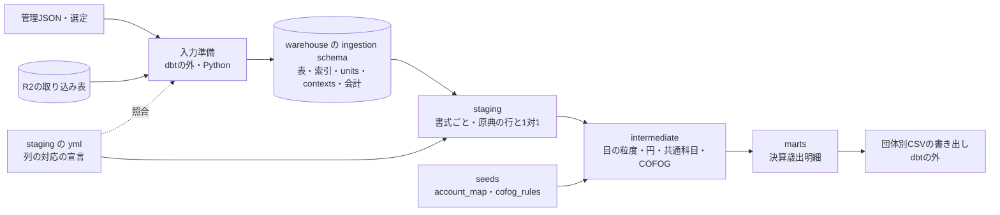

# 決算の歳出を目の粒度で団体をまたいで比べる dbt モデルと、取り込み表の出力契約

担当者: wwwyo / Claude
更新日: `2026-10-11`
状態: Draft

## Summary

取り込み表（R2 の Parquet）は変換器ごとに列構成が違い、dbt が団体をまたいで共通に読むための条件が決まっていない。この設計は、次の3点を定める。

1. 取り込み表と metadata が満たすべき最小の出力契約と、取り込み側（B）への変更要求。
2. staging・intermediate・marts の責務とモデル構成、marts の歳出 CSV の列。
3. 最初に通す縦の一本（slice）: **2025年度決算・歳出・一般会計・目の粒度**で、書式の違う 131041 新宿区・132012 八王子市・132021 立川市。

レビューで決めたいのは、出力契約の置き場（[ADR 0019](../../adr/0019-staging-column-map-in-dbt.md)）、marts を目の粒度から始めること、B への変更要求の優先順位の3点である。

## Goals / Non-Goals

- Goal: slice の3団体について、目ごとの支出済額を同じ列の団体別 CSV として出し、原典の印字額と照合できる状態にする。
- Goal: 他の団体・資料区分を足すときに、どこへ何を書けばよいかを決める。取り込み表に足りない情報は、表 ID 付きの変更要求として B に渡す。
- Non-Goal: 目より細かい内訳（節・事業）の marts。団体ごとに内訳の軸が違うため、slice の後に別に設計する（[Open Questions](#open-questions)）。
- Non-Goal: 特別会計・当初予算・補正予算。slice の次の段階で足す（[Validation / Rollout](#validation--rollout)）。
- Non-Goal: 配布物のメタデータ（列の定義・出典・利用条件を CSV に添える処理）と公開。[ADR 0009](../../adr/0009-dbt-model-layers.md) のとおり dbt の外で、パイプライン完成後に扱う。

## Background

### 現状

dbt（`pipeline/dbt`）にはマスタの seeds と正規化 macro（`trim_cell`・`staging_amount`）だけが残り、モデルはない。取り込みは16宣言・80表が R2 にある。表ごとの単位・粒度・列の所属は、管理 JSON の `tables[].metadata` にある。要件は [fiscal-records の PRD](../fiscal-records/prd.md)、概念は [ドメインモデル](../fiscal-records/fiscal-domain-model.md)、取り込み表の保存と metadata の形は [保存設計](../ingestion-storage/design-doc.md) を参照する。

別の worktree で、PDF の階層別合計検査の共通化と変換器の修正が進んでいる。変換器の列は変わる可能性があり、この設計は列名ではなく、表が持つべき情報を契約にする。

### 実測した取り込み表の違い

2026-10-11 に全80表を `ingestion.fiscal.run restore --remote` で復元し、duckdb で読んだ。全量は gitignore 配下の `pipeline/ingestion/fiscal/observations/dbt-output-contract/` にある。設計に効く違いは次のとおり。

階層と金額の持ち方は、原典の様式ごとに違う。どの表も、末端の行に款・項・目の番号・名称・金額を反復する横持ちである。違うのは目より細かい末端の軸で、それは原典が目の下に何を印字しているかで決まる。

| 末端の軸 | 団体と表 ID | 目の金額列 |
| --- | --- | --- |
| 事業（説明欄） | 131041 `general-expenditure-detail`（備考_番号・名称・金額） | 当初予算額・補正予算額・継続費及び繰越事業費繰越額・予備費支出及び流用増減・計・支出済額・翌年度繰越額・不用額 |
| 法定の節 | 131105・131148・131172 `general-setsu`（区分_番号・名称）、131156・132021 `general-expenditure-details`（節_番号・名称） | 同上。131105・131148・131172 は翌年度繰越額を継続費逓次繰越・繰越明許費・事故繰越しに分ける |
| 節と説明を別表に分ける | 131156・132021 の `general-expenditure-notes`（説明・細目） | 同上 |
| 主要施策の事業（抜粋） | 132012 `general-detail`（事業・内訳・細目） | 予算現額・当年度決算額・前年度決算額だけ |
| 事業・節・数量表を一表に展開 | 131024 `chuo-general-settlement`（751列） | 当初予算額・補正予算額・繰越事業費繰越額・予備費支出・流用増減・予算現額計・支出済額・翌年度繰越額・不用額・執行率 |
| 説明（当初予算） | 132071 `akishima-text-budget-expenditure` | 本年度予算額・前年度予算額・比較・財源内訳（千円） |

目の粒度なら、一般会計の決算がある8団体すべてで印字額が閉じる。 131024・131041・131105・131148・131156・131172・132012・132021 の一般会計の表で、(款_番号, 項_番号, 目_番号) ごとに目の支出済額は一意に決まり、その和は全款で款の支出済額と一致した。132012 以外の7団体では、全目で「予算現額 = 当初＋補正＋繰越＋予備費・流用」と「予算現額 = 支出済額＋繰越＋不用額」が成り立った。132012 は繰越額・不用額の列がなく、後者を検算できない。

一方、目より細かい軸は、団体ごとに完全性が違う。 節の支出済額の和は、131105・131148・131156・131172・132021 の全目で目の支出済額と一致した。131041 の事業（備考）も141目中140目で一致し、残る1目は末端の欄がない目である。132012 の事業は107目中50目で一致しない。選定した原典が「主要な施策の成果・事務報告書」で、事業を抜粋しているためである。

表記の揺れは、staging で吸収できる範囲にある。 名称には均等割付の字間空白（132021・131172・131024 の「議 会 費」）と折り返しの改行が残る。金額は桁区切りと「△」が中心で、既存の `staging_amount` で読める。131024 以外の一般会計の7表と 132071 の当初予算の表を調べたところ、読めないのは 132012 の予算現額「(767,030,000)」、前年度決算額「<49,315,029>」、款の財源欄の「－」だけだった。132012 には複数の目を一行にまとめた「目 2～6」が1件ある。

会計は表の列にない。 表は会計ごとに分かれているが、会計名を持つのは変換器の options（131041 の特別会計）か表 ID の接頭辞だけである。原典 SHA と行の物理頁を選定の scope（会計・方向・頁範囲）に当てると、70表で会計が一つに決まった。残りは、頁の列名が `physical_page` の 132039 水道の7表、頁の列がない 132071 の当初予算の1表、会計の列を持つ 132047 の CSV 2表である。

金額列の見出しも metadata にない。 単位を宣言した金額列 1,761 列のうち、簡易判定で 1,587 列は `column_contexts.header_path` が行の段（例 `['科目','目']`）で、金額欄の見出し（例「予算現額＞計」）ではない。131041 の `目_計` が予算現額であることは、変換器の検査コード（`validation.py` の `total`）と列名からしか読めない。131105 の `金額` が予算現額であることは notes の自由記述にある。

## Design

### 全体像

- **入力準備**は dbt の外に置く。dbt の sources yml に列挙した表について、管理 JSON から SHA 照合済みの Parquet を復元し、warehouse の `ingestion` schema に読み込む。索引（表・対象・原典 SHA・行数）、metadata の units・column_contexts・notes、表ごとに解決した会計も表として置く。
- **列の対応の宣言**は staging の yml の列 `meta` に置く（ADR 0019）。入力準備は宣言と metadata を照合し、存在しない列・単位のない金額列・会計が一つに決まらない表があれば止まる。
- **書き出し**は dbt の外に置き、marts の表から団体別 CSV を `pipeline/.build/marts/` に書く。

### 取り込み表の最小の出力契約

staging が団体をまたいで共通に読むために、取り込み表と `tables[].metadata` が満たす条件を次に定める。列名は契約に含めない。列名の違いは staging の改名で吸収し、契約はその改名を原典に照らして検査できる情報に限る。

| ID | 条件 | 使う層 | 現状 |
| --- | --- | --- | --- |
| C1 | 表は管理 JSON の対象（団体・年度・資料区分・方向）と表 ID で識別でき、Parquet の SHA・行数が管理 JSON と一致する | 入力準備 | 80表で満たす |
| C2 | 一つの表は一つの会計に属し、原典 SHA と行の物理頁から選定 scope の会計が一つに決まる。複数会計を含む表は、会計の原文の列を持つ | 入力準備 | 70表が頁で、132047 の CSV 2表が会計の列（例「01一般会計」）で満たす。残り8表は頁の列名が違う（7表）か頁の列がない（1表）ため、C3 を満たせば解決する |
| C3 | 階層の段ごとに、その段の行が印字された原典の物理頁の列がある | 入力準備・marts | 132071 当初予算の表は頁の列がない。列名は `物理頁`・`<段>_物理頁`・`原典物理頁`・`physical_page` と揺れる |
| C4 | 款・項・目の各段に番号と名称が別の列としてあり、`column_contexts.grain_columns` で段の粒度を宣言している。同じ目に属する行は、目の番号・名称・金額を同じ値で反復する | staging・intermediate | 132071 当初予算は款・項・目が番号と名称を一つの列に持ち（例「第１款議会費」「1議会費」）、款・項の context がない。132039 水道は款・項・目が単一列で、番号と名称を分けているかは未確認 |
| C5 | 金額列ごとに、金額欄の原典の見出しを上位見出しから順に `header_path` で持つ。行の段の見出しと区別する | 入力準備（宣言の照合） | 金額列の大半が行の段の見出しだけを持つ（Background を参照） |
| C6 | 金額列すべてに単位の原文が `units` で宣言されている | intermediate | 131024 以外の一般会計の7表と 132071 の当初予算の表で、金額列の宣言漏れはない。他の表は未確認 |
| C7 | 金額は原文の文字列で、印字の装飾（括弧・不等号・「円」・「－」・「△」）を保持する。空欄（NULL）・印字された0・「－」を区別する。装飾の意味は notes に書く | staging | 満たす。132012 の括弧と不等号の意味は notes にある |
| C8 | 同じ支出の独立した分解（節表と説明表、財源内訳、款項表）は別の表 ID に分け、表どうしの関係を notes に書く | staging | 満たす。ただし 131041 の法定節一覧は R2 の表になく、ローカルの検算観測にだけある |

C5 は、ADR 0019 の照合の根拠になる。たとえば staging の宣言で `目_計` を予算現額と決めたとき、入力準備はその列の `header_path` に「予算現額」があることを確かめる。C5 が満たされない列は照合できない列として一覧にし、宣言の説明に根拠（変換器の検査コードなど）を書いて使う。

### 取り込み側（B）への変更要求

| 優先 | 表 ID | 要求 | 理由 |
| --- | --- | --- | --- |
| 高（slice の検査） | 131041 の `general-expenditure-detail`・`kaigo-`・`kokuho-`・`kouki-expenditure-detail`、132021 の `*-expenditure-details`・`*-expenditure-notes`、132012 の `*-detail` | 金額列ごとに金額欄の見出しを `header_path` に持たせる（例 `目_計` → `['予算現額','計']`）。行の段の見出しは番号・名称の列の context に分ける | C5。予算現額を使う恒等式の検査（目・項・款）で、`計` を予算現額と読む根拠を原典の見出しから取るため |
| 中（当初予算の slice の前） | 132071 `akishima-text-budget-expenditure` | 款・項・目の番号と名称を別の列に分け、款・項の `column_contexts` を足す。行ごとに物理頁の列を足す | C2・C3・C4。番号がないと目の識別と共通科目への対応ができず、頁がないと会計の解決と原典照合ができない |
| 中（節の marts の前） | 131041 の4会計 | 法定節一覧を、説明欄の明細とは別の表 ID で保存する | C8。節は経済分類の軸で、新宿区だけ節の支出済額を R2 から読めない |
| 中（水道を入れる前） | 132039 の `shuueki_hiyou_meisai` ほか水道の7表 | 款・項・目の番号と名称が分かれているかを確認し、分かれていなければ分ける | C4（現状は未確認） |
| 低（推奨） | 全表 | 物理頁の列名を `<段>_物理頁`（段の行）と `物理頁`（末端の行）に揃える。または metadata で頁の列を宣言する | C3。並行して進む階層別合計検査の共通化でも同じ列を使うため。揃うまでは staging の宣言で吸収する |

B の外の上流（原典選定 A）にも、slice で影響する事実が一つある。132012 の選定は決算書ではなく「主要な施策の成果・事務報告書」で、事業は抜粋、目は範囲の行（2～6）を含み、当初予算額・補正予算額・繰越額・不用額・節がない。scope にある9会計のうち、取り込まれているのは一般会計・介護・借入金管理・後期高齢者・国保の5会計である。目の粒度の支出済額は款と閉じるので slice には使えるが、決算書を選び直すかは A で判断する。

### 層ごとの責務とモデル構成

[Glossary](../../../AGENTS.md) と [ADR 0009](../../adr/0009-dbt-model-layers.md) に沿って分ける。slice のモデル名を例に示す。

#### staging: 書式ごとに、原典の行と1対1のまま列名と型を整える

- モデルは「団体 × 変換器の書式」ごとに一つ作る。同じ書式の会計・年度違いの表は `union all` でまとめる。slice では `stg_fiscal__131041_settlement_detail`・`stg_fiscal__132012_settlement_report`・`stg_fiscal__132021_settlement_details`・`stg_fiscal__132021_settlement_summary`（検査用の款項表）の4モデルになる。
- 行は取り込み表の行と1対1にし、`source_table_key`（対象・方向・表 ID）と `source_row_number`（Parquet の行番号）で取り込み表の行へ戻れるようにする。行番号は表の SHA を固定した範囲でだけ意味を持つ。
- 階層・目の金額・頁の列を共通の英字名へ改名し、文字列は `trim_cell`、金額は原文の `*_text` を残して `staging_amount` で数値の `*_amount` を足す。単位は原典のままにし、列ごとの単位は入力準備の units 表から引いて `*_unit` に置く。
- 132012 の括弧・不等号のように、表記の装飾を外す列は yml で宣言する。装飾を外す関数は、宣言した形でない値を受け取ったら例外にする（`staging_amount` と同じく、黙って NULL にしない）。この関数は staging plugin に足す。
- 名称は原文（`trim_cell` 済み）を保持する。字間の空白や改行は staging では除かない。
- 末端の軸（事業・節・説明）の列も 1対1 の行に残すが、slice の後段では使わない。

#### intermediate: 目の粒度・円・共通科目・COFOG へ揃える

- `int_fiscal__settlement_expenditure_moku`: staging から目の行を取り出して団体をまたいで `union all` する。粒度は (団体, 年度, 資料区分, 会計, 款番号, 項番号, 目番号)。反復した目の金額は `distinct` ではなく、目の鍵ごとに金額の組が一つであることを検査してから一行にする。原典が複数の目を一行にまとめた行（132012 の「2～6」）は、印字された範囲の表記を目番号として一行のまま残す。目ごとへの展開は配賦になるため行わず、範囲の行も目の鍵で一意になる。金額は units に従って円へ換算し（円は1倍、千円は1000倍、それ以外の単位は止める）、支出済額に加えて照合用の予算現額・当初予算額などを、原典にある分だけ持つ。名称は、字間の空白と折り返しの改行を除いた表示用の名称を足す。
- `int_fiscal__settlement_expenditure_standard`: seed の `account_map` で、団体の款を法定の款（`account_master`）へ対応づける。slice の3団体の行は seed にないので、根拠付きで足す。`account_master` は施行規則別記の市町村の表から作られており、特別区の 131041 にそのまま当てはまるかは未確認である。
- `int_fiscal__settlement_expenditure_cofog`: seed の `cofog_rules` を優先順に当て、各目に分類状態と COFOG コードを一つ付ける。どの規則にも当たらない目があれば構築を止める。目の粒度では節を条件にする規則（積立金・繰出金）が当たらない。
- 予算現額などの照合用の値は intermediate に留め、marts には出さない（ドメインモデルの「予算の報告値は決算明細と分ける」に従う）。

#### marts: 決算歳出明細を目の粒度で確定する

`fiscal_settlement_expenditure` を一つ作り、団体別 CSV（`<団体コード>/settlement_expenditure.csv`）に書き出す。一行は、ある団体・年度の決算書が印字した一つの目の支出済額である。COFOG は Glossary に従って同じ CSV に含め、原典由来の値と風土記の判断は列の説明で区別する。

| 列 | 型 | 意味 | 由来 |
| --- | --- | --- | --- |
| `line_id` | VARCHAR | 明細の安定 ID（[ADR 0005](../../adr/0005-content-derived-ids.md)）。団体コード・年度・資料区分・方向・選定 scope の会計名の原文・`trim_cell` 済みの款項目の番号（範囲の表記を含む）を区切り文字で連結したハッシュ。名称と原典の版は入れない | 風土記が生成 |
| `jurisdiction_code` | VARCHAR | 団体コード。団体マスタを参照する | 宣言（管理 JSON の対象） |
| `fiscal_year` | INTEGER | 会計年度（西暦） | 宣言 |
| `document_kind` | VARCHAR | 資料区分。slice では `settlement` | 宣言 |
| `account_name` | VARCHAR | 原典の会計名（例「一般会計」） | 原典（選定の scope） |
| `kan_code` / `kou_code` | VARCHAR | 款・項の番号。原典の表記のまま | 原典 |
| `moku_code` | VARCHAR | 目の番号。原典が複数の目を一行にまとめた場合は範囲の表記（例 `2～6`） | 原典 |
| `kan_name` / `kou_name` / `moku_name` | VARCHAR | 款・項・目の名称。字間の空白と折り返しの改行を除いた表記 | 原典（表記の正規化だけ） |
| `amount_yen` | BIGINT | 支出済額（円）。千円単位の原典は1000倍する | 原典（単位換算だけ） |
| `source_unit` | VARCHAR | 原典の金額の単位の原文 | 原典（metadata） |
| `source_sha256` | VARCHAR | 原典ファイルの SHA-256 | 宣言（管理 JSON） |
| `source_page` | INTEGER | 目の行が印字された原典の物理頁 | 原典 |
| `standard_kan_code` | INTEGER | 法定の款（地方自治法施行規則の別記）の番号。団体固有の款は NULL | 判断（`account_map`） |
| `cofog_status` | VARCHAR | `assigned` / `unclassifiable` / `out-of-scope` | 判断（`cofog_rules`） |
| `cofog_code` | VARCHAR | 割り当てた COFOG コード。`assigned` のときだけ値を持ち、上位分類は COFOG 分類マスタの親子関係から求める | 判断（`cofog_rules`） |

金額は支出済額の一列だけにし、金額の段階を選ぶ列は設けない。特別会計を足すときに、会計の名寄せ（`fund_directory`）と連結判断の列を足す。

### 検査

各層は、その層で初めて確かめられることだけを検査する。合計の一致は名称の欠落や同額の取り違えを検出できないため、原典の目視照合と組み合わせる。

| 層 | 検査 | 失敗の扱い |
| --- | --- | --- |
| 入力準備 | 管理 JSON と Parquet の SHA・行数（C1）、宣言した列の存在、金額列の単位がちょうど一つ（C6）、表の会計が一つに決まる（C2）、宣言した段階と `header_path` の一致（C5） | C5 は照合できない列を一覧にして続行し、それ以外は止める |
| staging | 行数が管理 JSON の `row_count` と一致（1対1）、`source_row_number` の一意、金額の変換失敗（例外）、宣言した装飾の形、目の鍵の not null | 止める |
| intermediate | 目の鍵ごとに金額の組が一つ、目の和と項・款の印字額の一致（印字がある段だけ）、予算現額の恒等式（列がある団体だけ）、立川の款項表と目の和の一致、単位が円・千円のどちらか、`account_map` が全款を覆う、COFOG の規則が全目に当たる | 止める。列がなく検算できない組み合わせ（八王子の恒等式・項の金額）は一覧に残す |
| marts | `line_id` の一意、団体ごとの行数、支出済額の和、書き出した CSV を読み戻した値の一致 | 止める |

slice の期待値は、実測から次のとおりである。目の行数は 131041 が141、132012 が107、132021 が102。支出済額の和（款の印字額の和）は 131041 が 187,801,267,640円、132012 が 243,948,213,327円、132021 が 93,876,812,014円。

### slice を実装する手順

1. dbt の sources yml に4表（131041 `general-expenditure-detail`、132012 `general-detail`、132021 `general-expenditure-details`・`general-summary`）を対象・表 ID 付きで列挙し、入力準備を実装する。会計の解決と C1・C2・C6 の検査を含める。
2. staging の4モデルと yml の列の宣言を書く。staging plugin に装飾を外す金額の関数を足す。staging の検査を通す。
3. `int_fiscal__settlement_expenditure_moku` を作り、目の鍵・合計・恒等式・款項表の検査を通す。
4. seed の `account_map` に3団体の款の対応を、`cofog_rules` に3団体の目に当たる規則を、根拠付きで足す。標準化と COFOG の intermediate を作る。
5. ADR 0004・0009 を、COFOG を歳出明細と同じ CSV に含め、支出も intermediate を通す形に更新する（[Open Questions](#open-questions) の食い違い）。更新が済むまで marts には着手しない。marts と CSV の書き出しを作り、期待値の検査を通す。
6. 各団体から目を3件ずつ選び、`source_page` の頁を原典 PDF で開いて名称と支出済額を目視で照合する。結果は PR に書く。

## Alternatives Considered

| 案 | 利点 | 採否 |
| --- | --- | --- |
| marts を末端（事業・節）の粒度で出す | 事業の単位で細かく見られる | 末端の軸が団体ごとに違い、132012 は抜粋で目と閉じない。軸ごとに別の marts にするかを先に決める必要があるため、slice は目で始める |
| 予算現額などの報告値を同じ CSV の列に出す | 予算と実績を一表で比べられる | ドメインモデルが予算の報告値を決算明細から分けているため出さない。出すかは Open Questions に残す |
| slice に 132071 昭島市を入れる | 千円単位の換算と当初予算を早く試せる | 2025年度の決算は公営企業会計の表だけで、一般会計の決算と並べられない。当初予算の表は C2〜C4 を満たさないため、B の修正後に当初予算の slice として足す |
| 3団体目を 131156 杉並区にする | 立川市と同じく節表と説明表を持つ | 131041 と列構成がほぼ同じで、書式の違いへの耐性を試せない。132012 は金額の段階・表記・粒度が違い、契約の検査に向く |
| staging で目の行だけを取り出す | intermediate が単純になる | 原典の行との1対1が崩れ、末端の軸を後で使うときに staging を作り直すことになるため採用しない |

列の対応を取り込み側に持たせる案と、取り込み表の列名を揃える案の比較は ADR 0019 に書いた。

## Cross-Cutting Concerns

- **原典と取り込み表の秘匿**: 入力準備は R2 を読むだけで書かない。復元した Parquet と warehouse は `pipeline/.cache/`・`pipeline/.build/` に置き、Git に入れない。
- **ライセンス**: 原典ごとの利用条件は配布物のメタデータで扱う。団体をまたぐ結合 CSV は作らない（[ADR 0004](../../adr/0004-package-per-jurisdiction.md)）。intermediate の `union all` は構築用で、配布の単位ではない。
- **再現性**: 入力は管理 JSON の SHA で固定し、seeds とモデルは Git で管理する。CSV は再生成する。
- **ネットワーク**: 入力準備の `--remote` は cf CLI で R2 を読むため、サンドボックスの外で実行し、CI では回さない（[pipeline/AGENTS.md](../../../pipeline/AGENTS.md) の規約）。

## Validation / Rollout

1. slice（2025年度決算・歳出・一般会計・3団体）を上の手順で通す。
2. 同じ3団体の特別会計を足す。131041 は一般会計と同じ列構成の3表、132021 は後期高齢者・駐車場の表を `union all` し、`fund_directory` と連結判断の列を足す。
3. 2025年度決算の一般会計がある残りの5団体（131024・131105・131148・131156・131172）を足す。staging は書式ごとに追加する。
4. B の修正後に、132071 の当初予算で当初予算の slice を通し、千円の換算を確かめる。

## Open Questions

- **目より細かい内訳を marts にどう出すか**: 末端の軸ごと（節・事業）に別の CSV にする案と、軸の種類を列に持つ一つの CSV にする案がある。節の CSV は歳出の節マスタに対応づけられるが、131041 は節を R2 に持たず、132012 は節がない。
- **予算現額などの報告値を利用者向けに出すか**: 決算書に印字された予算現額は、PRD の「予算の変化と実績を比べる」に直接使える。一方でドメインモデルは、予算の履歴を予算書から作り、報告値は照合用に分ける。出すなら別の CSV にするか、同じ CSV の列にするかを決める。
- **132012 の原典を決算書へ選び直すか**: 選び直せば目が法定の目と一致し、節も取れる。成果報告書のままなら、範囲の目（2～6）を marts で表す方法を決める。
- **名称の正規化の範囲**: 字間の空白は非 ASCII 文字の間だけ除く案を前提にした。英数字を含む名称の空白、旧字・異体字は変えない。この規則で原典の表記を損なう例がないかは未確認。
- **年度をまたぐ明細の同一性**: `line_id` は名称を含めず番号の原文から作るため、名称の表記修正では変わらない。一方、番号は年度で振り直されることがあり（多摩市の款コードのゼロ埋めの変化）、年度をまたいで同じ目を `line_id` で結べるとは限らない。年度間の対応を別の表で持つかを決める。
- **COFOG を目の粒度で当てる限界**: 節を条件にする規則（積立金・繰出金）が当たらず、節の粒度で分類した場合と結果が変わる。目の粒度で `unclassifiable` にするか、節の marts を待つかを決める。
- **既存文書の食い違い**: Glossary の提供用データは「COFOG は歳出明細と同じ CSV に含める」とし、[ADR 0016](../../adr/0016-cofog-master-and-assignment.md) も分類結果を明細と同じ行に持つ。一方、ADR 0004 は正本と判断を別リソースにし、ADR 0009 も原典由来の値と分類を別リソースで提供するとしている。この設計は Glossary と ADR 0016 に従ったが、ADR 0004・0009 の更新が必要である。ADR 0009 は「原典由来の支出は staging から marts へ進む」ともするが、Glossary が intermediate に置く団体間の構造・単位の統一を経るため、この設計は支出も intermediate を通す。また seeds の `_seeds.yml` は、削除済みのモデルや検査（`tests/account_map_covers_lines.sql`、`expenditure.csv`）を参照している。
