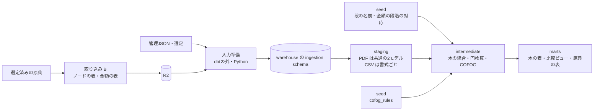
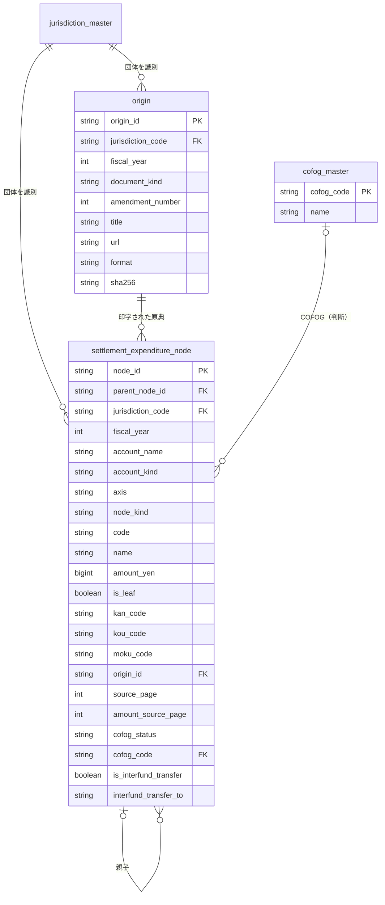

# 決算の歳出を原典の木構造のまま持ち、目で団体をまたいで比べる: 取り込みの出力と dbt モデルの設計

担当者: wwwyo / Claude
更新日: `2026-10-11`
状態: Draft

## Summary

取り込み表（R2 の Parquet）は変換器ごとに列構成が違い、dbt が団体をまたいで共通に読むための条件が決まっていない。目より細かい内訳（事業・節）は団体ごとに段の数も種類も違い、固定の列へ揃えると、印字のない段と該当のない段を区別できなくなる。

この設計は次の4点を定める。

1. PDF の取り込みの出力: 原典に印字された項目を1行とするノードの表と、印字された金額を1行とする金額の表。CSV は原文の表のまま取り込む（[ADR 0020](../../adr/0020-ingestion-outputs-node-tables.md)）。
2. 提供用データの形: 決算の木の表と、木の目ノードを選ぶ比較用のビュー。判断は COFOG だけを同じ表の列に持つ。
3. dbt の各層の責務と、段の名前を共通規則（[ADR 0022](../../adr/0022-level-names-by-shared-rule.md)）・金額の段階への対応を共有辞書に置くこと（[ADR 0021](../../adr/0021-level-and-phase-map-in-dbt-seed.md)）。
4. 最初に通す縦の一本（slice）: 2025年度決算・歳出・一般会計で、131041 新宿区・132021 立川市・131156 杉並区。

レビューで決めたいのは、取り込みの出力の形（ノードの表と金額の表の列）、提供用データの列、取り込み側（B）への変更要求の優先順位の3点である。

## Goals / Non-Goals

- Goal: slice の3団体について、目より下の事業・節まで原典の印字どおりに持ち、「何に使われたか」に原典が許す粒度で答えられるようにする。
- Goal: 団体をまたいで比べる入口を、目の粒度と COFOG に限って一つにする。
- Goal: 取り込みと dbt の境界を、「原典の事実（木）」と「判断・正規化・検査」で分ける。
- Non-Goal: 予算現額などの決算書に載る予算の報告値。MVP の列は最小にし、提供用データには出さない。
- Non-Goal: 特別会計・当初予算・補正予算。slice の次の段階で足す（[Validation / Rollout](#validation--rollout)）。
- Non-Goal だった法定の科目マスタへの対応（`account_master`・`account_map`）は削除した。復元は commit `2e9b29b` から。特別区の款は法定の款と大きく違い、MVP では COFOG だけで比べる。
- Non-Goal: 配布物（Fiscal Data Package）と MCP の公開。どちらも提供用データから作る配布経路で、パイプライン完成後に扱う。

## Background

### 現状

dbt（`pipeline/dbt`）は 2025年度決算・歳出の PDF 40表を入力にし、staging 2モデル・intermediate・マーツ（木の表・比較ビュー・原典の表）を持つ。入力の宣言 `_sources.yml` は `dbt/scripts/generate_sources.py` が管理 JSON から生成する（手書きしない）。取り込みは16宣言・47表を管理している（PDF のみ。CSV2表は別作業）。段の名前は共通規則で付ける（[ADR 0022](../../adr/0022-level-names-by-shared-rule.md)）。会計名は管理 JSON の原文のまま持ち、団体共通の種類（`account_kind`）を語の辞書（`account_kind_map`）で付ける（[ADR 0023](../../adr/0023-account-kind-and-no-consolidation.md)）。要件は [fiscal-records の PRD](../fiscal-records/prd.md)、概念は [ドメインモデル](../fiscal-records/fiscal-domain-model.md)、現行の取り込み表の保存と metadata は [保存設計](../ingestion-storage/design-doc.md) を参照する。

PDF の取り込みの出力は、原典に印字された項目を1行とするノードの表と、印字された金額を1行とする金額の表である。表が属する会計名と注記は管理 JSON の `tables[]` にある。階層別の合計検査と変換器の修正は #88 で取り込まれた。ノードと金額の表に対する共通の木の検査を使い、表をまたぐ照合・分解軸の対応・抜粋の検査は別に残す。

想定する主な利用者は、MCP を通して風土記のデータを参照する AI である。AI に書かせる問い合わせは SQL の絞り込みと集計が中心になるため、提供用データは表（DuckDB）で持つ。

### 実測した取り込み表の違い

2026-10-11 に、水道7表と補助表24表を外す前の全80表を `ingestion.fiscal.run restore --remote` で復元し、duckdb で読んだ。全量は gitignore 配下の `pipeline/ingestion/fiscal/observations/dbt-output-contract/` にある。

どの表も横持ちで、違うのは目より細かい末端の軸である。軸は、原典が目の下に何を印字しているかで決まる。

| 末端の軸 | 団体と表 ID |
| --- | --- |
| 事業（備考欄、1段） | 131041 `general-expenditure-detail` |
| 法定の節 | 131105・131148・131172 `general-setsu`、131156・132021 `general-expenditure-details` |
| 事業の説明（節の表とは別表） | 131156 `general-expenditure-notes`（実施事業 → 項目 → 細目）、132021 `general-expenditure-notes`（事業 → 節 → 細目 → 内訳） |
| 主要施策の事業（抜粋） | 132012 `general-detail` |
| 事業・節・数量表を一表に展開 | 131024 `chuo-general-settlement`（751列） |
| 説明（当初予算） | 132071 `akishima-text-budget-expenditure` |

平らにした結果、列構成は書式ごとに違う。段ごとの列名（`目_支出済額`・`区分_番号` など）、物理頁の列名（`物理頁`・`<段>_物理頁`・`原典物理頁`・`physical_page`）が揺れる。金額欄の見出しも metadata に残っていない。単位を宣言した金額列 1,761 列のうち、簡易判定で 1,587 列は `header_path` が行の段の見出し（例 `['科目','目']`）だけで、131041 の `目_計` が予算現額であることは列名と変換器の検査コードからしか読めない。

目の粒度なら、一般会計の決算がある8団体（131024・131041・131105・131148・131156・131172・132012・132021）すべてで印字額が閉じる。目の支出済額の和は全款で款の支出済額と一致した。

しかし目の粒度は、「何に使われたか」に答えるには粗い。6団体で、支出の上位10目が総額の53〜66%を占め、一つの目が数百億円になる（杉並区の「児童福祉費」は1目で618億円）。

目より細かい軸の完全性は団体ごとに違う。

- 事業（説明の第1段）の金額の和が目の支出済額と一致する: 131041（141目中140目。残る1目は内訳の欄がない目）、132021（説明欄のある101目すべて）、131156（実施事業のある98目すべて）。
- 説明の下位の段は #88 で修正された。132021 の「特別職給」の子に「市長」「副市長」が入り、説明のある101目すべてで末端の和が目の支出済額と一致する（合計93,876,812,014円）。131156 も末端の和が260,972,903,444円と一致する。132021 の「繰越明許費」「事故繰越」「支出済額」「不用額」「本年度支出額」は細目の子ではなく金額欄の見出しであり、移行時に細目の金額として保持する。
- 節の内訳が目の支出済額を完全に分解する: 131105・131148・131156・131172・132021 の全目。
- 132012 の事業は107目中50目で目と一致しない。選定した原典が「主要な施策の成果・事務報告書」で、事業を抜粋しているためである。

事業と節は、同じお金を目的と性質の2つの軸で切ったものである。132021 の説明欄は「事業 → 節 → 細目」の入れ子で、673事業のうち659事業が節の見出しを持つ。#88 の「説明内の節→法定節」で、786件（目×節）のうち743件が一致、不一致は0、印字なしの43件は検算不可となった（2026-10-11）。この照合は共通の木の検査とは別に残す。131041・131156 では、節の一覧と事業の説明が同じ目の独立した分解として並び、両者の対応は原典にない。

そのほかの事実は次のとおりである。

- 名称には均等割付の字間空白（「議 会 費」）と折り返しの改行が残る。131156 には目の名称の文字化け（目 4-1-2 の「馬齢者福祉普」。おそらく「高齢者福祉費」）がある。
- 金額は桁区切りと「△」が中心で、既存の `staging_amount` で読める。131024 以外の一般会計の7表と 132071 の当初予算の表で読めないのは、132012 の括弧・不等号付きの金額と「－」だけだった。
- 会計は表の列にない。原典 SHA と行の物理頁を選定の scope（会計・方向・頁範囲）に当てると、70表で会計が一つに決まった。残りは頁の列名が違う 132039 水道の7表（その後、取り込みから外した）、頁の列がない 132071 の当初予算の1表、会計の列を持つ 132047 の CSV 2表である。
- 法定の科目マスタとの一致は、市と特別区で大きく違う。132012・132021 は款の番号と名称がおおむね一致した（11款中9、12款中9）。特別区6区は11〜13款中1〜3しか一致せず、「福祉保健費」のように法定の複数の款にまたがる款を立てている。

## Design

### 全体像

取り込み（B）は原典の事実を木として出す。dbt は構造を復元せず、段の名前と金額の段階への対応（判断）、単位換算、団体の統合、COFOG、検査を受け持つ。

- **入力準備**は dbt の外に置く。dbt の sources yml に列挙した表について、管理 JSON から SHA 照合済みの Parquet を復元し、warehouse の `ingestion` schema に読み込む。管理 JSON の表の会計名・注記と、原典選定の記録から作る原典の表も置く。
- **marts** は DuckDB の表とビューである。MCP・団体別 CSV・Fiscal Data Package は、ここから作る配布経路として後で扱う。

### 取り込みの出力: ノードの表と金額の表

PDF の取り込みの一つの表（表 ID）は、ノードの表と金額の表の組で出す（ADR 0020）。CSV は対象外である（後述）。どちらも原文を保持する raw の表で、単位換算・名称の統一・共通分類への対応は行わない。

**ノードの表**: 1行は原典に印字された項目一つである。

| 列 | 意味 |
| --- | --- |
| `node_key` | 表の中でノードを識別する生成 ID。観測 ID と同じく、表の版の中でだけ意味を持つ。別の表で同じ値が使われてもよい |
| `parent_node_key` | 親ノード。木の根（款）は NULL |
| `axis_header` | 分解の軸。項目が印字された欄の原典の見出し（例「科目」「節」「備考」「説明」） |
| `depth` | 軸の中での段の深さ（1から） |
| `level_header` | 原典に印字された段の見出し（例「款」「項」「目」）。印字がなければ NULL |
| `code_text` / `name_text` | 原典の番号と名称の原文。番号がなければ NULL |
| `physical_page` | 印字された原典の物理頁 |
| `x0` / `y0` / `x1` / `y1` | 項目（番号と名称）の印字範囲を囲む矩形。名称が折り返していれば全行を囲む |

款・項・目のノードは、同じ会計の各表に含める。各表が款を根とする完全な木になり、表だけで親子を検査できる。表をまたいだ同じ款・項・目のノードは dbt で一つにまとめる。

**金額の表**: 1行は印字された金額一つである。

| 列 | 意味 |
| --- | --- |
| `node_key` | 金額が属するノード |
| `header_path` | 金額が印字された欄の原典の見出しを上位から順に「／」で連結した文字列（例「予算現額／計」「支出済額」「備考／事業説明」）。必須。金額だけの欄に見出しがなく、説明などの欄に印字された金額は、その欄の見出しを持つ |
| `amount_text` | 金額の原文。桁区切り・「△」・括弧・「円」・「－」を保持する |
| `unit_text` | 原典の単位の原文（例「円」「千円」） |
| `physical_page` | 金額が印字された原典の物理頁。不明ならNULL（名称の頁は流用しない）。見開きでは属するノードと違う頁になることがある（131148 は金額の欄が右の頁） |
| `x0` / `y0` / `x1` / `y1` | 金額の印字範囲を囲む矩形。不明ならNULL。金額自身の頁が不明なら座標もNULL。座標系はノードの表と同じ |

座標は全表で一つの座標系に揃える。表示頁（CropBox・回転を反映した後）の左上を原点とする PDF の point 単位で、OCR の座標は描画した画像の画素から元の頁の座標へ戻して入れる。同じ親の中の印字の順序は、頁・`y0`・`x0` の順に並べて求める。座標は原典で項目と金額を探し直すために持ち、親子の判定には使わない（親子は原典の配置・罫線・番号で確認した所属で決める）。

見出しを配列の列でなく区切りの文字列にするのは、原典の値を配列・JSON・STRUCT の列に入れないという取り込みの規約に合わせるためである。

表の単位で決まる事実は、Parquet の行に反復せず管理 JSON の `tables[]` に置く。対象・方向・表 ID・保存参照（SHA・サイズ・行数）は今の管理 JSON と同じで、これに表が属する原典の会計名と、原典由来の注記（`notes`）を足す。一つの表は原典ファイル一つから作り、どのファイルかは管理 JSON で決まる。原典ファイルの SHA は変換の `inputs` にあり、表やノードへ複製しない。分冊をまたいで続く款・項・目は、各分冊の表に同じ款・項・目のノードを置き、dbt で一つにまとめる。一つの表 ID に、ノードの表と金額の表の2つの保存参照を持たせる。

この形で求める条件（出力契約）は次のとおりである。

| ID | 条件 | 使う層 |
| --- | --- | --- |
| N1 | 表は管理 JSON の対象（団体・年度・資料区分・方向）と表 ID で識別でき、Parquet の SHA・行数が管理 JSON と一致する | 入力準備 |
| N2 | 一つの表は一つの会計に属し、管理 JSON の `tables[]` に原典の会計名を持つ。`ingestion:check` は、その会計名が変換の入力の選定 scope にあることを確かめる | 入力準備 |
| N3 | 原典に印字された項目はすべてノードになり、親は原典の配置・罫線・番号で確認した所属だけを指す。継続頁に再掲された見出しは、元の項目と同じノードにする | intermediate |
| N4 | 同じ支出の独立した分解（節の一覧と事業の説明など）は、別の `axis_header` の枝にする。一つの枝に混ぜない | intermediate |
| N5 | 金額はすべて金額の表に入り、`unit_text` と `header_path` を持つ。見出しを確かめられない金額は保存しない | intermediate |
| N6 | 空欄（行なし）・印字された0・「－」を区別する。読み取れなかった金額は行を作らない | staging |
| N7 | 読み取れなかった金額と所属を確認できない項目の件数を、管理 JSON の `tables[]` に持つ。入力準備は、どちらかが0でない表で止める。表に行がないだけでは、空欄と未読を区別できないためである | 入力準備 |

### CSV の原典は原文の表のまま取り込む

CSV の原典は、ノードの表にしない。CSV は款・項・目・節が最初から別の列に並び、取り込みが復元する木がない。取り込みは今のとおり原文の行と1対1の表を作り、全セルを原典と照合する検査で完了する。ノードの形への変換は dbt の intermediate で行う。CSV の原典の位置は、原文の表が持つ物理行の範囲で示す。

### 現行の横持ちの表からの移行

PDFの全表をノードの表と金額の表へ移す。既存の変換器は全面的に書き直さず、横持ちの表と metadata から変換する共通処理を取り込み（`ingestion/lib/node_tables.py`）に一つ置く。CSVは原文の表のまま保持する。各表の移行を検査して採用した後、R2の横持ちの表を削除する。削除は候補の検査・保存とは別の操作として行う。

- 段の列のまとまりは `column_contexts` から取り、同じ行の上位の段を親にする。
- この変換は、横持ちの表が段を正しく持つ範囲でだけ正しい木を作れる。一つの `column_contexts` が複数段をまとめていれば、名称列の接頭辞で列を分ける。段ごとの位置があれば親と位置で識別し、位置がなければ同じ親の下で連続するその段までの値の組で識別する。離れて再登場する同名の兄弟をまとめない。根は実際に値がある最初の段の軸とし、見出しを「科目」に固定しない。節の一覧は独立した枝にし、別の説明の軸が続く場合は直前の説明に結ぶ。説明のない款・項・目は、conversion が違っても同じ会計の明細表から補う。変換後に同じ軸の「子の金額の和＝親の金額」を全段で確かめ、通らない表は保存しない。金額の印字がない箇所は0で補わず、比較の対象から外す。
- 座標は、横持ちの表が持つ位置の列から取る。131041 のように縦の範囲（上端・下端）しかない表は、x を NULL にする。座標を全部持つのは、新しい変換器が直接出す表だけである。
- 金額の見出しは、宣言の欄の見出しと列名を使って機械的に組み立てる。予算の5列は「予算現額」を上位に持たせる。備考欄の注記金額は、所有する段の `column_contexts` の経路と列名の備考以下を保持し、支出済額とは区別する。132021の細目の金額内訳は、その印字見出しを細目ノードの金額の `header_path` に入れる。見出しや所属を解決できない欄は保存しない。
- 未読・所属未確認は移行で検出できた件数を数える。旧変換器はこれらを数えていないため、0の根拠が金額のある親子の全段の合計一致であることを注記に残す。原典の未抽出箇所がないことまで保証するものではない。
- 新しい変換器は、ノードの表と金額の表を直接出す。

### 取り込み側（B）への変更要求

| 優先 | 対象 | 要求 | 理由 |
| --- | --- | --- | --- |
| 高（slice） | 管理 JSON の schema、共通の変換、131041 `general-expenditure-detail`、132021・131156 の `general-expenditure-details`・`general-expenditure-notes` | 管理 JSON の `tables[]` に2つの保存参照と会計名を持てるようにする。横持ちの表からノードの表と金額の表を作る共通の変換を実装し、slice の5表に適用して R2 に保存する | ADR 0020・N2。slice の dbt はこの表を入力にする |
| 高（slice） | 131156 の2表 | 目 4-1-2 の名称「馬齢者福祉普」を原典と照合して直す | 文字層の誤りとみられ、木と比較ビューにそのまま出る |
| 高（slice） | 132021 `general-expenditure-notes` | 修正済みの説明の軸をsliceに含め、細目の金額内訳見出しを金額の表へ移す | 全101目で末端の和が目の支出済額と一致する。見出しを子ノードにすると二重計上になる |
| 高（slice） | 131156 `general-expenditure-notes` | 段の位置を持つ既存の変換を使う | 共通の変換は位置のない複数段の欄にも対応済み |
| 中（節の軸の前） | 131041 の4会計 | 法定節一覧を、事業の説明とは別の軸として保存する | N4。新宿区だけ節の支出済額を R2 から読めない |
| 中（当初予算の前） | 132071 `akishima-text-budget-expenditure` | 款・項・目の番号と名称を分け、物理頁を持たせる | N3。番号がないと目を識別できず、頁がないと原典照合ができない |
| 中（水道の前） | 132039 の水道 | ADR 0019 の実装で作り直すとき、款・項・目の番号と名称を分けてノードの表で出す | 凍結したOCR観測が残っておらず、現行の7表は撤去済み |
| 中（変換器を直すとき） | 全変換器 | ノードの表と金額の表を直接出し、金額欄の見出しを上位から `header_path` に入れる | 移行の変換では見出しが不完全な列が残る |

表内の親子合計はノードの表と金額の表に対する共通の木の検査で確認する。#88の宣言は、表をまたぐ照合・分解軸の対応・表全体の印字合計・抜粋の検査も含むため、管理対象の表では移行時に削除しない。補助表を外すときは、その表の宣言と、それを参照する検査も外す。

B の外の上流（原典選定 A）にも、影響する事実が一つある。132012 の選定は決算書ではなく「主要な施策の成果・事務報告書」で、事業は抜粋、目は範囲の行（2～6）を含み、節がない。scope にある9会計のうち、取り込まれているのは5会計である。決算書を選び直すかは A で判断する。

### 提供用データの形

保存するのは、決算の木の表 `settlement_expenditure_node` と、原典選定の記録から作る原典の表 `origin` である。団体をまたいで比べるときは、木の表を根ノードと同じ軸（`is_subject`）かつ `node_kind = '目'` で絞る。比較用の値を別に保存しないので、値どうしが食い違うことはない。

木の表は資料区分ごとに分ける。決算の木は、金額が支出済額だと表名で決まる。当初予算を入れるときは `initial_expenditure_node`（当初予算額）、補正予算を入れるときは補正号と増減額を持つ表を別に作る。一つの表で資料区分をまたぐと、同じ金額の列に実績・当初予算額・増減額が混ざり、段階の違う金額を足す危険があるためである。

#### 決算の木の表 `settlement_expenditure_node`

1行は原典に印字された一つの項目で、取り込みのノードと1対1に対応する。ただし、表をまたいで同じ款・項・目のノードは一つにまとめる。

| 列 | 型 | 意味 | 由来 |
| --- | --- | --- | --- |
| `node_id` | VARCHAR | 安定 ID。款・項・目は団体・年度・会計・款・項・目の番号から、目より下は親の `node_id`・軸・段の名前・番号・名称から導出したハッシュ。同じ親・軸・段・番号・名称の兄弟が複数ある場合（132021 の番号なしの「有料自転車等駐車場管理運営委託料」2件など）は、頁・`y0` の順の連番を足す。連番の ID は、同じ原典で同名の兄弟の集合が変わらない間だけ安定する（[ADR 0005](../../adr/0005-content-derived-ids.md)） | 風土記が生成 |
| `parent_node_id` | VARCHAR | 親ノード。款は NULL | 原典（取り込みの親子） |
| `jurisdiction_code` | VARCHAR | 団体コード。団体マスタを参照する | 宣言 |
| `fiscal_year` | INTEGER | 会計年度（西暦） | 宣言 |
| `account_name` | VARCHAR | 原典の会計名（例「一般会計」） | 原典（選定の scope） |
| `account_kind` | VARCHAR | 団体共通の会計の種類（一般会計・国民健康保険・介護保険・後期高齢者医療・用地・駐車場・下水道・介護サービス事業）。団体をまたぐ比較はこの列で行う | 判断（`account_kind_map`） |
| `is_interfund_transfer` | BOOLEAN | 会計間の繰出の印。科目の目で名称が「<会計名>繰出金」の形のものと、科目以外の軸で名称が「繰出金」または「<会計名>繰出金」のもの（法定の節・備考や説明の内訳）に付ける。節・備考の同名でも会計で終わらない内訳（例：保険基盤安定繰出金）は一会計の中の法定の負担で移転ではないため含まない。印は枝の最も上だけに付け、同じ目の下で節と備考の両方には付けない（節が優先）。節も備考も無い団体（132012）は拾えず、印は網羅ではない。印の付いた金額はそのまま足せる | 名称の規則から機械的に判定 |
| `axis` | VARCHAR | 分解の軸（例 科目・備考・節・説明） | 原典の見出し |
| `is_subject` | BOOLEAN | 表の根ノードと同じ軸か。軸名の印字を保持して科目の枝を識別する | 親子関係から機械的に判定 |
| `node_kind` | VARCHAR | 段の名前（例 款・項・目・内訳1）。科目軸の深さ1/2/3は款・項・目、それ以外の軸は印字見出し、なければ内訳＋深さ（[ADR 0022](../../adr/0022-level-names-by-shared-rule.md)） | 原典の見出し、または共通規則 |
| `code` | VARCHAR | 原典の番号。表記のまま（範囲の表記 `2～6` も含む）。番号がなければ NULL | 原典 |
| `name` | VARCHAR | 原典の名称。字間の空白と折り返しの改行を除く | 原典（表記の正規化だけ） |
| `amount_yen` | BIGINT | 支出済額（円）。千円単位の原典は1000倍する。支出済額の印字がない段は NULL | 原典（どの見出しを支出済額とするかは判断・共有辞書） |
| `is_leaf` | BOOLEAN | 同じ軸の中で子を持たないか | 風土記が生成 |
| `kan_code` / `kou_code` / `moku_code` | VARCHAR | 所属する款・項・目の番号。款・項での検索・集計のために全ノードへ反復する | 原典 |
| `origin_id` | VARCHAR | 印字された原典ファイル | 宣言（管理 JSON） |
| `source_page` | INTEGER | 項目（番号と名称）が印字された原典の物理頁 | 原典 |
| `amount_source_page` | INTEGER | 採った支出済額が印字された原典の物理頁。不明ならNULL。見開きでは `source_page` と違うことがある | 原典 |
| `cofog_status` | VARCHAR | `assigned` / `tentative` / `unclassifiable` / `out-of-scope`。MVP では目ノードだけ値を持つ。`tentative` は境界の判断で確信が持てないままコードを付けた暫定の割り当てで、`cofog_rules` の `tentative` が true の規則が当たった目に付く | 判断（`cofog_rules`） |
| `cofog_code` | VARCHAR | 割り当てた COFOG コード（`01`・`01.1`・`04.1.2` のように深さが変わる）。`assigned`・`tentative` のときだけ値を持つ | 判断（`cofog_rules`） |
| `interfund_transfer_to` | VARCHAR | 繰出の受け手の会計の種類（`account_kind_map` で引く）。受け手が入力に無い会計でも付ける。名称が「繰出金」の節などは親の目の名称から引き、引けなければ印だけ付けて NULL（例：他会計繰出金、費の目の下の節繰出金）。金額の消去はしない（[ADR 0023](../../adr/0023-account-kind-and-no-consolidation.md)） | 判断（`account_kind_map`） |

金額の和は「同じ軸の末端（`is_leaf`）を足す」と決める。軸の違うノードや、親と子を混ぜて足すと二重計上になる。131041・131156 は目の下に2本の軸（事業と節）がぶら下がり、132021 は説明の軸の中で節が事業の子として現れる。この規則は列の説明として AI と利用者に渡す。

132012 のように原典が複数の目を一行にまとめた場合は、印字された範囲の表記を `code` に持つ一つの目ノードにする。目ごとへの展開は配賦になるため行わない。

#### 原典の表 `origin`

1行は原典ファイル一つで、団体・年度・資料区分・補正号（補正予算のときだけ）・資料名・公開 URL・形式（CSV か PDF か）・SHA-256 を持つ。原典選定の記録から毎回生成する派生の表で、独立した provenance ファイルを新しく保存するものではない。木のノードは `origin_id` と `source_page` で原典の位置を指し、分冊でもファイルと頁で位置が決まる。

#### 目の絞り込み（比較の入口）

団体をまたいで比べるときは、木の表を 根ノードと同じ軸（`is_subject`）かつ `node_kind = '目'` で絞る。目の支出済額と COFOG を並べる。款・項での集計は `kan_code`・`kou_code` で行い、款・項の名前は目ノードから親を2段辿って取る。

#### COFOG 分類マスタ

`cofog_master` はコードと名称だけを持つ。親は末尾の段を削ったコードで、配下の集計は前方一致（`04` または `04.%`）で行う（[ADR 0016](../../adr/0016-cofog-master-and-assignment.md)）。

### 層ごとの責務とモデル構成

[Glossary](../../../AGENTS.md) と [ADR 0009](../../adr/0009-dbt-model-layers.md) に沿って分ける。PDF の取り込みの出力は全団体で同じ形なので、PDF の staging は書式ごとに分けない。

#### staging: 取り込みの行と1対1のまま型を整える

- PDF は `stg_fiscal__nodes` と `stg_fiscal__amounts` の2モデルで、sources yml に列挙した全表を `union all` する。
- CSV は原文の表のまま取り込まれる（後述）。CSV の書式ごとに staging を作り、原文の行と1対1のまま列名と型を整える。どの列が款・項・目・節の番号・名称・金額かは、この staging の yml で宣言する。
- 各行に `source_table_key`（対象・方向・表 ID）を付け、取り込みの行へ戻れるようにする。`node_key` は表の中でだけ一意なので、ノードの識別・親・金額の参照は (`source_table_key`, `node_key`) の組で扱う。
- 文字列は `trim_cell`、金額は原文の `amount_text` を残して `staging_amount` で数値を足す。単位は原典のままにする。132012 の括弧のように装飾を外す必要がある見出しは seed で宣言し、宣言した形でない値は例外にする。

#### intermediate: 対応の宣言を当て、木を統合し、円・COFOG を付ける

- `int_fiscal__csv_expenditure_nodes`: CSV の staging から、会計/款/項/目/事項/節/細々節の列を group by して木を作る。CSV の行は葉の粒度で経路が完全なので、PDF のノードの表を経由せず直接ノードの形にし、款・項・目の `node_id` の導出は PDF と共通にする。CSV では親子は列から機械的に決まり、原典の事実の復元ではなく正規化なので、取り込みではなくここで行う。葉の金額は千円を1000倍し、親は子の和の集計を持つ（印字ではない）。番号の印字がない目は親基準の ID で保つ。
- `int_fiscal__settlement_expenditure_nodes`（決算・当初予算の PDF 共通。`document_kind` を列として流し、決算は支出済額・当初予算は当初予算額を選ぶ）:
  - 共通規則で `node_kind` を決める（[ADR 0022](../../adr/0022-level-names-by-shared-rule.md)）。科目軸の深さと印字見出しが食い違えば止める。
  - 共有辞書（`pipeline/shared/fiscal_amount_map.csv`）で各ノードの支出済額を一つ選ぶ。宣言にない金額の見出しがあれば止める。
  - 表をまたいだ同じ款・項・目のノードを、団体・年度・会計・款・項・目の番号で一つにまとめ、`node_id` を作る。まとめる前に、名称と支出済額が表の間で一致することを検査し、食い違えば止める。原典の位置は、原典ファイル・物理頁・`y0` の順で最初のものを採る。祖先の款・項・目の番号を各ノードへ反復する。
  - 金額を円へ換算し（円は1倍、千円は1000倍、それ以外の単位は止める）、名称から字間の空白と改行を除く。
- `int_fiscal__expenditure_accounts`: PDF の木と CSV の木の両方にある会計の一覧に、語の辞書（`account_kind_map`）で団体共通の種類を付ける。語に当たらない会計名があれば構築を止める。
- `int_fiscal__expenditure_transfers`: 会計の種類と会計間の繰出の印・受け手の種類を、資料区分を列に持って一つの表で付ける（決算・当初予算、PDF・CSV 共通。`node_id` が資料をまたいで同じ導出のためキーは `node_id` と `document_kind`）。印の規則はここだけに持ち、両 marts は結合するだけにする（[ADR 0023](../../adr/0023-account-kind-and-no-consolidation.md)）。
- `int_fiscal__settlement_expenditure_cofog`: seed の `cofog_rules` を優先順に当て、目ノードに分類状態と COFOG コードを一つ付ける。PDF の木と CSV の木の両方の目を対象にする。どの規則にも当たらない目があれば構築を止める。団体限定の規則は足さず、共通の語の辞書で当てる。特別会計の目は会計の種類で受ける共通の fallback（国民健康保険・後期高齢者医療→07、介護保険・介護サービス事業→10.2、駐車場→04.5、下水道→05.2、用地→unclassifiable）を持ち、償還・積立・繰出など行き先が違う目は種類を問わない語の規則で先に分ける。一般会計の目は目の名称の語彙で当てる。境界の判断はコード付きのまま `tentative` にする。

#### marts: 木の表・原典の表を確定する

- `settlement_expenditure_node`: intermediate の木に COFOG の列と、共有の会計の種類・繰出の印（`int_fiscal__expenditure_transfers`）の列を結合した表（決算だけを残す）。
- `initial_expenditure_node`: 当初予算の PDF の木と CSV の木を同じ列で合わせ、COFOG の列と共有の会計の種類・繰出の印の列を結合した表。金額は当初予算額。歳入の CSV は marts にしない（未設計）。
- `origin`: 入力準備が原典選定の記録から作った表を整える。

### 検査

各層は、その層で初めて確かめられることだけを検査する。合計の一致は名称の欠落や同額の取り違えを検出できないため、原典の目視照合と組み合わせる。

| 層 | 検査 | 失敗の扱い |
| --- | --- | --- |
| 入力準備 | 管理 JSON と Parquet の SHA・行数（N1）、表に会計名がある（N2）、未読・所属未確認の件数が0（N7）、ノード・金額の表の列と型。seed との照合はしない | 止める |
| staging | 行数が管理 JSON の `row_count` と一致（1対1）、(`source_table_key`, `node_key`) の一意、親と金額が同じ表のノードを参照すること、金額の変換失敗（例外）、金額の単位の not null（N5） | 止める |
| intermediate | 段の名前が共通規則で決まる、全金額の見出しが共有辞書で網羅される、支出済額の見出しが一つに決まる、表をまたいだ款・項・目の名称と金額の一致、同じ軸で子の和が親の金額と一致（両方に金額がある所だけ）、会計ごとに目の和が款の金額と一致、単位が円・千円のどちらか | 止める。子の和が合わない所は原因（原典の不整合・取り込みの誤り）を切り分けるまで止める |
| marts | `node_id` の一意、`parent_node_id` の参照先の存在、比較ビューの行数と支出済額の和、全ノードの `origin_id` が原典の表にある | 止める |

slice の期待値は、現行の横持ちの表の実測から次のとおりである。

| 団体 | 目の数 | 目の支出済額の和 | 目より下の軸 |
| --- | --- | --- | --- |
| 131041 新宿区 | 141 | 187,801,267,640円 | 備考（事業）: 931行 |
| 132021 立川市 | 102 | 93,876,812,014円 | 節: 786行。説明の軸の末端4,525ノードの支出額の和: 93,876,812,014円 |
| 131156 杉並区 | 102 | 260,972,903,444円 | 節: 718行、説明: 3,031行 |

### slice を実装する手順

1. B: 横持ちの表からノードの表と金額の表を作る共通の変換を実装する。131156 の目の名称と説明の段の宣言を直し、slice の表に適用して、全段で子の和の検査を通してから R2 に保存する。132021の修正済みの説明の表も含める。
2. dbt の sources yml に slice の表を列挙し、入力準備を実装する。原典の表の生成と、N1・N2 の検査を含める。
3. staging の2モデルを作り、staging の検査を通す。
4. seed に段の対応と金額の対応を根拠付きで書き、木の intermediate を作る。親子・子の和・目と款の和の検査を通す。
5. seed の `cofog_rules` に3団体の規則を根拠付きで足し、COFOG の intermediate を作る。
6. marts の木の表・比較ビュー・原典の表を作り、期待値の検査を通す。
7. 各団体から目を3件ずつ選び、目とその下のノードを `source_page` の頁で原典 PDF と目視で照合する。結果は PR に書く。

## Alternatives Considered

| 案 | 利点 | 採否 |
| --- | --- | --- |
| 取り込みは横持ちのまま、dbt が書式ごとに木を組み立てる | 取り込みを変えずに始められる | 取り込みが復元した木を平らにして、dbt がまた戻す往復になる。書式ごとの staging と列の宣言が変換器の数だけ増える |
| 目の粒度の表だけを出す | 列が少なく、団体をまたいで揃う | 上位10目で総額の5〜6割を占め、「何に使われたか」に答えられない。目は比較ビューとして残す |
| 款・項・目・事業・節を固定の列に持つ表 | 素朴に集計しやすい | 目より下の段の数と種類が団体で違い、新しい段のたびに列が増える。印字のない段と該当のない段の空欄を区別できない |
| graph DB に入れる | 任意の深さの探索に強い | 対象は親が一つの浅い木で、主な問いは絞り込みと集計である。graph の問い合わせ言語は SQL より生成の精度とサーバーの選択肢で劣る。将来、取引単位の支出で支払先のつながりを辿るときに、派生のビューとして検討する |
| 資料区分をまたぐ一つの木の表に、金額の段階の列を持たせる | 表が一つで済む | 同じ金額の列に段階の違う金額が混ざり、足し間違いの危険が残る |
| 比較用の表を保存する | 比較の問い合わせで結合が要らない | 木と同じ値を重ねて持つと食い違いが起こりうる。分類だけを持つ1対1の表は ADR 0016 が退けている |
| 法定の科目マスタへの対応を持つ | 日本の目的別の区分で比べられる | 特別区の款は法定と大きく違い、款の粒度の対応が役に立たない |
| slice に 132012 八王子市を入れる | 書式の違いへの耐性を試せる | 事業が抜粋で目と閉じず、木の「子の和＝親」が成り立たない。原典を選び直すまで外す |

取り込みの出力の形の比較は ADR 0020、対応の宣言の置き場の比較は ADR 0021 に書いた。

## Cross-Cutting Concerns

- **原典と取り込み表の秘匿**: 入力準備は R2 を読むだけで書かない。復元した Parquet と warehouse は `pipeline/.cache/`・`pipeline/.build/` に置き、Git に入れない。
- **ライセンス**: 原典ごとの利用条件は配布経路を作るときに扱う。団体をまたぐ配布ファイルは作らない（[ADR 0004](../../adr/0004-package-per-jurisdiction.md)）。intermediate の `union all` と比較ビューは構築と問い合わせのためのもので、配布の単位ではない。
- **再現性**: 入力は管理 JSON の SHA で固定し、seeds とモデルは Git で管理する。warehouse は再生成する。
- **ネットワーク**: 入力準備の `--remote` は cf CLI で R2 を読むため、サンドボックスの外で実行し、CI では回さない（[pipeline/AGENTS.md](../../../pipeline/AGENTS.md) の規約）。

## Validation / Rollout

1. slice（2025年度決算・歳出・一般会計・3団体）を上の手順で通す。済み。
2. 同じ3団体の特別会計を足す。会計の名寄せと連結判断の列は、このときに決める。→ 2026-10 に特別会計を含めて全団体へ広げた。会計の種類は語の辞書（`account_kind_map`）で付け、連結（消去）はせず繰出の印と受け手の種類を付けた（目は名称、節・備考は内訳まで。印は網羅ではない）（[ADR 0023](../../adr/0023-account-kind-and-no-consolidation.md)）。
3. 2025年度決算の一般会計がある残りの団体（131024・131105・131148・131172）の表を、共通の変換でノードの表にして足す。→ 2026-10 に132012を含めて済み。入力は決算・歳出の PDF 40表（132071・132128・132217 の4表は共通モデルで通らず除外。理由は `generate_sources.py` の EXCLUDE）。COFOG は 2026-10 に共通の辞書を育てて全目に状態を付け、`covers_moku` を error に戻した。金額比の当たり率（assigned+tentative ÷ 総額）は 131041 94%・131105 96%・131156 90%・131172 94%・132012 95%・132021 97%・132039 100%・132063 100%、131024 89%・131148 78%。残りは終端状態（複合の目・積立・償還・元金の unclassifiable / out-of-scope）で、分類可能な金額は全団体で100%コード付き。取り込みの管理に無い団体（131016・132195・132241）の団体限定の規則は同月に削除した。
4. B の修正後に、132071 の当初予算で `initial_expenditure_node` を作り、千円の換算を確かめる。→ 2026-10 に済み。132071 の PDF（110目、563.6億円）と 132047 の CSV 歳出（167目、5会計1229.1億円）を同じ表に入れた。千円は1000倍し、款の印字と一致。132047 は歳出合計が歳入 CSV の合計と会計ごとに一致した。COFOG は既存規則のまま両団体とも目に100%当たった（132071: assigned 95・tentative 11、132047: assigned 151・tentative 6）。歳入の marts は未設計のため作らない。
5. 移行が済んだら、文書と実装の整合を確かめ、旧形式（横持ちの表と `column_contexts`）の説明を整理する（ADR 0020）。

## Open Questions

- **132012 の原典を決算書へ選び直すか**: 選び直せば目が法定の目と一致し、節も取れる。成果報告書のままなら、事業の軸が目と閉じない木をどう表すかを決める。
- **131041・131156 の節の軸をいつ入れるか**: 両区は事業の軸と節の軸が独立している。131156 は R2 に節の表があるので slice に入れている。131041 は B の変更要求（法定節一覧の保存）が済んでから入れる。
- **金額以外の印字（備考の文・数量表など）の扱い**: ノードの表と金額の表に入らない印字（131024 の数量表、備考の注記）を、取り込みでどの表に残すかを決める。MVP の提供用データには出さない。
- **名称の正規化の範囲**: 字間の空白は非 ASCII 文字の間だけ除く案を前提にした。英数字を含む名称の空白、旧字・異体字は変えない。この規則で原典の表記を損なう例がないかは未確認。
- **年度をまたぐ明細の同一性**: `node_id` は番号の原文と名称から作るため、年度で番号が振り直されたり名称が変わったりすると、同じ項目でも ID が変わる。年度間の対応を別の表で持つかを決める。
- **COFOG を目の粒度で当てる限界**: 節を条件にする規則（積立金・繰出金）が目では当たらない。事業・節のノードで分類するとき、どのノードの集合で足せば総額になるかの規則を決める。
- **dbt を使い続けるか**: 構造の復元が取り込みへ移り、dbt の変換は少なくなる。seed・検査・列の説明（MCP で AI に渡す説明の元）を追加の仕組みなしで持てるため残すが、これらを使わないなら SQL を Python から回す形でも足りる。
- **使わない seeds の扱い**: `account_master`・`account_map`・`fund_directory`・`expenditure_setsu_map` は削除した。復元は commit `2e9b29b` から。旧処理の連結・照合用の seed と `packages/fiscal` の旧配布契約は 2026-10-11 に削除した。`fund_directory` は団体×会計名の完全一致で団体ごとに行が要るため使わず、団体共通の語の辞書 `account_kind_map` を新設した（[ADR 0023](../../adr/0023-account-kind-and-no-consolidation.md)）。節の対応は団体ごとの表をやめ、区切り・異体字を除く共通の規則で法定の節に引く。
- **表をまたぐ照合（軸どうしの節の一致・財源分解）は宣言ではなく dbt の共通の検査として作り直すか**: 2026-10 に PDF の旧合計検査の宣言（`sum_checks/` 14ファイル）を木の検査への置換として削除した。失った照合は 132021 の説明内節→法定節3件・132217 の同1件・132071-initial の財源分解4件で、いずれも旧横持ち列の参照でノードの表には効いていなかった。必要になれば個別宣言ではなく共通の検査として作り直す。
