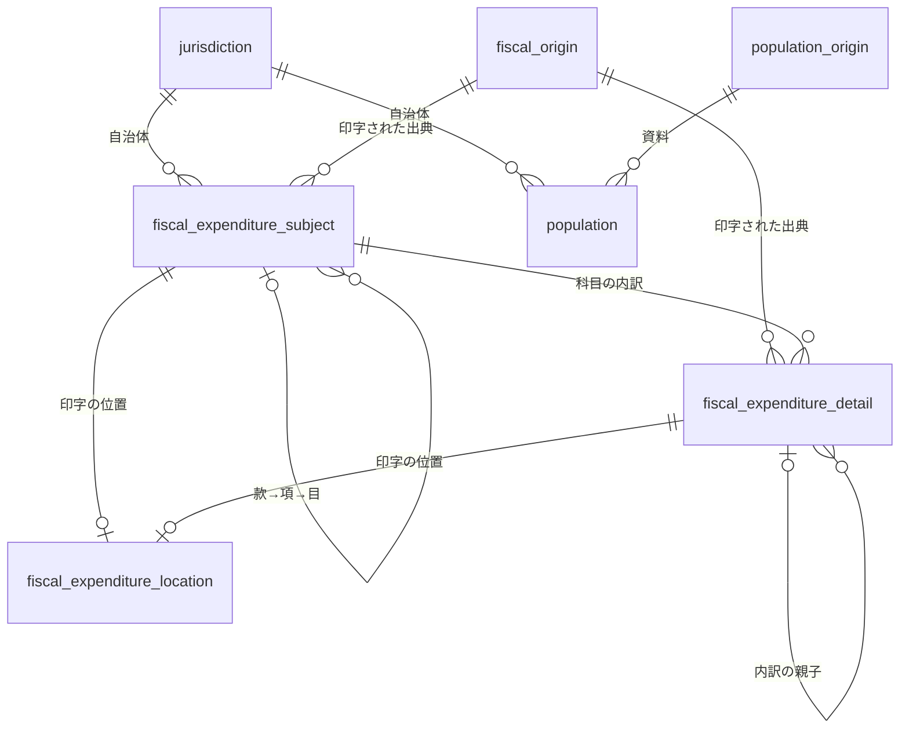

# 歳出を「科目の表」と「内訳の表」に分け、配信の表名を領域で揃える: 提供用データと D1・API の作り直し

担当者: wwwyo / Claude
更新日: `2026-11-06`
状態: Draft（別の agent のレビューを反映済み）

## Summary

今の歳出の木の表（`settlement_expenditure_node`・`initial_expenditure_node`）は、出典に印字された項目を1行とし、親へのポインタで木にした汎用の表である。款・項・目と、目の下の事業・節・細節が同じ表に入るので、行ごとに粒度が違い、足してよい行の組を利用者が `axis`・`is_subject`・`is_leaf`・`node_kind` の組合せで判断する必要がある。分解の軸の名前は出典の見出しのままで、同じ品川区の事業の枝が決算では `備考`、当初予算では `説明` になる。事業を取り出す列も無い。

この設計は次の4点を定める（互換は保たない。2026-11-06 に yuito と合意）。

1. 歳出を、款・項・目の **科目の表** `fiscal_expenditure_subject` と、科目の下の **内訳の表** `fiscal_expenditure_detail` に分ける。内訳の枝には分け方（`breakdown`: `事業`・`節`・`その他`）を付ける。分け方は出典（自治体・年度・資料区分）と見出しごとに宣言する風土記の判断で、宣言が要るのに無い見出し（見出しが「節」の枝は既定で `節`）は dbt の検査で止める。
2. 当初予算と決算を、資料区分・補正号・金額の段階の列を持つ一つの表にまとめる（[ADR 0022](../../adr/0022-serve-marts-via-worker-d1-rest-and-mcp.md) の「資料区分ごとに表を分ける」を改める）。印字の位置（頁と枠の座標16列）は **印字の位置の表** `fiscal_expenditure_location` に出す。
3. 配信の表名を「領域_中身」に揃える（`jurisdiction`・`fiscal_origin`・`fiscal_coverage`・`population_origin`・`population`）。
4. 公開 API（REST・MCP）の操作・パス・列名を新しい表に合わせて作り直し、web と MCP の表示も移す。

## Goals / Non-Goals

- Goal: 同じ表・同じ粒度の中で行を絞って足せば二重計上が起きない形にする。足してよい組を、列の組合せではなく表・`level`・`breakdown` で決める。
- Goal: 事業を `breakdown = '事業'` で直接引けるようにし、所管課（名称末尾の【…】）を列にする。
- Goal: 当初予算と決算を同じ列・同じ条件で引けるようにする。科目は `node_key` で突き合わせられる（内訳は見出しや名前が資料で違うと一致しない）。補正予算を足すときに表を増やさない。
- Goal: 検索の応答から出典の座標を外し、行を軽くする。
- Non-Goal: 年度をまたいだ同じ項目の対応（ID は年度ごとのまま）。
- Non-Goal: ドメインモデル（[fiscal-domain-model](../fiscal-records/fiscal-domain-model.md)）の「明細」と予算の変更履歴を分ける形。
- Non-Goal: 取り込みの誤り（下の「配らない見出し」）の修正と、CSV の節・見出しを取り違えた節への法定の節の ID の付与。
- Non-Goal: 歳入。
- Non-Goal: 補正予算。ID と列（`amendment_number`）は補正号を含めて用意するが、検索の必須条件（号を一つに絞るか）と増減額の金額の段階は、補正予算を入れるときに決める。

## Background

2026-11-06 に `dbt:build --remote` で全件（決算 50 自治体・301,175 ノード、当初予算 3 自治体・30,195 ノード）を作り、warehouse で実測した。

### 目の下の分け方

決算の非科目のノードの軸（`axis`、出典の見出し）と件数は次のとおり。

| 軸 | ノード | 自治体 | 親 | 科目との関係 |
| --- | --- | --- | --- | --- |
| 備考 | 183,710 | 28 | 目・備考の内訳・項（132225 の3件） | 目の直下の和が目の額と一致しない目が 83（多くは金額欠け） |
| 節 | 72,444 | 48 | 目（281000 の1件だけ項） | 一致しない目が 8（134015・281000・132195） |
| 細節 | 6,676 | 6 | 節 | 節の内訳 |
| 事業説明 | 3,471 | 1（131024） | 目・事業説明 | 一致 |
| 事業名 | 550 | 1（132195） | 目 | 一致（5目は金額欠け） |
| 説明 | 100 | 1（132128） | 目・説明 | 一致。事業 → 節 → 細目 の入れ子で、節のノードも軸は `説明` |
| 予算現額 | 979 | 1（131059） | 目 | 名称は節。見出しの取り違えで、文京区の節はこの軸にしかない |
| 予算現 | 801 | 1（132152） | 目 | 名称は節。同じ区に `節` 軸（813）もあり重複 |
| 節説明 | 3,287 | 1（132195） | 目・節説明 | 金額が無い |
| 予算現額に対する支出割合・支出総額に対する割合 | 82 | 1（133035） | 款 | 金額ではなく割合 |

当初予算は `説明`（131091・132071）・`節`・`本年度予算額の財源内訳`（132071、財源の内訳で支出の目的の内訳ではない）。132047 の CSV（当初予算と決算）は全ノードが科目の軸で、目 → 事項 → 節 → 細々節 と1本の枝になる（`is_subject = true`、`node_kind` で段を区別）。科目の軸の名前も `科目` のほか `款項`（131172）・`款項目`（132063）がある。

**備考の中身は自治体で違う。** 目の直下の備考の名称のうち、経費の品目（消耗品費・通信運搬費・印刷製本費・職員人件費など）の割合は、133035 で約5割、132098・132187 で約2割、133078 で約1割、ほかの22自治体は0〜7%である。133035 の「賦課徴収費」の備考は `印刷製本費・通信運搬費・その他委託料・その他役務費` で、事業ではない。見出しの語だけで「備考 = 事業」とは決められない。

### 科目の和

款の和と、末端の科目（目、目の無い項）の和は、318 の資料（自治体・年度・資料区分・会計）のうち 317 で一致する。目の無い項は 42（132012 の介護保険・後期高齢者医療など）。281000 の2025年度一般会計は、総務費の項の下に目と並んで節が1件直接付き（福祉局の冊、[ADR 0030](../../adr/0030-division-share-tables.md)）、末端の科目の和が款の和より 170,000円少ない。

### ID

今の `node_id` は資料区分を含まずに導出され、同じ自治体・年度の当初予算と決算で款・項・目・内訳（131091 で 1,061件）・132047 の事項以下（約9,100件）が同じ ID になる。表が分かれているので今は衝突せず、同じ ID で予算と決算を突き合わせられる。

## Design

### 表の構成

| 新しい表（marts と D1 で同名） | 今の表 | 1行 |
| --- | --- | --- |
| `jurisdiction` | `jurisdiction_master` | 自治体。列は変えない |
| `fiscal_origin` | `origin` | 予算・決算の出典ファイル。列は変えない |
| `fiscal_expenditure_subject` | 2つの木の表の科目の軸の款・項・目 | 一つの資料の款・項・目 |
| `fiscal_expenditure_detail` | 2つの木の表の、科目の下のノード | 一つの資料の科目の下の内訳の項目 |
| `fiscal_expenditure_location` | 2つの木の表の `source_*`・`amount_source_*` | 上の2表の1行が印字された位置 |
| `fiscal_coverage` | `expenditure_coverage` | 収録範囲。列は変えない |
| `population_origin` | `population_origin` | 人口の資料。変えない |
| `population` | `jurisdiction_population` | 自治体・資料ごとの住基人口。列は変えない |
| `control` | `control` | 停止スイッチ。変えない |

科目の表に入れる行は「科目の軸（`is_subject`）かつ段が款・項・目」で選ぶ。軸の名前（`科目`・`款項`・`款項目`）では選ばない。それ以外のノード（非科目の軸と、CSV の事項・節・細々節）は内訳の表に入れる。

内訳を事業の表と節の表に分けない理由は、内訳の中で事業と節が入れ子になる出典があるためである。132047 の CSV は 事項 → 節 → 細々節、132128 の説明は 事業 → 節 → 細目 と、事業の下に節が付く。

### 分け方（breakdown）の宣言

内訳の枝の根（科目の直下のノード）の見出しに、分け方を宣言する。宣言は seed `fiscal_detail_breakdown`（`jurisdiction_code`・`fiscal_year`・`document_kind`・`source_heading`・`breakdown`・`basis`）で、出典（自治体・年度・資料区分）ごとに1行ずつ書く。全自治体に効く行は持たない。見出しの語が同じでも中身が自治体で違い（上の備考）、自治体だけで書くと別の年度の資料に誤って効くためである。ただし見出しが「節」の枝は、宣言が無ければ `節` とする（2026-11-13 時点で宣言390行のうち202行がすべて「節→節」だった）。見出しが「節」でない枝は、分け方が `節` でも宣言を書く。

| breakdown | 意味 | 例 |
| --- | --- | --- |
| `事業` | 科目の額を事業ごとに分けたもの | 131091 の備考・説明、131024 の事業説明、132047 の事項 |
| `節` | 科目の額を法定の節（経済的な性質）で分けたもの | 各自治体の節、131059 の予算現額（見出しの取り違え） |
| `その他` | 出典の内訳だが、事業とも法定の節とも言えないもの | 133035・132098・132187・133078 の備考（経費の品目が混ざる） |
| `除外` | 配らない（金額でない・重複・財源の内訳） | 132152 の予算現、132195 の節説明、133035 の割合、132071 の財源内訳、131121 の備考（金額なし7件） |

- 根の分け方を、その枝の子孫すべてに付ける。子孫の見出しは seed で引かない（132047 の事項の下の節は `breakdown = '事業'`、`node_kind = '節'`）。
- 最初の seed は 2026-11-06 の warehouse から作り、備考は経費の品目の割合が1割以上の出典を `その他`、それ未満を `事業` にした。行ごとの判断の根拠は `basis` に書く。
- 内訳のノードがあるのに seed に行が無い出典・見出しは、dbt の検査（error）で止める。新しい出典を取り込むときは、取り込んだ人（agent）が目の直下の名称を見て行を書き、`basis` に確かめた中身を書く。手順は `.agents/skills/pipeline/` に置く。
- 同じ科目の下で、同じ分け方（`事業`・`節`・`その他`）の根の見出しが二つ以上あれば、dbt の検査で止める。`depth = 1` の和が二重になるため。新しい出典が黙って落ちたり、誤って事業になったりしないようにする。
- `除外` で落ちる会計間の繰出の印（132152 の3件）は、同じ区の節の軸に同じ印があることを確かめる。

### 足し方の規則

- **科目の表**: 同じ資料（自治体・年度・資料区分・補正号・会計）の中で、`is_leaf = true` の行（目と、目の無い項）を足すと総額になる。款の和・項の和もそれぞれ総額。`level` か `is_leaf` で絞らずに足さない。例外は、末端でない科目の直下に付いた内訳（281000 の総務費の項の直下の節 170,000円、ADR 0030）で、内訳の表の `is_subject_remainder = true` で示す。その節（役務費 132,000円）を足しても、冊をまたいで足すノードの無い 38,000円が残る。検査 `fiscal_serving_totals` は旧い会計の合計の検査と同じく、取り込みの行から項の分を足して確かめる。
- **内訳の表**: 同じ科目（`subject_id`）・同じ `breakdown` で `depth = 1` の行を足すと、その科目の額になる。ただし出典が金額を欠く行があると閉じない（備考で 83 目、節で 8 目）。`is_subject_remainder` の行は科目の額の一部だけなので、この規則の外。閉じるかを示す列は持たず、列の説明と検査の報告で示す。`breakdown` と深さを混ぜない。
- **COFOG** は科目の表の目だけに付き、今の規則（前方一致・division 止まりの扱い・3状態で総額）を変えない。

### 識別子

- `node_key`: 今の `node_id`。資料区分を含まないので、同じ自治体・年度の当初予算と決算の同じ項目が同じ値になる。予算と決算の突き合わせに使う。
- `subject_id` / `detail_id`: `sha256(to_json([document_kind, amendment_number::varchar, node_key]))`。資料区分と補正号を含むので、一つの表で一意になる。取得の操作はこの ID で引く。

### `fiscal_expenditure_subject`

| 列 | 型 | 意味 |
| --- | --- | --- |
| `subject_id` | VARCHAR | 上の導出。主キー |
| `node_key` | VARCHAR | 今の `node_id` |
| `parent_subject_id` | VARCHAR | 款は NULL |
| `jurisdiction_code` / `fiscal_year` | | 今と同じ |
| `document_kind` | VARCHAR | `settlement`・`initial`（後で `supplementary`） |
| `amendment_number` | INTEGER | 補正予算の号数。それ以外は NULL |
| `amount_phase` | VARCHAR | 金額の段階（`executed` 決算・`approved` 当初予算）。用語集の語彙 |
| `account_name` / `account_kind` | VARCHAR | 今と同じ |
| `level` | VARCHAR | `款`・`項`・`目` |
| `code` / `name` | VARCHAR | 今と同じ正規化 |
| `kan_code` / `kan_name` / `kou_code` / `kou_name` / `moku_code` / `moku_name` | VARCHAR | 所属する款・項・目。`moku_name` を足す |
| `amount_yen` | BIGINT | `amount_phase` の金額（円） |
| `is_leaf` | BOOLEAN | 科目の子を持たないか（目と、目の無い項） |
| `cofog_status` / `cofog_code` | VARCHAR | 目だけ。今と同じ |
| `is_interfund_transfer` / `interfund_transfer_to` | | 科目の目の印。今と同じ |
| `origin_id` | VARCHAR | |

消す列: `axis`・`is_subject`・`node_kind`（`level` へ）・`expenditure_setsu_id`（科目では常に NULL）・座標16列。

### `fiscal_expenditure_detail`

| 列 | 型 | 意味 |
| --- | --- | --- |
| `detail_id` | VARCHAR | 上の導出。主キー |
| `node_key` | VARCHAR | 今の `node_id` |
| `parent_detail_id` | VARCHAR | 枝の根（科目の直下）は NULL |
| `subject_id` | VARCHAR | 枝が属する科目（ほぼ目。132225 の備考3件・281000 の節1件は項） |
| `jurisdiction_code` / `fiscal_year` / `document_kind` / `amendment_number` / `amount_phase` / `account_name` / `account_kind` | | 科目と同じ |
| `kan_code` / `kan_name` / `kou_code` / `kou_name` / `moku_code` / `moku_name` | | 所属する科目。API は結合しないので行に持つ |
| `breakdown` | VARCHAR | 枝の分け方（判断、seed `fiscal_detail_breakdown`）。`事業`・`節`・`その他` |
| `source_heading` | VARCHAR | 出典の見出し（今の `axis`）。CSV は `科目` |
| `node_kind` | VARCHAR | 段の名前（今の `node_kind`。内訳1・事項・節・細々節・細目など） |
| `depth` | INTEGER | 科目の直下が 1 |
| `code` / `name` | VARCHAR | 今と同じ。名称は印字のまま（【所管課】も残す） |
| `department` | VARCHAR | 名称末尾の【…】の中身（印字からの機械的な切り出し）。無ければ NULL。決算 3,110件・当初予算 1,278件 |
| `amount_yen` | BIGINT | 科目と同じ意味 |
| `is_leaf` | BOOLEAN | 内訳の子を持たないか |
| `is_subject_remainder` | BOOLEAN | 末端でない科目の直下の枝の根か。科目の子の科目と並んで科目の額を構成する（281000 の1件） |
| `expenditure_setsu_id` | VARCHAR | 法定の節の ID。今の規則のまま（節の軸のノードだけ。CSV の節・131059 は付かない） |
| `is_interfund_transfer` / `interfund_transfer_to` | | 今と同じ |
| `origin_id` | VARCHAR | |

### `fiscal_expenditure_location`

主キーは `row_id`（`subject_id` か `detail_id`）。列は `origin_id`・`source_page`・`source_x0`〜`source_y1`・`amount_source_page`・`amount_source_x0`〜`amount_source_y1` で、今と同じ意味。CSV の行は `amount_source_page`（物理行）だけを持つ。

「出典」は用語集で `origin`、「出典対象」は `source` なので、印字の位置の表に `source` を使わない。列名の `source_page` などは今のまま残す。

### index（D1）

- 科目: `(fiscal_year, document_kind, jurisdiction_code, level)`、`(fiscal_year, document_kind, cofog_code)`、`(parent_subject_id)`
- 内訳: `(subject_id, breakdown, depth)`、`(parent_detail_id)`、`(fiscal_year, document_kind, jurisdiction_code, breakdown)`
- 印字の位置: 主キー `row_id`

### 公開 API

パスは `/v1/fiscal/...` に揃える。`document_kind` と `fiscal_year` を検索の必須にする規則は保つ（意味の違う金額を一つの応答に混ぜない・走査の上限）。

| 操作（MCP の tool 名） | REST | 中身 |
| --- | --- | --- |
| `list_jurisdictions` | `GET /v1/jurisdictions` | 今と同じ（人口・収録範囲付き） |
| `search_expenditure_subjects` | `POST /v1/fiscal/expenditure/subjects:search` | 科目の表の検索。今の `search_expenditure_nodes` と同じ条件の書き方 |
| `search_expenditure_details` | `POST /v1/fiscal/expenditure/details:search` | 内訳の表の検索 |
| `get_expenditure_subject` | `GET /v1/fiscal/expenditure/subjects/{subject_id}` | 科目と、子の科目、直下の内訳（`breakdown` ごと）、印字の位置 |
| `get_expenditure_detail` | `GET /v1/fiscal/expenditure/details/{detail_id}` | 内訳と、その子、印字の位置 |
| `describe_expenditure_columns` | `GET /v1/fiscal/expenditure/columns` | 2表の列の説明・足し方の規則・検索の例 |
| （REST だけ） | `GET /v1/fiscal/origins/{origin_id}/pdf` | 出典の PDF |

id は資料区分を含んで導出するので、取得のパスから `document_kind` を外す。検索の応答には印字の位置を付けず、取得の応答にだけ `locations` として付ける（`origins` と同じく一度だけ）。MCP の表示（`render_expenditure_view`）と web の自治体ページ・一覧は新しい操作に移す。web の一覧は全自治体の款を `level = '款'` で引く（科目の表の index に合う）。

### 費用

内訳の表は約30万行（今の決算の木の表 301,175 行とほぼ同じ）。名称の `contains` で自治体を絞らずに内訳を検索すると、1年度・1資料区分の内訳をほぼ全件走査する。これは今の木の表でも同じで、ADR 0022 の見積もり（最悪 21,059 行）は古くなっている。改める ADR で最悪の走査行数と月額を今の行数で見積もり直す。

### 同期と切り替え

`serving/sync_d1.py` の `TABLE_ORDER` を新しい8表にする。表名が全部変わるので、同期は旧い表に触れない。

1. merge の前に本番の D1 へ同期する。新しい表が増えるだけで、旧い Worker は旧い表を読み続ける。
2. merge で `deploy-api` と `deploy-web` が独立に走る。新しい web が先に出ると旧い API を呼び、自治体のページが数分失敗する。互換を持たない合意のもとで、この数分は許容する。
3. deploy を確かめてから、旧い表（`jurisdiction_master`・`origin`・`settlement_expenditure_node`・`initial_expenditure_node`・`expenditure_coverage`・`jurisdiction_population`）を drop する。drop の option（`serving:sync --drop-legacy`）はこの PR で足す。

## Alternatives Considered

| 案 | 利点 | 採否 |
| --- | --- | --- |
| 今の木のまま列を直す（`breakdown` を足し、表をまとめる） | 変更が小さく、汎用の取得で掘り続けられる | 同じ親に事業と節がぶら下がるので、`breakdown` で絞らずに子を足すと二重計上が残る |
| 目の表・事業の表・節の表に分ける | 表ごとの意味が最も単純 | 事業の下の節（132047・132128）を表せない |
| 款・項の額を末端の科目の和として API で返す | 科目の表が末端だけで済む | 印字された款・項の額を配らなくなる。web の一覧が全自治体の目を引き走査が増える。API に集計を持ち込む |
| 見出しごとの共通の対応（全自治体に効く seed） | 行が少ない | 備考の中身が自治体で違い、133035 などで経費の品目を事業と呼ぶことになる |
| 資料区分ごとに表を分け続ける（ADR 0022） | 一つの表で金額の意味が一つ | 補正予算・予算現額を足すたびに表と API が増える。必須の `document_kind` で応答は混ざらない |
| ID を今の `node_id` のまま、主キーを `(document_kind, node_id)` にする | 列が減る | D1 の主キーと取得のパスが2列になり、内訳の親の参照も2列になる |

## Cross-Cutting Concerns

- **公開 API の破壊的な変更**: 互換は保たない（合意済み）。web と MCP の表示は同じ PR で移す。docs サイトの API 説明も更新する。
- **用語**: 用語集に 科目の表（subject）・内訳（detail）・分け方（breakdown）・所管課（department）・印字の位置（location）を足す。
- **ADR**: ADR 0022 の「データの形」・操作の一覧・費用の見積もりを改める新しい ADR を書く。

## Validation / Rollout

1. marts と検査を作り、`dbt:build` が通ることを確かめる。科目の末端の和・内訳の `depth = 1` の和が今の木の表と一致すること、seed に無い見出しが無いことを検査に入れる。
2. `serving:columns` で列の契約を作り直し、API・MCP・web を移す。`bun run test`・`typecheck:all` を通す。
3. ローカルの D1（`serving:sync --local`）で API と web を起動し、品川区のページ・一覧・MCP の表示を確かめる。
4. merge の前に本番の D1 へ同期し、merge・deploy の後に旧い表を drop する。

## Open Questions

- 132152 の `節` と `予算現` の重複、131059 の見出しの取り違えは、取り込みで直すか。
- 132047 の CSV の節（`breakdown = '事業'` の枝の中）と 131059 の節に、法定の節の ID を付けるか。付ければ自治体をまたいだ節の比較に入る。
- 内訳の検索で自治体を必須にするか（走査の上限と、自治体をまたいだ事業の検索の利便の兼ね合い）。
