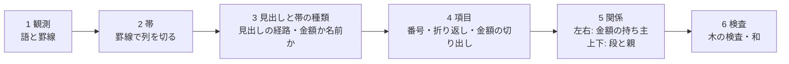

# 団体ごとの変換器を、罫線・見出し・字下げ・金額の和で木を組む共通の段に置き換える

担当者: wwwyo / Claude
更新日: `2026-10-13`（全表の一覧・文字層の修復・段のパターン・単位の決め方・見開きと杉並・取り込みの入口へのつなぎを追加）
状態: Draft（試作と計測まで。採用・置き換えは未決）

## Summary

PDF の決算書・予算書を、ノードの表と金額の表（[ADR 0020](../../adr/0020-ingestion-outputs-node-tables.md)）にする変換器は、今は団体ごとに手で書いている（約14個、各数百〜千行）。座標の数値・列名・行の数え方が変換器に埋まり、団体を足すたびに一つ書く。

この文書は、変換を団体共通の6つの段（観測→帯→見出しと帯の種類→項目→左右と上下の関係→検査）に分け、団体・表ごとの設定を「頁の範囲」だけにする設計と、その試作の計測結果をまとめる。試作は `pipeline/ingestion/generic/` にある。

結果の要点は次のとおり。

- **規則だけの流れ（A）で、新宿区・立川市の一般会計（決算・歳出）を既存の変換器とほぼ同じに組めた。** 新宿は款項目・備考・金額が全件一致し、木の検査も通る。立川は款項目・節・款項目の金額が全件一致し、備考（3〜4段の説明の木）は 96.2%、目より下の金額は 98.5%。設定は頁の範囲だけで、座標・列名・段の名前は一つも書いていない。Jev の費用は0。
- **金額の和で木を決める流れ（S）は、木を決める主役ではなく検証と曖昧さの解消に向く。** 番号の文法で候補を絞ると、款項目の並びは和で閉じ、親の正解は 新宿 191/194・立川 141/142。外れは金額0が並ぶ所に残る。番号の制約が無い和だけの探索は、長い並びで組み合わせが爆発する（状態数30万の上限を超える）。備考の区画は、和だけで閉じるのが 65/101、番号で絞ると 79/101。閉じた区画の木は A の木と一致した。
- **行の役割を Jev が選ぶ流れ（B）は、A と同等で、上回らなかった。** 立川の備考は 7001/7290（A は 7012）、費用は2団体で $0.11。A の規則は新宿・立川を見ながら足したので、未調整の団体で B が効くかは未確認である。
- **中央区（131024）は A で 0 件一致だった。** 科目が1列で段を「(款)(項)(目)」の接頭で示し、事業説明は予算の列の罫線が切れた下の自由な枠に、字下げと金額の位置で並ぶ。これに要る段（罫線の切れ目で領域を分ける・接頭で段を決める・自由な枠の木）は未実装で、残る難所の筆頭である。

- **試験の11団体の一般会計（歳出）を、取り込みの入口と保存の関門まで通した（2026-10-13）。** 23表のうち22表（10団体）が、木の検査・網羅の検査・単位の確かめをすべて通る（候補まで。保存はしていない）。止まるのは羽村の1表で、原典の印字が閉じない（節の和が目より 282,000 少ない）。関門は緩めていない。全45表の回帰は分類が下がらない（[取り込みの入口につないだ一覧](#取り込みの入口につないだ一覧試験の11団体一般会計2025決算歳出)）。

推奨は「A を骨格に、各区画の木を和で確かめ、和で閉じない所だけ番号と字下げで決め、それでも残る所を Jev に回す」流れである（[推奨の流れ](#推奨の流れ)）。決めたいのは、この流れで既存の変換器を置き換えていくか、置き換えの順序と、残る難所への手当て（[未決](#未決)）である。

## Goals / Non-Goals

- Goal: 団体・表ごとの手書きの分岐を足さずに、決算書の表からノードの表と金額の表を作る段を設計する。人が書くのは採用する表（頁の範囲・表の種類）だけにする。
- Goal: 各段を規則で行うか Jev の判定で行うかを、段ごとに理由とともに決める。
- Goal: 試作の出力を既存の表と突き合わせ、指標と費用で比べる。
- Non-Goal: 既存の変換器・`node_tables.py`・`pipeline/shared/`・dbt の変更（#103 が触っている）。
- Non-Goal: R2 への保存・採用。試作の出力は `pipeline/.cache/generic/` に置く。
- Non-Goal: scan PDF の OCR そのもの。観測の段は OCR の語と座標を受け取る形にするが、試作では text PDF だけを通した。

## Background

既存の変換器は、測った座標で列を切る（例: 新宿の `DETAIL_EDGES`）、行頭の番号の x 範囲で款・項・目を決める、備考の番号の桁数で項目を見分ける、といった規則を団体ごとに書いている。規則の種類はどの団体もほぼ同じで、違うのは数値と列名である。決算事項別明細書は地方自治法施行規則の様式で、款・項・目・予算現額の内訳・節・支出済額・翌年度繰越額・不用額・備考という列の並びは団体をまたいで共通している。

ユーザーの見立ては「セルが認識できれば、前後左右のセルとの関係から木を組める」である。左右の関係（同じ行のラベルと金額、どの金額の列か）と上下の関係（字下げ・番号の形・前の行との親子）が分かれば、款→項→目→説明・節の木と各ノードの金額が決まる。決算書には、親の金額が子の金額の和に一致するという強い制約もある。

## Design

### 段の分け方



| 段 | やること | 規則 / Jev | 理由 |
| --- | --- | --- | --- |
| 1 観測 | Poppler の語（`pdftotext -bbox`）と、pdfplumber の罫線（線と、暗い色の細い塗り）。白い背景の塗りは罫線にしない | 規則 | 抽出は決まった処理。scan PDF は OCR の語と、画像から取った罫線に差し替える |
| 2 帯 | 本文まで伸びる縦罫線の間を帯にする。横罫線が渡っていない隙間は表の外。左端の帯が金額の頁は、前の頁の行の続き（見開き）として横に並べて一つの論理頁にする | 規則 | 幾何の事実。見開きの対応は行の罫線の高さが左右で一致する |
| 3 見出し | 最初の数字より上の全幅の横罫線を見出しの下端とする。見出しの語を罫線で囲まれた枠ごとにまとめ、帯を覆う枠を上から積んで見出しの経路にする（「予算現額／当初予算額」）。帯の種類は、文書全体で同じ経路の帯の行に文字があるか・桁区切りの数字か・0だけかで決める | 規則 | 見出しは印字の事実。種類は文書全体の多数決で、空の継続頁でも同じになる |
| 4 項目 | 帯を、款・項・目の帯（科目の軸）と、それ以外の名前の帯（節・備考などの軸）にまとめ、行を項目にする。番号の切り出し、折り返し、金額の切り出し、括弧書き・金額の種類の行の扱い | 規則（試作 B では一部を Jev） | 番号・字下げ・金額の列は幾何で決まる。曖昧なのは番号の無い行の役割だけ |
| 5 関係 | 左右: 金額の帯の金額は、同じ罫線の行にある、左隣の名前の軸の項目のもの。上下: 科目は番号が始まる款・項・目の帯で段を決める。他の軸は名前の始まりの字下げを文書全体で段に分け、開いている浅い項目を親にする。根は開いている科目の項目の子 | 規則（試作 S では和、B の延長で Jev） | 左右は同じ行の帯の関係で一意に決まる。上下の曖昧さは和で確かめられる |
| 6 検査 | `check_tree` で全段の子の和を確かめる。金額の段階は共有辞書を見出しの末尾から引く | 規則 | 既存の検査をそのまま使う |

### 各段の規則（団体によらない）

新宿・立川を通すために足した規則は、すべて団体名・座標・列名を含まない。主なものと、それが解いた原典の作りを挙げる。

- **語を罫線で割る（見出しだけ）**: 立川の見出し「款項」は一語で2つの帯にまたがる。本文の語は割らず、語の始まりがある帯に入れる（「10」が狭い款の帯からはみ出しても一つの番号のまま）。
- **科目の行は番号の単位で項目にする**: 続きの頁は「1 1 1」「10 2 3」と番号だけを並べる。立川は新しい目が「3 2 1」の番号行の上下に名前を2行で印字し、款の名前は頁上部の「款（7）商工費」にしか無いことがある。番号で始まる語の並びが別の帯に入るごとに項目を分け、同じ罫線の枠の番号の無い行は一番深い番号の名前にし、名前の無い新しい款・項は頁上部の見出しから補う。前の項目と番号が同じ番号だけの行は、継続頁の再掲として同じノードにする。
- **合計の行**: 番号が無く「合計・総計・計」の行は合計として、その行の金額を木に入れない。
- **番号か名前か**: 「3歳児健康診査委託料」は番号ではない。行頭の数字を番号と読むのは、文書全体でその左端（または右端）の位置から始まる行の多くが番号を持つときだけにする。
- **金額の切り出し**: 行末の金額は名前と離れていれば別の語、くっついていれば（「…】112,408,043」が語の途中で切れていても）文字の位置で割る。負号「△」が上の行に印字されていれば次の数字に付ける。
- **折り返し**: 番号の無い行は、前の項目に金額がまだ無く、同じ罫線の枠にあり、名前の始まりと揃っていれば前の名前の続き。立川の長い事業名は2行目（【所管課】と金額）を1字下げて印字し、子の項目と字下げが同じになる。これは**金額の右揃えの列**で見分ける。段ごとに金額を印字する列が決まっている（立川は右端から 0・2・4 字）ので、文書全体で「段→金額の列」を学び、2行目の金額が上の項目の段の列にあれば折り返しとする。
- **金額の種類の行**: 「繰越明許費 302,000」「不用額 …」は、上の項目の金額の内訳で、見出しを「備考／繰越明許費」として上の項目に付ける。語彙は共有辞書の見出しと、繰越・不用額の語。括弧で囲まれた行（「（翌年度へ繰越明許費 …）」）は上の項目の名前の続きにする。
- **注記**: 科目の行（款・項・目の罫線の行）に印字された番号の無い備考と、「流用・充用・予備費支出・第n節へ・第n款…」で始まる行は、その科目の注記とし、金額は「備考／注記／<原文>」の見出しで科目のノードに付ける。新宿の「前年度繰越事業費不用額」もこれになる。
- **並べる順**: 科目の項目は、名前の印字位置ではなく、その行の罫線の上端で開く。立川は目の名前を行の中央に印字するので、名前より上に印字された説明が前の目に付いてしまうのを防ぐ。

### 金額の和で木を決める段（S）

読む順の並びは木の前順の走査なので、木は「各括弧の先頭の金額が直下の子の金額の和に等しく、根の和が目の金額に等しい」括弧付けである。`sums.py` はこれを動的計画法で探し、閉じる括弧付けの数を（2で打ち切って）数える。子孫は先祖の金額を超えないので、先頭より大きい金額が出たらその部分木は終わる、という枝刈りを入れる。

| モード | 候補の絞り方 | 複数あるときの選び方 |
| --- | --- | --- |
| sum | なし | 子を持たせる方を先に選ぶ |
| code+sum | 兄弟は番号の有無がそろい、番号は増える | 同上 |
| indent+sum | なし | A の字下げの木に近い方 |

和で閉じない区画は、A の木を残すか（else geometry）、平らに置く（else flat、単独の成績を見るため）。

### Jev で行の役割を選ぶ段（B）

番号の無い備考の行だけについて、区画の行（文字・字下げの文字数・金額・金額の右端の内側の文字数・番号）を state にし、行ごとに Choice（新しい項目／前の名前の続き／前の項目の金額の種類／注記）を問う。番号・罫線・科目の行・金額の持ち主は規則のまま。モデルは `jev-1.13.0` に固定し、答えは要求のハッシュで `.cache` に保存して再実行では呼ばない。

## 試した流れの比較

実測 2026-10-12。2025年度決算・歳出・一般会計。正解は既存の変換器の出力（#103 の候補、`.agent/w3c/final/<対象>/inspection/`）。ノードは根からの（軸・番号・名前）の経路が一致したとき一致とする（番号・名前・すべての先祖が合う）。名前は NFKC と空白の除去の後で比べる。金額は（ノードの経路・金額の段階・値）で比べ、段階は共有辞書で引き、辞書に無い見出しは印字の経路で比べる。新宿の「歳出総括」の金額（総括表 p3 から既存の変換器が補った値）は、試作が総括表を読まないので比較から外した。

### 新宿区 131041（p65–147、83頁）

| 指標 | A 規則 | B Jev | S（3通りとも） |
| --- | --- | --- | --- |
| 款項目のノード | 194/194 | 194/194 | 194/194 |
| 備考のノード（再現 / 適合） | 931/931 / 931/931 | 931/931 / 931/931 | 931/931 |
| 款項目の金額 | 1552/1552 | 1552/1552 | — |
| 備考の金額 | 931/931 | 931/931 | 931/931 |
| 注記の金額 | 11/11 | 7/11 | — |
| 木の検査 | 通過（1127組一致） | 通過（1126組） | 140区画すべて一意に閉じる |
| Jev | 0 | 106要求・32.5万トークン・$0.014・28秒 | 0 |

節の軸（1159ノード）も出しているが、既存の変換器は節の一覧を保存していない（観測としてローカルに残すだけ）ので比べていない。

### 立川市 132021（p82–441、見開き180組）

| 指標 | A 規則 | B Jev |
| --- | --- | --- |
| 款項目のノード | 142/142 | 142/142 |
| 節のノード | 786/786 | 786/786 |
| 備考のノード（再現 / 適合） | 7012/7290（96.2%）/ 7012/7117（98.5%） | 7001/7290（96.0%）/ 7001/7097（98.6%） |
| 款項目の金額 | 1136/1136 | 1136/1136 |
| 目より下の金額（再現） | 10337/10499（98.5%） | 10299/10499（98.1%） |
| 木の検査（組の一致 / 不一致） | 3547 / 46 | 3509 / 93 |
| Jev | 0 | 259要求・229万トークン・$0.096・80秒 |

備考の不一致の主なものは、(1) 括弧書きの繰越の注記を正解は名前に含めたり別のノードにしたりしていて一定でない、(2) 3段目の名前の折り返しで金額の列が段の列とずれる行、(3) 4段目の項目（正解で6件）の字下げが3段目の折り返しと同じ位置にある所。

和の段の比較（備考、101区画）:

| モード | 一意に閉じる | 複数 | 閉じない | 上限超え | 備考（閉じない区画は A） | 備考（閉じない区画は平ら） |
| --- | --- | --- | --- | --- | --- | --- |
| A（字下げ） | — | — | — | — | 7012 | — |
| sum | 65 | 4 | 9 | 23 | 7009 | 3059 |
| code+sum | 79 | 5 | 17 | 0 | 7007 | 5015 |
| indent+sum | 65 | 4 | 9 | 23 | 7012 | 3062 |

款項目の並び全体（新宿194・立川142）を和で組むと、sum は状態数の上限（30万）を超え、code+sum は閉じて2通り以上が残り、親の正解は 191/194・141/142 だった。外れは金額0の款・項・目（予備費など）が並ぶ所で、0 はどこにでも置けるため和では決まらない。

### 中央区 131024（p96–163）

A の規則のままでは 0 件一致。崩れる箇所は次の3つで、いずれも規則の追加で扱える種類のものだが、試作では実装していない。

1. 表の枠内の題字（「歳」「出」）を見出しと読み、見出しの経路が「歳／科目」になる。
2. 科目は1列で、段は「(款)」「(項)」「(目)」の接頭で示す。款・項・目の帯が無いので科目の軸にならない。
3. 事業説明は、款・項・目の行の下で予算の列の縦罫線が切れた自由な枠に、字下げと金額の位置（「126,549,974 円」のように円付き）で並ぶ。人数・回数（「11 人」「4回」）や小さな表（委員会名と回数）が混ざる。帯を縦罫線だけで切ると、この枠の語が予算の列に割り振られる。

### 時間・資源

観測（Poppler と pdfplumber）は新宿83頁で約55秒、立川360頁で約2分。観測は JSON にキャッシュし、規則の再実行は数秒〜数十秒。和の段は立川の備考で約40秒。Jev は合計 $0.11（上限 $5）。

## 全表に案A を当てた一覧

実測 2026-10-12。案A（規則を足さない試作のまま、Jev なし）を、#103 の候補にある保存対象の text PDF の全45表に当てた（scan PDF の 132055・132101 は対象外）。表・原典・頁は機械的に取った。頁は表ごとの coverage の記録（変換器が処理した頁）から取り、記録の無い5表（132012 の3表・132063・132071 当初予算。一覧の※）は正解の表に記録された頁の最小〜最大にした。正解は候補の `*-nodes.parquet`・`*-amounts.parquet`。同じ原典・頁の表（明細と備考の2表など）は1回の生成を共有する。

指標は「再現 / 適合」。款項目はノードの一致、目の金額は目のノードの金額（段階・値）の一致、目より下は**正解が持つ軸**に限ったノードと金額の一致である。正解が持たない軸（既存の変換器が保存していない節の一覧や、同じ頁の別の表の軸）の生成は「上乗せ」として分け、誤りに数えない。木の検査は `check_tree` で、「問題」は見出し・単位・金額の原文を解決できないノードの数。

分類は次のとおり。(a) は指示の条件（款項目・目の金額が100%、木の検査が通る）に、正解の軸の目より下も全件一致を加えた。

- (a) そのまま置き換えられる: 款項目・目の金額・目より下が全件一致し、木の検査が通る。
- (b) 少しの差: 款項目と目の金額がおおむね合い（再現 90% 前後以上）、差の原因が1つに絞れる。
- (c) 合わない: 原因の型で分ける（接頭の段・自由な枠・見開き・その他）。

### 結果

| 分類 | 件数 | 表 |
| --- | --- | --- |
| (a) | 3 | 132021 駐車場（明細・備考）、132021 後期高齢（明細） |
| (b) | 14 | 131041 の4表、131105 の4表、131148 一般・土地、132021 一般（明細・備考）・後期高齢（備考）、132128 後期高齢 |
| (c) | 28 | 131024 の4表、131148 介護・後期・国保、131156 の8表、131172 の4表、132012 の3表、132039、132063、132217、132071 の3表 |

(c) の原因の型: 接頭の段 4（131024）、自由な枠 3（132012 の事務報告書）、見開き 3（131148）、その他 18（テキスト層の字の崩れ 8: 131156、二重印字 4: 131172、番号と名前が別の欄 2: 132063・132217、公営企業の番号の無い科目 2: 132071、縦書きの款項 1: 132039、当初予算書の様式 1: 132071）。

所要時間は2プロセスで全体 約2分53秒（観測から木の検査・評価まで。生成は38回・計1,753頁）。最大の表は 132021 一般会計の66秒、新宿一般会計の29秒。

(b) の差のうち、規則を足さずに解ける見込みのものがある。131041 の4表は、coverage の頁に総括表の頁が入って総括の款が単位なしで重複するだけで、詳細の頁だけを渡せば一般会計では検査も通った（[試した流れの比較](#試した流れの比較)）。採用する頁を「表の種類」として選ぶ人の判断（総括を含めない）で (a) になる。

### 表ごとの指標

| 表 | 頁 | 款項目 | 目の金額 | 目より下（正解の軸） | 目より下の金額 | 上乗せ（軸・ノード） | 木の検査 | 秒 | 分類 | 原因 |
| --- | --- | --- | --- | --- | --- | --- | --- | --- | --- | --- |
| 131024/chuo-care-settlement | 203–214（12） | 0.0% / 0.0% | 0.0% / 0.0% | 0.0% / 0.0% 事業説明:0/82 節:0/3 | 0.0% / 0.0% | A・予備費支出・備考・当初予算額・繰越事…（5軸） 68 | 不一致 0・問題 52 | 2.8 | c | 接頭の段: 科目が1列で段を「(款)(項)(目)」で示す。事業説明は罫線の切れた自由な枠。枠内の題字を見出しと読む |
| 131024/chuo-general-settlement | 96–163（68） | 0.0% / 0.0% | 0.0% / 0.0% | 0.0% / 0.0% 事業説明:0/1555 節:0/1 | 0.0% / 0.0% | %・A・予備費支出・予算現額計A・備考・…（9軸） 1658 | 不一致 0・問題 596 | 14.4 | c | 接頭の段: 科目が1列で段を「(款)(項)(目)」で示す。事業説明は罫線の切れた自由な枠。枠内の題字を見出しと読む |
| 131024/chuo-kokuho-settlement | 178–187（10） | 0.0% / 0.0% | 0.0% / 0.0% | 0.0% / 0.0% 事業説明:0/50 節:0/3 | 0.0% / 0.0% | A・予備費支出・補正予算額 49 | 不一致 0・問題 41 | 2.2 | c | 接頭の段: 科目が1列で段を「(款)(項)(目)」で示す。事業説明は罫線の切れた自由な枠。枠内の題字を見出しと読む |
| 131024/chuo-kouki-settlement | 225–229（5） | 0.0% / 0.0% | 0.0% / 0.0% | 0.0% / 0.0% 事業説明:0/15 節:0/2 | 0.0% / 0.0% | A・予備費支出・補正予算額 32 | 不一致 0・問題 24 | 1.2 | c | 接頭の段: 科目が1列で段を「(款)(項)(目)」で示す。事業説明は罫線の切れた自由な枠。枠内の題字を見出しと読む |
| 131041/general-expenditure-detail | 3–147（84） | 100.0% / 100.0% | 100.0% / 100.0% | 100.0% / 100.0% 備考:931/931 | 100.0% / 100.0% | 節 1159 | 不一致 0・問題 13 | 29.1 | b | 款項目・金額・備考は全件一致。coverage に総括表の頁が入り、総括の款が単位なしで重複して木の検査に問題が出る（詳細の頁だけなら通過を確認済み: 一般会計） |
| 131041/kaigo-expenditure-detail | 162–177（9） | 100.0% / 100.0% | 100.0% / 100.0% | 100.0% / 100.0% 備考:50/50 | 100.0% / 100.0% | 節 77 | 不一致 0・問題 6 | 3.5 | b | 款項目・金額・備考は全件一致。coverage に総括表の頁が入り、総括の款が単位なしで重複して木の検査に問題が出る（詳細の頁だけなら通過を確認済み: 一般会計） |
| 131041/kokuho-expenditure-detail | 149–160（8） | 100.0% / 100.0% | 100.0% / 100.0% | 100.0% / 97.6% 備考:40/40 | 100.0% / 100.0% | 節 50 | 不一致 0・問題 6 | 2.3 | b | 款項目・金額・備考は全件一致。coverage に総括表の頁が入り、総括の款が単位なしで重複して木の検査に問題が出る（詳細の頁だけなら通過を確認済み: 一般会計） |
| 131041/kouki-expenditure-detail | 179–186（4） | 100.0% / 100.0% | 100.0% / 100.0% | 100.0% / 100.0% 備考:19/19 | 100.0% / 100.0% | 節 24 | 不一致 0・問題 5 | 1.3 | b | 款項目・金額・備考は全件一致。coverage に総括表の頁が入り、総括の款が単位なしで重複して木の検査に問題が出る（詳細の頁だけなら通過を確認済み: 一般会計） |
| 131105/elderly-medical-setsu | 128–133（6） | 100.0% / 100.0% | 90.0% / 100.0% | 67.9% / 67.9% 節:19/28 | 56.5% / 67.9% | — 0 | 不一致 0・問題 52 | 1.5 | b | 支出済額の欄が帯にならず目の支出済額が欠ける。節の字下げが2段に割れ、節の下に節が付く。頁に単位表記が無く単位を取れない |
| 131105/general-setsu | 42–91（50） | 100.0% / 100.0% | 89.8% / 100.0% | 62.0% / 62.0% 節:537/866 | 51.7% / 62.0% | 備考 2 | 不一致 0・問題 1032 | 18.2 | b | 支出済額の欄が帯にならず目の支出済額が欠ける。節の字下げが2段に割れ、節の下に節が付く。頁に単位表記が無く単位を取れない |
| 131105/long-term-care-setsu | 150–159（10） | 100.0% / 100.0% | 90.0% / 100.0% | 76.7% / 76.7% 節:46/60 | 63.9% / 76.7% | — 0 | 不一致 0・問題 108 | 2.9 | b | 支出済額の欄が帯にならず目の支出済額が欠ける。節の字下げが2段に割れ、節の下に節が付く。頁に単位表記が無く単位を取れない |
| 131105/national-health-insurance-setsu | 107–115（9） | 100.0% / 100.0% | 90.0% / 100.0% | 86.0% / 86.0% 節:43/50 | 71.7% / 86.0% | — 0 | 不一致 0・問題 102 | 2.4 | b | 支出済額の欄が帯にならず目の支出済額が欠ける。節の字下げが2段に割れ、節の下に節が付く。頁に単位表記が無く単位を取れない |
| 131148/care-insurance-setsu | 234–245（12） | 80.8% / 84.0% | 69.2% / 100.0% | 0.0% / 0.0% 節:0/45 | 0.0% / 0.0% | 予算現額 45 | 不一致 9・問題 0 | 1.8 | c | 見開き: 組がずれて款項目の行と金額の行が合わない（一般会計と同じ作り）。節の見出しが左右に割れる |
| 131148/general-setsu | 106–145（40） | 97.8% / 98.9% | 96.4% / 100.0% | 0.0% / 0.0% 節:0/531 | 0.0% / 0.0% | 予算現額・備考 534 | 不一致 5・問題 0 | 6.8 | b | 見開きの組が1頁ずれる所がある（最初の頁が右頁だけ）。節の見出しが左右の頁に割れて軸名が「予算現額」になる |
| 131148/land-setsu | 156–157（2） | 100.0% / 100.0% | 100.0% / 100.0% | 0.0% / 0.0% 節:0/2 | 0.0% / 0.0% | 予算現額 2 | 通過 | 0.9 | b | 見開きの組が1頁ずれる所がある（最初の頁が右頁だけ）。節の見出しが左右の頁に割れて軸名が「予算現額」になる |
| 131148/late-elderly-medical-setsu | 204–209（6） | 66.7% / 85.7% | 0.0% / 0.0% | 0.0% / 0.0% 節:0/3 | 0.0% / 0.0% | 予算現額 3 | 不一致 5・問題 0 | 1.1 | c | 見開き: 組がずれて款項目の行と金額の行が合わない（一般会計と同じ作り）。節の見出しが左右に割れる |
| 131148/national-health-insurance-setsu | 178–189（12） | 87.5% / 90.3% | 84.2% / 100.0% | 0.0% / 0.0% 節:0/44 | 0.0% / 0.0% | 予算現額 44 | 不一致 5・問題 0 | 1.7 | c | 見開き: 組がずれて款項目の行と金額の行が合わない（一般会計と同じ作り）。節の見出しが左右に割れる |
| 131156/care-insurance-expenditure-details | 35–44（10） | 44.4% / 40.0% | 7.3% / 21.5% | 18.0% / 18.0% 節:11/61 | 12.3% / 17.4% | 予備費支出及び流用増減・考備・補正予算額 239 | 不一致 29・問題 0 | 1.4 | c | その他（テキスト層）: 数字が1字ずつ離れて印字され金額にならない。見出しの字順が崩れる（「算予現額」「考備」「八刀区」） |
| 131156/care-insurance-expenditure-notes | 35–44（10） | 44.4% / 40.0% | 7.3% / 21.5% | 0.0% / 0.0% 備考:0/129 | 0.0% / 0.0% | 予備費支出及び流用増減・節・考備・補正予算額 300 | 不一致 29・問題 0 | 1.4 | c | その他（テキスト層）: 数字が1字ずつ離れて印字され金額にならない。見出しの字順が崩れる（「算予現額」「考備」「八刀区」） |
| 131156/general-expenditure-details | 1–160（160） | 83.9% / 83.3% | 24.9% / 81.2% | 78.0% / 78.0% 節:560/718 | 56.2% / 77.8% | 予備費支出及び流用増減・継続費及び繰越事…（5軸） 6804 | 不一致 405・問題 0 | 17.3 | c | その他（テキスト層）: 数字が1字ずつ離れて印字され金額にならない。見出しの字順が崩れる（「算予現額」「考備」「八刀区」） |
| 131156/general-expenditure-notes | 1–160（160） | 83.9% / 83.3% | 24.9% / 81.2% | 0.0% / 0.0% 備考:0/4293 | 0.0% / 0.0% | 予備費支出及び流用増減・節・継続費及び繰…（6軸） 7522 | 不一致 405・問題 0 | 17.3 | c | その他（テキスト層）: 数字が1字ずつ離れて印字され金額にならない。見出しの字順が崩れる（「算予現額」「考備」「八刀区」） |
| 131156/late-stage-elderly-expenditure-details | 54–59（6） | 57.1% / 54.5% | 10.9% / 23.3% | 33.3% / 33.3% 節:4/12 | 22.9% / 34.4% | 予備費支出及び流用増減・考備 40 | 不一致 7・問題 0 | 0.6 | c | その他（テキスト層）: 数字が1字ずつ離れて印字され金額にならない。見出しの字順が崩れる（「算予現額」「考備」「八刀区」） |
| 131156/late-stage-elderly-expenditure-notes | 54–59（6） | 57.1% / 54.5% | 10.9% / 23.3% | 0.0% / 0.0% 備考:0/24 | 0.0% / 0.0% | 予備費支出及び流用増減・節・考備 52 | 不一致 7・問題 0 | 0.6 | c | その他（テキスト層）: 数字が1字ずつ離れて印字され金額にならない。見出しの字順が崩れる（「算予現額」「考備」「八刀区」） |
| 131156/national-health-insurance-expenditure-details | 12–19（8） | 52.0% / 49.1% | 18.5% / 52.6% | 54.9% / 54.9% 節:28/51 | 39.7% / 55.5% | 予備費支出及び流用増減・考備・補正予算額 132 | 不一致 24・問題 0 | 1.2 | c | その他（テキスト層）: 数字が1字ずつ離れて印字され金額にならない。見出しの字順が崩れる（「算予現額」「考備」「八刀区」） |
| 131156/national-health-insurance-expenditure-notes | 12–19（8） | 52.0% / 49.1% | 18.5% / 52.6% | 0.0% / 0.0% 備考:0/82 | 0.0% / 0.0% | 予備費支出及び流用増減・節・考備・補正予算額 183 | 不一致 24・問題 0 | 1.2 | c | その他（テキスト層）: 数字が1字ずつ離れて印字され金額にならない。見出しの字順が崩れる（「算予現額」「考備」「八刀区」） |
| 131172/general-setsu | 53–94（42） | — | — | 0.0% / 0.0% 款項:0/169 節:0/933 | 0.0% / 0.0% | 不用事故繰越・予予算算現現額額・予算補正…（25軸） 3810 | 不一致 0・問題 2996 | 44.3 | c | その他（二重印字）: 文字が二重に印字され見出しが「予予算算現現額額」になり、帯が細かく割れる。科目の帯にならない |
| 131172/kaigo-setsu | 109–113（5） | — | — | 0.0% / 0.0% 款項:0/50 節:0/73 | 0.0% / 0.0% | 不用事故繰越・予予算算現現額額・予補正予…（13軸） 428 | 不一致 0・問題 299 | 4.9 | c | その他（二重印字）: 文字が二重に印字され見出しが「予予算算現現額額」になり、帯が細かく割れる。科目の帯にならない |
| 131172/kokuho-setsu | 99–102（4） | — | — | 0.0% / 0.0% 款項:0/56 節:0/48 | 0.0% / 0.0% | 不用事故繰越・予算額補正予算・予補正算額…（11軸） 293 | 不一致 0・問題 249 | 4.3 | c | その他（二重印字）: 文字が二重に印字され見出しが「予予算算現現額額」になり、帯が細かく割れる。科目の帯にならない |
| 131172/kouki-setsu | 118–119（2） | — | — | 0.0% / 0.0% 款項:0/23 節:0/26 | 0.0% / 0.0% | 不用事故繰越・予予算算現現額額・予算補正…（13軸） 179 | 不一致 0・問題 108 | 2.3 | c | その他（二重印字）: 文字が二重に印字され見出しが「予予算算現現額額」になり、帯が細かく割れる。科目の帯にならない |
| 132012/general-detail | 148–457（310）※ | 0.0% / 0.0% | 0.0% / 0.0% | — | — | (1)地域農業活性化推進事業478,30…（79軸） 798 | 不一致 24・問題 17 | 22.8 | c | 自由な枠: 主要な施策の成果・事務報告書（文章の中の金額と内訳）で、罫線の表ではない |
| 132012/kaigo-detail | 510–522（13）※ | 0.0% / 0.0% | — | — | — | (360,352,000)346,859…（8軸） 179 | 不一致 3・問題 1 | 1.5 | c | 自由な枠: 主要な施策の成果・事務報告書（文章の中の金額と内訳）で、罫線の表ではない |
| 132012/kouki-detail | 493–498（6）※ | 0.0% / 0.0% | — | — | — | (予算現額)当年度決算額1総務費主要な施…（4軸） 107 | 不一致 6・問題 0 | 1.0 | c | 自由な枠: 主要な施策の成果・事務報告書（文章の中の金額と内訳）で、罫線の表ではない |
| 132021/chushajo-expenditure-details | 508–511（4） | 100.0% / 100.0% | 100.0% / 100.0% | 100.0% / 100.0% 節:13/13 | 100.0% / 100.0% | 備考 32 | 通過 | 1.3 | a |  |
| 132021/chushajo-expenditure-notes | 508–511（4） | 100.0% / 100.0% | 100.0% / 100.0% | 100.0% / 100.0% 備考:32/32 | 100.0% / 100.0% | 節 13 | 通過 | 1.3 | a |  |
| 132021/general-expenditure-details | 82–443（362） | 100.0% / 100.0% | 100.0% / 100.0% | 100.0% / 100.0% 節:786/786 | 99.9% / 100.0% | 備考 7117 | 不一致 46・問題 0 | 66.4 | b | 備考の名前の折り返し・括弧書きの繰越注記の扱いの差（備考 96.2%）。木の検査 46 組不一致 |
| 132021/general-expenditure-notes | 82–443（362） | 100.0% / 100.0% | 100.0% / 100.0% | 96.2% / 98.5% 備考:7012/7290 | 97.9% / 97.9% | 節 786 | 不一致 46・問題 0 | 66.4 | b | 備考の名前の折り返し・括弧書きの繰越注記の扱いの差（備考 96.2%）。木の検査 46 組不一致 |
| 132021/kouki-expenditure-details | 570–575（6） | 100.0% / 100.0% | 100.0% / 100.0% | 100.0% / 100.0% 節:21/21 | 100.0% / 100.0% | 備考 80 | 通過 | 2.1 | a |  |
| 132021/kouki-expenditure-notes | 570–575（6） | 100.0% / 100.0% | 100.0% / 100.0% | 98.8% / 98.8% 備考:79/80 | 98.8% / 98.8% | 節 21 | 通過 | 2.1 | b | 備考 79/80（委託料の名前の折り返し1件） |
| 132039/kouki-expenditure-detail | 1–3（3） | 9.5% / 9.5% | 0.0% / 0.0% | 0.0% / 0.0% 節:0/18 | 0.0% / 0.0% | 備考 33 | 不一致 0・問題 72 | 0.7 | c | その他（縦書き）: 款・項の名前が狭い欄に縦書き。頁に単位表記が無い |
| 132063/kouki-setsu | 50–54（5）※ | — | — | 0.0% / 0.0% 款項目:0/23 節:0/26 | 0.0% / 0.0% | 備考・施策番号・計当初予算額補正予算額継…（3軸） 23 | 不一致 0・問題 67 | 1.1 | c | その他（番号と名前が別の欄）: 款項目の番号と名前が一つの見出しの下の別の欄。予算の内訳が1欄に縦積み |
| 132071/akishima-enterprise-expenditure-capital-detail | 30–31（2） | — | — | 0.0% / 0.0% 備考:0/14 款項:0/27 | 0.0% / 0.0% | — 0 | 不一致 0・問題 28 | 0.3 | c | その他（公営企業）: 款・項に番号が無く、科目の帯で段を決められない |
| 132071/akishima-enterprise-expenditure-revenue-detail | 24–28（5） | — | — | 0.0% / 0.0% 備考:0/41 款項:0/78 | 0.0% / 0.0% | — 0 | 不一致 0・問題 62 | 0.4 | c | その他（公営企業）: 款・項に番号が無く、科目の帯で段を決められない |
| 132071/akishima-text-budget-expenditure | 10–449（440）※ | 27.6% / 13.0% | 0.0% / 0.0% | 0.0% / 0.0% 本年度予算額の財源内訳:0/255 節:0/819 説明:0/5834 | 0.0% / 0.0% | その他・一般財源・千円・国都支出金・地方債 729 | 不一致 0・問題 7997 | 58.8 | c | その他（当初予算書）: 千円・財源内訳の欄・説明の欄の様式。款項目 27.6% |
| 132128/late-elderly-medical-setsu | 1–7（7） | 100.0% / 100.0% | 100.0% / 100.0% | 0.0% / 0.0% 説明:0/99 | 0.0% / 0.0% | 備考・節 122 | 不一致 14・問題 0 | 1.4 | b | 款項目・目の金額は全件一致。説明の軸名が正解は「説明」、印字は「備考」。木の検査 14 組不一致 |
| 132217/late-elderly-medical-setsu | 159–164（6） | 0.0% / 0.0% | 0.0% / 0.0% | 0.0% / 0.0% 備考:0/109 節:0/23 | 0.0% / 0.0% | — 0 | 不一致 9・問題 0 | 0.9 | c | その他（番号と名前が別の欄）: 款・項・目の番号の欄と、款項目共通の名前の欄が分かれ、名前を科目に結べない |

一覧は `all-tables/` のスクリプトで作り直せる（`targets.py` で対象を列挙し、`run.py` を2プロセスで回し、`summary.py` で集計する。原因と分類は `causes.json` に手で書いた）。

### 置き換えの方針への示唆

- 案A がそのまま効くのは、款・項・目が罫線の帯に分かれ、説明が列にある作り（立川・新宿）に限られる。45表中 (a)+(b) は17表で、団体では 131041・132021・132128 がほぼそのまま、131105・131148 は1〜2個の共通の規則（欄の境の帯・見開きの組）で届く見込み（未検証）。
- (c) の28表のうち12表は「表の作り」ではなく「テキスト層」の差（131156 の字の崩れ、131172 の二重印字）で、観測の段の正規化（重なった同じ字を1つにする、1字ずつの数字をつなぐ）で解ける種類と見ている（未検証）。表の作りの差（接頭の段・番号と名前が別の欄・縦書き・自由な枠）は、それぞれ別の規則が要る。
- 132012（事務報告書）と 132071 当初予算書は、決算事項別明細書と別の資料の種類で、同じ流れに載せるかは資料の選定から見直す対象である。

## 文字層の修復の段を足して測り直した一覧

実測 2026-10-12。観測の直後、帯より前に「文字層の修復」の段（`ingestion/generic/repair.py`）を足し、全45表を測り直した。団体名・頁・座標は書いていない。規則は修復の段のほかは足していない（Jev なし）。

### 修復の段

| 修復 | やり方 | 根拠 |
| --- | --- | --- |
| 見えない字（二重描画） | pdfium で字ごとの箱と、その字を描く描画物のクリップを取り、箱がクリップの外の字を捨てる。頁の外に置かれた字は数えない。見えない字が頁の字の2割以上の頁は、見える字の正確な箱から語を組み直す（縦罫線をまたいでつながない）。それ未満の頁は Poppler の語から該当の字だけを除く。見えない字のある頁では、見える線がほぼ無い罫線（幽霊の罫線）も捨てる | 131172 は頁を2回描き、各回を頁の左半分・右半分にクリップしている。131172 の変換器は `mutool trace` で同じことを団体専用に行っていた。pdfium は pdfplumber の依存として入っており、新しい依存は要らない |
| 重ね打ち | 同じ字が同じ位置（1pt 未満）に2回あれば1つにする | 太字を重ね打ちで描く欄 |
| 分かれた字 | 同じ位置に重なった1字ずつの字（重なり 60% 以上）を1語にする | 杉並の「分」が「八」と「刀」の2字で描かれる |
| 1字ずつの数字 | 同じ行で右隣に接する数字・カンマ・△の語をつなぐ | 杉並の金額が1字ずつ重なり合って描かれる |
| 見出しの読み順（帯の段 `layout.py`） | 見出しの語を、縦の重なりで行にまとめてから左→右に並べる（上端の丸めで行を分けない） | 杉並の「算予現額」「考備」は字の基準線が少しずつずれていた |
| 既知の誤字 | 団体共通の辞書 `pipeline/ingestion/lib/text_repairs.csv`（誤・正・文脈の正規表現（任意）・根拠）を、壊れていると判定した文書にだけ当てる。当たった置き換えは件数と例（前後の語・頁）を記録する | 杉並の変換器の `REPAIR_WORDS`・`REPAIR_CHARS`・`GLYPH_FIX`・`DIGIT_FIX` と `repair_text` の個別の置き換えを移した（変換器側は残す）。新規は「八刀→分」1件。計155件。取り込みだけが使うので `shared/`（dbt の seed にもなる）ではなく `ingestion/lib/` に置いた |

**壊れの判定**は、辞書の2字以上の誤字の出現が1万字あたり2件以上のとき「壊れている」とする（基準と閾値は `repair.py` の冒頭の1か所）。最初は「既知の見出しの語が無い頁の割合」も基準に入れたが、表ではない事務報告書（132012）を壊れと判定し、「捕獲→捕護」「関連動画→関運動画」「誰か→護か」「大栗川→大票川」と正しい語を書き換えた。見出しの有無は文字層の壊れの証拠にならないので判定から外し、記録だけにした。

判定の結果、壊れているのは 131156 の4つの生成（一般会計と特別会計3つ。出現率は1万字あたり16〜34件）だけで、壊れていない文書の最大は0.5件だった。置き換えは計2,345件で、辞書155件のうち139件が当たった（多い順に ゜→0 1667、八刀→分 184、•→△ 95、晋→費 38、連営→運営 31、•→・ 25、謹→護 21、·→・ 21、背→費 14、菩→費 12）。

### 結果

名前の一致は「完全一致」と「誤字を許した一致」の2つで出す。分類は再現率で判定し、適合率は見ない。正解に無い軸の生成と、正解が持たない注記の金額（立川の流用の注記など）は「上乗せ」として別に数え、誤りに数えないためである（適合率の下限を置くと、注記を持つ立川の一般会計が (b) から落ちる）。誤字を許した一致は、根からの（軸・番号）の並びが同じノードどうしで、名前が同じか金額を1つでも共有すれば一致とする（番号と親が同じなら名前の違いを許す）。目の金額は見出しの名前によらず値で比べる（変換器ごとに見出しの名付けが違うため）。分類の (a) は完全一致の基準のまま、(b) は誤字を許した一致で款項目 90% 以上・目の金額（値）80% 以上・目より下 50% 以上（正解の軸がある場合）とした。前回手で (b) にした3表（131148 一般・土地、132128）は軸の名前の違いが原因で修復とは関係しないので、分類を変えていない。

| 分類 | 前回 | 今回 | 変わった表 |
| --- | --- | --- | --- |
| (a) | 3 | 3 | — |
| (b) | 14 | 18 | 131156 一般（明細）、131172 一般・後期、132039 が (c) から移った |
| (c) | 28 | 24 | — |

- **131156 杉並（8表）**: 見出しが正しく読めるようになり、一般会計の明細は款項目が完全一致 95.8%（誤字を許せば 100%）、節 96.4%（同 100%）で (b) に移った。目の金額（値）は 87.5% で、残りは0の欄の金額の行が決まらない所（行の無い金額 327件）で、文字層ではなく罫線の対応の問題である。備考の4表は、備考の木（○事業【所管】→番号の項目→細目）を今の規則で組めず、誤字を許しても 14〜48% のまま (c)。特別会計の明細3表は款項目（誤字許容）71〜89% で (c) のまま（未調査）。
- **131172（4表）**: 二重描画を除き（見えない字 6.8万字・幽霊の罫線 1,026本）、款項目が前回の 0% から 100%（4表とも）、節は誤字を許して 92〜93% になった。一般・後期は目の金額（値）86〜93% で (b)。介護・国保は右頁の金額の行の対応がずれ、目の金額（値）70〜75% で (c)。4表とも頁に単位の表記が無く（欄ごとの「円」だけ）、木の検査は単位を解決できない問題で落ちる。
- **132039**: 修復とは関係なく、誤字を許した一致を出したことで、款・項の縦書きの名前以外はすべて合うと分かった（誤字を許せば款項目・目の金額・節すべて 100%）。
- 新宿・立川は修復の前後で変わらない（立川の頁の外の字は Poppler も拾っていない）。

(c) の原因の型（24表）: 接頭の段 4（131024）、自由な枠 3（132012）、見開き 3（131148 介護・後期・国保）、その他 14（131156 の備考の作り 4・特別会計の明細 3、131172 の行の対応 2、番号と名前が別の欄 2: 132063・132217、公営企業 2: 132071、当初予算書 1: 132071）。

所要時間は2プロセスで全体 16〜17秒（観測はキャッシュから。修復・組み立て・評価だけ）。修復の段だけの時間は 131172 後期2頁で0.2秒、立川362頁で約4秒。

### 残る壊れ

- 単位の表記が頁に無い表（131172・131105・132039。欄ごとの「円」だけ）は、金額の単位を取れず木の検査で問題になる。文字層ではなく見出しの読み方の問題で、欄の「円」から単位を取る規則が要る。
- 131156 の0の欄の金額 327件が行に結べない。修復で「゜」は「0」になったが、罫線と行の対応が合っていない。
- 見えない字の判定はクリップが矩形のときだけ確かめた。クリップが矩形でない文書、白い字・白い面で隠した字には効かない（今回の45表には無かった）。

**誤字の運用**（ユーザー決定）: 辞書に無い誤字を自動で見つける仕組みは作らない。多少の誤字は許し、気づいたら共通の誤字辞書 `pipeline/ingestion/lib/text_repairs.csv` に行（誤・正・文脈・根拠）を足して直す。

### 表ごとの指標（修復後）

「誤字を許した」の列は 款項目 / 目の金額（値） / 目より下 の順に「再現 / 適合」。分類の列は 前回→今回。

| 表 | 頁 | 款項目 | 目の金額 | 目より下（正解の軸） | 目より下の金額 | 誤字を許した 款項目 / 目の金額（値） / 目より下 | 上乗せ（軸・ノード） | 木の検査 | 文字層 | 秒 | 分類 | 原因 |
| --- | --- | --- | --- | --- | --- | --- | --- | --- | --- | --- | --- | --- |
| 131024/chuo-care-settlement | 203–214（12） | 0.0% / 0.0% | 0.0% / 0.0% | 0.0% / 0.0% 事業説明:0/82 節:0/3 | 0.0% / 0.0% | 12.5% / 14.0% / 1.6% / 9.1% / 0.0% / 0.0% | A・予備費支出・備考・当初予算額・繰越事…（5軸） 68 | 不一致 0・問題 52 | — | 0.2 | c→c | 接頭の段: 科目が1列で段を「(款)(項)(目)」で示す。事業説明は罫線の切れた自由な枠。枠内の題字を見出しと読む |
| 131024/chuo-general-settlement | 96–163（68） | 0.0% / 0.0% | 0.0% / 0.0% | 0.0% / 0.0% 事業説明:0/1555 節:0/1 | 0.0% / 0.0% | 0.0% / 0.0% / 0.0% / 0.0% / 0.0% / 0.0% | %・A・予備費支出・予算現額計A・備考・…（9軸） 1658 | 不一致 0・問題 596 | — | 1.2 | c→c | 接頭の段: 科目が1列で段を「(款)(項)(目)」で示す。事業説明は罫線の切れた自由な枠。枠内の題字を見出しと読む |
| 131024/chuo-kokuho-settlement | 178–187（10） | 0.0% / 0.0% | 0.0% / 0.0% | 0.0% / 0.0% 事業説明:0/50 節:0/3 | 0.0% / 0.0% | 2.0% / 4.0% / 0.0% / 0.0% / 0.0% / 0.0% | A・予備費支出・補正予算額 49 | 不一致 0・問題 41 | — | 0.2 | c→c | 接頭の段: 科目が1列で段を「(款)(項)(目)」で示す。事業説明は罫線の切れた自由な枠。枠内の題字を見出しと読む |
| 131024/chuo-kouki-settlement | 225–229（5） | 0.0% / 0.0% | 0.0% / 0.0% | 0.0% / 0.0% 事業説明:0/15 節:0/2 | 0.0% / 0.0% | 4.2% / 11.1% / 0.0% / 0.0% / 0.0% / 0.0% | A・予備費支出・補正予算額 32 | 不一致 0・問題 24 | — | 0.1 | c→c | 接頭の段: 科目が1列で段を「(款)(項)(目)」で示す。事業説明は罫線の切れた自由な枠。枠内の題字を見出しと読む |
| 131041/general-expenditure-detail | 3–147（84） | 100.0% / 100.0% | 100.0% / 100.0% | 100.0% / 100.0% 備考:931/931 | 100.0% / 100.0% | 100.0% / 93.7% / 100.0% / 100.0% / 100.0% / 100.0% | 節 1159 | 不一致 0・問題 13 | — | 1.6 | b→b | 款項目・金額・備考は全件一致。coverage に総括表の頁が入り、総括の款が単位なしで重複して木の検査に問題が出る（詳細の頁だけなら通過を確認済み: 一般会計） |
| 131041/kaigo-expenditure-detail | 162–177（9） | 100.0% / 100.0% | 100.0% / 100.0% | 100.0% / 100.0% 備考:50/50 | 100.0% / 100.0% | 100.0% / 87.5% / 100.0% / 100.0% / 100.0% / 100.0% | 節 77 | 不一致 0・問題 6 | — | 0.2 | b→b | 款項目・金額・備考は全件一致。coverage に総括表の頁が入り、総括の款が単位なしで重複して木の検査に問題が出る（詳細の頁だけなら通過を確認済み: 一般会計） |
| 131041/kokuho-expenditure-detail | 149–160（8） | 100.0% / 100.0% | 100.0% / 100.0% | 100.0% / 97.6% 備考:40/40 | 100.0% / 100.0% | 100.0% / 88.5% / 100.0% / 99.2% / 100.0% / 97.6% | 節 50 | 不一致 0・問題 6 | — | 0.2 | b→b | 款項目・金額・備考は全件一致。coverage に総括表の頁が入り、総括の款が単位なしで重複して木の検査に問題が出る（詳細の頁だけなら通過を確認済み: 一般会計） |
| 131041/kouki-expenditure-detail | 179–186（4） | 100.0% / 100.0% | 100.0% / 100.0% | 100.0% / 100.0% 備考:19/19 | 100.0% / 100.0% | 100.0% / 77.3% / 100.0% / 100.0% / 100.0% / 100.0% | 節 24 | 不一致 0・問題 5 | — | 0.1 | b→b | 款項目・金額・備考は全件一致。coverage に総括表の頁が入り、総括の款が単位なしで重複して木の検査に問題が出る（詳細の頁だけなら通過を確認済み: 一般会計） |
| 131105/elderly-medical-setsu | 128–133（6） | 100.0% / 100.0% | 90.0% / 100.0% | 67.9% / 67.9% 節:19/28 | 56.5% / 67.9% | 100.0% / 100.0% / 82.0% / 100.0% / 67.9% / 67.9% | — 0 | 不一致 0・問題 52 | — | 0.1 | b→b | 支出済額の欄が帯にならず目の支出済額が欠ける。節の字下げが2段に割れ、節の下に節が付く。頁に単位表記が無く単位を取れない |
| 131105/general-setsu | 42–91（50） | 100.0% / 100.0% | 89.8% / 100.0% | 62.0% / 62.0% 節:537/866 | 51.7% / 62.0% | 100.0% / 100.0% / 85.5% / 100.0% / 62.0% / 62.0% | 備考 2 | 不一致 0・問題 1032 | — | 1.1 | b→b | 支出済額の欄が帯にならず目の支出済額が欠ける。節の字下げが2段に割れ、節の下に節が付く。頁に単位表記が無く単位を取れない |
| 131105/long-term-care-setsu | 150–159（10） | 100.0% / 100.0% | 90.0% / 100.0% | 76.7% / 76.7% 節:46/60 | 63.9% / 76.7% | 100.0% / 100.0% / 82.9% / 100.0% / 76.7% / 76.7% | — 0 | 不一致 0・問題 108 | — | 0.1 | b→b | 支出済額の欄が帯にならず目の支出済額が欠ける。節の字下げが2段に割れ、節の下に節が付く。頁に単位表記が無く単位を取れない |
| 131105/national-health-insurance-setsu | 107–115（9） | 100.0% / 100.0% | 90.0% / 100.0% | 86.0% / 86.0% 節:43/50 | 71.7% / 86.0% | 100.0% / 100.0% / 85.2% / 100.0% / 86.0% / 86.0% | — 0 | 不一致 0・問題 102 | — | 0.1 | b→b | 支出済額の欄が帯にならず目の支出済額が欠ける。節の字下げが2段に割れ、節の下に節が付く。頁に単位表記が無く単位を取れない |
| 131148/care-insurance-setsu | 234–245（12） | 80.8% / 84.0% | 69.2% / 100.0% | 0.0% / 0.0% 節:0/45 | 0.0% / 0.0% | 80.8% / 84.0% / 67.9% / 100.0% / 0.0% / 0.0% | 予算現額 45 | 不一致 9・問題 0 | 不可視 52字 | 0.1 | c→c | 見開き: 組がずれて款項目の行と金額の行が合わない（一般会計と同じ作り）。節の見出しが左右に割れる |
| 131148/general-setsu | 106–145（40） | 97.8% / 98.9% | 96.4% / 100.0% | 0.0% / 0.0% 節:0/531 | 0.0% / 0.0% | 97.8% / 98.9% / 96.9% / 99.4% / 0.0% / 0.0% | 予算現額・備考 534 | 不一致 5・問題 0 | 不可視 116字 | 1.2 | b→b | 見開きの組が1頁ずれる所がある（最初の頁が右頁だけ）。節の見出しが左右の頁に割れて軸名が「予算現額」になる |
| 131148/land-setsu | 156–157（2） | 100.0% / 100.0% | 100.0% / 100.0% | 0.0% / 0.0% 節:0/2 | 0.0% / 0.0% | 100.0% / 100.0% / 100.0% / 100.0% / 0.0% / 0.0% | 予算現額 2 | 通過 | 不可視 2字 | 0.0 | b→b | 見開きの組が1頁ずれる所がある（最初の頁が右頁だけ）。節の見出しが左右の頁に割れて軸名が「予算現額」になる |
| 131148/late-elderly-medical-setsu | 204–209（6） | 66.7% / 85.7% | 0.0% / 0.0% | 0.0% / 0.0% 節:0/3 | 0.0% / 0.0% | 66.7% / 85.7% / 0.0% / 0.0% / 0.0% / 0.0% | 予算現額 3 | 不一致 5・問題 0 | 不可視 28字 | 0.0 | c→c | 見開き: 組がずれて款項目の行と金額の行が合わない（一般会計と同じ作り）。節の見出しが左右に割れる |
| 131148/national-health-insurance-setsu | 178–189（12） | 87.5% / 90.3% | 84.2% / 100.0% | 0.0% / 0.0% 節:0/44 | 0.0% / 0.0% | 87.5% / 90.3% / 88.1% / 100.0% / 0.0% / 0.0% | 予算現額 44 | 不一致 5・問題 0 | 不可視 72字 | 0.1 | c→c | 見開き: 組がずれて款項目の行と金額の行が合わない（一般会計と同じ作り）。節の見出しが左右に割れる |
| 131156/care-insurance-expenditure-details | 35–44（10） | 44.4% / 40.0% | 19.8% / 27.3% | 21.3% / 21.3% 節:13/61 | 20.5% / 22.1% | 88.9% / 80.0% / 78.9% / 83.5% / 80.3% / 80.3% | 備考 227 | 不一致 24・問題 0 | 壊れ・置換 288 | 0.2 | c→c | その他（未調査）: 文字層は修復したが、特別会計の分冊で款項目（誤字許容）71〜89%・目の金額（値）50〜81% |
| 131156/care-insurance-expenditure-notes | 35–44（10） | 44.4% / 40.0% | 19.8% / 27.3% | 0.0% / 0.0% 備考:0/129 | 0.0% / 0.0% | 88.9% / 80.0% / 78.9% / 83.5% / 41.9% / 23.8% | 節 61 | 不一致 24・問題 0 | 壊れ・置換 288 | 0.2 | c→c | その他（備考の作り）: 文字層は修復したが、備考の木（○事業【所管】→番号の項目→細目）を罫線の枠と字下げの規則で組めない（誤字を許しても備考 14〜48%） |
| 131156/general-expenditure-details | 1–160（160） | 95.8% / 95.1% | 66.1% / 94.9% | 96.4% / 96.4% 節:692/718 | 88.3% / 95.2% | 100.0% / 99.3% / 87.5% / 95.2% / 100.0% / 100.0% | 備考 6691 | 不一致 625・問題 0 | 壊れ・置換 1693 | 2.5 | c→b | 文字層を修復（壊れと判定し既知の誤字を置換、見出しの読み順・1字ずつの数字・分かれた字を修復）。誤字を許せば款項目 100%・節 100%。目の金額（値）87.5%: 0の欄の金額の行が決まらない（行の無い金額 327件） |
| 131156/general-expenditure-notes | 1–160（160） | 95.8% / 95.1% | 66.1% / 94.9% | 0.3% / 0.2% 備考:12/4293 | 0.1% / 0.2% | 100.0% / 99.3% / 87.5% / 95.2% / 34.8% / 22.0% | 節 718 | 不一致 625・問題 0 | 壊れ・置換 1693 | 2.5 | c→c | その他（備考の作り）: 文字層は修復したが、備考の木（○事業【所管】→番号の項目→細目）を罫線の枠と字下げの規則で組めない（誤字を許しても備考 14〜48%） |
| 131156/late-stage-elderly-expenditure-details | 54–59（6） | 57.1% / 54.5% | 21.9% / 25.0% | 41.7% / 41.7% 節:5/12 | 41.7% / 43.5% | 71.4% / 68.2% / 51.4% / 50.0% / 58.3% / 58.3% | 備考 38 | 不一致 4・問題 0 | 壊れ・置換 99 | 0.1 | c→c | その他（未調査）: 文字層は修復したが、特別会計の分冊で款項目（誤字許容）71〜89%・目の金額（値）50〜81% |
| 131156/late-stage-elderly-expenditure-notes | 54–59（6） | 57.1% / 54.5% | 21.9% / 25.0% | 0.0% / 0.0% 備考:0/24 | 0.0% / 0.0% | 71.4% / 68.2% / 51.4% / 50.0% / 33.3% / 21.1% | 節 12 | 不一致 4・問題 0 | 壊れ・置換 99 | 0.1 | c→c | その他（備考の作り）: 文字層は修復したが、備考の木（○事業【所管】→番号の項目→細目）を罫線の枠と字下げの規則で組めない（誤字を許しても備考 14〜48%） |
| 131156/national-health-insurance-expenditure-details | 12–19（8） | 52.0% / 49.1% | 33.8% / 42.2% | 58.8% / 58.8% 節:30/51 | 55.4% / 58.5% | 86.0% / 81.1% / 80.6% / 82.6% / 86.3% / 86.3% | 備考 118 | 不一致 22・問題 0 | 壊れ・置換 265 | 0.2 | c→c | その他（未調査）: 文字層は修復したが、特別会計の分冊で款項目（誤字許容）71〜89%・目の金額（値）50〜81% |
| 131156/national-health-insurance-expenditure-notes | 12–19（8） | 52.0% / 49.1% | 33.8% / 42.2% | 2.4% / 1.7% 備考:2/82 | 1.2% / 1.9% | 86.0% / 81.1% / 80.6% / 82.6% / 47.6% / 33.1% | 節 51 | 不一致 22・問題 0 | 壊れ・置換 265 | 0.2 | c→c | その他（備考の作り）: 文字層は修復したが、備考の木（○事業【所管】→番号の項目→細目）を罫線の枠と字下げの規則で組めない（誤字を許しても備考 14〜48%） |
| 131172/general-setsu | 53–94（42） | 100.0% / 100.0% | 73.4% / 84.0% | 72.6% / 72.6% 節:677/933 | 47.9% / 47.9% | 100.0% / 100.0% / 92.5% / 100.0% / 91.5% / 91.5% | 備考 1 | 不一致 0・問題 1102 | 不可視 52120字 | 3.4 | c→b | 二重描画をクリップで除いた（見えない字・罫線を捨てる）。款項目 100%・節 92%（誤字許容）。目の金額は値で 86〜93%: 一部の右頁の行の対応。金額の見出し名が正解と違う（印字「金額」、正解「款項／目」）。頁に単位表記が無く木の検査に問題が出る |
| 131172/kaigo-setsu | 109–113（5） | 100.0% / 100.0% | 53.9% / 92.7% | 82.2% / 82.2% 節:60/73 | 54.8% / 54.8% | 100.0% / 100.0% / 69.9% / 100.0% / 93.2% / 93.2% | — 0 | 不一致 0・問題 123 | 不可視 7063字 | 0.4 | c→c | その他（行の対応）: 二重描画は除けて款項目 100%・節 92〜93% になったが、右頁の金額の行の対応がずれ、目の金額（値）70〜75% |
| 131172/kokuho-setsu | 99–102（4） | 100.0% / 100.0% | 50.3% / 95.4% | 83.3% / 83.3% 節:40/48 | 54.9% / 54.9% | 100.0% / 100.0% / 75.0% / 100.0% / 91.7% / 91.7% | — 0 | 不一致 0・問題 104 | 不可視 5852字 | 0.4 | c→c | その他（行の対応）: 二重描画は除けて款項目 100%・節 92〜93% になったが、右頁の金額の行の対応がずれ、目の金額（値）70〜75% |
| 131172/kouki-setsu | 118–119（2） | 100.0% / 100.0% | 65.7% / 86.7% | 73.1% / 73.1% 節:19/26 | 48.1% / 48.1% | 100.0% / 100.0% / 86.4% / 100.0% / 92.3% / 92.3% | — 0 | 不一致 0・問題 49 | 不可視 2780字 | 0.2 | c→b | 二重描画をクリップで除いた（見えない字・罫線を捨てる）。款項目 100%・節 92%（誤字許容）。目の金額は値で 86〜93%: 一部の右頁の行の対応。金額の見出し名が正解と違う（印字「金額」、正解「款項／目」）。頁に単位表記が無く木の検査に問題が出る |
| 132012/general-detail | 148–457（310）※ | 0.0% / 0.0% | 0.0% / 0.0% | — | — | 0.0% / 0.0% / 0.0% / 0.0% / — | (1)地域農業活性化推進事業478,30…（79軸） 798 | 不一致 24・問題 17 | 不可視 17字 | 2.8 | c→c | 自由な枠: 主要な施策の成果・事務報告書（文章の中の金額と内訳）で、罫線の表ではない |
| 132012/kaigo-detail | 510–522（13）※ | 0.0% / 0.0% | — | — | — | 0.0% / 0.0% / — / — | (360,352,000)346,859…（8軸） 179 | 不一致 3・問題 1 | — | 0.1 | c→c | 自由な枠: 主要な施策の成果・事務報告書（文章の中の金額と内訳）で、罫線の表ではない |
| 132012/kouki-detail | 493–498（6）※ | 0.0% / 0.0% | — | — | — | 0.0% / 0.0% / — / — | (予算現額)当年度決算額1総務費主要な施…（4軸） 107 | 不一致 6・問題 0 | — | 0.0 | c→c | 自由な枠: 主要な施策の成果・事務報告書（文章の中の金額と内訳）で、罫線の表ではない |
| 132021/chushajo-expenditure-details | 508–511（4） | 100.0% / 100.0% | 100.0% / 100.0% | 100.0% / 100.0% 節:13/13 | 100.0% / 100.0% | 100.0% / 100.0% / 100.0% / 100.0% / 100.0% / 100.0% | 備考 32 | 通過 | — | 0.1 | a→a |  |
| 132021/chushajo-expenditure-notes | 508–511（4） | 100.0% / 100.0% | 100.0% / 100.0% | 100.0% / 100.0% 備考:32/32 | 100.0% / 100.0% | 100.0% / 100.0% / 100.0% / 100.0% / 100.0% / 100.0% | 節 13 | 通過 | — | 0.1 | a→a |  |
| 132021/general-expenditure-details | 82–443（362） | 100.0% / 100.0% | 100.0% / 100.0% | 100.0% / 100.0% 節:786/786 | 99.9% / 100.0% | 100.0% / 100.0% / 100.0% / 75.0% / 100.0% / 100.0% | 備考 7117 | 不一致 46・問題 0 | — | 7.8 | b→b | 備考の名前の折り返し・括弧書きの繰越注記の扱いの差（備考 96.2%）。木の検査 46 組不一致 |
| 132021/general-expenditure-notes | 82–443（362） | 100.0% / 100.0% | 100.0% / 100.0% | 96.2% / 98.5% 備考:7012/7290 | 97.9% / 97.9% | 100.0% / 100.0% / 100.0% / 75.0% / 97.0% / 98.9% | 節 786 | 不一致 46・問題 0 | — | 7.8 | b→b | 備考の名前の折り返し・括弧書きの繰越注記の扱いの差（備考 96.2%）。木の検査 46 組不一致 |
| 132021/kouki-expenditure-details | 570–575（6） | 100.0% / 100.0% | 100.0% / 100.0% | 100.0% / 100.0% 節:21/21 | 100.0% / 100.0% | 100.0% / 100.0% / 100.0% / 92.3% / 100.0% / 100.0% | 備考 80 | 通過 | — | 0.2 | a→a |  |
| 132021/kouki-expenditure-notes | 570–575（6） | 100.0% / 100.0% | 100.0% / 100.0% | 98.8% / 98.8% 備考:79/80 | 98.8% / 98.8% | 100.0% / 100.0% / 100.0% / 92.3% / 100.0% / 100.0% | 節 21 | 通過 | — | 0.2 | b→b | 備考 79/80（委託料の名前の折り返し1件） |
| 132039/kouki-expenditure-detail | 1–3（3） | 9.5% / 9.5% | 0.0% / 0.0% | 0.0% / 0.0% 節:0/18 | 0.0% / 0.0% | 100.0% / 100.0% / 100.0% / 100.0% / 100.0% / 100.0% | 備考 33 | 不一致 0・問題 72 | — | 0.1 | c→b | 款・項の名前が縦書きで崩れる（厳密な款項目 9.5%）が、誤字を許せば款項目・目の金額・節がすべて 100%。頁に単位表記が無い |
| 132063/kouki-setsu | 50–54（5）※ | 0.0% / 0.0% | 0.0% / 0.0% | 0.0% / 0.0% 節:0/26 | 0.0% / 0.0% | 0.0% / 0.0% / 0.0% / 0.0% / 0.0% / 0.0% | 備考・施策番号・款項目・計当初予算額補正…（4軸） 46 | 不一致 0・問題 67 | — | 0.1 | c→c | その他（番号と名前が別の欄）: 款項目の番号と名前が一つの見出しの下の別の欄。予算の内訳が1欄に縦積み |
| 132071/akishima-enterprise-expenditure-capital-detail | 30–31（2） | 0.0% / 0.0% | 0.0% / 0.0% | 0.0% / 0.0% 備考:0/14 款項:0/14 | 0.0% / 0.0% | 0.0% / 0.0% / 0.0% / 0.0% / 0.0% / 0.0% | — 0 | 不一致 0・問題 28 | — | 0.0 | c→c | その他（公営企業）: 款・項に番号が無く、科目の帯で段を決められない |
| 132071/akishima-enterprise-expenditure-revenue-detail | 24–28（5） | 0.0% / 0.0% | 0.0% / 0.0% | 0.0% / 0.0% 備考:0/41 款項:0/62 | 0.0% / 0.0% | 0.0% / 0.0% / 0.0% / 0.0% / 0.0% / 0.0% | — 0 | 不一致 0・問題 62 | — | 0.0 | c→c | その他（公営企業）: 款・項に番号が無く、科目の帯で段を決められない |
| 132071/akishima-text-budget-expenditure | 10–449（440）※ | 27.6% / 13.0% | 0.0% / 0.0% | 0.0% / 0.0% 本年度予算額の財源内訳:0/255 節:0/819 説明:0/5834 | 0.0% / 0.0% | 27.6% / 11.0% / 0.0% / 0.0% / 0.0% / 0.0% | その他・一般財源・千円・国都支出金・地方債 729 | 不一致 0・問題 7997 | — | 4.7 | c→c | その他（当初予算書）: 千円・財源内訳の欄・説明の欄の様式。款項目 27.6% |
| 132128/late-elderly-medical-setsu | 1–7（7） | 100.0% / 100.0% | 100.0% / 100.0% | 0.0% / 0.0% 説明:0/99 | 0.0% / 0.0% | 100.0% / 100.0% / 100.0% / 100.0% / 0.0% / 0.0% | 備考・節 122 | 不一致 14・問題 0 | — | 0.1 | b→b | 款項目・目の金額は全件一致。説明の軸名が正解は「説明」、印字は「備考」。木の検査 14 組不一致 |
| 132217/late-elderly-medical-setsu | 159–164（6） | 0.0% / 0.0% | 0.0% / 0.0% | 0.0% / 0.0% 備考:0/109 節:0/23 | 0.0% / 0.0% | 100.0% / 95.0% / 100.0% / 100.0% / 17.4% / 16.1% | — 0 | 不一致 9・問題 0 | — | 0.1 | c→c | その他（番号と名前が別の欄）: 款・項・目の番号の欄と、款項目共通の名前の欄が分かれ、名前を科目に結べない |

一覧は前回と同じスクリプトで作り直せる（`run.py` が修復の段を通す。`NO_REPAIR=1` で修復の段だけを外せる。見出しの読み順の修正は帯の段 `layout.py` にあるので外れない）。修復の記録（置き換えの件数と例、見えない字・罫線の数、壊れの判定の値）は各表の結果の JSON の `repairs` にある。

## 段の示し方のパターンを足し、文書ごとに選んだ一覧

実測 2026-10-12。段（款・項・目・事業）の示し方をパターンとして足し、文書ごとの設定にはせず、木の検査の閉じ具合で自動に選ぶ。全45表を測り直し、文字層の修復の後の一覧（a3・b18・c24）と比べた。団体名・座標は書いていない。Jev は使っていない。

**例外: 中央区（131024）は汎用の対象外とし、専用の変換器を残す**（ユーザー決定）。説明欄が罫線のない自由な欄（欄内の小さな表・施工概要・番地と金額の混在）だからである。中央区のためだけに試した「名前の前の印（(款)(項)(目)）」のパターンは、他の団体で選ばれなかったので残していない（試作では中央区の款項目を誤字を許して 83/88〜49/49 まで組めた）。一覧では中央区の4表を「例外」として別に数える。

### パターンと選び方

科目（款・項・目）の段の決め方（`tree.SUBJECT_PATTERNS`）:

| パターン | 段の決め方 | 選ばれた文書 |
| --- | --- | --- |
| bands（番号の列） | 款・項・目それぞれの帯があり、番号が始まる帯が段（従来の規則） | 中央区を除く大半 |
| names（番号と名前が別の列） | 款・項・目の番号の帯のどれが埋まっているかで段を決め、隣の共通の名前の帯を同じ罫線の行で結ぶ | 132217 |
| indent（字下げ） | 1つの科目の欄で、行の始まりの位置を文書全体で段に分ける（番号は任意） | 132063、132012 一般（事務報告書。合っていない） |

番号がない科目（132071 公営企業）は「番号の列」の帯の作りで組めた（番号はあり、名前の欄が帯に分かれている）。金額の和（親＝子の和）で段を決める方法は、[和で木を決める段](#金額の和で木を決める段s) を検証に使う形のまま、ここでは足していない。

内訳（備考・節・説明）の段の決め方（`tree.DETAIL_PATTERNS`）は、軸ごとに選ぶ:

| パターン | 段の決め方 | 選ばれた軸 |
| --- | --- | --- |
| indent（字下げ） | 名前の始まりの位置を文書全体で段に分ける（従来の規則） | 多数 |
| shape（番号の形） | 番号の形（〇などの印・(1)・①・(ア)・ア・算用数字）ごとに、その軸で最初に現れた段に置く（番号は親ごとに1からやり直す前提）。番号の無い行は、直前の項目より字下げが深ければその子、そうでなければ字下げの段 | 131105 の節（4表）、131172 の節（4表）、132128 の節、131156 介護の備考 |

選び方（`build.closure`・`build.choose_pattern`、基準は1か所）:

- 科目のパターンは、科目の軸の中で親子の和が合う組の数から、合わない組の数の2倍を引いた値で選ぶ。同点なら木全体の閉じ具合、次に名前の付いた科目の数。科目の欄を見つけられなかったパターンは候補にしない。最初は木全体の閉じ具合で選んでいたが、131148 で科目を25のうち7しか作らない字下げのパターンが、科目以外の欄の和だけで勝った。
- 内訳のパターンは、軸ごとに、親子の組のうち和が合う割合で選ぶ。数で選ぶと、軸を平らにして比べる組を減らした方が勝つ（杉並の備考で 6,670項目が1段に並ぶ木が選ばれた）。それでも杉並の介護の備考では、閉じる割合の高い「番号の形」が正解との一致では悪い（7/129）。閉じ具合と正解が食い違う例として残る。
- 選んだパターン・各パターンの閉じ具合・単位の決め方は、各表の結果の `repairs.pattern` に記録する。

同時に入れた共通の修正:

- 縦書き（文字層の修復の段）: 1つの列に隙間なく縦に積まれた1字ずつの字で、同じ行に（縦罫線で隔てられていない）隣の字が無いものを、上から読んだ1語にする。132039 の款・項の名前（保健事業費・葬祭諸費など12語）。
- 番号の無い節: 番号も金額も持たない行でも、同じ罫線の行の金額の欄に金額があれば項目として扱う（132071 公営企業の節の列）。
- 単位: 頁に「単位」の表記が無いとき、金額の欄の上端の「円」や見出しの「(円)」から単位を取る（下の[単位の決め方](#単位の決め方)）。これで 131041 の総括表の頁の款も単位を持ち、木の検査が通った。
- 流用の注記: 「01.01.01.01から流用」のように数字で始まる流用・充用の行も注記にする（132217）。

### 結果

| 分類 | 前（文字層の修復の後） | 後 | 変わった表 |
| --- | --- | --- | --- |
| (a) | 3 | 6 | 131041 一般・介護・後期（(b)→(a)。単位を取れて総括の頁の木の検査が通った） |
| (b) | 18 | 16 | 132217（(c)→(b)。「番号と名前が別の列」で款項目 19/19、備考 83/132） |
| (c) | 24 | 19 | — |
| 例外 | — | 4 | 中央区の4表（(c) から外した） |

パターンで大きく変わったが分類が動かなかった表:

- 132071 公営企業（2表）: 款項目 16/16・13/13、目の金額（値）100% になった（前は0）。正解は節を款項の軸の第4段に、備考をその下に置くので、節・備考の軸の作りが合わず (c)。
- 132063: 「字下げ」で款項目 12/23（前は0）。予算の欄が「計／当初予算額／補正予算額」を見出し付きで縦に積む作りで、金額の持ち主と見出しが決まらない。
- 131105（4表）・131172（4表）: 節が「番号の形」で全件一致（131105 一般 866/866、131172 一般 933/933。前は2桁の番号で字下げが2段に割れていた）。分類は変わらない（131105 は目の支出済額の欠け、131172 介護・国保は右頁の行の対応）。

(c) の原因の型（19表）: 自由な枠 3（132012 の事務報告書）、見開き 3（131148 介護・後期・国保）、その他 13（131156 の備考の作り 4・特別会計の明細 3、131172 介護・国保の行の対応 2、132071 公営企業の軸の作り 2、132063 の縦積みの欄 1、132071 当初予算書 1）。

所要時間は2プロセスで全体 約30秒（観測はキャッシュから。科目の3パターン＋内訳の形の1回で、1文書あたり4〜5回組み立てる）。

### 単位の決め方

単位は団体ごとの宣言にせず、共通の規則（`ingestion/generic/units.py`。規則と範囲はここ1か所）で決める（ユーザー決定）。

1. 頁に印字された単位を使う: 表の近くの「単位：円／千円／百万円」（printed）、金額の欄の上端の「円」や見出しの「金額(円)」（column mark）。単位の無い頁は前の頁の単位を引き継ぐ（carried）。
2. どれも無ければ資料区分の既定値（default）: 決算は円、予算（当初・補正）は千円。
3. 確かめ（変換の入口 `build.run_with_repairs` はどちらかが外れたら止める。全表の計測は止めずに記録する）: 款の合計（決算は支出済額、予算は当初予算額）が印字の歳出合計に一致すること。合計の行は「合計」を含む行を選び、無ければ一番大きい「計」の行。一般会計では、合計の金額の桁が単位に合うこと（決算は円で億〜兆＝10^8 以上 10^13 未満、予算は千円で十万〜十億＝10^5 以上 10^10 未満。小さな特別会計はこの桁に収まらないので当てない）。合計の印字が読んだ頁に無い一般会計は、款の合計の桁だけを確かめる。

結果（実測 2026-10-12）:

- 頁に単位表記の無い表は、欄の印から単位を得た: 131172（4表）・131105（4表）・132039・132063・132071（公営企業2表）。既定値まで落ちた表は今回の45表に無かった。
- 止まった表は 132071 の当初予算書だけ: 款の合計 281,800,047 千円に対して印字の歳出合計 56,360,000 千円。款が重複して読まれている（款項目 42/152）。
- 杉並（131156 一般）は止まらなかった。前の測定で款の合計が 5,219億円と多めに出ていたのは、「歳出合計」の「合」が「ム」と「ロ」の2字に分かれて合計の行と読めず、合計の行を款として数えていたためである。誤字辞書に「ムロ→合」を1行足すと（運用どおり）合計の行が読め、款の合計 2,610億円が印字の歳出合計と一致した。
- 確かめられない表: 合計の行が無く款に支出済額も付かない 131105（4表）・132012（3表）・132063・132071 公営企業（2表）・中央区（例外）。

| 表 | 単位の決め方（頁数） | 合計の行 | 印字の合計 | 款の合計 | 確かめ |
| --- | --- | --- | --- | --- | --- |
| 131024/chuo-care-settlement | column mark 12 | — | — | — | 合計の印字なし・款の金額なし |
| 131024/chuo-general-settlement | column mark 40・carried 28 | — | — | — | 合計の印字なし・款の金額なし |
| 131024/chuo-kokuho-settlement | column mark 10 | — | — | — | 合計の印字なし・款の金額なし |
| 131024/chuo-kouki-settlement | column mark 5 | — | — | — | 合計の印字なし・款の金額なし |
| 131041/general-expenditure-detail | printed 83・column mark 1 | 歳出合計 | 187801267640 | 187801267640 | 一致 |
| 131041/kaigo-expenditure-detail | printed 8・column mark 1 | 歳出合計 | 27272698949 | 27272698949 | 一致 |
| 131041/kokuho-expenditure-detail | printed 7・column mark 1 | 歳出合計 | 37446701938 | 37446701938 | 一致 |
| 131041/kouki-expenditure-detail | printed 3・column mark 1 | 歳出合計 | 9312423258 | 9312423258 | 一致 |
| 131105/elderly-medical-setsu | column mark 6 | — | — | — | 合計の印字なし・款の金額なし |
| 131105/general-setsu | column mark 50 | — | — | — | 合計の印字なし・款の金額なし |
| 131105/long-term-care-setsu | column mark 10 | — | — | — | 合計の印字なし・款の金額なし |
| 131105/national-health-insurance-setsu | column mark 9 | — | — | — | 合計の印字なし・款の金額なし |
| 131148/care-insurance-setsu | printed 6 | 歳出合計 | 25853890092 | 25853890092 | 一致 |
| 131148/general-setsu | printed 20 | 歳出合計 | 201055319845 | 201055319845 | 一致 |
| 131148/land-setsu | printed 1 | 歳出合計 | 1147734648 | 1147734648 | 一致 |
| 131148/late-elderly-medical-setsu | printed 3 | 歳出合計 | 8582140982 | 8582140982 | 一致 |
| 131148/national-health-insurance-setsu | printed 6 | 歳出合計 | 33378539979 | 33378539979 | 一致 |
| 131156/care-insurance-expenditure-details | printed 10 | 歳出合計 | 45834355536 | 45834355536 | 一致 |
| 131156/care-insurance-expenditure-notes | printed 10 | 歳出合計 | 45834355536 | 45834355536 | 一致 |
| 131156/general-expenditure-details | printed 160 | 歳出合計 | 260972903444 | 260972903444 | 一致 |
| 131156/general-expenditure-notes | printed 160 | 歳出合計 | 260972903444 | 260972903444 | 一致 |
| 131156/late-stage-elderly-expenditure-details | printed 6 | 歳出合計 | 16689752491 | 16689752491 | 一致 |
| 131156/late-stage-elderly-expenditure-notes | printed 6 | 歳出合計 | 16689752491 | 16689752491 | 一致 |
| 131156/national-health-insurance-expenditure-details | printed 8 | 歳出合計 | 52374721624 | 52374721624 | 一致 |
| 131156/national-health-insurance-expenditure-notes | printed 8 | 歳出合計 | 52374721624 | 52374721624 | 一致 |
| 131172/general-setsu | column mark 40 | 歳出合計 | 192605549382 | 192605549382 | 一致 |
| 131172/kaigo-setsu | column mark 5 | 歳出合計 | 34184817993 | 34184817993 | 一致 |
| 131172/kokuho-setsu | column mark 4 | 歳出合計 | 34311395819 | 34311395819 | 一致 |
| 131172/kouki-setsu | column mark 2 | 歳出合計 | 10658250552 | 10658250552 | 一致 |
| 132012/general-detail | printed 2・column mark 1・carried 301 | — | — | — | 合計の印字なし・款の金額なし |
| 132012/kaigo-detail | printed 1・carried 12 | — | — | — | 合計の印字なし・款の金額なし |
| 132012/kouki-detail | printed 1・carried 5 | — | — | — | 合計の印字なし・款の金額なし |
| 132021/chushajo-expenditure-details | printed 2 | 歳出合計 | 105320674 | 105320674 | 一致 |
| 132021/chushajo-expenditure-notes | printed 2 | 歳出合計 | 105320674 | 105320674 | 一致 |
| 132021/general-expenditure-details | printed 181 | 歳出合計 | 93876812014 | 93876812014 | 一致 |
| 132021/general-expenditure-notes | printed 181 | 歳出合計 | 93876812014 | 93876812014 | 一致 |
| 132021/kouki-expenditure-details | printed 3 | 歳出合計 | 5482654219 | 5482654219 | 一致 |
| 132021/kouki-expenditure-notes | printed 3 | 歳出合計 | 5482654219 | 5482654219 | 一致 |
| 132039/kouki-expenditure-detail | column mark 3 | 歳出合計 | 4753793797 | 4753793797 | 一致 |
| 132063/kouki-setsu | column mark 3 | — | — | — | 合計の印字なし・款の金額なし |
| 132071/akishima-enterprise-expenditure-capital-detail | column mark 2 | — | — | — | 合計の印字なし・款の金額なし |
| 132071/akishima-enterprise-expenditure-revenue-detail | column mark 5 | — | — | — | 合計の印字なし・款の金額なし |
| 132071/akishima-text-budget-expenditure | column mark 432・carried 5 | 歳出合計 | 56360000 | 281800047 | 止める |
| 132128/late-elderly-medical-setsu | printed 7 | 歳出合計 | 5940640832 | 5940640832 | 一致 |
| 132217/late-elderly-medical-setsu | printed 3 | 歳出合計 | 2498043291 | 2498043291 | 一致 |

### 表ごとの指標（パターン選択の後）

「段のパターン」の列は選んだ科目のパターンと、番号の形を選んだ内訳の軸。分類の列は 前→後。

| 表 | 頁 | 款項目 | 目の金額 | 目より下（正解の軸） | 目より下の金額 | 誤字を許した 款項目 / 目の金額（値） / 目より下 | 上乗せ（軸・ノード） | 木の検査 | 文字層 | 段のパターン | 秒 | 分類 | 原因 |
| --- | --- | --- | --- | --- | --- | --- | --- | --- | --- | --- | --- | --- | --- |
| 131024/chuo-care-settlement | 203–214（12） | 0.0% / 0.0% | 0.0% / 0.0% | 0.0% / 0.0% 事業説明:0/82 節:0/3 | 0.0% / 0.0% | 2.1% / 1.0% / 0.0% / 0.0% / 0.0% / 0.0% | A・予備費支出・備考・当初予算額・繰越事…（5軸） 63 | 不一致 107・問題 0 | — | bands | 0.4 | c→例外 | 例外（ユーザー決定）: 説明欄が罫線のない自由な欄（欄内の小さな表・施工概要・番地と金額の混在）のため、専用の変換器を残す |
| 131024/chuo-general-settlement | 96–163（68） | 0.0% / 0.0% | 0.0% / 0.0% | 0.0% / 0.0% 事業説明:0/1555 節:0/1 | 0.0% / 0.0% | 0.0% / 0.0% / 0.0% / 0.0% / 0.0% / 0.0% | %・A・予備費支出・予算現額計A・備考・…（9軸） 1711 | 不一致 314・問題 0 | — | bands | 3.6 | c→例外 | 例外（ユーザー決定）: 説明欄が罫線のない自由な欄（欄内の小さな表・施工概要・番地と金額の混在）のため、専用の変換器を残す |
| 131024/chuo-kokuho-settlement | 178–187（10） | 0.0% / 0.0% | 0.0% / 0.0% | 0.0% / 0.0% 事業説明:0/50 節:0/3 | 0.0% / 0.0% | 0.0% / 0.0% / 0.0% / 0.0% / 0.0% / 0.0% | A・予備費支出・補正予算額 8 | 不一致 115・問題 0 | — | indent | 0.4 | c→例外 | 例外（ユーザー決定）: 説明欄が罫線のない自由な欄（欄内の小さな表・施工概要・番地と金額の混在）のため、専用の変換器を残す |
| 131024/chuo-kouki-settlement | 225–229（5） | 0.0% / 0.0% | 0.0% / 0.0% | 0.0% / 0.0% 事業説明:0/15 節:0/2 | 0.0% / 0.0% | 0.0% / 0.0% / 0.0% / 0.0% / 0.0% / 0.0% | A・予備費支出・補正予算額 32 | 不一致 35・問題 0 | — | bands | 0.2 | c→例外 | 例外（ユーザー決定）: 説明欄が罫線のない自由な欄（欄内の小さな表・施工概要・番地と金額の混在）のため、専用の変換器を残す |
| 131041/general-expenditure-detail | 3–147（84） | 100.0% / 100.0% | 100.0% / 100.0% | 100.0% / 100.0% 備考:931/931 | 100.0% / 100.0% | 100.0% / 93.7% / 100.0% / 100.0% / 100.0% / 100.0% | 節 1159 | 通過 | — | bands | 4.4 | b→a |  |
| 131041/kaigo-expenditure-detail | 162–177（9） | 100.0% / 100.0% | 100.0% / 100.0% | 100.0% / 100.0% 備考:50/50 | 100.0% / 100.0% | 100.0% / 87.5% / 100.0% / 100.0% / 100.0% / 100.0% | 節 77 | 通過 | — | bands | 0.4 | b→a |  |
| 131041/kokuho-expenditure-detail | 149–160（8） | 100.0% / 100.0% | 100.0% / 100.0% | 100.0% / 100.0% 備考:40/40 | 100.0% / 100.0% | 100.0% / 88.5% / 100.0% / 99.2% / 100.0% / 100.0% | 節 50 | 通過 | — | bands | 0.4 | b→b | 款項目・金額は全件一致し木の検査も通る。備考が1件多い（適合 40/41） |
| 131041/kouki-expenditure-detail | 179–186（4） | 100.0% / 100.0% | 100.0% / 100.0% | 100.0% / 100.0% 備考:19/19 | 100.0% / 100.0% | 100.0% / 77.3% / 100.0% / 100.0% / 100.0% / 100.0% | 節 24 | 通過 | — | bands | 0.2 | b→a |  |
| 131105/elderly-medical-setsu | 128–133（6） | 100.0% / 100.0% | 90.0% / 100.0% | 100.0% / 100.0% 節:28/28 | 83.3% / 100.0% | 100.0% / 100.0% / 82.0% / 100.0% / 100.0% / 100.0% | — 0 | 通過 | — | bands（形: 節） | 0.2 | b→b | 支出済額の欄が帯にならず目の支出済額が欠ける。節の字下げが2段に割れ、節の下に節が付く。頁に単位表記が無く単位を取れない |
| 131105/general-setsu | 42–91（50） | 100.0% / 100.0% | 89.8% / 100.0% | 100.0% / 100.0% 節:866/866 | 83.3% / 100.0% | 100.0% / 100.0% / 85.5% / 100.0% / 100.0% / 100.0% | — 0 | 通過 | — | bands（形: 節） | 4.2 | b→b | 支出済額の欄が帯にならず目の支出済額が欠ける。節の字下げが2段に割れ、節の下に節が付く。頁に単位表記が無く単位を取れない |
| 131105/long-term-care-setsu | 150–159（10） | 100.0% / 100.0% | 90.0% / 100.0% | 100.0% / 100.0% 節:60/60 | 83.3% / 100.0% | 100.0% / 100.0% / 82.9% / 100.0% / 100.0% / 100.0% | — 0 | 通過 | — | bands（形: 節） | 0.4 | b→b | 支出済額の欄が帯にならず目の支出済額が欠ける。節の字下げが2段に割れ、節の下に節が付く。頁に単位表記が無く単位を取れない |
| 131105/national-health-insurance-setsu | 107–115（9） | 100.0% / 100.0% | 90.0% / 100.0% | 100.0% / 100.0% 節:50/50 | 83.3% / 100.0% | 100.0% / 100.0% / 85.2% / 100.0% / 100.0% / 100.0% | — 0 | 通過 | — | bands（形: 節） | 0.4 | b→b | 支出済額の欄が帯にならず目の支出済額が欠ける。節の字下げが2段に割れ、節の下に節が付く。頁に単位表記が無く単位を取れない |
| 131148/care-insurance-setsu | 234–245（12） | 80.8% / 84.0% | 69.2% / 100.0% | 0.0% / 0.0% 節:0/45 | 0.0% / 0.0% | 80.8% / 84.0% / 67.9% / 100.0% / 0.0% / 0.0% | 予算現額 45 | 不一致 9・問題 0 | 不可視 52字 | bands | 0.3 | c→c | 見開き: 組がずれて款項目の行と金額の行が合わない（一般会計と同じ作り）。節の見出しが左右に割れる |
| 131148/general-setsu | 106–145（40） | 97.8% / 98.9% | 96.4% / 100.0% | 0.0% / 0.0% 節:0/531 | 0.0% / 0.0% | 97.8% / 98.9% / 96.9% / 99.1% / 0.0% / 0.0% | 予算現額・備考 532 | 不一致 4・問題 0 | 不可視 116字 | bands | 3.4 | b→b | 見開きの組が1頁ずれる所がある（最初の頁が右頁だけ）。節の見出しが左右の頁に割れて軸名が「予算現額」になる |
| 131148/land-setsu | 156–157（2） | 100.0% / 100.0% | 100.0% / 100.0% | 0.0% / 0.0% 節:0/2 | 0.0% / 0.0% | 100.0% / 100.0% / 100.0% / 100.0% / 0.0% / 0.0% | 予算現額 2 | 通過 | 不可視 2字 | bands | 0.1 | b→b | 見開きの組が1頁ずれる所がある（最初の頁が右頁だけ）。節の見出しが左右の頁に割れて軸名が「予算現額」になる |
| 131148/late-elderly-medical-setsu | 204–209（6） | 66.7% / 85.7% | 0.0% / 0.0% | 0.0% / 0.0% 節:0/3 | 0.0% / 0.0% | 66.7% / 85.7% / 0.0% / 0.0% / 0.0% / 0.0% | 予算現額 3 | 不一致 5・問題 0 | 不可視 28字 | bands | 0.1 | c→c | 見開き: 組がずれて款項目の行と金額の行が合わない（一般会計と同じ作り）。節の見出しが左右に割れる |
| 131148/national-health-insurance-setsu | 178–189（12） | 87.5% / 90.3% | 84.2% / 100.0% | 0.0% / 0.0% 節:0/44 | 0.0% / 0.0% | 87.5% / 90.3% / 88.1% / 100.0% / 0.0% / 0.0% | 予算現額 44 | 不一致 5・問題 0 | 不可視 72字 | bands | 0.3 | c→c | 見開き: 組がずれて款項目の行と金額の行が合わない（一般会計と同じ作り）。節の見出しが左右に割れる |
| 131156/care-insurance-expenditure-details | 35–44（10） | 44.4% / 40.0% | 18.2% / 26.3% | 21.3% / 21.3% 節:13/61 | 20.5% / 22.3% | 88.9% / 80.0% / 78.0% / 83.3% / 80.3% / 80.3% | 備考 226 | 不一致 14・問題 0 | 壊れ・置換 262 | bands（形: 備考） | 0.6 | c→c | その他（未調査）: 文字層は修復したが、特別会計の分冊で款項目（誤字許容）71〜89%・目の金額（値）50〜81% |
| 131156/care-insurance-expenditure-notes | 35–44（10） | 44.4% / 40.0% | 18.2% / 26.3% | 0.0% / 0.0% 備考:0/129 | 0.0% / 0.0% | 88.9% / 80.0% / 78.0% / 83.3% / 5.4% / 3.1% | 節 61 | 不一致 14・問題 0 | 壊れ・置換 262 | bands（形: 備考） | 0.6 | c→c | その他（備考の作り）: 文字層は修復したが、備考の木（○事業【所管】→番号の項目→細目）を罫線の枠と字下げの規則で組めない（誤字を許しても備考 14〜48%） |
| 131156/general-expenditure-details | 1–160（160） | 95.8% / 95.8% | 65.4% / 95.5% | 96.4% / 96.4% 節:692/718 | 86.2% / 95.3% | 100.0% / 100.0% / 86.9% / 95.2% / 100.0% / 100.0% | 備考 6681 | 不一致 623・問題 0 | 壊れ・置換 1468 | bands | 6.2 | b→b | 文字層を修復（壊れと判定し既知の誤字を置換、見出しの読み順・1字ずつの数字・分かれた字を修復）。誤字を許せば款項目 100%・節 100%。目の金額（値）87.5%: 0の欄の金額の行が決まらない（行の無い金額 327件） |
| 131156/general-expenditure-notes | 1–160（160） | 95.8% / 95.8% | 65.4% / 95.5% | 0.3% / 0.2% 備考:12/4293 | 0.1% / 0.2% | 100.0% / 100.0% / 86.9% / 95.2% / 34.7% / 22.0% | 節 718 | 不一致 623・問題 0 | 壊れ・置換 1468 | bands | 6.2 | c→c | その他（備考の作り）: 文字層は修復したが、備考の木（○事業【所管】→番号の項目→細目）を罫線の枠と字下げの規則で組めない（誤字を許しても備考 14〜48%） |
| 131156/late-stage-elderly-expenditure-details | 54–59（6） | 57.1% / 54.5% | 21.9% / 26.4% | 41.7% / 41.7% 節:5/12 | 41.7% / 43.5% | 71.4% / 68.2% / 51.4% / 50.0% / 58.3% / 58.3% | 備考 38 | 不一致 3・問題 0 | 壊れ・置換 87 | bands | 0.2 | c→c | その他（未調査）: 文字層は修復したが、特別会計の分冊で款項目（誤字許容）71〜89%・目の金額（値）50〜81% |
| 131156/late-stage-elderly-expenditure-notes | 54–59（6） | 57.1% / 54.5% | 21.9% / 26.4% | 0.0% / 0.0% 備考:0/24 | 0.0% / 0.0% | 71.4% / 68.2% / 51.4% / 50.0% / 33.3% / 21.1% | 節 12 | 不一致 3・問題 0 | 壊れ・置換 87 | bands | 0.2 | c→c | その他（備考の作り）: 文字層は修復したが、備考の木（○事業【所管】→番号の項目→細目）を罫線の枠と字下げの規則で組めない（誤字を許しても備考 14〜48%） |
| 131156/national-health-insurance-expenditure-details | 12–19（8） | 52.0% / 49.1% | 33.8% / 42.7% | 58.8% / 58.8% 節:30/51 | 54.9% / 58.6% | 86.0% / 81.1% / 80.6% / 82.6% / 86.3% / 86.3% | 備考 118 | 不一致 22・問題 0 | 壊れ・置換 253 | bands | 0.5 | c→c | その他（未調査）: 文字層は修復したが、特別会計の分冊で款項目（誤字許容）71〜89%・目の金額（値）50〜81% |
| 131156/national-health-insurance-expenditure-notes | 12–19（8） | 52.0% / 49.1% | 33.8% / 42.7% | 2.4% / 1.7% 備考:2/82 | 1.2% / 1.9% | 86.0% / 81.1% / 80.6% / 82.6% / 47.6% / 33.1% | 節 51 | 不一致 22・問題 0 | 壊れ・置換 253 | bands | 0.5 | c→c | その他（備考の作り）: 文字層は修復したが、備考の木（○事業【所管】→番号の項目→細目）を罫線の枠と字下げの規則で組めない（誤字を許しても備考 14〜48%） |
| 131172/general-setsu | 53–94（42） | 100.0% / 100.0% | 73.4% / 84.0% | 79.3% / 79.3% 節:740/933 | 52.4% / 52.4% | 100.0% / 100.0% / 92.5% / 100.0% / 100.0% / 100.0% | 備考 1 | 不一致 33・問題 0 | 不可視 52120字 | bands（形: 節） | 8.1 | b→b | 二重描画をクリップで除いた（見えない字・罫線を捨てる）。款項目 100%・節 92%（誤字許容）。目の金額は値で 86〜93%: 一部の右頁の行の対応。金額の見出し名が正解と違う（印字「金額」、正解「款項／目」）。頁に単位表記が無く木の検査に問題が出る |
| 131172/kaigo-setsu | 109–113（5） | 100.0% / 100.0% | 53.9% / 92.7% | 84.9% / 84.9% 節:62/73 | 56.6% / 56.6% | 100.0% / 100.0% / 69.9% / 100.0% / 100.0% / 100.0% | — 0 | 不一致 14・問題 0 | 不可視 7063字 | bands（形: 節） | 0.9 | c→c | その他（行の対応）: 二重描画は除けて款項目 100%・節 92〜93% になったが、右頁の金額の行の対応がずれ、目の金額（値）70〜75% |
| 131172/kokuho-setsu | 99–102（4） | 100.0% / 100.0% | 50.3% / 95.4% | 91.7% / 91.7% 節:44/48 | 60.4% / 60.4% | 100.0% / 100.0% / 75.0% / 100.0% / 100.0% / 100.0% | — 0 | 不一致 13・問題 0 | 不可視 5852字 | bands（形: 節） | 0.9 | c→c | その他（行の対応）: 二重描画は除けて款項目 100%・節 92〜93% になったが、右頁の金額の行の対応がずれ、目の金額（値）70〜75% |
| 131172/kouki-setsu | 118–119（2） | 100.0% / 100.0% | 65.7% / 86.7% | 76.9% / 76.9% 節:20/26 | 50.6% / 50.6% | 100.0% / 100.0% / 86.4% / 100.0% / 100.0% / 100.0% | — 0 | 不一致 5・問題 0 | 不可視 2780字 | bands（形: 節） | 0.4 | b→b | 二重描画をクリップで除いた（見えない字・罫線を捨てる）。款項目 100%・節 92%（誤字許容）。目の金額は値で 86〜93%: 一部の右頁の行の対応。金額の見出し名が正解と違う（印字「金額」、正解「款項／目」）。頁に単位表記が無く木の検査に問題が出る |
| 132012/general-detail | 148–457（310）※ | 0.0% / 0.0% | 0.0% / 0.0% | — | — | 0.0% / 0.0% / 0.0% / 0.0% / — | (1)地域農業活性化推進事業478,30…（82軸） 825 | 不一致 24・問題 17 | 不可視 17字 | indent | 3.7 | c→c | 自由な枠: 主要な施策の成果・事務報告書（文章の中の金額と内訳）で、罫線の表ではない |
| 132012/kaigo-detail | 510–522（13）※ | 0.0% / 0.0% | — | — | — | 0.0% / 0.0% / — / — | (360,352,000)346,859…（8軸） 179 | 不一致 1・問題 1 | — | bands | 0.2 | c→c | 自由な枠: 主要な施策の成果・事務報告書（文章の中の金額と内訳）で、罫線の表ではない |
| 132012/kouki-detail | 493–498（6）※ | 0.0% / 0.0% | — | — | — | 0.0% / 0.0% / — / — | (予算現額)当年度決算額1総務費主要な施…（4軸） 107 | 不一致 6・問題 0 | — | bands | 0.1 | c→c | 自由な枠: 主要な施策の成果・事務報告書（文章の中の金額と内訳）で、罫線の表ではない |
| 132021/chushajo-expenditure-details | 508–511（4） | 100.0% / 100.0% | 100.0% / 100.0% | 100.0% / 100.0% 節:13/13 | 100.0% / 100.0% | 100.0% / 100.0% / 100.0% / 100.0% / 100.0% / 100.0% | 備考 32 | 通過 | — | bands | 0.1 | a→a |  |
| 132021/chushajo-expenditure-notes | 508–511（4） | 100.0% / 100.0% | 100.0% / 100.0% | 100.0% / 100.0% 備考:32/32 | 100.0% / 100.0% | 100.0% / 100.0% / 100.0% / 100.0% / 100.0% / 100.0% | 節 13 | 通過 | — | bands | 0.1 | a→a |  |
| 132021/general-expenditure-details | 82–443（362） | 100.0% / 100.0% | 100.0% / 100.0% | 100.0% / 100.0% 節:786/786 | 99.9% / 100.0% | 100.0% / 100.0% / 100.0% / 75.0% / 100.0% / 100.0% | 備考 7117 | 不一致 46・問題 0 | — | bands | 10.4 | b→b | 備考の名前の折り返し・括弧書きの繰越注記の扱いの差（備考 96.2%）。木の検査 46 組不一致 |
| 132021/general-expenditure-notes | 82–443（362） | 100.0% / 100.0% | 100.0% / 100.0% | 96.2% / 98.5% 備考:7012/7290 | 97.9% / 97.9% | 100.0% / 100.0% / 100.0% / 75.0% / 97.0% / 98.9% | 節 786 | 不一致 46・問題 0 | — | bands | 10.4 | b→b | 備考の名前の折り返し・括弧書きの繰越注記の扱いの差（備考 96.2%）。木の検査 46 組不一致 |
| 132021/kouki-expenditure-details | 570–575（6） | 100.0% / 100.0% | 100.0% / 100.0% | 100.0% / 100.0% 節:21/21 | 100.0% / 100.0% | 100.0% / 100.0% / 100.0% / 92.3% / 100.0% / 100.0% | 備考 80 | 通過 | — | bands | 0.2 | a→a |  |
| 132021/kouki-expenditure-notes | 570–575（6） | 100.0% / 100.0% | 100.0% / 100.0% | 98.8% / 98.8% 備考:79/80 | 98.8% / 98.8% | 100.0% / 100.0% / 100.0% / 92.3% / 100.0% / 100.0% | 節 21 | 通過 | — | bands | 0.2 | b→b | 備考 79/80（委託料の名前の折り返し1件） |
| 132039/kouki-expenditure-detail | 1–3（3） | 9.5% / 9.5% | 0.0% / 0.0% | 0.0% / 0.0% 節:0/18 | 0.0% / 0.0% | 100.0% / 100.0% / 100.0% / 100.0% / 100.0% / 100.0% | 備考 33 | 通過 | — | bands | 0.1 | b→b | 款・項の名前が縦書きで崩れる（厳密な款項目 9.5%）が、誤字を許せば款項目・目の金額・節がすべて 100%。頁に単位表記が無い |
| 132063/kouki-setsu | 50–54（5）※ | 52.2% / 50.0% | 4.0% / 13.3% | 61.5% / 61.5% 節:16/26 | 29.8% / 31.6% | 52.2% / 50.0% / 15.0% / 30.0% / 61.5% / 61.5% | 備考・当補初正計予予算算額額継続費及び繰…（3軸） 30 | 不一致 7・問題 0 | — | indent | 0.1 | c→c | その他（縦積みの欄）: 「字下げ」で款項目 12/23 まで組めた。予算の欄が「計／当初予算額／補正予算額」を見出し付きで縦に積み、金額の持ち主と見出しが決まらない |
| 132071/akishima-enterprise-expenditure-capital-detail | 30–31（2） | 100.0% / 100.0% | 0.0% / 0.0% | 0.0% / 0.0% 備考:0/14 款項:0/14 | 0.0% / 0.0% | 100.0% / 100.0% / 100.0% / 100.0% / 0.0% / 0.0% | 節 14 | 通過 | — | bands | 0.0 | c→c | その他（軸の作り）: 番号の無い節を項目として扱い款項目は 16/16・13/13、目の金額（値）100%。正解は節を款項の軸の第4段に置き、備考をその下に置くため、節・備考の軸が合わない |
| 132071/akishima-enterprise-expenditure-revenue-detail | 24–28（5） | 100.0% / 88.9% | 0.0% / 0.0% | 0.0% / 0.0% 備考:0/41 款項:0/62 | 0.0% / 0.0% | 100.0% / 88.9% / 100.0% / 84.6% / 0.0% / 0.0% | 節 60 | 不一致 5・問題 0 | — | bands | 0.1 | c→c | その他（軸の作り）: 番号の無い節を項目として扱い款項目は 16/16・13/13、目の金額（値）100%。正解は節を款項の軸の第4段に置き、備考をその下に置くため、節・備考の軸が合わない |
| 132071/akishima-text-budget-expenditure | 10–449（440）※ | 27.6% / 13.0% | 0.0% / 0.0% | 0.0% / 0.0% 本年度予算額の財源内訳:0/255 節:0/819 説明:0/5834 | 0.0% / 0.0% | 27.6% / 11.0% / 0.0% / 0.0% / 0.0% / 0.0% | その他・一般財源・千円・国都支出金・地方債 729 | 不一致 456・問題 0 | — | bands | 6.2 | c→c | その他（当初予算書）: 千円・財源内訳の欄・説明の欄の様式。款項目 27.6% |
| 132128/late-elderly-medical-setsu | 1–7（7） | 100.0% / 100.0% | 100.0% / 100.0% | 0.0% / 0.0% 説明:0/99 | 0.0% / 0.0% | 100.0% / 100.0% / 100.0% / 100.0% / 0.0% / 0.0% | 備考・節 122 | 不一致 8・問題 0 | — | bands（形: 節） | 0.2 | b→b | 款項目・目の金額は全件一致。説明の軸名が正解は「説明」、印字は「備考」。木の検査 14 組不一致 |
| 132217/late-elderly-medical-setsu | 159–164（6） | 100.0% / 100.0% | 100.0% / 100.0% | 62.9% / 66.4% 備考:60/109 節:23/23 | 72.5% / 72.5% | 100.0% / 100.0% / 100.0% / 74.4% / 62.9% / 62.9% | — 0 | 不一致 6・問題 0 | — | names | 0.2 | c→b | 「番号と名前が別の列」で款項目 19/19・目の金額（値）100%。備考 83/132（字下げで4段に組む説明の段のずれ） |

## 見開きの組・金額の持ち主・杉並を直した一覧

実測 2026-10-12。前回（a6・b16・c19・例外4）から、見開きの組の決め方を中身の一致に変え、131148・131172 の残りと杉並（131156）を調べた。規則は団体名・座標を含まない。Jev は使っていない。

ユーザー決定: 八王子（132012）の事務報告書3表は「例外」、昭島の当初予算書（132071）は「後回し（予算書の様式は未対応）」として数える。

### 直したこと

- **見開きの組を中身で決める**（`layout.same_rows`、基準 `SPREAD_ROW_MATCH`・`SPREAD_MAX_SHIFT` は1か所）: 左端の帯が金額の頁は、前の頁と横罫線の高さがそろうとき（短い方の罫線の6割以上が、最もよく重なる一定の上下のずれ（8pt まで）のもとで 1pt 以内に見つかる）だけ組にする。頁の番号の連続は使わない。132217 は右頁が 1.7pt 上にずれて印刷されており、ずれを許さないと組が外れた。立川の180組・131148 の組は変わらない。
- **金額の持ち主はまず同じ印字の行で探す**（`tree.owner`）: 見つからないときだけ、罫線の枠の中で探す（枠の中央に置かれた名前のため）。131172 は節の行に罫線が無く、目の罫線の枠の中に節が並ぶので、枠だけで探すと右頁の目の金額が同じ枠の節に結ばれていた。
- **階段状の款・項・目の欄**: 「字下げ」のパターンが、款・項・目（科目）の見出しを持つ隣り合う帯をすべて1つの科目の欄として読む。131148 の介護・後期は見出しが階段状で、目の番号が項の帯の端から始まるため、「番号の列」では目が項と読まれ、項と同じ番号・名前の目が再掲として消えていた。選び方（科目の軸の閉じ具合）で「字下げ」が選ばれた。
- **見開きをまたぐ見出し**: 軸の名前を決める見出しの枠が頁の端で切れていれば、反対の頁の金額の欄にまたがる見出しとして扱う。131148 は「節」の見出しが 区分（左頁）｜金額（右頁）にまたがり、軸の名前が上の「予算現額」になっていた。
- **数字の読み**（共通）: カンマで始まる語は同じ行の左の数字につなぐ（杉並の「2 ,181 ,817」。数字はカンマで始まらない）。番号は1から始まるので、行頭の「0」は番号ではなく印として扱い、行頭の印（〇・○など）は名前に含めない。

### 見開きで直った表

131148 の介護・後期・国保の3表が (c) から (b) に上がった。原因は見開きの組ではなかった（組は前から正しかった）。階段状の款・項・目の欄と、見開きをまたぐ節の見出しが原因で、直した後は介護・後期で款項目・目の金額・節が完全一致の全件一致。131172 の介護・国保も (c) から (b) に上がった（金額の持ち主の探し方。4表とも木の検査が全部一致）。

### 杉並（131156）の結論

- **直せた2表**: 一般会計の明細（(b) のまま。目の金額（値）87.5%→97.1%。前回の「0の欄の金額 327件の行の対応」は、金額の持ち主を同じ行で探す修正で 2件まで減った）、介護の明細（(c)→(b)）。
- **例外にした6表**（ユーザー判断の目安「杉並にしか効かない規則が要る」に当たる）:
  - 備考4表: 備考の木（〇事業【所管課】→番号の項目→細目）は字下げで分かれるが、杉並の文字層の誤読（「【」を l・[・( と読む、「〇」を 0 と読む）と、事業名の【所管課】が次の行に折り返す作りが段の手がかりを壊す。共通の規則（カンマ・0・印）で 一般の備考は誤字を許して 34.8%→47.9% に上がったが、残りを直すには杉並にしか効かない規則が要る。
  - 特別会計の明細2表（後期・国保）: 一般会計の明細の「0の欄」とは別の原因で、款・項・目の番号「1」を英字「l」の1字の語として読む誤読。辞書に「l→1」を足しても、語単位の辞書では同じ「l」が「【」の誤読でもある所と区別できず、当たらなかった（行を足して測り、0件だったので戻した）。

### 結果

| 分類 | 前 | 後 | 変わった表 |
| --- | --- | --- | --- |
| (a) | 6 | 7 | 131041 国保（(b)→(a)） |
| (b) | 16 | 23 | 131148 介護・後期・国保、131172 介護・国保、131156 介護の明細、132071 公営企業2表（(c)→(b)） |
| (c) | 19 | 1 | — |
| 例外 | 4 | 13 | 132012 の3表（ユーザー決定）、131156 の6表（杉並） |
| 後回し | — | 1 | 132071 当初予算書（ユーザー決定） |

残る (c) 1表: 132063（予算の欄が「計／当初予算額／補正予算額」を見出し付きで縦に積む作りで、金額の持ち主と見出しが決まらない。款項目 12/23）。

132071 公営企業2表は (b) とした（親の判断）。既存の表は節を款項の軸の第4段に、備考をその下に置き、汎用は節を別の軸に置く。持ち方の違いだけで金額と親子は同じ（款項目 16/16・13/13、目の金額（値）100%）で、どちらも誤りではない。置き換え時は汎用の持ち方（節を別の軸）に合わせる。

所要時間は2プロセスで全体 約1分（観測はキャッシュから）。

### 表ごとの指標（見開き・持ち主・杉並の後）

| 表 | 頁 | 款項目 | 目の金額 | 目より下（正解の軸） | 目より下の金額 | 誤字を許した 款項目 / 目の金額（値） / 目より下 | 上乗せ（軸・ノード） | 木の検査 | 文字層 | 段のパターン | 秒 | 分類 | 原因 |
| --- | --- | --- | --- | --- | --- | --- | --- | --- | --- | --- | --- | --- | --- |
| 131024/chuo-care-settlement | 203–214（12） | 0.0% / 0.0% | 0.0% / 0.0% | 0.0% / 0.0% 事業説明:0/82 節:0/3 | 0.0% / 0.0% | 2.1% / 1.0% / 0.0% / 0.0% / 0.0% / 0.0% | A・予備費支出・備考・当初予算額・繰越事…（5軸） 57 | 不一致 110・問題 0 | — | bands | 0.6 | 例外→例外 | 例外（ユーザー決定）: 説明欄が罫線のない自由な欄（欄内の小さな表・施工概要・番地と金額の混在）のため、専用の変換器を残す |
| 131024/chuo-general-settlement | 96–163（68） | 0.0% / 0.0% | 0.0% / 0.0% | 0.0% / 0.0% 事業説明:0/1555 節:0/1 | 0.0% / 0.0% | 0.0% / 0.0% / 0.0% / 0.0% / 0.0% / 0.0% | %・A・予備費支出・予算現額計A・備考・…（9軸） 1553 | 不一致 246・問題 0 | — | bands | 6.4 | 例外→例外 | 例外（ユーザー決定）: 説明欄が罫線のない自由な欄（欄内の小さな表・施工概要・番地と金額の混在）のため、専用の変換器を残す |
| 131024/chuo-kokuho-settlement | 178–187（10） | 0.0% / 0.0% | 0.0% / 0.0% | 0.0% / 0.0% 事業説明:0/50 節:0/3 | 0.0% / 0.0% | 0.0% / 0.0% / 0.0% / 0.0% / 0.0% / 0.0% | A・予備費支出・補正予算額 8 | 不一致 115・問題 0 | — | indent | 0.5 | 例外→例外 | 例外（ユーザー決定）: 説明欄が罫線のない自由な欄（欄内の小さな表・施工概要・番地と金額の混在）のため、専用の変換器を残す |
| 131024/chuo-kouki-settlement | 225–229（5） | 0.0% / 0.0% | 0.0% / 0.0% | 0.0% / 0.0% 事業説明:0/15 節:0/2 | 0.0% / 0.0% | 0.0% / 0.0% / 0.0% / 0.0% / 0.0% / 0.0% | A・予備費支出・補正予算額 29 | 不一致 35・問題 0 | — | bands | 0.2 | 例外→例外 | 例外（ユーザー決定）: 説明欄が罫線のない自由な欄（欄内の小さな表・施工概要・番地と金額の混在）のため、専用の変換器を残す |
| 131041/general-expenditure-detail | 3–147（84） | 100.0% / 100.0% | 100.0% / 100.0% | 100.0% / 100.0% 備考:931/931 | 100.0% / 100.0% | 100.0% / 93.7% / 100.0% / 100.0% / 100.0% / 100.0% | 節 1159 | 通過 | — | bands | 5.4 | a→a |  |
| 131041/kaigo-expenditure-detail | 162–177（9） | 100.0% / 100.0% | 100.0% / 100.0% | 100.0% / 100.0% 備考:50/50 | 100.0% / 100.0% | 100.0% / 87.5% / 100.0% / 100.0% / 100.0% / 100.0% | 節 77 | 通過 | — | bands | 0.5 | a→a |  |
| 131041/kokuho-expenditure-detail | 149–160（8） | 100.0% / 100.0% | 100.0% / 100.0% | 100.0% / 100.0% 備考:40/40 | 100.0% / 100.0% | 100.0% / 88.5% / 100.0% / 99.2% / 100.0% / 100.0% | 節 50 | 通過 | — | bands | 0.4 | b→a |  |
| 131041/kouki-expenditure-detail | 179–186（4） | 100.0% / 100.0% | 100.0% / 100.0% | 100.0% / 100.0% 備考:19/19 | 100.0% / 100.0% | 100.0% / 77.3% / 100.0% / 100.0% / 100.0% / 100.0% | 節 24 | 通過 | — | bands | 0.2 | a→a |  |
| 131105/elderly-medical-setsu | 128–133（6） | 100.0% / 100.0% | 90.0% / 100.0% | 100.0% / 100.0% 節:28/28 | 83.3% / 100.0% | 100.0% / 100.0% / 82.0% / 100.0% / 100.0% / 100.0% | — 0 | 通過 | — | bands（形: 節） | 0.2 | b→b | 支出済額の欄が帯にならず目の支出済額が欠ける。節の字下げが2段に割れ、節の下に節が付く。頁に単位表記が無く単位を取れない |
| 131105/general-setsu | 42–91（50） | 100.0% / 100.0% | 89.8% / 100.0% | 100.0% / 100.0% 節:866/866 | 83.3% / 100.0% | 100.0% / 100.0% / 85.5% / 100.0% / 100.0% / 100.0% | — 0 | 通過 | — | bands（形: 節） | 5.1 | b→b | 支出済額の欄が帯にならず目の支出済額が欠ける。節の字下げが2段に割れ、節の下に節が付く。頁に単位表記が無く単位を取れない |
| 131105/long-term-care-setsu | 150–159（10） | 100.0% / 100.0% | 90.0% / 100.0% | 100.0% / 100.0% 節:60/60 | 83.3% / 100.0% | 100.0% / 100.0% / 82.9% / 100.0% / 100.0% / 100.0% | — 0 | 通過 | — | bands（形: 節） | 0.6 | b→b | 支出済額の欄が帯にならず目の支出済額が欠ける。節の字下げが2段に割れ、節の下に節が付く。頁に単位表記が無く単位を取れない |
| 131105/national-health-insurance-setsu | 107–115（9） | 100.0% / 100.0% | 90.0% / 100.0% | 100.0% / 100.0% 節:50/50 | 83.3% / 100.0% | 100.0% / 100.0% / 85.2% / 100.0% / 100.0% / 100.0% | — 0 | 通過 | — | bands（形: 節） | 0.5 | b→b | 支出済額の欄が帯にならず目の支出済額が欠ける。節の字下げが2段に割れ、節の下に節が付く。頁に単位表記が無く単位を取れない |
| 131148/care-insurance-setsu | 234–245（12） | 100.0% / 100.0% | 100.0% / 100.0% | 100.0% / 100.0% 節:45/45 | 83.3% / 83.3% | 100.0% / 100.0% / 100.0% / 100.0% / 100.0% / 100.0% | — 0 | 通過 | 不可視 52字 | indent | 0.3 | c→b | 見開きの組は正しかった。款・項・目の見出しが階段状で目が項の帯の端から始まる作りを「字下げ」で読み（介護・後期）、見開きの左右に割れた節の見出しを軸の名前にして、款項目・目の金額・節が誤字を許してほぼ全件一致 |
| 131148/general-setsu | 106–145（40） | 97.8% / 98.9% | 96.4% / 100.0% | 99.6% / 99.6% 節:529/531 | 83.0% / 83.0% | 97.8% / 98.9% / 96.9% / 99.1% / 99.6% / 99.6% | 備考 1 | 不一致 4・問題 0 | 不可視 116字 | bands | 4.2 | b→b | 見開きの左右に割れた節の見出しを軸の名前にして節 99.6%。款項目 97.8%（「番号の列」で読む。一部の目が項の帯の端から始まる） |
| 131148/land-setsu | 156–157（2） | 100.0% / 100.0% | 100.0% / 100.0% | 100.0% / 100.0% 節:2/2 | 83.3% / 83.3% | 100.0% / 100.0% / 100.0% / 100.0% / 100.0% / 100.0% | — 0 | 通過 | 不可視 2字 | bands | 0.1 | b→b | 見開きの組は正しかった。款・項・目の見出しが階段状で目が項の帯の端から始まる作りを「字下げ」で読み（介護・後期）、見開きの左右に割れた節の見出しを軸の名前にして、款項目・目の金額・節が誤字を許してほぼ全件一致 |
| 131148/late-elderly-medical-setsu | 204–209（6） | 100.0% / 100.0% | 100.0% / 100.0% | 100.0% / 100.0% 節:3/3 | 83.3% / 83.3% | 100.0% / 100.0% / 100.0% / 100.0% / 100.0% / 100.0% | — 0 | 通過 | 不可視 28字 | indent | 0.1 | c→b | 見開きの組は正しかった。款・項・目の見出しが階段状で目が項の帯の端から始まる作りを「字下げ」で読み（介護・後期）、見開きの左右に割れた節の見出しを軸の名前にして、款項目・目の金額・節が誤字を許してほぼ全件一致 |
| 131148/national-health-insurance-setsu | 178–189（12） | 87.5% / 84.8% | 84.2% / 84.2% | 93.2% / 93.2% 節:41/44 | 77.7% / 77.7% | 100.0% / 97.0% / 100.0% / 100.0% / 100.0% / 100.0% | — 0 | 通過 | 不可視 72字 | indent | 0.4 | c→b | 見開きの組は正しかった。款・項・目の見出しが階段状で目が項の帯の端から始まる作りを「字下げ」で読み（介護・後期）、見開きの左右に割れた節の見出しを軸の名前にして、款項目・目の金額・節が誤字を許してほぼ全件一致 |
| 131156/care-insurance-expenditure-details | 35–44（10） | 86.7% / 86.7% | 73.4% / 82.5% | 78.7% / 78.7% 節:48/61 | 75.8% / 79.1% | 91.1% / 91.1% / 87.2% / 91.3% / 85.2% / 85.2% | 備考 222 | 不一致 12・問題 0 | 壊れ・置換 262 | indent（形: 備考） | 0.8 | c→b | 文字層の修復と、カンマで始まる語・0の番号・行頭の印（〇）の規則で、款項目（誤字許容）91%・目の金額（値）87%・節 85% |
| 131156/care-insurance-expenditure-notes | 35–44（10） | 86.7% / 86.7% | 73.4% / 82.5% | 0.0% / 0.0% 備考:0/129 | 0.0% / 0.0% | 91.1% / 91.1% / 87.2% / 91.3% / 7.0% / 4.0% | 節 61 | 不一致 12・問題 0 | 壊れ・置換 262 | indent（形: 備考） | 0.8 | c→例外 | 例外（杉並）: 備考の木（〇事業【所管課】→番号の項目→細目）は字下げで分かれるが、杉並の文字層の誤読（【→l・[・(、〇→0）と、事業名の【所管課】が次の行に折り返す作りが段の手がかりを壊す。直すには杉並にしか効かない規則が要る（誤字を許しても備考 7〜61%） |
| 131156/general-expenditure-details | 1–160（160） | 95.8% / 95.8% | 80.5% / 95.9% | 96.4% / 96.4% 節:692/718 | 86.7% / 96.0% | 100.0% / 100.0% / 97.1% / 95.7% / 100.0% / 100.0% | 備考 6347 | 不一致 676・問題 0 | 壊れ・置換 1468 | bands | 8.6 | b→b | 款項目（誤字許容）100%・節 100%・目の金額（値）97%。0の欄の金額の行は、金額の持ち主を同じ行で探すようにして大半が結べた |
| 131156/general-expenditure-notes | 1–160（160） | 95.8% / 95.8% | 80.5% / 95.9% | 1.8% / 1.2% 備考:77/4293 | 0.8% / 2.0% | 100.0% / 100.0% / 97.1% / 95.7% / 47.8% / 31.9% | 節 718 | 不一致 676・問題 0 | 壊れ・置換 1468 | bands | 8.6 | c→例外 | 例外（杉並）: 備考の木（〇事業【所管課】→番号の項目→細目）は字下げで分かれるが、杉並の文字層の誤読（【→l・[・(、〇→0）と、事業名の【所管課】が次の行に折り返す作りが段の手がかりを壊す。直すには杉並にしか効かない規則が要る（誤字を許しても備考 7〜61%） |
| 131156/late-stage-elderly-expenditure-details | 54–59（6） | 71.4% / 71.4% | 46.9% / 51.7% | 58.3% / 58.3% 節:7/12 | 58.3% / 58.3% | 71.4% / 71.4% / 51.4% / 51.4% / 58.3% / 58.3% | 備考 34 | 不一致 2・問題 0 | 壊れ・置換 87 | indent（形: 備考） | 0.2 | c→例外 | 例外（杉並）: 款・項・目の番号「1」を英字「l」と1字の語で読む誤読。語単位の辞書では同じ「l」が「【」の誤読でもある所と区別できず、杉並専用の規則が要る（款項目 誤字許容 71〜86%） |
| 131156/late-stage-elderly-expenditure-notes | 54–59（6） | 71.4% / 71.4% | 46.9% / 51.7% | 0.0% / 0.0% 備考:0/24 | 0.0% / 0.0% | 71.4% / 71.4% / 51.4% / 51.4% / 4.2% / 2.9% | 節 12 | 不一致 2・問題 0 | 壊れ・置換 87 | indent（形: 備考） | 0.2 | c→例外 | 例外（杉並）: 備考の木（〇事業【所管課】→番号の項目→細目）は字下げで分かれるが、杉並の文字層の誤読（【→l・[・(、〇→0）と、事業名の【所管課】が次の行に折り返す作りが段の手がかりを壊す。直すには杉並にしか効かない規則が要る（誤字を許しても備考 7〜61%） |
| 131156/national-health-insurance-expenditure-details | 12–19（8） | 82.0% / 82.0% | 72.7% / 77.3% | 84.3% / 84.3% 節:43/51 | 79.4% / 83.5% | 86.0% / 86.0% / 85.5% / 85.5% / 86.3% / 86.3% | 備考 104 | 不一致 19・問題 0 | 壊れ・置換 253 | indent | 0.5 | c→例外 | 例外（杉並）: 款・項・目の番号「1」を英字「l」と1字の語で読む誤読。語単位の辞書では同じ「l」が「【」の誤読でもある所と区別できず、杉並専用の規則が要る（款項目 誤字許容 71〜86%） |
| 131156/national-health-insurance-expenditure-notes | 12–19（8） | 82.0% / 82.0% | 72.7% / 77.3% | 2.4% / 1.9% 備考:2/82 | 1.2% / 1.9% | 86.0% / 86.0% / 85.5% / 85.5% / 61.0% / 48.1% | 節 51 | 不一致 19・問題 0 | 壊れ・置換 253 | indent | 0.5 | c→例外 | 例外（杉並）: 備考の木（〇事業【所管課】→番号の項目→細目）は字下げで分かれるが、杉並の文字層の誤読（【→l・[・(、〇→0）と、事業名の【所管課】が次の行に折り返す作りが段の手がかりを壊す。直すには杉並にしか効かない規則が要る（誤字を許しても備考 7〜61%） |
| 131172/general-setsu | 53–94（42） | 100.0% / 100.0% | 81.8% / 81.8% | 79.3% / 79.3% 節:740/933 | 52.9% / 52.9% | 100.0% / 100.0% / 100.0% / 100.0% / 100.0% / 100.0% | 備考 1 | 通過 | 不可視 52120字 | bands（形: 節） | 9.7 | b→b | 二重描画をクリップで除いた（見えない字・罫線を捨てる）。款項目 100%・節 92%（誤字許容）。目の金額は値で 86〜93%: 一部の右頁の行の対応。金額の見出し名が正解と違う（印字「金額」、正解「款項／目」）。頁に単位表記が無く木の検査に問題が出る |
| 131172/kaigo-setsu | 109–113（5） | 100.0% / 100.0% | 81.8% / 81.8% | 84.9% / 84.9% 節:62/73 | 56.6% / 56.6% | 100.0% / 100.0% / 100.0% / 100.0% / 100.0% / 100.0% | — 0 | 通過 | 不可視 7063字 | bands（形: 節） | 1.1 | c→b | 節の行に罫線が無く目の罫線の枠の中に節が並ぶ作りで、右頁の目の金額が同じ枠の節に結ばれていた。金額の持ち主を同じ印字の行で先に探すようにして、木の検査が全部一致。目の金額は値で 100%、見出しの名前は正解と違う（金額 / 款項／目） |
| 131172/kokuho-setsu | 99–102（4） | 100.0% / 100.0% | 81.8% / 81.8% | 91.7% / 91.7% 節:44/48 | 61.1% / 61.1% | 100.0% / 100.0% / 100.0% / 100.0% / 100.0% / 100.0% | — 0 | 通過 | 不可視 5852字 | bands（形: 節） | 1.0 | c→b | 節の行に罫線が無く目の罫線の枠の中に節が並ぶ作りで、右頁の目の金額が同じ枠の節に結ばれていた。金額の持ち主を同じ印字の行で先に探すようにして、木の検査が全部一致。目の金額は値で 100%、見出しの名前は正解と違う（金額 / 款項／目） |
| 131172/kouki-setsu | 118–119（2） | 100.0% / 100.0% | 81.8% / 81.8% | 76.9% / 76.9% 節:20/26 | 51.3% / 51.3% | 100.0% / 100.0% / 100.0% / 100.0% / 100.0% / 100.0% | — 0 | 通過 | 不可視 2780字 | bands（形: 節） | 0.5 | b→b | 二重描画をクリップで除いた（見えない字・罫線を捨てる）。款項目 100%・節 92%（誤字許容）。目の金額は値で 86〜93%: 一部の右頁の行の対応。金額の見出し名が正解と違う（印字「金額」、正解「款項／目」）。頁に単位表記が無く木の検査に問題が出る |
| 132012/general-detail | 148–457（310）※ | 0.0% / 0.0% | 0.0% / 0.0% | — | — | 0.0% / 0.0% / 0.0% / 0.0% / — | (1)地域農業活性化推進事業478,30…（81軸） 821 | 不一致 23・問題 17 | 不可視 17字 | indent | 4.7 | c→例外 | 例外（ユーザー決定）: 主要な施策の成果・事務報告書で、罫線の表ではない |
| 132012/kaigo-detail | 510–522（13）※ | 0.0% / 0.0% | — | — | — | 0.0% / 0.0% / — / — | (360,352,000)346,859…（8軸） 179 | 不一致 1・問題 1 | — | bands | 0.3 | c→例外 | 例外（ユーザー決定）: 主要な施策の成果・事務報告書で、罫線の表ではない |
| 132012/kouki-detail | 493–498（6）※ | 0.0% / 0.0% | — | — | — | 0.0% / 0.0% / — / — | (予算現額)当年度決算額1総務費主要な施…（4軸） 107 | 不一致 6・問題 0 | — | bands | 0.1 | c→例外 | 例外（ユーザー決定）: 主要な施策の成果・事務報告書で、罫線の表ではない |
| 132021/chushajo-expenditure-details | 508–511（4） | 100.0% / 100.0% | 100.0% / 100.0% | 100.0% / 100.0% 節:13/13 | 100.0% / 100.0% | 100.0% / 100.0% / 100.0% / 100.0% / 100.0% / 100.0% | 備考 32 | 通過 | — | bands | 0.2 | a→a |  |
| 132021/chushajo-expenditure-notes | 508–511（4） | 100.0% / 100.0% | 100.0% / 100.0% | 100.0% / 100.0% 備考:32/32 | 100.0% / 100.0% | 100.0% / 100.0% / 100.0% / 100.0% / 100.0% / 100.0% | 節 13 | 通過 | — | bands | 0.2 | a→a |  |
| 132021/general-expenditure-details | 82–443（362） | 100.0% / 100.0% | 100.0% / 100.0% | 100.0% / 100.0% 節:786/786 | 99.9% / 100.0% | 100.0% / 100.0% / 100.0% / 75.0% / 100.0% / 100.0% | 備考 7117 | 不一致 46・問題 0 | — | bands | 13.4 | b→b | 備考の名前の折り返し・括弧書きの繰越注記の扱いの差（備考 96.2%）。木の検査 46 組不一致 |
| 132021/general-expenditure-notes | 82–443（362） | 100.0% / 100.0% | 100.0% / 100.0% | 96.2% / 98.5% 備考:7012/7290 | 97.9% / 97.9% | 100.0% / 100.0% / 100.0% / 75.0% / 97.0% / 98.9% | 節 786 | 不一致 46・問題 0 | — | bands | 13.4 | b→b | 備考の名前の折り返し・括弧書きの繰越注記の扱いの差（備考 96.2%）。木の検査 46 組不一致 |
| 132021/kouki-expenditure-details | 570–575（6） | 100.0% / 100.0% | 100.0% / 100.0% | 100.0% / 100.0% 節:21/21 | 100.0% / 100.0% | 100.0% / 100.0% / 100.0% / 92.3% / 100.0% / 100.0% | 備考 80 | 通過 | — | bands | 0.3 | a→a |  |
| 132021/kouki-expenditure-notes | 570–575（6） | 100.0% / 100.0% | 100.0% / 100.0% | 98.8% / 98.8% 備考:79/80 | 98.8% / 98.8% | 100.0% / 100.0% / 100.0% / 92.3% / 100.0% / 100.0% | 節 21 | 通過 | — | bands | 0.3 | b→b | 備考 79/80（委託料の名前の折り返し1件） |
| 132039/kouki-expenditure-detail | 1–3（3） | 9.5% / 9.5% | 0.0% / 0.0% | 0.0% / 0.0% 節:0/18 | 0.0% / 0.0% | 100.0% / 100.0% / 100.0% / 100.0% / 100.0% / 100.0% | 備考 33 | 通過 | — | bands | 0.2 | b→b | 款・項の名前が縦書きで崩れる（厳密な款項目 9.5%）が、誤字を許せば款項目・目の金額・節がすべて 100%。頁に単位表記が無い |
| 132063/kouki-setsu | 50–54（5）※ | 52.2% / 50.0% | 4.0% / 13.3% | 61.5% / 61.5% 節:16/26 | 29.8% / 31.6% | 56.5% / 54.2% / 15.0% / 30.0% / 61.5% / 61.5% | 備考・当補初正計予予算算額額継続費及び繰…（3軸） 30 | 不一致 7・問題 0 | — | indent | 0.1 | c→c | その他（縦積みの欄）: 「字下げ」で款項目 12/23 まで組めた。予算の欄が「計／当初予算額／補正予算額」を見出し付きで縦に積み、金額の持ち主と見出しが決まらない |
| 132071/akishima-enterprise-expenditure-capital-detail | 30–31（2） | 100.0% / 100.0% | 0.0% / 0.0% | 0.0% / 0.0% 備考:0/14 款項:0/14 | 0.0% / 0.0% | 100.0% / 100.0% / 100.0% / 100.0% / 0.0% / 0.0% | 節 14 | 通過 | — | bands | 0.0 | c→b | 持ち方の違い: 節を科目の段（款項の軸の第4段、備考をその下）とみるか、別の軸とみるかの違いだけで、金額と親子は同じ（款項目 16/16・13/13、目の金額（値）100%）。置き換え時は汎用の持ち方（節を別の軸）に合わせる |
| 132071/akishima-enterprise-expenditure-revenue-detail | 24–28（5） | 100.0% / 88.9% | 0.0% / 0.0% | 0.0% / 0.0% 備考:0/41 款項:0/62 | 0.0% / 0.0% | 100.0% / 88.9% / 100.0% / 84.6% / 0.0% / 0.0% | 節 60 | 不一致 5・問題 0 | — | bands | 0.1 | c→b | 持ち方の違い: 節を科目の段（款項の軸の第4段、備考をその下）とみるか、別の軸とみるかの違いだけで、金額と親子は同じ（款項目 16/16・13/13、目の金額（値）100%）。置き換え時は汎用の持ち方（節を別の軸）に合わせる |
| 132071/akishima-text-budget-expenditure | 10–449（440）※ | 27.6% / 13.0% | 0.0% / 0.0% | 0.0% / 0.0% 本年度予算額の財源内訳:0/255 節:0/819 説明:0/5834 | 0.0% / 0.0% | 27.6% / 11.0% / 0.0% / 0.0% / 0.0% / 0.0% | その他・一般財源・国都支出金・地方債 629 | 不一致 457・問題 0 | — | bands | 8.0 | c→後回し | 後回し（ユーザー決定）: 当初予算書の様式は未対応。単位の確かめ（款の合計 ≠ 印字の歳出合計）でも止まる |
| 132128/late-elderly-medical-setsu | 1–7（7） | 100.0% / 100.0% | 100.0% / 100.0% | 0.0% / 0.0% 説明:0/99 | 0.0% / 0.0% | 100.0% / 100.0% / 100.0% / 100.0% / 0.0% / 0.0% | 備考・節 122 | 不一致 8・問題 0 | — | bands（形: 節） | 0.2 | b→b | 款項目・目の金額は全件一致。説明の軸名が正解は「説明」、印字は「備考」。木の検査 14 組不一致 |
| 132217/late-elderly-medical-setsu | 159–164（6） | 100.0% / 100.0% | 100.0% / 100.0% | 62.9% / 66.4% 備考:60/109 節:23/23 | 72.5% / 72.5% | 100.0% / 100.0% / 100.0% / 74.4% / 62.9% / 62.9% | — 0 | 不一致 6・問題 0 | — | names | 0.2 | b→b | 「番号と名前が別の列」で款項目 19/19・目の金額（値）100%。備考 83/132（字下げで4段に組む説明の段のずれ） |

## 取り込みの入口につないだ一覧（試験の11団体・一般会計・2025決算・歳出）

実測 2026-10-13。生成機を取り込みの入口（`ingestion:convert`）の converter にし、保存の関門（全軸の木の検査と、印字された数字の網羅の検査）を通る形に合わせた。保存はしていない（候補まで）。対象は[試験](trial.md)で科目と款の合計が閉じた11団体で、原典は選定の宣言の2025年度・決算の選定済み候補、会計は一般会計の歳出だけ。

### つなぎ方

| 項目 | 内容 |
| --- | --- |
| converter | `ingestion/generic/convert.py` の `convert(inputs, destination, options)`。layout の入口は manifest の制約（`fiscal/layouts/<名>/convert.py`）のため `fiscal/layouts/generic_text/convert.py` に薄く置く |
| 宣言（options） | `account`・`table_id`（分冊は `partial: true`）だけ。頁は選定の scope の会計・方向の頁をそのまま使う。座標・列名・段の名前は無い |
| 返し方 | `{table_id: {nodes, amounts, notes}}`。wide 表も metadata も作らない。`run.py` の直接の経路が木の検査 → 注記 → 網羅の検査 → 受領書へ進める |
| 木の検査 | `tree_checks.check_tree`（旧 `node_tables.check_tree`）の1つ（表の作り手で検査を分けない）。「子と同じ軸の子孫のどこにも金額の印字が無い親」は比べない（羽村型。一部の子だけ印字が無い場合は今どおり不一致。印字の無い子の金額は NULL のまま補わない）。負例と正例のテストは `node_tables_test.py`。保存済みの45表に `ingestion:verify --remote` を当て、45表すべて一致 |
| 網羅の scope | `<table_id>.coverage.json`。語は罫線の枠の内側（見出し含む）、金額帯は金額の欄の位置、非採用範囲は `EXCLUSION_KINDS` の既存の種類（`本文`・`数量表`・`総括`）だけ。新しい種類は作っていない |
| 金額の見出し | 共有辞書（`shared/fiscal_amount_map.csv`）に無い見出しの経路（`予算現額／節／金額`・`支出済額(B)`・積んだ種類を文字層が連結した `翌年度繰越額継続費逓次繰越繰越明許費事故繰越し`）は、dbt の金額の契約（`fiscal_amounts_contract`）を通らない。印字された語だけから辞書の見出しに寄せる（`ingestion/generic/headers.py`）。辞書に載る経路・末尾の語が載る経路は触らない。寄せた件数と語は受領書の notes に残す |
| 別の方向の頁 | 選定の scope が歳入と歳出で頁を共有する原典（総括の頁）では、`歳 入` と題された頁（右半分・続きの頁は前の頁の題を引き継ぐ）を歳出の変換で読まない（`build.page_titles`）。読んだ頁と網羅の scope は読んだ頁だけ |
| 注記 | 共有辞書の kind の注記ノード（親は注記される科目、名前は原文、金額の見出しは「注記金額」）。科目・節・備考の金額には載せず木の和に入れない（[ADR 0024](../../adr/0024-monetary-annotations-without-phase.md)） |

`check_tree` は `node_tables.py` の中で直した（ユーザー決定。その後 [ADR 0027](../../adr/0027-refresh-fingerprints-by-table-content.md) に従い `ingestion/lib/tree_checks.py` へ移した）。`node_tables.py` は保存済みの全 PDF 変換器の fingerprint に入るので、保存済み14管理 JSON が stale になる（`ingestion:check` は `Stale saved table: chuo-general-settlement` ほかで止まる）。指紋は [ADR 0027](../../adr/0027-refresh-fingerprints-by-table-content.md) の `ingestion:refresh --remote` で、表の中身が同じことを確かめて更新する（#116 の merge 後に main へ rebase して回す）。当面は、表の作り手で検査を変える二重の基準（別ファイルの `tree_check.py` と `DIRECT_CONVERTERS` の分岐）を持たないことを優先した。

### 結果

関門は、木の検査（全軸が一致）・網羅の検査（止まった数字が0）・単位の確かめ（款の和と印字の歳出合計）のすべてを通ること。**23表のうち22表（10団体）が通り、羽村の1表が止まる。**

| 団体 | 表 | 関門 | ノード / 金額 | 木の検査（一致/不一致） | 網羅の検査 | 単位・款の和 |
| --- | --- | --- | --- | --- | --- | --- |
| 132047 三鷹 | general-expenditure | 通る | 1,096 / 6,930 | 科目 400/0・節 666/0 | 止まった 0・報告 0 | 款の和 86,852,424,416 = 歳出合計 86,852,424,416 |
| 132209 東大和 | general-expenditure | 通る | 3,780 / 8,859 | 備考 867/0・科目 440/0・節 594/0 | 止まった 0・報告 897 | 款の和 39,945,977,890 = 歳出合計 39,945,977,890 |
| 132225 東久留米 | general-expenditure | 通る | 6,708 / 12,181 | 備考 2331/0・科目 420/0・節 666/0 | 止まった 0・報告 24 | 款の和 52,327,515,243 = 歳出合計 52,327,515,243 |
| 132241 多摩 | general-expenditure | 通る | 1,054 / 4,530 | 科目 467/0・節 394/0 | 止まった 0・報告 0 | 款の和 68,782,852,598 = 歳出合計 68,782,852,598 |
| 132250 稲城 | general-expenditure | 通る | 6,522 / 10,101 | 備考 2287/0・科目 320/0・節 380/0・細節 308/0 | 止まった 0・報告 104 | 款の和 44,406,439,217 = 歳出合計 44,406,439,217 |
| 132276 羽村 | general-expenditure | **止まる** | 7,034 / 9,642 | 備考 1440/0・科目 368/0・節 470/2 | 止まった 3・報告 0 | 款の和 27,092,378,763 = 歳出合計 27,092,378,763 |
| 132292 西東京 | general-expenditure-01 | 通る | 92 / 179 | 備考 23/0・科目 20/0・節 6/0 | 止まった 0・報告 0 | 款の和 442,801,054（歳出合計の印字なし・桁のみ） |
| 132292 西東京 | general-expenditure-02 | 通る | 1,869 / 3,329 | 備考 573/0・科目 70/0・節 156/0 | 止まった 0・報告 0 | 款の和 8,357,584,922（歳出合計の印字なし・桁のみ） |
| 132292 西東京 | general-expenditure-03 | 通る | 2,504 / 3,505 | 備考 908/0・科目 40/0・節 108/0 | 止まった 0・報告 24 | 款の和 49,047,036,668（歳出合計の印字なし・桁のみ） |
| 132292 西東京 | general-expenditure-04 | 通る | 737 / 1,170 | 備考 242/0・科目 30/0・節 48/0 | 止まった 0・報告 0 | 款の和 5,885,607,485（歳出合計の印字なし・桁のみ） |
| 132292 西東京 | general-expenditure-05 | 通る | 24 / 81 | 備考 9/0・科目 20/0・節 6/0 | 止まった 0・報告 0 | 款の和 11,342,756（歳出合計の印字なし・桁のみ） |
| 132292 西東京 | general-expenditure-06 | 通る | 118 / 258 | 備考 42/0・科目 20/0・節 18/0 | 止まった 0・報告 0 | 款の和 107,671,387（歳出合計の印字なし・桁のみ） |
| 132292 西東京 | general-expenditure-07 | 通る | 155 / 304 | 備考 52/0・科目 20/0・節 18/0 | 止まった 0・報告 0 | 款の和 278,836,644（歳出合計の印字なし・桁のみ） |
| 132292 西東京 | general-expenditure-08 | 通る | 855 / 1,751 | 備考 286/0・科目 60/0・節 108/0 | 止まった 0・報告 0 | 款の和 7,311,354,219（歳出合計の印字なし・桁のみ） |
| 132292 西東京 | general-expenditure-09 | 通る | 234 / 457 | 備考 70/0・科目 20/0・節 30/0 | 止まった 0・報告 0 | 款の和 2,802,132,830（歳出合計の印字なし・桁のみ） |
| 132292 西東京 | general-expenditure-10 | 通る | 1,928 / 3,245 | 備考 622/0・科目 70/0・節 144/0 | 止まった 0・報告 10 | 款の和 9,672,324,837（歳出合計の印字なし・桁のみ） |
| 132292 西東京 | general-expenditure-11 | 通る | 28 / 74 | 備考 9/0・科目 20/0・節 12/0 | 止まった 0・報告 0 | 款の和 4,578,687,204（歳出合計の印字なし・桁のみ） |
| 132292 西東京 | general-expenditure-12 | 通る | 14 / 69 | 備考 6/0・科目 30/0・節 12/0 | 止まった 0・報告 0 | 款の和 1,350,260,833（歳出合計の印字なし・桁のみ） |
| 132292 西東京 | general-expenditure-13 | 通る | 16 / 43 | 科目 20/0 | 止まった 0・報告 0 | 款の和 0 ≠ 89,845,640,839 |
| 133035 瑞穂町 | general-expenditure | 通る | 3,891 / 7,505 | 備考 596/0・科目 396/0・節 448/0 | 止まった 0・報告 0 | 款の和 17,157,360,475 = 歳出合計 17,157,360,475 |
| 133051 日の出町 | general-expenditure | 通る | 3,510 / 6,793 | 備考 421/0・科目 446/0・節 444/0 | 止まった 0・報告 0 | 款の和 10,613,907,895 = 歳出合計 10,613,907,895 |
| 133621 利島村 | general-expenditure | 通る | 2,041 / 4,804 | 備考 757/0・科目 495/0・節 348/0 | 止まった 0・報告 0 | 款の和 2,790,485,621 = 歳出合計 2,790,485,621 |
| 134015 八丈町 | general-expenditure | 通る | 1,189 / 5,063 | 科目 405/0・節 497/0 | 止まった 0・報告 0 | 款の和 10,922,732,928 = 歳出合計 10,922,732,928 |

「ノード / 金額」は候補の表の行数（注記軸のノードを含む。羽村は止まった表の測定値）。「報告」は網羅の検査で止めない散文の数字（金額の欄の外）の数。

西東京は歳出が13分冊で、分冊ごとの表は目の途中から始まる。分冊をまたぐ款の和は分冊単位では閉じない（`partial`）。13表の款の和の合計は 89,845,640,839 で、分冊13の印字の歳出合計と一致した。

### 止まる表（羽村 132276）

| 原因 | 頁・件数 | 内容 |
| --- | --- | --- |
| 原典の印字が閉じない | 頁98・節の予算現額と不用額 各1組（同じ目） | 目「財産管理費」の予算現額の計 156,167,000 に継続費繰越額 282,000 が入っているが、節の行にその金額を持つ節が無い（節の金額の和 155,885,000）。節の不用額の和も目の不用額 16,112,204 より 282,000 少ない。生成の誤りではなく原典の不整合で、関門は緩めない |
| 名前の無い行 | 頁363・3語（0・0・30,000,000） | 款14 予備費 の下の4行目は、名前の無い節の行で、目と同じ金額（0・0・30,000,000）を繰り返している。印字された数字は網羅の検査に残る。この行を除外する既存の種類が無い（`総括` は合計の行・枠の意味）。新しい種類（名前の無い節の行）か、`総括` の理由の拡張かは未決（上と別に、原典の不整合が残るので、羽村はどちらを選んでも通らない） |

### 足した共通の規則（団体名・座標・表IDを含まない）

| 段 | 規則 |
| --- | --- |
| 観測・修復 | 行を丸めた中心でなく、先頭の語の縦の重なりで組む（`11,148,` + `119` を結ぶ）／△▲は数字の途中に入らない（`0△22,990,000` を割る） |
| 帯 | 金額の語は中心で帯に入れる／単位だけの見出しの枠（円）は見出しの段でなく `Band.unit_mark`／枠の上端と、枠の左端の罫線の区間を持つ／**罫線で2つに割れた同じ見出しの列（節の番号の狭い帯と名前の帯）は1つの列として読み、見出しの軸も同じにする** |
| 項目 | 番号は最も近い段に置く（始まりの一致を終わりの一致より強く。許容は桁の幅の0.6）／括弧は数字の始まりに寄せる／丸数字（㉑〜㊿・❶〜）／数字で始まる名前（番・歳・階・年・か月）は番号でない／番号は直前の同じ段の番号の次／**番号が単独の語で、続く語が数字で始まるとき（`8` `2歳児…`）は番号と名前**／半角の番号に続く全角の数字は名前／「年」の4桁の前の数字は番号／折り返しは左へ出ない・列の右限まで届く・括弧だけの2行目・7桁の事業番号の名前の始まり・箇条書きの字下げ／**番号付きの見出しに金額が無く、次の行の金額が下の番号付き項目の和に等しいときは、その行は見出しの名前の続き（`9 …運営` / `・補助事業費 38,343,659` / `（地域福祉課）`）**／金額の後の「円」は金額でも名前でもない／金額が上でラベルが下の注記（`12,409,365 円` / `流用`）とラベルが上で金額が下／合計は「合計・総計」で終わる行（`長期総合計画` は合計でない）／括弧書きは末尾の複数を除いて転記か判定／科目の名前の折り返しは自分の列の罫線の枠で結ぶ／科目の行の備考で金額を持つ行は注記の語のときだけ注記（部署の行は項目）／単発でも6pt以上離れた字下げは段／部署の見出し（括弧＋金額）は、下の同じ段の項目の和が金額に等しいときだけ親 |
| 関係 | 金額の注記は注記軸／予備費の備考「…へ」は充用／積んだ欄（継続費逓次繰越・繰越明許費）は、欄が一度でも2つ積むとき見出しに種類を足す／**財源の見出し語（`保険料`・`市債`・`国庫支出金`…）は金額の種類でなく項目の名前** |
| 範囲・確かめ | 款項目も予算現額・支出済額の欄も持たない枠は読まず `総括` で除外／**計の行（款の小計）も合計の行と同じく `総括`。合計の行の範囲は、金額に続く文字（`4,764,369,474明許`）まで含めた印字の語の幅**／**名前に数字を含む名前と金額が詰めて印字された語は、網羅の対象の語を名前と金額に分ける**／分冊（`partial`）は款の和と桁の確かめを報告にとどめる |

### dbt の確認（候補を一時的に登録して）

候補の表を管理 JSON の `tables` と取り直した表のキャッシュに一時的に写し、`dbt:build` を当てた（確認のあとで元に戻した。保存はしていない）。保存の関門（木・網羅・単位）では見つからず、dbt の契約と中間モデルで見つかったものがある。

| 見つかったもの | 直し方 |
| --- | --- |
| 多摩の歳出の scope が歳入の頁（p9–14）を共有していて、歳入の款（市税…）が歳出の款として読まれていた（金額の契約 `fiscal_amounts_contract` が `調定額(B)` で止まった） | 頁の題（`歳 入`）で別の方向の頁を読まない |
| 辞書に無い金額の見出しの経路（`予算現額／節／金額` 7団体・`金額`（三鷹）・`支出済額(B)`・積んだ種類を文字層が連結した語・`…との比較`） | 印字された語から辞書の見出しに寄せる（`headers.py`） |
| 節の列に印字された細節（稲城 `10 需用費` の下の `1 消耗品費`）が節の軸に載り、`int_fiscal__expenditure_setsu` が `燃料費` で止まった | 節の下の細節は細節の軸に置く（`convert.fine_sections`） |
| 東大和: `…へ流用△` の次の行の `66,000)` を項目 `66` と読み、子が金額を持たない親ができた（`fiscal_tree_balances` の `missing_child_amounts`） | カンマ区切りの数字で始まる行は番号でない |
| 節の名前が頁の下端で切れて印字された（`共済`・`負担金`・`負担金補助及`・`使用料及`・`備品購入`・`公有財産`・`償還金利子及び割引`・`職員手当`。利島村・八丈町・稲城） | 原典の印字のまま。dbt の `int_fiscal__expenditure_setsu` に「法定の節の名前のちょうど1つの前方一致なら寄せる」規則を足した（`setsu_match = 'prefix'`。coordinator の判断） |
| 繰出金の受け手 `土地区画整理事業特別会計`（稲城）・`駅西土地区画整理事業特別会計`（瑞穂） | `account_kind_map` に `土地区画整理` の行を足した（coordinator の判断） |

結果。

| 項目 | 結果 |
| --- | --- |
| 7団体（三鷹・東大和・多摩・稲城・瑞穂・日の出町・西東京13表）を登録した `dbt:build` | seed・モデル・テスト103件のうち、落ちるのは `fiscal_cofog_covers_moku` の1件だけ（41目が `cofog_rules` のどの規則にも当たらない） |
| 既存12団体の `settlement_expenditure_node` | 団体ごとの件数・金額・node_id の順序つき digest が変わらない。`fiscal_slice_expectations`（3団体の目の件数と金額）も通る |
| 受け手が `特別会計` とだけ印字された繰出金（八丈町 頁148 目 `特別会計繰出金` 支出済額 80,000,000、利島村 頁85・91・101 の備考 4行、東久留米 頁58 の備考 6行） | `int_fiscal__expenditure_transfers` が止まる。受け手の種類に「不明」を足すかは未決。この3団体は候補のまま、dbt の確認から外した |
| COFOG の割り当て | 新10団体の72目（名称64種）が当たらない。規則は別の作業で足す |

### 回帰（全45表）

基準は HEAD のコード。設計書の規則での分類（(a) 7・(b) 23・(c) 1・例外 13・後回し 1）は基準と同数で、下がった表は無い。(a)(b) の表の行単位の差は次のとおり説明できる。

| 表 | 差 |
| --- | --- |
| 131041 一般・国保 | 注記の見出しの名前から議決番号の列が外れた（原文の見出しのみ）。予備費充用の注記が1件増えた |
| 131105 一般・介護・国保（節） | 追加のみ（予備費充用の注記が増えた） |
| 131156 杉並（一般・介護） | 議決番号の行が名前に連結されなくなった。備考の段の読みが変わり、木の検査の不一致は 273→201 に減ったが、保存済みの表と一致する目より下の金額は 2493→2420（名前が揃わなくなった行。金額の誤りではない） |
| 131172 一般（節） | 予備費の備考で壊れた項目（`繰越事業費不用額,800,419円`）が注記30件になった |
| 132021 一般・後期 | 名前が2行に割れる委託料の名前が1項目に結べた。備考の段の読みが変わった |
| 132039 後期 | 縦書きの款・項の名前が通る（誤字許容の一致の行が入れ替わる） |
| 例外（131024 中央区・132012 八王子） | 行が動くが分類は例外のまま（専用の変換器を残す） |

東大和の2つの直し（網羅の scope の語の行頭の記号を落とす・番号の上の括弧だけの部署を前の項目に付ける）を入れた head（2026-10-13）で、全45表と11団体を測り直し、直す前（同日の測定）と比べた。

| 範囲 | 結果 |
| --- | --- |
| 全45表（分類と行） | 行の差なし（行の増減 0）。分類は a7/b23/c1/例外13/後回し1 のまま。132021 一般の明細・備考の「一致」が 2686→2683・3564→3561 になったのは、親の金額が0で子が金額を印字しない3組が、`check_tree` の羽村型で比べない組になったため（行は同じ） |
| 11団体23表 | 22表のゲートの結果は同じ（ノード・金額・木の検査・網羅・款の和が同じ）。羽村は同じ原因で止まる。東大和だけ、網羅の「報告」（金額の欄の外の散文の数字）が 897→30（行頭の記号を落としたため。止まる数字は0のまま） |

### 未決（この節で増えたもの）

- 名前の無い節の行（羽村 頁363）を網羅の検査から外す種類を、新しく作るか、`総括` の理由を広げるか。
- 受け手が `特別会計` とだけ印字された繰出金の受け手の種類（「不明」を足すか）。
- 新10団体の72目の COFOG の規則。
- 羽村型（細節の金額を印字しない）は dbt の `fiscal_tree_balances`（`missing_child_amounts`）に当たる。羽村は別の理由で止まっているが、通す場合は dbt 側の扱いを決める。
- 指紋の更新（`ingestion:refresh --remote`）の時期。#116（`check_digit_coverage` の変更）の merge 後に main へ rebase して回す。

## scan PDF に当てた一覧（青梅・小金井・2025決算・歳出）

実測 2026-10-13。青梅（132055）・小金井（132101）の決算事項別明細書（scan PDF、全36冊。うち下水道3冊は公営企業会計の別様式で組み立ての対象外だが、通過数の母数には含める）に汎用の組み立てを当て、残る不一致の原因を測った。OCR の観測は固定済みのもの（[ADR 0019](../../adr/0019-freeze-scan-ocr-observations.md)）で、規則は足していない。保存したのは、まるごと通った青梅の後期高齢者医療（特別会計）の1表だけ（#133）。

### つなぎ方

観測の段を `ingestion/generic/scan.py` に置き換えた。罫線は頁の画像から取り（`ingestion/lib/pdf_rules.py`）、Vision の行を罫線で切って、同じ升目の近い切れ端をつなぐ（桁区切りで割れた金額、△を A と読む誤り）。同じ枠の頁どうしで、見出しの読みを帯ごとの多数決にそろえる。組み立てには scan で見つかった共通の規則を2つ足した：名前が2行で、その間の高さにある金額の持ち主（`tree.owner`）と、本文に単独で印字された単位（`layout` の帯の種類）。

| | 汎用の組み立て | scan 用の変換器（`settlement_statement`） |
| --- | --- | --- |
| 通過した冊（36冊） | 4 | 19 |

一般会計（款ごとの分冊27冊）は、どちらでも大きい款（総務・民生・衛生・土木・教育）が通らない。

### 不一致の原因の割り振り（一般会計27冊・921件）

不一致を差の形と scan 用の変換器との突き合わせで分け、残り（その他）を抜き取りで分けた。「推定」は抜き取りの割合を全体に掛けた数。原典の画像で確かめた例（代表例と抜き取り）には、原典の印字の誤りは無かった。表の「原典 0」はこの確かめた範囲の数で、全件を原典と照らしたものではない。

| 原因 | 件数 | 割り振り | 代表例 |
| --- | --- | --- | --- |
| 段の取り違え（孫が子と同じ段・子が隣の親） | 227 | 組み立て | 青梅 総務費 22頁：「補助金 25,546,870」の内訳4行（1字下げて印字）が補助金の兄弟に並ぶ |
| 頁をまたぐ続き | 91 | 組み立て | 子が次の頁に続く区画で、子の和が合わない |
| 合計・種類の行の取り違え | 82 | 組み立て | 青梅 議会費 4頁：備考の末尾の「計」を直前の項目の金額の種類として読み、備考の軸が予算現額と比べられる |
| 金額の持ち主 | 31 | 組み立て | 青梅 議会費 1頁：備品購入費に支出済額が付かない |
| 名前の無い科目ノード・注記を子に数える | 12 | 組み立て | 小金井：継続頁の番号だけの行（1 11 1）が名前の無い科目のノードになる |
| その他の残り：子の欠け・段（推定） | 134 | 組み立て | 小金井 教育費 41頁：折り返した名前の2行目「ア謝礼 1,209,000」が別の項目になり、兄弟の子に入る |
| OCR の1桁の誤読 | 70 | OCR | 青梅 土木費 2頁：負担金の印字 420,900、子の和 390,900 |
| 両方の組み立てで同じ差（推定 OCR） | 75 | OCR | 青梅 土木費 16頁：均等割付の「工　事　費」の「工」の読み落とし |
| 見出しの誤読で段階を取り違え | 9 | OCR | 「予備費支出及び流用増減」を「予一備一費支出…」と読み、見出しの寄せが「予算現額」と解す |
| その他の残り：OCR・行の結合（推定） | 58 | OCR | 不用額「158,522」（印字は 1,585,221）。「13役務費使用料及び賃借料」（2行を1行に） |
| 科目の項目の欠け | 132 | 混在 | 番号の読み落とし（OCR）と、継続頁の番号行（組み立て）が混じる |
| **計** | **921** | **組み立て 577・OCR 212・混在 132・原典 0（確認できたもの）** | |

このほか、行に付かない金額・1行に2つの金額が99件ある（持ち主の取り違え、組み立て）。これは木の比較の不一致ではないので、921件には含めていない。

### OCR の精度（セル単位）

一般会計の scan 用の変換器の最終の値（木の検査に落ちた金額のセルを VLM で読み直し、訂正を管理 JSON に宣言した後）から、冊と頁を散らして60セルを無作為に選び、原典の画像と照らした。

| 種類 | 一致 | 外れ |
| --- | --- | --- |
| 金額 | 25/25 | — |
| 番号 | 15/15 | — |
| 名前 | 17/20 | 誤読2（期末→期木、報償費→報償貴）、余計な字1（経費一（交通対策課）） |

この抜き取りは出力から選ぶので、OCR が丸ごと読み落としたセル（単独の0、科目の番号の細い「1」）は入らない。読み落としは墨チェックの数で見る（下）。

### 字下げのずれ

段の取り違えの例の行で、OCR の行の枠の左端と、画像で墨が始まる位置を比べた（15行）。枠は墨より 1.1〜2.6pt 左にあり、行ごとのばらつきは最大1.3pt。1字下げの幅は 10.0pt。ずれは字下げの4分の1以下なので、OCR の位置で段を読み違えることはない。補助金（347.1pt）と内訳（356.9〜358.1pt）は OCR の枠でも約10pt 離れており、同じ段に並んだのは組み立ての段の分け方の問題である。

### 墨チェックの覆いの判定（科目の番号の読み落とし）

小金井の「7 諸支出金」は、行の箱が「7」まで覆うのに文字が無い。「1 広域連合納付金」の「1」は、箱から1.5pt 以内にあって覆われた扱いになる。覆いの判定を変えた場合を両市36冊で数えた（取得の本体は変えていない）。

| 判定 | 新しく拾う墨 | 本物 / ゴミ | 小金井の2か所（7・1） |
| --- | --- | --- | --- |
| 語の箱で判定 | 3,203 | 抜き取り48か所はすべてゴミ（括弧・金額の最後の桁のはみ出し・頁番号の横棒） | 拾う |
| Vision の1字の枠（`boundingBox(for:)`） | — | 1字の枠は行の枠を割り振ったもので墨に合わない。1字目の枠が行頭の空きまで覆う（「諸」の枠が 22.5〜38.5pt で「7」を含む） | 「7」は拾えない |
| 行の箱のまま、細い墨だけ余白を 0.5pt | 18 | 本物8（すべて小金井の款・項の番号）・ゴミ10（括弧の線7・読めている字の端3） | 拾う |

語の箱は括弧を含まないので括弧がゴミになる。行の箱と細い墨の余白の組み合わせは件数が少ないが、読めている数字の端を数字として補う恐れが残る。

### 和で木を決める段の検証（入れない）

木の検査に落ちた区画（目ごとの備考・節）だけを支出済額の和で括弧付けし直し、閉じ方が1通りのときだけ採る形を試した（試作は main に入れていない）。

- 段の取り違えは 227→164（28%減）、不一致の全体は 921→848、通過した冊は 4→4。落ちた226区画のうち、組み直したのは35、閉じ方は1通りだが今の木と同じもの35、閉じないもの50、金額の読めない項目を含むもの101、2通り以上4、探索の上限1。金額の無い項目を今の親のまま残す形でも 157（31%減）。
- 組み直した区画のうち22を原典で確かめ、正しい20、誤り1、判定不能1。誤りは、予備費の充当の注記「［予備費充当］ 10 需用費」を同じ金額の「修繕料」の子にして和を閉じさせたもの。
- 目安（段の取り違えが半分以上減り、誤り0）を満たさない。和の段が効くのは閉じる区画だけで、残る不一致の多くは OCR の誤読・項目の欠けと金額の無い見出しの行である。和だけを根拠にすると注記を子にして閉じるので、採るなら注記の語を含む行を動かさない歯止めが要る。

### 段の取り違えを直した6回（2026-10-13）

字下げの位置は OCR でも十分に正確だった（上の節）ので、text で効く組み立てが scan で崩れる理由を、代表例を1つずつ追って直した。数字は `scan/measure.py` で作り直せる（scan の本番の変換器は `settlement_statement` のままで、汎用の組み立てが scan の頁を読むのはこの測定だけ）。1回ごとに、scan の一般会計27冊の原因別の件数と通過数、text の代表8表（`trial/loop.py` の代表）の行の差を測った。

| 回 | 原因（代表例） | 直し | scan の不一致 | 通過 |
| --- | --- | --- | --- | --- |
| 前 | | | 921 | 4 |
| 1 | 内訳の字下げの段を「隣と3pt 以内ならつなぐ」で作るため、OCR のばらつきと間の数行（861〜863pt）が、補助金（856pt）と内訳（866pt）を1つの段にした（青梅 総務費22頁） | 1字（6pt）より広い連鎖を、分布の谷で切る | 806（段の取り違え 227→55） | 4 |
| 2 | 継続頁の科目の再掲を、名前の完全一致で見ていた（「秘書広银費」） | 番号が同じで、3字以上の名前が1字違いまでなら再掲 | 805 | 4 |
| 3 | 折り返しの右の限界が、升目の右上の「円」と、OCR が金額を名前に読んだ数本で右にずれた（小金井 教育費41頁）。text では「○」の行を見出しの続きにしていた（武蔵野） | 限界に単独の単位を数えない。OCR では十分な数の行が届く一番右にする。印で始まる行は折り返しにしない | 791 | 4 |
| 4 | 備考の末尾の「計」が、辞書の「予算現額／計」のせいで金額の種類の行になった（青梅 議会費4頁） | OCR では、合計の語だけの行を合計の行にする | 705（合計の行 86→0） | 5 |
| 5 | 継続頁の番号だけの行（10 2 3）の番号を OCR が読み誤り、名前の無い款・項ができた（青梅 教育費） | OCR では、番号が近ければ（1桁の増減・頭の0）、名前があれば番号によらず再掲 | 627（科目の欠け 132→102） | 5 |
| 6 | 番号だけの行に OCR の1字の切れ端（10 -、2 コ）が付いた（小金井 教育費） | OCR では、2字未満の名前は名前の無い行と同じ | 594（科目の欠け 102→73） | 5 |

和で木を決める段（上の節）は入れていない。不一致は 921→594（36%減）で、残りの大半は小金井（不一致の6割）と、その他（頁をまたぐ続きの残り・子の欠け）である。

規則の置き場所。OCR の観測のときだけ要る規則は `ingestion/generic/scan.py` に置き、論理頁の `ocr` の印（`scan.logicals` が立てる）があるときだけ呼ぶ。text でも意味がある規則（text では条件に当たらず働かないものを含む）は共通のファイルに置き、docstring とテストに入れたときの例を書く。

| 規則 | ファイル | 扱い | 入れた例 | 理由 |
| --- | --- | --- | --- | --- |
| 観測の段（行を罫線で切ってつなぐ、見出しの多数決） | `scan.py` | scan 専用 | 青梅・小金井 | OCR の語のための段 |
| 名前が2行の行の金額の持ち主（#123） | `tree.owner` | 共通 | 青梅 災害復旧費 | 罫線の無い高い升目の作りで、text にも起きうる |
| 本文の単独の単位を帯の種類に数えない（#123） | `layout.logical_pages` | 共通 | 小金井 | 印字の作り（升目の右上の「円」） |
| 1字より広い字下げの連鎖を谷で切る | `tree.split_wide` | 共通 | 青梅 総務費22頁 | text は位置が一点で、連鎖が1字を超えないので働かない |
| 再掲の名前の1字違い | `tree.same_heading` | 共通（迷う） | 青梅「秘書広银費」 | OCR の誤読のためだが、text の文字層の誤り（昭島「管渠維持費修」）にも効き、木の検査が良くなった |
| 印で始まる行を折り返しにしない | `tree.items` | 共通 | 武蔵野（text） | text の例 |
| 折り返しの限界に単独の単位を数えない | `tree.line_limits` | 共通 | 小金井 | 印字の作り。日の出町（text）の折り返した名前が1つになった |
| 折り返しの限界を十分な数の行が届く位置にする | `scan.dense_limit` | scan 専用 | 小金井 | OCR の外れ値のため。text に当てると立川の備考が崩れた |
| 合計の語だけの行を合計の行にする | `scan.total_row` | scan 専用 | 青梅 議会費 | text では「補正予算額／計」を1つの升目に積む作り（132063）で、「計」が金額の種類 |
| 再掲の番号の近さ・番号によらない名前の一致・1字の切れ端 | `scan.near_code`・`scan.misread_repeat` | scan 専用 | 青梅・小金井の継続頁 | OCR の誤読への寛容さ |

解けていないもの：日野（text）の「議会図書室図書」は、長い名前を詰めて組んだため、字間を空けた兄弟（899pt）より1字左（890pt）から始まり、続く兄弟がその子になる。名前の長さで書き出しが変わる作りで、字下げだけでは段が決まらない（括弧の後で測る案は、立川の「(一財)…負担金」を崩したので戻した）。

### 測り方と引き継ぎ（2026-10-13）

再現：`scan/measure.py` が、#123 の時点（73eb1c9）の管理 JSON（全冊の OCR の依頼を宣言している。main は保存した変換だけを持つ）と固定済みの OCR の観測から、汎用の組み立てで36冊を組み、通過の数と一般会計27冊の不一致を出す（2026-10-13の旧観測での値：通過 5/36、不一致594）。使い方は道具の docstring にある。**本番の変換器への配線はしていない。** scan の保存は scan 用の変換器（`settlement_statement`）のままで、汎用の組み立てが scan の頁を読むのはこの測定だけである。OCR 専用の規則（`scan.py`）も、この経路（`scan.logicals`）でだけ働く。

残る不一致594件（青梅203・小金井391）：

| 原因 | 件数（青梅・小金井） |
| --- | --- |
| その他（頁をまたぐ続きの残り・子の欠け・行の結合） | 269（94・175） |
| OCR の1桁の誤読 | 79（19・60） |
| 両方の組み立てで同じ差（OCR の共通の誤読と推定） | 78（3・75） |
| 科目の項目の欠け（項・目の番号の細い「1」の読み落としなど） | 73（42・31） |
| 段の取り違え（子が隣の親へ） | 59（22・37） |
| 金額の持ち主・子の欠け・段（孫）・行の付け違い | 36 |

次の候補：
- 小金井の科目の番号の読み落とし（細い「1」）。行の箱のまま細い墨だけ余白を 0.5pt にすると、本物8・ゴミ10（上の節）。読めている数字の端を数字と補わない歯止めと合わせて、OCR の取り直しで試す。
- 頁をまたぐ続きの残り（節の金額が続きの頁で付かない、事業が次の頁の頭で落ちる）。代表例を1つずつ追う。
- 名前の長さで書き出しが変わる作り（日野の text、「議会図書室図書」）。右端の揃いか和を手がかりにする。
- 和で木を決める段は、注記の語を含む行を動かさない歯止めを付けてから、閉じる区画だけに当てて再測する。

## 特別会計に当てた一覧（10団体・2025決算・歳出・地方公営企業法の事業会計を除く）

実測 2026-10-13。#122 で一般会計を取り込んだ10団体の特別会計を、同じ汎用の生成機（`generic_text`）で取り込んだ。対象は選定の宣言の scope にある国民健康保険・後期高齢者医療・介護保険・介護サービス事業・土地区画整理・駐車場・財産区の37表。様式の違う公営企業会計（下水道・水道・病院・簡易水道・浄化槽・一般旅客自動車運送）は含めない。管理 JSON の宣言は `account` と `table_id` だけで、頁は選定の scope のまま。

### つなぎ方

| 項目 | 内容 |
| --- | --- |
| 追加の仕方 | 保存済みの一般会計の表と、未保存の新しい変換は、同じ管理 JSON に共存できない（`Saved manifest must contain every expected table`）。1変換ずつ `ingestion:convert --extend-plan`（既存の変換を変えず、表1つを足す）で足す。ローカルでは候補だけを書き、`--remote` で保存と登録を行う |
| 保存の関門 | 木の検査・網羅の検査（Jev の聞き直しを含む）・単位の確かめ（#134 で `*_checks.py` に移った検査）。聞き直しの答えは `expenditure.digit-recheck.jsonl` に残る |

### 結果

37表のうち36表が関門を通り、1表が止まる。表の列は、ノード / 金額、木の検査（一致 / 不一致）、網羅の検査、単位の確かめ。

| 団体 | 会計 | ノード / 金額 | 木の検査 | 網羅の検査 | 単位・款の和 |
| --- | --- | --- | --- | --- | --- |
| 132047 三鷹 | 後期高齢者医療特別会計 | 46 / 334 | 一致142/0 | 止まった 0・金額 334・名称 44・非金額 29 | 款の和 5,475,435,477 = 歳出合計 5,475,435,477 |
| 132047 三鷹 | 介護保険事業特別会計 | 104 / 746 | 一致288/0 | 止まった 0・金額 746・名称 101・非金額 39 | 款の和 15,311,888,678 = 歳出合計 15,311,888,678 |
| 132047 三鷹 | 介護サービス事業特別会計 | 25 / 194 | 一致90/0 | 止まった 0・金額 194・名称 26・非金額 30 | 款の和 739,825,232 = 歳出合計 739,825,232 |
| 132047 三鷹 | 国民健康保険事業特別会計 | 95 / 739 | 一致364/0 | 止まった 0・金額 739・名称 96・非金額 33 | 款の和 17,196,397,247 = 歳出合計 17,196,397,247 |
| 132209 東大和 | 後期高齢者医療特別会計 | 124 / 538 | 一致260/0 | 止まった 0・金額 538・名称 126・非金額 15 | 款の和 2,767,399,705 = 歳出合計 2,767,399,705 |
| 132209 東大和 | 国民健康保険事業特別会計 | 192 / 910 | 一致455/0 | 止まった 0・金額 910・名称 191・非金額 16 | 款の和 8,293,452,547 = 歳出合計 8,293,452,547 |
| 132225 東久留米 | 後期高齢者医療特別会計 | 155 / 542 | 一致271/0 | 止まった 0・金額 542・名称 102・非金額 10 | 款の和 4,047,585,325 = 歳出合計 4,047,585,325 |
| 132225 東久留米 | 介護保険特別会計 | 388 / 1,263 | 一致554/0 | 止まった 0・金額 1263・名称 263・非金額 27 | 款の和 11,862,795,791 = 歳出合計 11,862,795,791 |
| 132225 東久留米 | 国民健康保険特別会計 | 314 / 1,132 | 一致553/0 | 止まった 0・金額 1132・名称 219・非金額 14 | 款の和 11,392,809,892 = 歳出合計 11,392,809,892 |
| 132241 多摩 | 後期高齢者医療特別会計 | 65 / 363 | 一致174/0 | 止まった 0・金額 362・名称 64・非金額 13 | 款の和 5,452,515,871 = 歳出合計 5,452,515,871 |
| 132241 多摩 | 介護保険特別会計 | 134 / 706 | 一致290/0 | 止まった 0・金額 705・名称 126・非金額 13 | 款の和 13,098,742,697 = 歳出合計 13,098,742,697 |
| 132241 多摩 | 国民健康保険特別会計 | 143 / 808 | 一致351/0 | 止まった 0・金額 807・名称 140・非金額 13 | 款の和 14,317,370,523 = 歳出合計 14,317,370,523 |
| 132250 稲城 | 後期高齢者医療特別会計 | 143 / 384 | 一致192/0 | 止まった 0・金額 381・名称 98・非金額 55 | 款の和 2,454,198,342 = 歳出合計 2,454,198,342 |
| 132250 稲城 | 土地区画整理事業特別会計 | 107 / 247 | 一致116/0 | 止まった 0・金額 241・名称 63・非金額 46 | 款の和 2,405,154,088 = 歳出合計 2,405,154,088 |
| 132250 稲城 | 介護保険特別会計 | 394 / 1,019 | 一致469/0 | 止まった 0・金額 1017・名称 267・非金額 76 | 款の和 6,154,900,895 = 歳出合計 6,154,900,895 |
| 132250 稲城 | 国民健康保険事業特別会計 | 274 / 821 | 一致397/0 | 止まった 0・金額 819・名称 197・非金額 77 | 款の和 7,626,472,660 = 歳出合計 7,626,472,660（生成機の単位の確かめは一致。関門の `unit_checks` は unchecked） |
| 132292 西東京 | 後期高齢者医療特別会計 | 105 / 388 | 一致217/0 | 止まった 0・金額 388・名称 67・非金額 10 | 款の和 5,974,429,280 = 歳出合計 5,974,429,280 |
| 132292 西東京 | 介護保険特別会計 | 430 / 1,357 | 一致584/0 | 止まった 0・金額 1357・名称 277・非金額 28 | 款の和 18,765,424,691 = 歳出合計 18,765,424,691 |
| 132292 西東京 | 国民健康保険特別会計 | 268 / 999 | 一致526/0 | 止まった 0・金額 999・名称 185・非金額 16 | 款の和 19,164,623,640 = 歳出合計 19,164,623,640 |
| 132292 西東京 | 駐車場事業特別会計 | 37 / 167 | 一致88/0 | 止まった 0・金額 167・名称 26・非金額 10 | 款の和 138,029,066 = 歳出合計 138,029,066 |
| 133035 瑞穂町 | 瑞穂町後期高齢者医療特別会計 | 103 / 369 | 一致189/0 | 止まった 0・金額 369・名称 108・非金額 24 | 款の和 1,018,165,987 = 歳出合計 1,018,165,987 |
| 133035 瑞穂町 | 福生都市計画瑞穂町箱根ケ崎駅西土地区画整理事業特別会計 | 72 / 205 | 一致87/0 | 止まった 0・金額 205・名称 78・非金額 23 | 款の和 798,018,118 = 歳出合計 798,018,118 |
| 133035 瑞穂町 | 瑞穂町介護保険特別会計 | 317 / 1,041 | 一致416/0 | 止まった 0・金額 1041・名称 328・非金額 22 | 款の和 3,001,603,677 = 歳出合計 3,001,603,677 |
| 133035 瑞穂町 | 国民健康保険特別会計 | 229 / 860 | 一致398/0 | 止まった 0・金額 860・名称 234・非金額 28 | 款の和 3,649,396,288 = 歳出合計 3,649,396,288 |
| 133035 瑞穂町 | 瑞穂町箱根ケ崎財産区特別会計 | 47 / 171 | 一致85/0 | 止まった 0・金額 171・名称 52・非金額 22 | 款の和 7,264,210 = 歳出合計 7,264,210 |
| 133035 瑞穂町 | 瑞穂町石畑財産区特別会計 | 76 / 241 | 一致100/0 | 止まった 0・金額 241・名称 80・非金額 22 | 款の和 14,714,121 = 歳出合計 14,714,121 |
| 133035 瑞穂町 | 瑞穂町長岡財産区特別会計 | 43 / 164 | 一致85/0 | 止まった 0・金額 164・名称 47・非金額 22 | 款の和 711,394 = 歳出合計 711,394 |
| 133035 瑞穂町 | 瑞穂町殿ケ谷財産区特別会計 | 43 / 164 | 一致85/0 | 止まった 0・金額 164・名称 47・非金額 22 | 款の和 3,710,686 = 歳出合計 3,710,686 |
| 133051 日の出町 | 日の出町後期高齢者医療特別会計 | 92 / 372 | 一致191/0 | 止まった 0・金額 372・名称 83・非金額 13 | 款の和 730,566,799 = 歳出合計 730,566,799 |
| 133051 日の出町 | 日の出町介護保険特別会計 | 265 / 961 | 一致437/0 | 止まった 0・金額 961・名称 226・非金額 13 | 款の和 1,680,718,077 = 歳出合計 1,680,718,077 |
| 133051 日の出町 | 日の出町国民健康保険特別会計 | 197 / 786 | 一致397/0 | 止まった 0・金額 786・名称 172・非金額 13 | 款の和 1,639,532,712 = 歳出合計 1,639,532,712 |
| 133621 利島村 | 後期高齢者事業特別会計 | 40 / 244 | 一致164/0 | 止まった 0・金額 244・名称 40・非金額 15 | 款の和 5,953,027 = 歳出合計 5,953,027 |
| 133621 利島村 | 介護保険事業特別会計（事業勘定） | 167 / 792 | 一致413/0 | 止まった 0・金額 792・名称 157・非金額 19 | 款の和 44,259,324 = 歳出合計 44,259,324 |
| 133621 利島村 | 国民健康保険事業特別会計（事業勘定） | 175 / 818 | 一致430/0 | 止まった 0・金額 818・名称 164・非金額 18 | 款の和 65,206,369 = 歳出合計 65,206,369 |
| 133621 利島村 | 国民健康保険事業特別会計（直診勘定） | 134 / 391 | 一致168/0 | 止まった 0・金額 391・名称 104・非金額 21 | 款の和 66,372,653 = 歳出合計 66,372,653 |
| 134015 八丈町 | 介護保険特別会計 | 160 / 851 | 一致360/0 | 止まった 0・金額 851・名称 149・非金額 14 | 款の和 1,022,840,739 = 歳出合計 1,022,840,739 |
| 132209 東大和 | 介護保険事業特別会計 | **止まる** | | 止まった 1（p187） | 款の和 8,040,378,891 = 歳出合計 8,040,378,891（単位は通る） |

「網羅の検査」の金額は印字された金額の数字、名称は項目の名前に読めた語、非金額は共通の規則で金額でないと分けた数字。木の検査は全軸が一致した（不一致 0）。

### 止まる表（東大和 132209 介護保険）

| 原因 | 頁・件数 | 内容 |
| --- | --- | --- |
| 括弧書きの注記の末尾の金額が金額の形で読まれない | 頁187・1語（`△102,000）`） | `18 負担金補助及び交付金 12,499,083` の下の流用の注記 `（同款、同項、…へ流用` / `△102,000）` が3行に折り返され、末尾の語が符号つきの金額と閉じ括弧が連なる。どの金額の規則も読まず、注記の金額として取り込まれない |

直す手は2つ試し、どちらも一般会計（東大和）の保存済みの表を変えるため採らず、止めたままにした。(a) `△102,000）` を金額と閉じ括弧に分ける: 一般会計の既存の注記が約70件、名前に結ばれた形から注記ノードに付け替わる（木・金額の和は閉じるが、保存済みの表が変わる）。(b) 括弧書きの注記だけを直前の項目の名前に結ぶ: 網羅の検査は数字そのものが金額の形のため通らず、一般会計の8ノードの名前が変わるだけだった。直す場合は、東大和の一般会計を再保存して差分（注記ノードが数件増える）を許可する形になる。

### 足した共通の規則（団体名・座標・表IDを含まない）

| 段 | 規則 |
| --- | --- |
| 網羅 | 名前の前に数字で描かれた先頭の `00`（箇条書きの印。項目の番号は1から）は、帯の中でも金額でない（`zero_marks`）。金額の欄に印字された単独の 0 は対象外 |
| 科目の欄 | 見出しのセルが `科目` を含むか、`款`・`項`・`目`・`・` だけから成るときだけ科目の欄とする。`予備費充当項目` の一覧表（三鷹の後期高齢者）が、見出しの `項目` で科目の欄と読まれ、金額の見出し `金額` が辞書に無く dbt の契約で止まっていた |

### dbt の確認（候補を一時的に登録して）

| 見つかったもの | 直し方 |
| --- | --- |
| 三鷹の後期高齢者 p400 の予備費充当一覧表が科目として読まれ、金額の契約（`金額`）で止まった | 上の科目の欄の規則（1ノード・1金額が減るだけ） |
| 会計名 `後期高齢者事業特別会計`（利島村）・`財産区特別会計`（瑞穂町の4会計）が `account_kind_map` に無く構築が止まった | `後期高齢者事業特別会計` を後期高齢者医療に、`財産区` を固有の種類にする行を足した。`後期高齢者` のような短い語にすると、稲城の一般会計の `後期高齢者事業費` 下の繰出金の受け手が「なし」から「後期高齢者医療」に変わる（正しい方向だが既存の値が変わるため採らなかった） |
| 稲城の土地区画整理事業特別会計の目 `組合施行事業費`・`公共団体施行事業費` が COFOG の規則に当たらない（`fiscal_cofog_covers_moku`） | `kind-fallback-land-readjustment`（会計の種類が土地区画整理の目を 06.2）。一般会計の `vocab-land-readjustment` と同じ分類で、償還・積立・繰出など行き先が違う目は先の規則が取る |

結果。

| 項目 | 結果 |
| --- | --- |
| 36表を登録した `dbt:build` | seed・モデル・テスト104件がすべて通る |
| 既存46会計（18団体）の `settlement_expenditure_node` | 会計ごとの件数・金額・全列の行ごとのダイジェストが変わらない。新しい36会計が増える |
| `check_slice.py` | 通る（3団体の目の件数と金額） |

### 回帰

| 範囲 | 結果 |
| --- | --- |
| 一般会計22表（10団体） | `ingestion:refresh --remote` で保存済みの表と列・型・行・値が全て同じ（指紋だけ更新） |
| 特別会計の候補 | 科目の欄の規則の前後で、違うのは三鷹の後期高齢者の予備費充当一覧表の1ノード・1金額だけ |

### 未決・注意

- 東大和の介護保険（上）。一般会計の注記ノードの付け替えを許すか。
- 稲城の国民健康保険は、款の和と印字の `歳出合計`（頁20、支出済額 7,626,472,660）が一致する。生成機の単位の確かめ（`generic/units.py`）は一致するが、関門の単位の確かめ（`unit_checks.py`）は `unchecked`（印字された合計の行を款の金額の欄に結べない）。2つの検査が食い違う表がある。管理 JSON の notes は生成機の確かめの文面である。
- 見出しが `項目` だけのセルは、今までどおり科目の欄と読まれる（`subject_header` の既知の穴。テストで固定）。見出しが `項目` の非科目の一覧表が出たら同じ誤読が起きる。
- 東大和の介護保険は管理 JSON に残らないため、`pipeline/ingestion/fiscal/jurisdictions/132209/README.md` に未完として記録した。
- 受け手の短い呼び名（`後期高齢者事業費`）を後期高齢者医療に結ぶかは、稲城の一般会計の1行が変わる判断として残す。

## 7団体の特別会計の追加（港区・武蔵野・町田・清瀬・2025決算・歳出・2026-10-14）

#147 の一般会計7団体の後続。選定の scope にある国民健康保険・後期高齢者医療・介護保険・土地区画整理・駐車場を、同じ汎用の生成機（`generic_text`）で取り込んだ。地方公営企業法の事業会計（下水道・水道・病院・競走）は除く。武蔵野・府中・日野・清瀬の後期高齢者医療は専用変換器の保存済みの表で、変えない。管理 JSON の宣言は `account` と `table_id` だけ。

### 結果（保存した10表）

| 団体 | 会計 | ノード / 金額 | 木の検査 | 網羅の検査 | 単位・款の和 |
| --- | --- | --- | --- | --- | --- |
| 131032 港区 | 国民健康保険事業会計 | 100 / 790 | 一致386/0 | 止まった 0（Jev 聞き直し7問） | matched・24,359,543,790 |
| 131032 港区 | 後期高齢者医療会計 | 39 / 286 | 一致150/0 | 止まった 0（7問） | matched・7,774,404,063 |
| 131032 港区 | 介護保険会計 | 69 / 546 | 一致256/0 | 止まった 0（6問） | matched・18,311,158,460 |
| 132039 武蔵野 | 国民健康保険事業会計 | 187 / 612 | 一致318/0 | 止まった 0（8問） | matched・13,182,887,868 |
| 132039 武蔵野 | 介護保険事業会計 | 190 / 516 | 一致202/0 | 止まった 0（11問） | matched・13,025,553,864 |
| 132098 町田 | 国民健康保険事業会計 | 150 / 602 | 一致328/0 | 止まった 0 | matched・39,569,525,456 |
| 132098 町田 | 後期高齢者医療事業会計 | 73 / 306 | 一致164/0 | 止まった 0 | matched・15,124,016,462 |
| 132098 町田 | 鶴川駅南土地区画整理事業会計 | 43 / 191 | 一致112/0 | 止まった 0 | matched・1,888,298,350 |
| 132217 清瀬 | 国民健康保険事業特別会計 | 358 / 716 | 一致402/0 | 止まった 0 | unchecked・7,685,729,849（生成機の確かめは一致） |
| 132217 清瀬 | 駐車場事業特別会計 | 45 / 99 | 一致57/0 | 止まった 0 | matched・82,703,002 |

港区・武蔵野の聞き直しの答えは `expenditure.digit-recheck.jsonl` に保存した。清瀬の国保は稲城（#139）と同じく、関門の `unit_checks` が印字された合計の行を款の金額の欄に結べず `unchecked` になる。

### 保存しなかった表と原因

| 団体 | 会計 | 止まった検査 | 原因 | 型 |
| --- | --- | --- | --- | --- |
| 132217 清瀬 | 介護保険特別会計 | 木 不一致8/255（p110-114・p120-122） | 見開きの右頁頭で備考の続きの親を取り違える（`11 役務費` が `10 需用費` の子、事業2〜4が事業1の子） | 設定の外（親の決め方） |
| 132128 日野 | 国民健康保険特別会計 | 網羅 止まった2（p8・Jev 0.77/0.74） | 括弧つきの金額の開き括弧が別の語で、`14,101,213)` が金額の規則に当たらない | 注記の書き方 |
| 132128 日野 | 介護保険特別会計 | 網羅 止まった7（p7・p8・p10・Jev 0.71〜0.74） | 同上 | 注記の書き方 |
| 132063 府中 | 国民健康保険特別会計 | 木 不一致19/179（p22-28） | 科目の番号が右揃えで段が割れる・頁頭の親名の再掲・金額見出しの重なり | 組版の習慣 |
| 132063 府中 | 介護保険特別会計 | 木 不一致15/153（p76-84） | 同上 | 組版の習慣 |
| 132063 府中 | 公共用地特別会計 | 網羅 止まった5（p104・p105） | 単位行「円」直下・金額の種別を縦に積む書式 | 組版の習慣 |

本段では、上の#154時点の停止表のうち日野国保・介護をamount_brackets、清瀬介護をindent_charsで解消して保存した。新しい汎用規則で和を合わせず、設定のある軸だけに小さな受け口を当て、木・網羅・単位の関門を通した。件数と残る一般の原因は[組版設定の検査](layout-settings.md)に記録する。府中は引き続き対象外。

関門を緩めていない。府中の競走事業会計は収益的支出・資本的支出の公営企業の様式で対象外。東村山の3表は #149、町田の介護と日野の土地区画整理は #151 で保存された。

### dbt の確認

| 項目 | 結果 |
| --- | --- |
| 新しい会計名・COFOG の規則 | 不要（`国民健康保険事業会計`・`後期高齢者医療事業会計`・`鶴川駅南土地区画整理事業会計`・`介護保険会計`・`駐車場事業特別会計` は既存の辞書に当たる） |
| 保存後の `dbt:build` | 通る（120表） |
| 既存85会計の `settlement_expenditure_node` | 件数・全列のダイジェストが変わらない。新しい10会計が増える |
| `check_slice.py` | 通る |

### つなぎ方・回帰

| 項目 | 内容 |
| --- | --- |
| 追加の仕方 | 保存済みの団体は `ingestion:convert --extend-plan` で1変換ずつ足す。町田は #151 の管理 JSON に W-L の3変換を足した。組版設定（`expenditure.layout.json`）は同じ管理 JSON の全変換に当たるが、3表の結果は変わらなかった |
| 回帰 | `ingestion:refresh --remote` は保存済みの表が全て same（different 0・blocked 0）。保存後は R2 から取り直して `ingestion:check`・`ingestion:verify --remote`（一致122）が通る |
| 保存の key | 町田の3表は内容の指紋で決まる key で、#151 の介護の表と重ならない |

## 一般会計3団体の追加と頁をまたぐ科目名

港区（131032）・東村山市（132136）・武蔵野市（132039）の2025決算・一般会計を、選定の scope と共通の `generic_text` で取り込む。武蔵野市の保存済みの後期高齢者医療会計は、一般会計を追加する計画（`--extend-plan`）でも保持する。

| 対象 | 取り込みで解くこと |
| --- | --- |
| 名前と金額に融合した繰越の語 | 金額の後ろの「一部繰越明許」などを名前・金額から分け、印字金額を保つ |
| 科目コードだけの流用行 | 数字と記号だけの科目コードに付く金額を注記に置き、次行または次の表頁の流用の語から種類を読む。桁区切りのカンマと減額記号（△・▲・先頭の-）を含む金額は科目コードにしない |
| 注記の内訳 | 同じ科目・同じ頁の注記の直下で番号を持たない近接した2行以上が同じ金額欄に印字され、その和が注記の金額と一致するときは注記の内訳にする。科目の開位置を越える行や離れた行は注記へ移さず、単独の一致でも事業から注記へ移さない |
| 細い見出し欄 | 他の見出し規則で読めない場合だけ、文字とその出現回数が共有辞書の見出し1つまたは2つと完全に一致するかを確かめる。全体の見出しを2つへの分解より優先し、同順位で複数の候補があれば原文を保持する |
| 科目名の続き | 同じ科目の段で、名称欄の罫線をまたいで近接する番号・金額のない次行を前の番号付き名称に結ぶ。次の表頁へ続く場合は、前の科目行が表の下端に、次頁の最初の科目行が表の上端に接していることを科目欄の罫線で確かめる。別欄の金額の所有者も確認し、金額を持つ項目は結ばない |

科目名の継続を別の子の目にすると、取り込みの木では比較対象にならない金額の欠けが、dbt の `fiscal_tree_balances` で `missing_child_amounts` として停止する。東村山の物理200頁では、目「8 市立社会福祉」の次行「センタ－費」が、目の番号欄と名称欄の罫線の違いで別の子になっていた。取り込みで「市立社会福祉センタ-費」に結び、両行の印字範囲を保持する（原典の「－」は既存の NFKC で「-」になる）。SQLで欠けを隠さない。利島村（133621）の物理80頁末尾「都議会議員」／82頁先頭「選挙費」は頁をまたぐ形で、一つの目「都議会議員選挙費」になるため一般会計を保存し直す。頁をまたぐ名称の印字位置は最初の頁のものを保持する。

町田・清瀬・日野・府中は採用しない。町田は名称の断片と金額のない子、清瀬は事業番号の字下げの揺れ、日野は項・目の番号の連結、府中は科目名と金額の別行という様式が残る。和に合わせた再親付け（`close_rejected_blocks`・`close_blocks`）と折り返し限界の変更は今回取り込まない。Jev は保存を止める聞き直しに限定し、固定した回答から検査を再現する。

利島の国民健康保険事業特別会計（事業勘定）にも、頁をまたぐ名称「国民健康保険団体連合」／「会負担金」と「直営診療施」／「設勘定繰出」／「金」があり、次頁先頭の近接した全ての行を結んでノードは175→172になる。一般会計は2,041→2,040、東村山は6,824→6,823。3表とも金額の行は増減せず、名称の結合と、その科目へ属する枝の親を訂正する。利島のほかの3会計は表の内容が同じで、指紋をそろえるため全5会計を正規の手順で再保存する。

次頁の結合は、先頭の非空の科目グループだけを試す。そこで番号付き科目・金額・異なる科目欄に当たったら、その後のグループへ進んで名称を拾わない。新しい科目の後の別項目を前頁へ結ばないためである。

科目名が大きなセルの中央に印字される作りにも対応するため、頁端との接触は罫線が区切る科目行で確かめる。接触の確認は結合開始時に行い、近接した2行目以降は同頁・同じ科目の段・番号と金額なしという既存の条件で結ぶ。注記の内訳では、名称の続きを結んだ後の科目の開位置を境界にして、次の科目の通常の支出が偶然同じ和でも注記へ移さない。結合で消える名称断片は新しい科目の境界にしない。

### 文書ごとの組版設定の受け口（2026-10-14）

内訳の組版の差は、設定のある文書・軸にだけ当てる6項目の受け口で扱う。[組版設定の形と検査](layout-settings.md)に `fitted_names`・`marks`・`wrap`・`notes`・`amount_brackets`・`indent_chars` の意味を置く。字下げ・印・均等割付・名前や注記の折り返しに団体の分岐を足さず、設定と保存の関門で確かめる。末尾の括弧金額は既存の金額読みで、字下げは欄の左端からの字数で読む。科目と金額欄の別様式は設定の外に残る。

### 科目を字下げで示す表の名称継続（2026-10-14）

東村山市の国保・介護・後期高齢者医療は、科目を1列に置き番号の字下げで款・項・目を示す。「分担金及び負」／「担金」などの2行目を別の子にすると、木の和は一致しても目より深い科目ができ、dbtの型の検査が停止する。名称の開始位置を保持して同頁の近接した番号・金額なしの続きを結び、その後に番号の開始位置へ戻して段を決める。帯で分けた科目に使う継続規則をこの作りにも適用し、団体の分岐は足さない。別位置や金額を持つ行は別項目として保つ。

各会計の5断片を結ぶ。国保315→310、介護289→284、後期149→144ノードで、金額1,305／959／616件のSHAは同一。木651／424／315組が一致し不一致0、数字の網羅・単位照合も通る。既存保存61表の再変換はsame61・different0・blocked0。3表の採用後に全112表の宣言検査、PDF110表の木の検査、dbt130項目とcheck_sliceが通った。既存85会計のmartsは全列・全行のダイジェストが同一。

### 科目の読み方と既存表への影響

科目の合計が同じように一致する読み方どうしは、名前のある科目数から名前のない科目数を引いた値を、全木の一致数より先に比較する。頁をまたぐ名称を結ぶと比較できる内訳の組が増えるが、その数だけで、番号と名称を別ノードにして空の科目名を多く作る読み方を選ばないためである。名称の完全性そのものを検査する指標ではなく、科目欄の構造の選択を助ける指標である。金額の合計の検査は最優先のままにする。

全保存済み表への照合では、八丈町の介護保険にも4つの頁をまたぐ名称の分裂が見つかった。「特例施設介」／「護サービス」／「給付費」などを結び、ノード160→155、金額851件は同じで、木374組・網羅・単位の関門を通る。2026-10-14にcoordinatorが再保存を承認し、正規の保存経路で訂正した。一般会計は1,189ノード・5,063金額とも内容同一で、同じ管理JSONの両会計を処理し指紋も更新する。指紋だけ更新して介護保険の内容差分を隠さない。

### 後段の分類

3団体をdbtへ渡すと、14目が既存のCOFOGの語に当たらず、分類の検査で停止した。私道等整備・公害病補償の語と、清掃費・校外施設費・特別支援教育費・公園費の項、社会体育費の項、農業費の款を共通の規則で受ける。追加した分類規則は既存の目の分類と規則IDを変えず、未分類14目だけを分類する。清掃費・校外施設費・社会体育費、公害病補償の境界は既存の方針に沿って暫定にする。小学校費・中学校費の特別支援学級は既存の教育段階の分類を優先し、段階のない特別支援教育費は教育の大分類に留める。

八丈町の名称復元後は、「財政安定化基金拠出金」1目が既存の `kind-x-refund`（基金拠出金）に当たり、`kind-fallback-kaigo` の10.2から分類対象外へ変わる。分類規則の追加ではなく、復元した名称による派生結果である。金額の行は変えない。名称断片として削除した八丈5ノードと利島1ノードの分類行も残さない。

根拠は既存の分類規則と、国連の [廃棄物管理](https://unstats.un.org/unsd/classifications/Econ/Structure/Detail/EN/4/05_1_0)、[娯楽・スポーツ](https://unstats.un.org/unsd/classifications/Econ/Structure/Detail/EN/4/08_1_0)、[教育の補助サービス](https://unstats.un.org/unsd/classifications/Econ/Structure/Detail/EN/4/09_6_0) の定義。原典の金額・所属の誤りをSQLや分類で隠す処理は加えない。

## 2024決算（2025決算が未公表の30団体）に当てた結果（歳出・2026-10-14）

実測 2026-10-14。2025決算が未公表の30団体のうち、2024決算が text PDF の16団体（国分寺・三宅の2団体は決算書でない頁を含む）の60表（地方公営企業法の事業会計・会計未記載を除く）を、`generic_text` で1表ずつ関門に当てた。年度が 2024 でも共通のコードと dbt は通る（`fiscal_year` を決める分岐は無い）。scan の14団体は変換せず保留した。

結果：**関門を通った7表は、marts に使えない表だった**（保存した R2 の表は宣言から外した。下の「関門の抜け」）。残る53表は関門で止まった。

### 関門の抜け

| 表 | ノード / 金額 | 款の和 | 実際 |
| --- | --- | --- | --- |
| 131164 豊島・一般・国保・後期・介護（4表） | 2,347/6,495・166/958・64/400・238/1,094 | 0（頁に歳出合計の印字なし） | 見出しに「支出済額」が無く、支出済額の金額が0件。marts の目の金額が全て NULL |
| 131202 練馬・介護保険 | 50 / 302 | 0（同上） | 同じく支出済額が0件 |
| 131121 世田谷・一般会計 | 1,151 / 6,239 | 0（同上） | 款に金額が無く、目125のうち27が NULL。款の和を作れない |
| 131121 世田谷・介護保険 | 78 / 7 | 0（同上） | 款が無く、名称が折り返しのまま（「介護サービス」「等諸費」）。dbt が「No subject axis」で停止 |

木の検査・網羅の検査・単位の確かめは、いずれも「金額が付いたものの和」と「印字された数字が金額の行に使われたか」だけを見るため、**支出済額という金額の段階が無い表**・**款の無い表**を止められない。款の和と歳出合計は「頁に歳出合計の印字なし」で桁だけの確かめになり、通ってしまった。関門の候補：保存前に、決算なら支出済額の金額が目の過半にあること、款の axis があることを条件にする（`generic/` と検査の変更で、この記録を作った作業の範囲外）。

### 止まった表の原因

| 団体 | 表 | 止まった所 | 原因（設定で解けないと見たもの） |
| --- | --- | --- | --- |
| 131059 文京 | 一般・国保・介護・後期（4） | ノード0（木の検査） | 見開きの頁で、不可視文字の補正（`repair.drop_invisible`）が罫線を全て落とし（頁60で罫線 24→0、論理頁 0）、ノードが0件になる。同じ CropBox の世田谷の一般会計は通るので、CropBox だけが原因ではない。原因は未特定 |
| 131067 台東 | 一般・国保・後期・介護・老健・病院（6） | 網羅 | 金額帯の数字が金額の行に結ばれない（一般 6,435/8,695、Jev は金額と読む） |
| 131075 墨田 | 一般・国保・介護・後期（4） | 木 | 不一致 769/2,108・43/328・41/218・10/149 |
| 131091 品川 | 一般（1） | ノード0 | 計・当初・補正・継続・予備を1科目の縦積みで印字する様式（府中と同じ型）。他は scan |
| 131113 大田 | 一般・国保・後期・介護（4） | ノード0 | 文字を二重に印字（「議 会 1費 議 会 費」） |
| 131121 世田谷 | 国保・後期・給食（3） | 木 1/4 不一致・ノード0 | 科目名と金額が別の行 |
| 131202 練馬 | 一般・国保・後期（3） | 木 不一致1・2、網羅 blocked 9 | 見出しの階層に題字「歳 出」の均等割付が混ざり（「出／不用額」と「不用額」）、頁をまたぐ同じ科目の子が別の見出しになる |
| 131229 葛飾 | 一般・国保・後期・介護・用地・駐車場（6） | ノード0 | 罫線の箱で左右に分けた見開き（頁92を目視。原因は未特定） |
| 132080 調布 | 一般・国保・用地・介護・後期（5） | 単位（款の和≠印字の歳出合計） | 一般 169,910,227,460 ≠ 109,405,332,961 ほか（見開きの片側を別の表と取り違えている疑い） |
| 132144 国分寺 | 一般（1） | ノード0 | 市報の1頁で、決算書でない。決算書は有償刊行物のみで、公式の公表頁を2026-10-14に再確認しても掲載なし |
| 132187 福生 | 一般・国保・介護・後期（4） | 木（金額の見出し・単位を解決できない） | 見出しが解決できない金額が残る |
| 132284 あきる野 | 一般・国保・後期・介護・土地区画整理（5） | 単位 | 一般 6,514,992,665 ≠ 35,702,001,803 ほか |
| 132284 あきる野 | 戸倉財産区・テレビ共同受信（2） | 木 | 不一致 1/100・11/105 |
| 133086 奥多摩 | 一般（1） | 単位 | 14,637,375,037 ≠ 6,993,624,326 |
| 133086 奥多摩 | 都民の森・山のふるさと村（2） | 木 | 不一致 5/60・5/68 |
| 133612 大島 | 一般（1） | 木 | 不一致 16/19 |
| 133817 三宅 | 一般（1） | ノード0 | 主要事業の一覧の頁で、決算書でない。財政のあらましの頁を2026-10-14に再確認しても決算書の掲載なし |

小平（132110）は決算の掲載頁・原典PDFが2026-10-14も404（市のカスタムエラー頁）で取得できない。神津島・新島・御蔵島・青ヶ島・小笠原は村HPの決算・財政の頁を2026-10-14に再確認し、一般会計の決算書・事項別明細書の掲載が無いことを確かめた（各選定の reason に記録）。

保存した7表（豊島4・練馬介護・世田谷一般・世田谷介護）の R2 object 14個は、参照が無いことを確かめて 2026-10-14 に削除した。

scan の保留（団体・会計の数）：千代田（5）・江東（4）・渋谷（4）・荒川（4）・板橋（5）・足立（10）・江戸川（4）・品川の特別会計（4）・檜原（8）・奥多摩の特別会計（3）。対象外：下水道・簡易水道・病院事業・財産区以外の公営企業・会計未記載の頁（小平・福生・あきる野・調布・新島・神津島・御蔵島・青ヶ島・小笠原・奥多摩）。

## 推奨の流れ

1. **A を骨格にする。** 観測・帯・見出し・項目・左右の関係・科目の段は規則で決める。ここは幾何の事実で、Jev に回しても精度は上がらず、費用と再現性の管理が増える。
2. **各区画の木を和で確かめる（S を検証として使う）。** A の木が `check_tree` を通る区画はそのまま採る。通らない区画は、code+sum と indent+sum で閉じる括弧付けを探し、一意に閉じればそれに直す。閉じた区画の木は、出力が木の検査を必ず通る。
3. **和で決まらない所だけ他の手がかりで決める。** 金額0・同じ金額が並ぶ所は番号の文法（兄弟で番号の形がそろう・増える）と字下げで決める。それでも複数残る所と、和が閉じない区画（注記・金額の種類の行が混ざる）を Jev の Choice（行の役割、または親の候補の選択）に回す。B の結果からは、全行を Jev に回すより、残る所だけに絞る方がよい。
4. **閉じない区画は保存しない。** 今の保存の規則（未読・所属未確認・合計不一致の表は保存しない）のままにし、件数と頁を報告して人が見る。

団体・表ごとの設定は、頁の範囲（選定の scope にある）と資料区分を基本にする。内訳の組版が文書ごとに異なる場合は、[6項目の組版設定](layout-settings.md)をその文書の内訳欄だけに当てる。原典1冊の頁の作り（見開きか、科目が帯か接頭か、説明が列か自由な枠か）は、段2・3が文書全体の多数決で推定する。

## 残る難所

- **例外: 八王子（132012）の事務報告書3表**（ユーザー決定）。罫線の表ではない。
- **例外: 杉並（131156）の備考4表と特別会計の明細2表**: 杉並の文字層の誤読と折り返しの作りが段の手がかりを壊し、直すには杉並にしか効かない規則が要る（[見開き・持ち主・杉並の節](#見開きの組金額の持ち主杉並を直した一覧)）。
- **後回し: 昭島（132071）の当初予算書**（ユーザー決定）。予算書の様式は未対応。
- **例外: 中央区（131024）**: 説明欄が罫線のない自由な欄（欄内の小さな表・施工概要・番地と金額の混在）のため、汎用の対象外とし、専用の変換器を残す（ユーザー決定）。

- **見出しと題字の区別**: 表の枠の上端に題字の枠がある作りでは、見出しの下端の推定が題字を含めてしまう。見出しの枠を「下の帯をすべて覆う枠の列」に限ると避けられる見込み。
- **scan PDF**: 観測の段は `ingestion/generic/scan.py`（罫線は画像から）。一般会計の大きい款は通らず、不一致の6割は組み立て（段の分け方・頁をまたぐ続き・合計の行）、2割強は OCR（[scan PDF に当てた一覧](#scan-pdf-に当てた一覧青梅小金井2025決算歳出)）。
- **見開きの対応**: 試作は「左端の帯が金額なら前の頁の続き」で組む。左右で行の罫線の高さが一致することを確かめる検査を足すべき（今は確かめていない）。
- **節の行と目の行が同じ高さの作り**: 最初の節を目と同じ行に印字する団体では、その行の支出済額が目のものか節のものか、左右の関係だけでは決まらない。和（目の支出済額＝節の和）で決める。
- **正解の作り方の揺れ**: 既存の変換器どうしで注記・括弧書きの扱いが違う（新宿は流用の注記を目の金額として持ち、立川は落とす）。置き換えの前に、注記・括弧書き・金額の種類の行をどう出すかを一つに決める必要がある。

## 既存の変換器を置き換える道筋

1. 試作を共通の変換器（`convert(inputs, destination, options)`）にし、options は会計・表の ID だけにする。出力は `run.py` の直接の経路が保存前に検査する。**済（2026-10-13、`ingestion/generic/convert.py`。[取り込みの入口につないだ一覧](#取り込みの入口につないだ一覧試験の11団体一般会計2025決算歳出)）**
2. 新宿・立川の一般会計で、生成した表を既存の表と並べて差分を見る（この文書の評価をそのまま使う）。差が正解の揺れか誤りかを決め、注記・括弧書きの扱いを決める。
3. 同じ様式（款・項・目が帯、説明が列）の団体（131156 杉並・132012 八王子など）に当て、規則を足さずに通るかを測る。通らない所は規則を足す前に、和と Jev で直せるかを先に試す。
4. 中央区型（接頭・自由な枠）の段を足し、131024 に当てる。残る団体の作りは当てて分類する（未調査）。
5. 置き換えた団体の変換器と宣言を削除する。保存済みの表は、生成した表が木の検査を通り、既存の表と差分が説明できたものから入れ替える。

## Alternatives Considered

| 案 | 利点 | 採否 |
| --- | --- | --- |
| 団体ごとの変換器を書き続ける | 1団体の精度は高い | 団体を足すたびに数百行を書き、座標が埋まる。採らない |
| 全部を Jev に選ばせる（語ごとの役割） | 規則を書かない | 予備実験で段の正解は 54〜78%、1頁15万トークン。座標の数字から列や字下げを読ませるのは弱い。採らない |
| 和だけで木を決める | 字下げ・列の位置が崩れても数字が木を決める | 長い並びで探索が爆発し、0・同じ金額で決まらない。検証と曖昧さの解消に使う |
| 行の役割だけ Jev（B） | 未調整の作りに強い見込み | 調整済みの2団体では A と同等。残る所に絞って使う |
| VLM に頁画像から表を書かせる | 自由な配置にも強い | 金額の桁の誤りを検出する手段が和しか無く、再現性・費用の管理が難しい。今回は比べていない |

## Validation / Rollout

再現の手順。正解は main に merge された保存済みの表（非公開 R2）を、原典は選定済みの PDF（非公開 R2）を、どちらも読むだけで自分の worktree の `pipeline/.cache/objects/` に取り直す（以下は repo root から）:

```bash
# 1. 保存済みの表と原典を R2 から取り直す（読むだけ）
for m in pipeline/ingestion/fiscal/jurisdictions/*/2025/*/expenditure.json; do
  bun run --cwd pipeline ingestion:restore --manifest "$PWD/$m" --remote
  bun run --cwd pipeline ingestion:originals --manifest "$PWD/$m" --output "$TMPDIR/inputs.json" --remote
done
# 2. 対象の一覧（表・原典・頁）を管理 JSON と取り直した表から作る
uv run --project pipeline python docs/prd/generic-node-builder/all-tables/targets.py .agent/all-tables/targets.json
# 3. 2プロセスで当てて測り、一覧にする（原因と分類は all-tables/causes.json）
cd pipeline
uv run python ../docs/prd/generic-node-builder/all-tables/run.py ../.agent/all-tables/targets.json ../.agent/all-tables/results 0 2 &
uv run python ../docs/prd/generic-node-builder/all-tables/run.py ../.agent/all-tables/targets.json ../.agent/all-tables/results 1 2 &
wait
uv run python ../docs/prd/generic-node-builder/all-tables/summary.py ../.agent/all-tables/results ../docs/prd/generic-node-builder/all-tables/causes.json
```

1つの表だけなら、`ingestion.generic.build <原典> <頁> <出力>` で作り、`ingestion.generic.evaluate <出力> pipeline/.cache/objects/fiscal/ingestion/<団体>/2025/settlement/expenditure/<表ID>` で突き合わせる。和の3通りは `ingestion.generic.sums`、B は `build ... --jev`（サンドボックス外。key は mise）。

頁は、正解の表が印字している物理頁に、3頁以内の欠けを埋めたもの（#103 の候補にあった coverage の記録は残っていない）。測った当時（2026-10-12）の正解は #103 の候補の表で、#103 の merge 後の保存済みの表は、金額の注記（流用・充用など）を「注記」の軸のノードとして持つ。汎用の生成は注記を科目のノードの金額（見出し「備考／注記／…」）として持つので、R2 の表で測り直すと注記の分だけ一致が下がる（2026-10-12 に新宿の4表で確かめた: 款項目・目の金額・備考・木の検査は同じで、注記が 一般 0/1・国保 0/4）。2026-10-13 に取り込みの入口へつないだときに、注記を保存済みの表と同じ「注記」軸のノードにした（`convert.lay_notes`）。

単体テストは `ingestion/generic/generic_test.py`（罫線の統合、金額の切り出し、科目の番号行の分け方、和の括弧付け、文字層の修復、段のパターン、見開きの組、金額の持ち主、単位）。

## 未決

- 人口: 団体をまたぐ1人あたりの比較を作るときに、団体マスタの隣に別ファイル（`packages/jurisdictions/population.json`。団体コード→人口・基準日・出典）として取得スクリプトと一緒に入れる。今回の単位の確かめには使っていない。

- この流れ（A を骨格に S で検証し、残りを Jev）で既存の変換器を置き換えていくか。
- 注記・括弧書き・金額の種類の行の出し方（正解の揺れの解消）。
- 中央区型の段を、次に実装するか、同じ様式の団体の置き換えを先にするか。
- 依存に pdfplumber（罫線の取得）を足した。scan PDF の罫線は、新しい依存を足さず `ingestion/lib/pdf_rules.py`（頁の画像の直線）から取る。

## 保存前に科目軸と支出済額を確かめる（2026-10-14）

通常の歳入歳出決算書の歳出事項別明細は、款の科目軸と少なくとも1件の款の支出済額を必要とし、目を印字する表ではその過半に支出済額があることを保存前に確かめる。0円は印字された金額として数え、予算現額・不用額・注記や別軸の金額は数えない。款・項だけを印字する表に目を作らず、款の支出済額は同様に必要とする。当初予算と歳入にはこの新しい支出済額検査を当てない。印字の歳出合計がない、または分冊の場合もこの検査は止める方向で適用し、金額を補わない。

管理JSONの変換に任意の `statement_kind`（省略時 `ordinary`、公営企業の様式は `public-enterprise`）を宣言する。これは組版設定とは別の表の種類で、団体名・table_id・会計名から推測しない。変換、R2保存直前、保存済み/候補verify、指紋refreshの関門で同じ検査を使う。

昭島の既存公営企業2表は款の軸はあるが、目の支出済額0/11・0/8（款の支出済額も0）で通常決算の検査では停止した。公営企業の様式として新検査の対象外を明示し、従来の木（31/17一致）・印字数字の網羅・単位の検査を維持する。通常の款項目martsへの投入は以前から対象外で、支出済額として意味を捏造して通さない。

2024の取り下げた実候補7表でも保存直前の関門を再現した。豊島4表と練馬介護は款/目の支出済額0、世田谷一般は款の支出済額0（目98/125）、世田谷介護は款の軸がなく停止する。元の木は全7表で通るため、木の和だけでは止まらなかった抜けを確認できる。

保存済み127表の宣言検査、PDF125表verify（通常決算122の新検査も全通過、当初予算1と公営企業2は新検査の適用対象外、CSV2は全セル保持検査）が成功した。refreshは29宣言current・公営企業2表same/different0/blocked0で、様式宣言を追加した管理JSON1件の指紋だけを更新した。R2の内容・参照は変えない。検査コードは指紋から外す既存の規約に従い、表を作る規則へ作用しない。

## 保存済みの専用変換器との照合（2026-10-14）

中央・新宿・目黒・中野・杉並・北の保存済み表を基準に、汎用の組み立てを原典と突き合わせる。原典に照らして説明できる差だけを候補とし、木・網羅・単位・款と目の支出済額の検査に加え、別DBのdbtで提供用データの差を確認してから保存する。提供用データの値が変わる場合は保存前に判断を求める。

新宿の総括頁では、見開き中央に向く支出済額欄の外枠の縦線が印字されていない。従来は最初の縦線から帯を始め、支出済額欄を落としていた。横罫線端を共通の境界へ加える試作では、既存76表のうち46表same・5表different、4文書blockedとなった（2026-10-14）。内部の横線端も列にしたことで日野の親名と子名が融合するなど、別文書への害を確認したため、共通規則は取り下げた。

組版JSONの `spread.gutter` に綴じ位置（用紙幅に対する比）を宣言した文書だけで、綴じ位置の左右に最も近い反復した横罫線端を外枠として読む。新宿は0.5を宣言する。設定がない文書には当てず、囲まれた欄の途中を反復端だけで分割しない。左右の開いた枠、短い延長、内部の横線端、設定なしの従来動作を検査する。欄の意味を補う `columns`（見出し経路→kind/axis_header）とは別の幾何の項目として、同じ設定JSONに併置する。

新宿一般を正規convertで再保存した。ノード1127→2308、金額2535→7260で、科目194・その金額1591・備考931の比較は全件一致した。追加の節1159行と総括の反復した款13行、独立した注記11行を保持し、予備費へ混ざった歳出合計の注記2行を除いた。木1124一致/0、数字の網羅0、印字合計との単位照合一致、款と目の新検査も通過、固定Jev/API0。提供用データは旧1125行を全て保持し、節1159行だけを加え、目の支出済額和187801267640円は同じ。新宿の繰出印3件/13031236538円も同じである。

共通の繰出分類は、受け手を読める内訳が節の全額を説明する場合だけそちらへ印を移す。既存8会計（決算7・昭島当初1）の23行は会計ごとの印金額の合計が同じで、NULLだった受け手を原文の種類へ変えた。部分内訳の杉並・瑞穂と、受け手が不明な東久留米は節を維持する（[ADR 0023](../../adr/0023-account-kind-and-no-consolidation.md)）。変換器の原典の額・親子・名前は変えない。


### 新宿の特別会計3表の汎用移行（2026-10-14）

介護179ノード/758金額、国保147/673、後期65/301を、一般と同じ汎用＋spread設定で構築した。専用保存済みの科目と備考の金額は全件一致し、木253/291/110一致・不一致0、数字の網羅0、印字合計との単位一致、款/目の支出済額検査に通る。Jev/API0。別DBの候補dbt130/130とcheck_sliceを保存前に確認した。

旧marts214行は全保持し、座標10列以外の全列が同一。節77/50/24の計151行（支出済額計74,031,824,145円）を追加し、他106会計は全行全列同一。国保の注記4→5は総括p149の予備費充用2,208,000円の追加と名称/座標の整形で、原典の印字を照合した。coordinatorが3表の再保存を承認。4表の宣言を汎用へ揃え、参照のなくなった専用変換器を削除し、独立検査の材料は保持する。

## scan の固定入力と汎用経路（2026-10-14）

`scan/plans/` に測定用の管理JSONを置く。正規manifestと同じschemaで検査し、`tables=[]` とする。採用前の変換も `ocr_inputs` の依頼・SHAで観測を参照する。`scan/plan.py` は旧管理JSON（73eb1c9）または選定済みのscan会計から計画を作り、`scan/acquire.py --remote` は1入力ずつ観測を固定してR2へ保存する。掃除は正規manifestとこの計画のkeyを照合する。採用した入力は正規manifestへ移し、計画から外す。表の保存契約は変えない。

`fiscal/layouts/generic_scan/convert.py` は固定観測を `scan.build_table` に渡すだけで、OCR・モデルを呼ばない。textと同じ帯、木、金額注記、見出し、単位の段を使う。構築後の木・数字の網羅・単位・科目の関門をすべて通った会計だけをdbtへ渡し、その後で表を保存する。分冊の一部の通過だけで会計全体を採用しない。

文書の欄の役割は共通の組版設定 `columns` に書く（[設定の意味と例](layout-settings.md)）。scanの共通規則には、観測の誤読への処置と幾何の事実だけを置く。公営企業など表の構造自体が違うものは専用の変換器を使える。今回の青梅・小金井の下水道3冊は科目の段や金額欄の様式が異なり、内訳の字下げ・印・折り返しの設定では表せないため、一般会計の汎用配線とは分ける。

取得の `request.column_tiles:true` は、罫線で区切った列を、文字のない行間で分割してVisionへ渡す。取得する文書ごとの選択で、省略時は従来の頁全体の読みを維持する。`vlm_fallback:false` は取得時のVLMを呼ばず未読の墨を残す。木の検査で必要になった金額だけ、既存の `settlement_statement.recheck` の対象選択・原文読み・訂正宣言を使い回す。

`ingestion.generic.scan_recheck` は頁・観測ID・原文・枠で1観測に結び付くセルだけを読む。数字のないC/Jなどは、`columns.kind:amount` と宣言した金額欄の中に限り、小さな原画でPaddleの「0」を先に試す。訂正する値は数字のみとし、原観測は書き換えない。回答は原典SHA・頁・ID・原文・枠・モデル・プロンプト・描画条件付きで、管理JSON隣の `*.amount-recheck.jsonl` に直ちに固定する。採用した回答だけ `amount_corrections` に宣言する。再実行はこの回答を使い、`--vlm-limit` は新規VLMの数だけを制限する。ローカルの0再読、VLMの未読文字、VLMの既読数字を別のバッチで木へ戻し、既存の一致がすべて保たれ、木の失敗と未処理セルの総数が減ったバッチだけを採用する。

金額の再検査だけでは、単位の「円」を0と読む誤りを検出できない。国立の初回再読でVLMが単位の「门」を0と返した2件を撤回した。ヘッダー直下かつ名前の最初の行より上で、少なくとも3つの「円」が同じ行に並ぶ位置は単位の行と判定し、そこへの金額訂正を拒否する。「千」は保持し、確認できた同じ行の「门」だけ「円」にする。

細い「1」の墨は、科目の連番に穴がある位置だけで読む。読めている数字の枠、名前に接した墨、括弧、検出済みの縦罫線と重なる墨は除く。国立57頁・62頁の初期候補2件は短い切り出しで縦罫線が数字の高さになった誤検出で、原画で確認して除いた。全頁の墨を番号として補う処理や、合計の差から値を作る処理は足さない。

取得が残した `unread_ink` の中心が金額欄の本文にある場合も、確認できた単位の行を除き、汎用scanの変換を停止する。新たな全頁の墨チェックではなく、固定観測が既に未読と宣言した範囲を使う。観測のない金額を空欄や0として採用しない。

原観測の行が負号を含むのに、Visionの単語の部分枠が数字だけを返す例があった（国立54頁: 行 `-4,177,000`、部分枠 `4,177,000`）。1つの罫線セル内で完結し、数値として読める行は、文字を欠く単語片より行の読みを優先する。列をまたぐ行や、個別訂正済みの単語はこの処置の対象にしない。数値だけの行の読点・空白（`-101、 261,000`）も桁区切りとして扱う。名前の空白は保持する。これは観測に既にある負号を保つ修正で、合計の差から負号を付けない。


### 固定した新baselineでの実測（2026-10-14）

旧594の観測は33冊分が失われており、そのまま同一入力の前後比較にはできない。残っていた3冊21頁の旧観測は不一致38、新しくVisionで読んだ同じ頁は36（青梅後期8→8、小金井後期8→6、国保22→22）。この2件を全冊の補正値に外挿しない。残る602頁を一度だけ再取得し、旧21頁と合わせた36冊623頁を新baselineとして固定した。

| 対象 | 新baselineの一般会計の不一致 | 今回の最終規則 | 組み立て時の通過冊数 | 最終化後の木と未所有が通る冊数 |
| --- | ---: | ---: | ---: | ---: |
| 青梅17冊（一般会計14冊） | 208 | 208 | 2/17 | 1/17 |
| 小金井19冊（一般会計13冊） | 391 | 391 | 3/19 | 3/19 |
| 合計36冊 | 599 | 599 | 5/36 | 4/36 |

青梅の1冊は組み立て時に通るが、見出しの最終化後に不一致1となる。旧測定の `passed` と保存の合否は同じではない。さらに正規の変換では対象全頁・未読の金額・網羅・単位・科目の関門が必要で、上の4冊だけでは会計を採用しない。一般会計の全冊を通る団体は0、今回の本番採用と表の保存は0である。

初見の国立は一般会計42頁（物理31〜72頁）、千代田2024は一般会計の先頭8頁を固定した。千代田の不一致25・未所有18は前後で同じで、汎用変換の入口は未観測の残りの頁で停止する。8頁を会計全体として扱わない。

| 国立42頁の条件 | 木の不一致 | C/Jのセル（明示した金額欄・単位を除く） | 読めない金額 / 金額の衝突 |
| --- | ---: | ---: | ---: |
| 初回（欄の役割設定前・観測の部分枠を優先） | 126 | — | 7 / 51 |
| 最終の観測規則、columnsなし | 117 | — | 7 / 52 |
| 全頁Vision、columnsあり | 87 | 845（C774/J71） | 7 / 58 |
| 同じ観測＋局所の0再読 | 87 | 0 | 7 / 58 |
| 列tile Vision、同じcolumns | 44 | 803（C724/J79） | 1 / 24 |
| 列tile＋局所の0再読 | 44 | 0 | 1 / 24 |

`columns` の効果は同じ最終規則で117→87（30減）。初回の126→96も30減だった。局所の0再読はC/Jを消すが木の不一致は0減で、columnsと再読の2つによる減少は30件である。共通の見出し誤読の辞書と原観測の負号保持などで別に9減、列tileの観測でさらに43減となる。列tileだけではC/Jは42セルしか減らず、局所のPaddle再読はなお必要だった。列tileの試行時には青梅・小金井の602頁は既に取得済みだったため、それらを取り直してはいない。

全頁版の訂正862件のうち860件はPaddle、2件はVLM（句点を0と確認）。列tile版の865件はPaddleのみ。VLMの新規再読は計212 cropで止め、答えと依頼を固定した。数字変更のバッチが既存の木の一致を壊す場合は採らない。取得のVLM fallbackは全新規入力で無効で、変換のモデル呼出しは0。細い1の回復は最終の全38冊で0件（縦罫線の誤候補2件を除外）。

測定用の参照は7管理JSON・96入力・736頁分（比較の重複を含む）で、既存21頁以外の715頁を新たに固定してR2へ保存した。全て `ocr_inputs` で参照し、未参照の保存物にしない。新規観測3個をローカルから退避してR2から再復元し、圧縮前SHAとgzipのバイト列が同じことも確かめた。


第1段の回帰では、mainと代表text8表を同じ原典・観測で比較し、ノード・金額の全行差分0、木と単位も同じだった。全保存表のrefreshは84表same・different0・blocked0で18管理JSONの指紋だけを更新した。旧Jev回答の未使用行は保全した。全127表の宣言検査、PDF125表のverify（CSV2表は対象外）、dbt130項目、check_slice（目2,159件・2,267,825,394,108円）が成功した。千代田8頁の観測だけを汎用変換入口へ渡すと、残りの対象頁の未観測により描画・モデル呼出し前に停止することも確認した。

青梅・小金井の599が動かないのは、今回の再読・columns追加を国立に当て、両市の観測と段の決定を新baselineから変えていないためである。細い1の回復も0件だった。残存は観測と組み立ての混在で、例えば小金井の教育費冊は予算現額が軸へ混ざる欄の問題を持ち、備考にも61件の不一致がある。国立の0再読だけで両市の親子や数字が直ったとは扱わない。

### 第2段: 国立の一般会計を汎用scanで採用（2026-10-15）

国立2025決算の一般会計全42頁（物理頁31〜72）を `generic_scan` で組み立て、木・数字の網羅・単位・科目と候補dbtの関門を通して保存した。13款・33項・111目の支出済額の和はいずれも38,925,340,647円で、印字の歳出合計と一致する。取り込みはノード1,068行・金額6,499行。構築ではモデルを呼ばず、固定観測と訂正宣言から再構築する。

| 国立42頁の比較 | 木の不一致 | 明示金額欄の未読文字 | 款和＝印字合計 |
| --- | ---: | ---: | --- |
| 第1段の列tile＋0再読 | 44 | 151 | 不一致 |
| 同じ観測、番号の整合を要求 | 32 | 151 | 不一致 |
| 全列を90pt以上にまとめた観測 | 95 | 25 | 一致 |
| 科目と0欄だけをまとめた観測 | 22 | 471 | 一致 |
| 同じ観測＋Paddleの0再読471件 | 22 | 0 | 一致 |
| 必要な数字の再読と幾何の修正後 | 0（1,115一致） | 0 | 一致 |

全列をまとめると不用額63件などの誤読が増えたため、採用しない。42入力を固定・R2保存した対照は `scan/plans/132152-2025-width90.json` に残す。採用した取得条件は科目・繰越財源充当・予備費支出/流用・翌年度繰越だけをまとめ、通常の金額欄は独立して読む。`scan/regions.py --min-width 90 --group-columns 科目 継続費及び繰越事業費繰越財源充当額 予備費支出及び流用増減 翌年度繰越額 --id-prefix scan-1-selective90` で取得のrequestを作る。団体名・座標・金額の和で選ばず、取得と変換の既定も変えない。文書の組版の差は `columns` の宣言で表す。

OCRだけの規則はscanに置いた。似た名前の継続とするには番号も整合することを求め、「1.常備消防費」と「2.非常備消防費」、「6.社会教育費」と「7.社会体育費」を別科目にする。小さい0の墨の枠は本文の枠と高さが違うため、行照合には両者の大きい文字高さを使う（textは不変）。罫線で1字も切らない単一の金額は元の観測枠を保持する。別ROIが同じ80,000のカンマだけを二度読んだ場合は、罫線をまたがない完全な数字の枠内のカンマだけを二重観測として除く。独立したカンマや名前のC/Jは除かず、原観測も変えない。

科目番号の条件を狭めると、青梅の継続頁の融合誤読4212・712が別の目を作った。原画は4/2/1・7/1/1だったため、2単語の訂正だけを青梅の測定宣言の `options.code_corrections` に固定した。受け口は科目欄内の数字だけの単語に限り、頁・単語ID・原文が完全一致しなければ停止する。番号の条件は維持し、金額は既存の `amount_corrections` を使う。項目の意味と例は [OCRの説明](../../../pipeline/ingestion/lib/scan_ocr.md#汎用scanの科目番号の訂正) にある。この訂正の前後で、青梅の2冊以外34冊（小金井19冊を含む）の全ノード・金額・木・未所有は同一、国立の全ノード・金額も同一だった。

金額の再読は原観測に一意に結び付くセルだけを選ぶ。`scan_recheck --cells <JSON> --column-crops` は失敗した比較と同じ欄の子孫の印字行を、罫線の両辺の内側まで読む。両辺がなければ停止し、crop矩形と問いを回答fingerprintへ含める。負号を数字の一部として読む問いで、親と子が全部負号を落として旧木で一致していた例も再読できた。数字の訂正は失敗数が減り、未処理が増えず、既存の一致が全部残る場合だけ保持する。一括で拒否した数字は同じ歯止めで個別に試す。70頁の旅費18,802円も原画から48,802円と再読し、和から作らなかった。訂正489件はPaddleの0が471、VLMの数字が18。新規VLMは第1段を含め累計267crop（上限300）で終了し、採否を問わず全回答を固定した。

注記の衝突も、別々の印字を独立した注記へ保持できた場合だけ解消した。60頁の同じ流用先の107,000円と415,000円などは、両方の値・単位・頁・枠を照合する。通常の金額、同一位置の矛盾、片方が失われた場合は停止する。

候補dbtは増減内訳の未登録見出しと節名の欠けでも停止した。「予算現／補正予算額」「予算現／継続費及び繰越事業費繰越財源充当額」「予算現／予備費支出及び流用増減」を、金額の段階なしで共通辞書に登録した。増減内訳を予算や支出の合計へ加えない。「增减」は見出し専用のOCR訂正で「増減」に揃える。節欄の60ptの横罫線は頁幅20%の検出閾値より短かったため、scanは観測済みの隣接した縦罫線2本を連続した暗い墨で結ぶ横線だけを補う。独立した墨・切れた線は不可。32頁の12「委託料」、13「使用料及び賃借料」、18「負担金補助及び交付金」が同じセル内で分離する。節21の「補價填及び賠償金」は原画で「補償、補填及び賠償金」と確認し、取り込みの原文を保持する既存の節名対応辞書に宣言した。

最後のCOFOG未対応は「国都支出金返納金」275,168,464円だった。目の名称に「国都支出金返納金」「国庫支出金返納金」「都支出金返納金」を含む一般会計の共通規則で、返す元の補助事業の機能が名前から決まらないため分類不能とする。金額は保持し、分類コードを付けない。追加前後の他団体COFOG3,957行は全値同一で、団体限定にする必要はなかった。

| 回帰 | 結果 |
| --- | --- |
| 新baselineの一般会計27冊 | 599→463不一致（青梅208→141、小金井391→322） |
| 青梅・小金井の全36冊 | 通過5/36のまま、全会計の不一致766→596 |
| text代表8表 | mainとのノード・金額の全行差分0、木・単位も同じ（既存の不一致は残る） |
| 保存済み表 | refresh95same・different0・blocked0、指紋だけを更新。旧Jev回答は保全 |
| 候補dbt | 131/131成功。既存決算81,776行・当初17,225行のmartsは全列・全行同一 |
| 国立の通常convert・候補verify | 木1,115一致、網羅blocked0、未読/所属未確認0、単位・科目合格 |

青梅・小金井の残りは観測と組み立ての混在で、番号の融合誤読、未読金額、備考の枝の所属などが残る。両市のVision602頁は第1段ですでに固定しており再取得しなかった。今回減った136件は共通の観測/幾何の規則と青梅2単語の訂正によるもので、国立の新観測・0再読を両市に当てた効果ではない。両市の一般会計全体は採用しない。

第2段で新たに固定した観測は90pt全列の42頁と選択列の42頁。採用した選択列の42参照と526固定回答は国立の正規manifest・`expenditure.amount-recheck.jsonl` に移し、対応する測定planから外した。負の対照と旧baselineの参照はplansに残し、掃除の参照元として保護する。国立の新2Parquetはローカルcacheを除いてR2から復元し、SHA・サイズ・行数を再検査した。採用後のcheckは132保存表、verifyはPDF130一致/CSV2対象外、dbt130/130、check_sliceは2,270目・2,306,750,734,755円で成功した（既存slice3団体の期待値は同一）。

### 目黒・中野・北の専用変換器との照合（2026-10-14 夜）

新宿の流れで残る3区を汎用の組み立てに当てた。共通の規則は、どの文書にも成り立つ幾何・字面の事実だけを足し、団体ごとの癖は組版設定へ置いた。全表 refresh（dry-run）は既存83表 same・different0・blocked0で、共通の変更が他の表を動かさないことを確かめた。

| 変更 | 原因（出た所） | 範囲 |
| --- | --- | --- |
| 縦の罫線を同じ x の断片の長さの和で列境界にする | 項・目の枠線が行ごとの断片で、1本が40ptに満たず列にならなかった（中野の款が1つだけの頁） | 共通 |
| 文字の直後の `△` と、注記の語に続く金額（`…へ流用△100,325円`・`繰越事業費不用額55,753,516円`）を別の語にする | 組版で隙間なく印字され、1語として金額が落ちた（目黒・北） | 共通。後者は注釈辞書の語に限る |
| 継続頁で繰り返された科目の番号を被覆の対象にする | 款の番号が名前と別の狭い帯にあり、直前の款と一致しても被覆が掛からなかった（中野の用地） | 共通 |
| 枠の全幅の題字を見出しから外す | 「歳｜出」が左右の枠の列見出しに入った（目黒） | `header.ignore_frame_title`（設定） |
| 繰越額の欄を金額の欄にする | 種類の語＋金額の行が名前の欄と読まれた（中野） | `columns`（設定。W-N と同形） |

| 団体 | 結果 | 扱い |
| --- | --- | --- |
| 131148 中野・介護/国保/後期 | 木・単位・被覆・款/目の支出済額を通過。旧行の欠落0、追加は総括の款と注記。提供用データは同じ行数（80,585）で、15行の座標だけが変わる。check_slice は2159目・2,267,825,394,108円で同一 | 汎用へ置換して保存 |
| 131148 中野・一般 | 通過。旧の注記25行の親が付け替わり（項→目など）、新規注記が追加。金額・名前・存否は旧の行で同じ | coordinator 承認で保存 |
| 131148 中野・用地 | 通過。ただし単一款の表で、見出しの語（繰越額増減）を注記の名前にした屑3行が出る | 専用のまま。原因は未解決 |
| 131105 目黒・4表 | 通過（一般は木1244一致/3不一致→0）。旧の注記（充用・流用）の親が1行ずれており、原典 p44 で新が正しい（款「総務費」の予備費充用 149,142,836円 は予算現額の予備費支出欄と一致。旧は目「事務局費」に付けていた）。一般で注記92行の親が付け替わり、総括の款項と節が追加 | coordinator 承認で保存。提供用データは行数・金額・名前が同じで座標だけが変わる |
| 131172 北・4表 | 繰越事業費の不用額の金額（融合）を分けて木・被覆とも通過。軸名は旧「款項」・汎用「科目」。dbt の `fiscal_rows_contract` が特別3会計で34件失敗（同じ款・項が総括頁と明細頁で `cross_table_subject_disagreement`）し、提供用データの値が軸名と構成に依存するため停止 | 専用のまま。款・項の総括頁と明細頁の扱いを決めてから |
| 131024 中央・131156 杉並 | 前回決定どおり専用（自由な説明欄・「1」と「l」の誤読） | 変更なし |

専用にした理由（中野の用地）: 単一款・単一項の表で、見出しの3行目の語（繰越額増減）が本文の行として読まれ、注記の名前になる。原因は未解決で、設定では表せないため専用の変換器を保持する。


### 2024決算 text の区への再測定（2026-10-15）

2025の共通の変更（題字・罫線の断片・金額の融合・見開き設定）を入れた後、2024決算 text の9区を1表ずつ（設定なし／見開き＋題字の設定）関門に当てた。

| 団体 | 結果 | 止まった所 |
| --- | --- | --- |
| 131202 練馬・一般/国保/介護/後期（4表） | **保存**。`spread.gutter=0.5`＋`header.ignore_frame_title`。dbt 130/130、marts は新規1,191行のみ、check_slice 不変。目12件の COFOG は練馬限定の規則を追加（暫定9・分離不能2・確定1） | — |
| 131059 文京（4） | 停止 | ノード0（木の検査）。見開きの罫線が全て落ちる（頁60で罫線 24→0）。設定でも変わらず |
| 131067 台東（6） | 停止 | 網羅。備考の「令和6年第9号議案区議会議決」の数字と、金額帯の数字（1,000・0）が行に結ばれない |
| 131075 墨田（4） | 停止 | 木 一般 355/1,509・国保 35/444・介護 27/245・後期 9/166 の不一致。設定で変わらず |
| 131091 品川（1） | 停止 | ノード0。計・当初・補正・継続・予備を縦積みで印字する様式（府中と同じ型） |
| 131113 大田（4） | 停止 | ノード0。文字を二重に印字 |
| 131121 世田谷（5） | 停止 | 一般は款の支出済額なし、介護は款の科目軸なし、国保は木1/4不一致、後期・給食はノード0 |
| 131164 豊島（4） | 停止 | 款の支出済額なし・目の支出済額が過半に満たない（0/70・0/40・0/11・0/35）。見出しに「支出済額」が無い |
| 131229 葛飾（6） | 停止 | ノード0。罫線の箱で左右に分けた見開き |

停止した区は保存せず、宣言も置いていない。原因はいずれも設定の受け口（幾何の事実）では表せない様式で、次の変更は個別の測定が要る。

## 2025で採用済みの団体の2024決算（歳出・2026-10-15）

2025決算が採用済みの23団体のうち、2024決算が text の団体に、2025の宣言と組版の設定を写して年度・原典・会計名だけを替え、一般会計から関門（木・網羅・単位）に当てた。scan の冊（立川・羽村の一般会計）は対象外にして測定しない。団体の分岐・座標・表IDを足した共通の規則は無い。

共通の変更は2つ。dbt の入力の relation 名に年度と資料区分を含めた（`generate_sources.relation_name`）。表ID は団体の中で年度をまたいで同じ名前を使うため、2025と同じ表IDを2024に使うと「同じ名前の source が2つ」で構築が止まる。relation 名は保存済みの表の key にも marts の値にも出ない（既存の marts は全列・全行のダイジェストが同一）。COFOG は目の名称のキーワードの規則を足した（下表の備考）。

| 団体 | 一般会計 | ノード / 金額 | 木の一致/不一致 | 款の支出済額和（円） | 備考 |
| --- | --- | ---: | ---: | ---: | --- |
| 131041 新宿 | 採用 | 2,294 / 7,142 | 1,114 / 0 | 184,195,725,502 | 2025の見開き設定を写した。印字の歳出合計と一致 |
| 131105 目黒 | 採用 | 1,251 / 7,118 | 1,235 / 0 | 132,378,198,311 | 見開き・題字の設定を写した。目「臨時特別給付金費」を `vocab-special-temporary-benefit`（10・暫定）で分類 |
| 132039 武蔵野 | 採用 | 4,816 / 8,849 | 1,735 / 0 | 86,395,950,790 | 目の説明文と事業の印（`marks`）を写した |
| 132209 東大和 | 採用 | 3,892 / 9,054 | 1,908 / 0 | 37,648,397,141 | 設定なしで通過 |
| 132225 東久留米 | 採用 | 6,514 / 11,774 | 3,383 / 0 | 51,035,905,326 | 設定なしで通過 |
| 132241 多摩 | 採用 | 1,076 / 4,524 | 849 / 0 | 63,603,356,782 | 設定なしで通過 |
| 132250 稲城 | 採用 | 6,430 / 9,965 | 3,275 / 0 | 41,731,748,546 | 設定なしで通過 |
| 132292 西東京 | 採用（13分冊） | 8,386 / 14,213 | 3,883 / 0 | 84,435,769,536 | 分冊は款の和と印字合計の照合が報告だけ（`units: partial`）。設定なしで通過 |
| 133051 日の出 | 採用 | 3,444 / 6,917 | 1,315 / 0 | 10,300,031,096 | 目「新型コロナウイルスワクチン接種費」を `vocab-vaccination`（07.4・暫定）で分類 |
| 134015 八丈 | 採用 | 1,151 / 4,843 | 836 / 0 | 9,312,675,300 | 設定なしで通過 |
| 132152 国立 | 採用（text 版） | 1,043 / 6,470 | 1,136 / 0 | 38,478,374,353 | 2025の scan 用の設定と変換器は使わず、2024の text を `generic_text` で読んだ。共通の修復1件と COFOG の規則1件（下） |

dbt は130/130、既存の marts の全列・全行のダイジェストは新規会計を除いて同一、check_slice は2,270目・2,306,750,734,755円で不変。

### 共通の変更（2024一般会計の一巡で足したもの）

| 変更 | 原因（出た所） | 範囲 |
| --- | --- | --- |
| 字間を空けた行の最後の1字は、箱を1字の幅へ戻す（`repair_positions`、幅が高さの2倍を超える1字） | 均等割付の見出し「増　減」の「減」の箱が右の列（計）の中まで伸び、見出しが「予算現／計減」「予算現／予備費支出及び流用増」になって dbt の金額の契約が止まった（国立） | 共通。保存済み117表の再変換は全件同一（refresh same117・different0・blocked0） |
| COFOG: 目の名称に「契約保証金」を含む一般会計の目は分類不能（金額は保持） | 国立の諸支出金・保証金・契約保証金。契約の担保として預かり返す金銭で機能に分けられない | 共通のキーワード。他団体の既存の目に該当なし |

### 停止した表（一般会計・2024）

| 団体 | 止まった所 | 原因 |
| --- | --- | --- |
| 131024 中央 | 変換（専用変換器） | `detail_pages` が2025の頁の固定で、2024の選定の頁の外（`Requested pages are outside selected account scope`）。2025の宣言を写しただけでは通らない |
| 131156 杉並 | 変換（専用変換器） | `Failed node migration has no saved legacy table: general-expenditure-notes`。横持ちの表からノードの表への移行が2024で成り立たない |
| 131172 北 | 変換（専用変換器） | `Split printed amounts in one column at y=150.2: ['1,000,000', '0']`。1つの欄に分かれて印字された金額を結べない |
| 132012 八王子 | 変換（専用変換器） | `Failed node migration has no saved legacy table: general-detail`。杉並と同じ移行の失敗 |
| 131032 港 | 木 | 不一致2（目の備考）。備考に「繰越事業費不用額」の内訳として節名＋円付き金額の行が続く。節名を `breakdown.備考.notes` に置くと木は一致するが、頁をまたいで次頁の先頭に折り返す注記の金額10件が網羅（Jev）で止まる |
| 131148 中野 | dbt | 木・網羅・単位は通る。款の総括頁（物理116）の款に支出済額が付かず、`fiscal_rows_contract` が款13件で止まる。議決番号が「令和６年第６号・」と行末の「・」で終わる行も網羅で止まる（共通の規則で解ける）が、保存は不可 |
| 132136 東村山 | 網羅 | 頁末の備考の行（「・ 030104【 132207】」など）の金額3件（803,755・400・55,500）が行に結ばれず、Jev が金額と読む |
| 133035 瑞穂 | 木 | ノードまたは金額が0件（`Table failed the tree check: {}`）。2025と頁の様式が違う疑い。未確認 |
| 133621 利島 | 木 | 不一致6（備考）。丸数字が21以降は通常の数字表記になり（「⑨宿日直手当」の次が「23災害急患対応手当」）、節の下の段が1つ深く読まれる |
| 132021 立川・132276 羽村 | 対象外 | 2024の一般会計は scan。この作業では測定しない |
| 132047 三鷹 | 採用（CSV） | 2024の歳出は決算 CSV（`08決算額`・円）。決算書 PDF は令和7年度版に差し替わり令和6年度分が公式サイト・Wayback に無いため、2025の PDF と同じ経路にはできない。dbt の CSV の経路を当初予算専用から宣言駆動に広げて取り込んだ（下の「三鷹の決算 CSV」） |

### 特別会計（2024）

2025の宣言と同じ並びで、一般会計の宣言に1表ずつ足した（`ingestion:convert --extend-plan`）。専用の変換器（2025の武蔵野の後期高齢者医療）は2024にそのまま通るかだけを試した。木は不一致0、款の和は印字の歳出合計と一致（分冊の西東京は桁だけ）。

| 団体 | 会計 | ノード / 金額 | 木の一致/不一致 | 款の支出済額和（円） |
| --- | --- | ---: | ---: | ---: |
| 131041 新宿 | 介護保険特別会計 | 184 / 766 | 253 / 0 | 27,252,564,836 |
| 131041 新宿 | 国民健康保険特別会計 | 167 / 770 | 331 / 0 | 37,999,578,987 |
| 131041 新宿 | 後期高齢者医療特別会計 | 63 / 296 | 110 / 0 | 8,848,927,933 |
| 131105 目黒 | 介護保険特別会計 | 145 / 968 | 419 / 0 | 21,779,202,754 |
| 131105 目黒 | 国民健康保険特別会計 | 141 / 959 | 447 / 0 | 26,462,832,363 |
| 131105 目黒 | 後期高齢者医療特別会計 | 65 / 472 | 230 / 0 | 8,076,212,286 |
| 132039 武蔵野 | 国民健康保険事業会計 | 208 / 720 | 359 / 0 | 13,567,438,276 |
| 132039 武蔵野 | 介護保険事業会計 | 190 / 516 | 201 / 0 | 12,644,756,513 |
| 132209 東大和 | 国民健康保険事業特別会計 | 179 / 843 | 450 / 0 | 8,309,266,792 |
| 132225 東久留米 | 国民健康保険特別会計 | 335 / 1,153 | 556 / 0 | 11,356,525,771 |
| 132225 東久留米 | 後期高齢者医療特別会計 | 138 / 490 | 265 / 0 | 3,881,765,045 |
| 132225 東久留米 | 介護保険特別会計 | 381 / 1,234 | 535 / 0 | 11,323,837,717 |
| 132241 多摩 | 国民健康保険特別会計 | 148 / 848 | 376 / 0 | 14,566,018,019 |
| 132241 多摩 | 後期高齢者医療特別会計 | 64 / 359 | 174 / 0 | 5,102,670,641 |
| 132250 稲城 | 国民健康保険事業特別会計 | 291 / 878 | 429 / 0 | 7,725,571,449 |
| 132250 稲城 | 土地区画整理事業特別会計 | 104 / 244 | 114 / 0 | 3,574,846,796 |
| 132250 稲城 | 介護保険特別会計 | 402 / 1,012 | 462 / 0 | 5,871,733,251 |
| 132250 稲城 | 後期高齢者医療特別会計 | 140 / 371 | 180 / 0 | 2,324,940,699 |
| 132292 西東京 | 国民健康保険特別会計 | 277 / 1,021 | 545 / 0 | 19,339,101,179 |
| 132292 西東京 | 駐車場事業特別会計 | 40 / 170 | 88 / 0 | 112,195,824 |
| 132292 西東京 | 介護保険特別会計 | 422 / 1,348 | 582 / 0 | 18,362,509,866 |
| 132292 西東京 | 後期高齢者医療特別会計 | 99 / 382 | 216 / 0 | 5,594,997,066 |
| 133051 日の出 | 日の出町国民健康保険特別会計 | 196 / 794 | 395 / 0 | 1,729,069,939 |
| 133051 日の出 | 日の出町介護保険特別会計 | 261 / 960 | 433 / 0 | 1,617,253,707 |
| 133051 日の出 | 日の出町後期高齢者医療特別会計 | 93 / 373 | 191 / 0 | 687,930,893 |
| 134015 八丈 | 介護保険特別会計 | 152 / 899 | 402 / 0 | 1,019,352,401 |
| 131032 港 | 国民健康保険事業会計 | 121 / 904 | 428 / 0 | 24,902,222,880 |
| 131032 港 | 後期高齢者医療会計 | 37 / 294 | 150 / 0 | 7,178,034,355 |
| 131032 港 | 介護保険会計 | 67 / 522 | 236 / 0 | 18,186,714,348 |
| 132012 八王子 | 介護保険特別会計 | 15 / 60 | 5 / 0 | 47,827,939,896 |
| 132012 八王子 | 後期高齢者医療特別会計 | 11 / 45 | 4 / 0 | 17,461,175,686 |
| 132136 東村山 | 国民健康保険事業特別会計 | 304 / 1,299 | 667 / 0 | 15,792,733,167 |
| 132136 東村山 | 介護保険事業特別会計 | 284 / 959 | 422 / 0 | 14,903,032,455 |
| 132136 東村山 | 後期高齢者医療特別会計 | 135 / 602 | 315 / 0 | 4,579,324,311 |
| 133621 利島 | 国民健康保険事業特別会計（事業勘定） | 172 / 813 | 446 / 0 | 66,423,739 |
| 133621 利島 | 国民健康保険事業特別会計（直診勘定） | 147 / 424 | 184 / 0 | 65,405,837 |
| 133621 利島 | 介護保険事業特別会計（事業勘定） | 153 / 760 | 404 / 0 | 43,724,335 |
| 133621 利島 | 後期高齢者事業特別会計 | 48 / 257 | 168 / 0 | 8,741,593 |

停止した特別会計（保存・宣言なし）:

| 団体 | 会計 | 止まった所 | 原因 |
| --- | --- | --- | --- |
| 132039 武蔵野 | 後期高齢者医療会計 | 変換（専用変換器） | 2025の専用変換器を2024にそのまま当てると `Unmeasured shared heading line at page 3` で止まる |
| 132209 東大和 | 後期高齢者医療特別会計 | 木 | 不一致1（備考）。親「高齢者の保健事業と介護予防の一体的実施事業費」の子の和が親に足りない（名称が頁の中で折り返し、子が次の行へ続く）。文字を二重に印字する文書 |
| 132241 多摩 | 介護保険特別会計 | 単位 | 款の和 25,620,430,770 が印字の歳出合計 12,810,215,385 の2倍。選定の頁範囲が2つ（156–161・171–185）あり、款が重ねて採られている疑い（未確認） |
| 131032 港・132136 東村山・132012 八王子・133621 利島 | （採用） | — | — | 一般会計が停止した団体でも、特別会計は上の表のとおり採用した。八王子の2表は2025の専用変換器（`text_settlement_report`）が2024にそのまま通った |
| 131024 中央 | 介護・国保・後期（専用変換器） | 変換 | `detail_pages` が2025の頁の固定で選定の頁の外（`Requested pages are outside selected account scope`） |
| 131156 杉並 | 介護・国保（details・notes）、後期（details・notes） | 変換（専用変換器） | 介護・国保は `Failed node migration has no saved legacy table`。後期は網羅の Jev で止まる |
| 131172 北 | 介護・国保・後期（専用変換器） | 変換 | `Split printed amounts in one column`（介護・後期）、`Shared parent/section baseline at page 98`（国保） |
| 131148 中野 | 介護・国保・用地・後期 | 網羅 | 議決番号「令和６年第６号・」の行末の区切りで Jev が止まる（一般会計と同じ）。用地は2025も専用変換器 |
| 133035 瑞穂 | 国保・区画整理・介護・後期・財産区4 | 木 | 一般会計と同じくノードまたは金額が0件（`Table failed the tree check: {}`） |

### 三鷹の決算 CSV（2024・歳出）

CSV の変換の宣言に `amount_column`（金額の列名）と `amount_unit`（円・千円）を置き、staging と intermediate は固定値（`08予算額`・千円×1000）をやめて宣言を読む。三鷹・年度の分岐は無い。既存の2024当初予算の宣言には `08予算額`・千円を書いた（refresh same2・different0）。決算の CSV は `settlement_expenditure_node` へ、PDF の決算と同じ表に union する。dbt の `fiscal_csv_gate` が、宣言した金額の列が文書の段階（決算＝支出済額・当初＝当初予算額）の辞書の見出しであること、款の軸があること、目の過半に金額があることを CSV にも当てる。

| 会計 | 款 / 目 | 款の和＝目の和（円） |
| --- | ---: | ---: |
| 一般会計 | 11 / 108 | 83,882,875,690 |
| 介護サービス事業特別会計 | 2 / 4 | 628,817,452 |
| 介護保険事業特別会計 | 5 / 20 | 14,604,582,169 |
| 国民健康保険事業特別会計 | 5 / 22 | 17,925,175,812 |
| 後期高齢者医療特別会計 | 4 / 6 | 5,223,963,329 |

2025（PDF）との比較: 目の node_id は年度を含むので年をまたいで一致しない。コードの表記も CSV はゼロ埋め（`08`）、PDF は無し（`8`）なので、番号を整数にそろえて比べた。一般会計の款は2024が11・2025が12、目は108・111、歳出合計は83,882,875,690円・86,852,424,416円。番号が同じ目は159、そのうち名称も同じ目は147、COFOG は名称が同じ147目で全て同じ。2024の一般会計の目のうち、2025に同名の目が無いのは1つ。既存の marts（三鷹の当初予算 CSV を含む）は全列・全行のダイジェストが同一、dbt 131/131、check_slice 不変。
