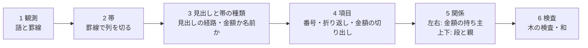

# 団体ごとの変換器を、罫線・見出し・字下げ・金額の和で木を組む共通の段に置き換える

担当者: wwwyo / Claude
更新日: `2026-10-12`（全表の一覧を追加）
状態: Draft（試作と計測まで。採用・置き換えは未決）

## Summary

PDF の決算書・予算書を、ノードの表と金額の表（[ADR 0020](../../adr/0020-ingestion-outputs-node-tables.md)）にする変換器は、今は団体ごとに手で書いている（約14個、各数百〜千行）。座標の数値・列名・行の数え方が変換器に埋まり、団体を足すたびに一つ書く。

この文書は、変換を団体共通の6つの段（観測→帯→見出しと帯の種類→項目→左右と上下の関係→検査）に分け、団体・表ごとの設定を「頁の範囲」だけにする設計と、その試作の計測結果をまとめる。試作は `pipeline/ingestion/generic/` にある。

結果の要点は次のとおり。

- **規則だけの流れ（A）で、新宿区・立川市の一般会計（決算・歳出）を既存の変換器とほぼ同じに組めた。** 新宿は款項目・備考・金額が全件一致し、木の検査も通る。立川は款項目・節・款項目の金額が全件一致し、備考（3〜4段の説明の木）は 96.2%、目より下の金額は 98.5%。設定は頁の範囲だけで、座標・列名・段の名前は一つも書いていない。Jev の費用は0。
- **金額の和で木を決める流れ（S）は、木を決める主役ではなく検証と曖昧さの解消に向く。** 番号の文法で候補を絞ると、款項目の並びは和で閉じ、親の正解は 新宿 191/194・立川 141/142。外れは金額0が並ぶ所に残る。番号の制約が無い和だけの探索は、長い並びで組み合わせが爆発する（状態数30万の上限を超える）。備考の区画は、和だけで閉じるのが 65/101、番号で絞ると 79/101。閉じた区画の木は A の木と一致した。
- **行の役割を Jev が選ぶ流れ（B）は、A と同等で、上回らなかった。** 立川の備考は 7001/7290（A は 7012）、費用は2団体で $0.11。A の規則は新宿・立川を見ながら足したので、未調整の団体で B が効くかは未確認である。
- **中央区（131024）は A で 0 件一致だった。** 科目が1列で段を「(款)(項)(目)」の接頭で示し、事業説明は予算の列の罫線が切れた下の自由な枠に、字下げと金額の位置で並ぶ。これに要る段（罫線の切れ目で領域を分ける・接頭で段を決める・自由な枠の木）は未実装で、残る難所の筆頭である。

推奨は「A を骨格に、各区画の木を和で確かめ、和で閉じない所だけ番号と字下げで決め、それでも残る所を Jev に回す」流れである（[推奨の流れ](#推奨の流れ)）。決めたいのは、この流れで既存の変換器を置き換えていくか、置き換えの順序と、残る難所への手当て（[未決](#未決)）である。

## Goals / Non-Goals

- Goal: 団体・表ごとの手書きの分岐を足さずに、決算書の表からノードの表と金額の表を作る段を設計する。人が書くのは採用する表（頁の範囲・表の種類）だけにする。
- Goal: 各段を規則で行うか Jev の判定で行うかを、段ごとに理由とともに決める。
- Goal: 試作の出力を既存の表と突き合わせ、指標と費用で比べる。
- Non-Goal: 既存の変換器・`node_tables.py`・`pipeline/shared/`・dbt の変更（#103 が触っている）。
- Non-Goal: R2 への保存・採用。試作の出力は `pipeline/.cache/generic/` に置く。
- Non-Goal: scan PDF の OCR そのもの。観測の段は OCR の語と座標を受け取る形にするが、試作では text PDF だけを通した。

## Background

既存の変換器は、測った座標で列を切る（例: 新宿の `DETAIL_EDGES`）、行頭の番号の x 範囲で款・項・目を決める、備考の番号の桁数で項目を見分ける、といった規則を団体ごとに書いている。規則の種類はどの団体もほぼ同じで、違うのは数値と列名である。決算事項別明細書は地方自治法施行規則の様式で、款・項・目・予算現額の内訳・節・支出済額・翌年度繰越額・不用額・備考という列の並びは団体をまたいで共通している。

ユーザーの見立ては「セルが認識できれば、前後左右のセルとの関係から木を組める」である。左右の関係（同じ行のラベルと金額、どの金額の列か）と上下の関係（字下げ・番号の形・前の行との親子）が分かれば、款→項→目→説明・節の木と各ノードの金額が決まる。決算書には、親の金額が子の金額の和に一致するという強い制約もある。

## Design

### 段の分け方



| 段 | やること | 規則 / Jev | 理由 |
| --- | --- | --- | --- |
| 1 観測 | Poppler の語（`pdftotext -bbox`）と、pdfplumber の罫線（線と、暗い色の細い塗り）。白い背景の塗りは罫線にしない | 規則 | 抽出は決まった処理。scan PDF は OCR の語と、画像から取った罫線に差し替える |
| 2 帯 | 本文まで伸びる縦罫線の間を帯にする。横罫線が渡っていない隙間は表の外。左端の帯が金額の頁は、前の頁の行の続き（見開き）として横に並べて一つの論理頁にする | 規則 | 幾何の事実。見開きの対応は行の罫線の高さが左右で一致する |
| 3 見出し | 最初の数字より上の全幅の横罫線を見出しの下端とする。見出しの語を罫線で囲まれた枠ごとにまとめ、帯を覆う枠を上から積んで見出しの経路にする（「予算現額／当初予算額」）。帯の種類は、文書全体で同じ経路の帯の行に文字があるか・桁区切りの数字か・0だけかで決める | 規則 | 見出しは印字の事実。種類は文書全体の多数決で、空の継続頁でも同じになる |
| 4 項目 | 帯を、款・項・目の帯（科目の軸）と、それ以外の名前の帯（節・備考などの軸）にまとめ、行を項目にする。番号の切り出し、折り返し、金額の切り出し、括弧書き・金額の種類の行の扱い | 規則（試作 B では一部を Jev） | 番号・字下げ・金額の列は幾何で決まる。曖昧なのは番号の無い行の役割だけ |
| 5 関係 | 左右: 金額の帯の金額は、同じ罫線の行にある、左隣の名前の軸の項目のもの。上下: 科目は番号が始まる款・項・目の帯で段を決める。他の軸は名前の始まりの字下げを文書全体で段に分け、開いている浅い項目を親にする。根は開いている科目の項目の子 | 規則（試作 S では和、B の延長で Jev） | 左右は同じ行の帯の関係で一意に決まる。上下の曖昧さは和で確かめられる |
| 6 検査 | `check_tree` で全段の子の和を確かめる。金額の段階は共有辞書を見出しの末尾から引く | 規則 | 既存の検査をそのまま使う |

### 各段の規則（団体によらない）

新宿・立川を通すために足した規則は、すべて団体名・座標・列名を含まない。主なものと、それが解いた原典の作りを挙げる。

- **語を罫線で割る（見出しだけ）**: 立川の見出し「款項」は一語で2つの帯にまたがる。本文の語は割らず、語の始まりがある帯に入れる（「10」が狭い款の帯からはみ出しても一つの番号のまま）。
- **科目の行は番号の単位で項目にする**: 続きの頁は「1 1 1」「10 2 3」と番号だけを並べる。立川は新しい目が「3 2 1」の番号行の上下に名前を2行で印字し、款の名前は頁上部の「款（7）商工費」にしか無いことがある。番号で始まる語の並びが別の帯に入るごとに項目を分け、同じ罫線の枠の番号の無い行は一番深い番号の名前にし、名前の無い新しい款・項は頁上部の見出しから補う。前の項目と番号が同じ番号だけの行は、継続頁の再掲として同じノードにする。
- **合計の行**: 番号が無く「合計・総計・計」の行は合計として、その行の金額を木に入れない。
- **番号か名前か**: 「3歳児健康診査委託料」は番号ではない。行頭の数字を番号と読むのは、文書全体でその左端（または右端）の位置から始まる行の多くが番号を持つときだけにする。
- **金額の切り出し**: 行末の金額は名前と離れていれば別の語、くっついていれば（「…】112,408,043」が語の途中で切れていても）文字の位置で割る。負号「△」が上の行に印字されていれば次の数字に付ける。
- **折り返し**: 番号の無い行は、前の項目に金額がまだ無く、同じ罫線の枠にあり、名前の始まりと揃っていれば前の名前の続き。立川の長い事業名は2行目（【所管課】と金額）を1字下げて印字し、子の項目と字下げが同じになる。これは**金額の右揃えの列**で見分ける。段ごとに金額を印字する列が決まっている（立川は右端から 0・2・4 字）ので、文書全体で「段→金額の列」を学び、2行目の金額が上の項目の段の列にあれば折り返しとする。
- **金額の種類の行**: 「繰越明許費 302,000」「不用額 …」は、上の項目の金額の内訳で、見出しを「備考／繰越明許費」として上の項目に付ける。語彙は共有辞書の見出しと、繰越・不用額の語。括弧で囲まれた行（「（翌年度へ繰越明許費 …）」）は上の項目の名前の続きにする。
- **注記**: 科目の行（款・項・目の罫線の行）に印字された番号の無い備考と、「流用・充用・予備費支出・第n節へ・第n款…」で始まる行は、その科目の注記とし、金額は「備考／注記／<原文>」の見出しで科目のノードに付ける。新宿の「前年度繰越事業費不用額」もこれになる。
- **並べる順**: 科目の項目は、名前の印字位置ではなく、その行の罫線の上端で開く。立川は目の名前を行の中央に印字するので、名前より上に印字された説明が前の目に付いてしまうのを防ぐ。

### 金額の和で木を決める段（S）

読む順の並びは木の前順の走査なので、木は「各括弧の先頭の金額が直下の子の金額の和に等しく、根の和が目の金額に等しい」括弧付けである。`sums.py` はこれを動的計画法で探し、閉じる括弧付けの数を（2で打ち切って）数える。子孫は先祖の金額を超えないので、先頭より大きい金額が出たらその部分木は終わる、という枝刈りを入れる。

| モード | 候補の絞り方 | 複数あるときの選び方 |
| --- | --- | --- |
| sum | なし | 子を持たせる方を先に選ぶ |
| code+sum | 兄弟は番号の有無がそろい、番号は増える | 同上 |
| indent+sum | なし | A の字下げの木に近い方 |

和で閉じない区画は、A の木を残すか（else geometry）、平らに置く（else flat、単独の成績を見るため）。

### Jev で行の役割を選ぶ段（B）

番号の無い備考の行だけについて、区画の行（文字・字下げの文字数・金額・金額の右端の内側の文字数・番号）を state にし、行ごとに Choice（新しい項目／前の名前の続き／前の項目の金額の種類／注記）を問う。番号・罫線・科目の行・金額の持ち主は規則のまま。モデルは `jev-1.13.0` に固定し、答えは要求のハッシュで `.cache` に保存して再実行では呼ばない。

## 試した流れの比較

実測 2026-10-12。2025年度決算・歳出・一般会計。正解は既存の変換器の出力（#103 の候補、`.agent/w3c/final/<対象>/inspection/`）。ノードは根からの（軸・番号・名前）の経路が一致したとき一致とする（番号・名前・すべての先祖が合う）。名前は NFKC と空白の除去の後で比べる。金額は（ノードの経路・金額の段階・値）で比べ、段階は共有辞書で引き、辞書に無い見出しは印字の経路で比べる。新宿の「歳出総括」の金額（総括表 p3 から既存の変換器が補った値）は、試作が総括表を読まないので比較から外した。

### 新宿区 131041（p65–147、83頁）

| 指標 | A 規則 | B Jev | S（3通りとも） |
| --- | --- | --- | --- |
| 款項目のノード | 194/194 | 194/194 | 194/194 |
| 備考のノード（再現 / 適合） | 931/931 / 931/931 | 931/931 / 931/931 | 931/931 |
| 款項目の金額 | 1552/1552 | 1552/1552 | — |
| 備考の金額 | 931/931 | 931/931 | 931/931 |
| 注記の金額 | 11/11 | 7/11 | — |
| 木の検査 | 通過（1127組一致） | 通過（1126組） | 140区画すべて一意に閉じる |
| Jev | 0 | 106要求・32.5万トークン・$0.014・28秒 | 0 |

節の軸（1159ノード）も出しているが、既存の変換器は節の一覧を保存していない（観測としてローカルに残すだけ）ので比べていない。

### 立川市 132021（p82–441、見開き180組）

| 指標 | A 規則 | B Jev |
| --- | --- | --- |
| 款項目のノード | 142/142 | 142/142 |
| 節のノード | 786/786 | 786/786 |
| 備考のノード（再現 / 適合） | 7012/7290（96.2%）/ 7012/7117（98.5%） | 7001/7290（96.0%）/ 7001/7097（98.6%） |
| 款項目の金額 | 1136/1136 | 1136/1136 |
| 目より下の金額（再現） | 10337/10499（98.5%） | 10299/10499（98.1%） |
| 木の検査（組の一致 / 不一致） | 3547 / 46 | 3509 / 93 |
| Jev | 0 | 259要求・229万トークン・$0.096・80秒 |

備考の不一致の主なものは、(1) 括弧書きの繰越の注記を正解は名前に含めたり別のノードにしたりしていて一定でない、(2) 3段目の名前の折り返しで金額の列が段の列とずれる行、(3) 4段目の項目（正解で6件）の字下げが3段目の折り返しと同じ位置にある所。

和の段の比較（備考、101区画）:

| モード | 一意に閉じる | 複数 | 閉じない | 上限超え | 備考（閉じない区画は A） | 備考（閉じない区画は平ら） |
| --- | --- | --- | --- | --- | --- | --- |
| A（字下げ） | — | — | — | — | 7012 | — |
| sum | 65 | 4 | 9 | 23 | 7009 | 3059 |
| code+sum | 79 | 5 | 17 | 0 | 7007 | 5015 |
| indent+sum | 65 | 4 | 9 | 23 | 7012 | 3062 |

款項目の並び全体（新宿194・立川142）を和で組むと、sum は状態数の上限（30万）を超え、code+sum は閉じて2通り以上が残り、親の正解は 191/194・141/142 だった。外れは金額0の款・項・目（予備費など）が並ぶ所で、0 はどこにでも置けるため和では決まらない。

### 中央区 131024（p96–163）

A の規則のままでは 0 件一致。崩れる箇所は次の3つで、いずれも規則の追加で扱える種類のものだが、試作では実装していない。

1. 表の枠内の題字（「歳」「出」）を見出しと読み、見出しの経路が「歳／科目」になる。
2. 科目は1列で、段は「(款)」「(項)」「(目)」の接頭で示す。款・項・目の帯が無いので科目の軸にならない。
3. 事業説明は、款・項・目の行の下で予算の列の縦罫線が切れた自由な枠に、字下げと金額の位置（「126,549,974 円」のように円付き）で並ぶ。人数・回数（「11 人」「4回」）や小さな表（委員会名と回数）が混ざる。帯を縦罫線だけで切ると、この枠の語が予算の列に割り振られる。

### 時間・資源

観測（Poppler と pdfplumber）は新宿83頁で約55秒、立川360頁で約2分。観測は JSON にキャッシュし、規則の再実行は数秒〜数十秒。和の段は立川の備考で約40秒。Jev は合計 $0.11（上限 $5）。

## 全表に案A を当てた一覧

実測 2026-10-12。案A（規則を足さない試作のまま、Jev なし）を、#103 の候補にある保存対象の text PDF の全45表に当てた（scan PDF の 132055・132101 は対象外）。表・原典・頁は機械的に取った。頁は表ごとの coverage の記録（変換器が処理した頁）から取り、記録の無い5表（132012 の3表・132063・132071 当初予算。一覧の※）は正解の表に記録された頁の最小〜最大にした。正解は候補の `*-nodes.parquet`・`*-amounts.parquet`。同じ原典・頁の表（明細と備考の2表など）は1回の生成を共有する。

指標は「再現 / 適合」。款項目はノードの一致、目の金額は目のノードの金額（段階・値）の一致、目より下は**正解が持つ軸**に限ったノードと金額の一致である。正解が持たない軸（既存の変換器が保存していない節の一覧や、同じ頁の別の表の軸）の生成は「上乗せ」として分け、誤りに数えない。木の検査は `check_tree` で、「問題」は見出し・単位・金額の原文を解決できないノードの数。

分類は次のとおり。(a) は指示の条件（款項目・目の金額が100%、木の検査が通る）に、正解の軸の目より下も全件一致を加えた。

- (a) そのまま置き換えられる: 款項目・目の金額・目より下が全件一致し、木の検査が通る。
- (b) 少しの差: 款項目と目の金額がおおむね合い（再現 90% 前後以上）、差の原因が1つに絞れる。
- (c) 合わない: 原因の型で分ける（接頭の段・自由な枠・見開き・その他）。

### 結果

| 分類 | 件数 | 表 |
| --- | --- | --- |
| (a) | 3 | 132021 駐車場（明細・備考）、132021 後期高齢（明細） |
| (b) | 14 | 131041 の4表、131105 の4表、131148 一般・土地、132021 一般（明細・備考）・後期高齢（備考）、132128 後期高齢 |
| (c) | 28 | 131024 の4表、131148 介護・後期・国保、131156 の8表、131172 の4表、132012 の3表、132039、132063、132217、132071 の3表 |

(c) の原因の型: 接頭の段 4（131024）、自由な枠 3（132012 の事務報告書）、見開き 3（131148）、その他 18（テキスト層の字の崩れ 8: 131156、二重印字 4: 131172、番号と名前が別の欄 2: 132063・132217、公営企業の番号の無い科目 2: 132071、縦書きの款項 1: 132039、当初予算書の様式 1: 132071）。

所要時間は2プロセスで全体 約2分53秒（観測から木の検査・評価まで。生成は38回・計1,753頁）。最大の表は 132021 一般会計の66秒、新宿一般会計の29秒。

(b) の差のうち、規則を足さずに解ける見込みのものがある。131041 の4表は、coverage の頁に総括表の頁が入って総括の款が単位なしで重複するだけで、詳細の頁だけを渡せば一般会計では検査も通った（[試した流れの比較](#試した流れの比較)）。採用する頁を「表の種類」として選ぶ人の判断（総括を含めない）で (a) になる。

### 表ごとの指標

| 表 | 頁 | 款項目 | 目の金額 | 目より下（正解の軸） | 目より下の金額 | 上乗せ（軸・ノード） | 木の検査 | 秒 | 分類 | 原因 |
| --- | --- | --- | --- | --- | --- | --- | --- | --- | --- | --- |
| 131024/chuo-care-settlement | 203–214（12） | 0.0% / 0.0% | 0.0% / 0.0% | 0.0% / 0.0% 事業説明:0/82 節:0/3 | 0.0% / 0.0% | A・予備費支出・備考・当初予算額・繰越事…（5軸） 68 | 不一致 0・問題 52 | 2.8 | c | 接頭の段: 科目が1列で段を「(款)(項)(目)」で示す。事業説明は罫線の切れた自由な枠。枠内の題字を見出しと読む |
| 131024/chuo-general-settlement | 96–163（68） | 0.0% / 0.0% | 0.0% / 0.0% | 0.0% / 0.0% 事業説明:0/1555 節:0/1 | 0.0% / 0.0% | %・A・予備費支出・予算現額計A・備考・…（9軸） 1658 | 不一致 0・問題 596 | 14.4 | c | 接頭の段: 科目が1列で段を「(款)(項)(目)」で示す。事業説明は罫線の切れた自由な枠。枠内の題字を見出しと読む |
| 131024/chuo-kokuho-settlement | 178–187（10） | 0.0% / 0.0% | 0.0% / 0.0% | 0.0% / 0.0% 事業説明:0/50 節:0/3 | 0.0% / 0.0% | A・予備費支出・補正予算額 49 | 不一致 0・問題 41 | 2.2 | c | 接頭の段: 科目が1列で段を「(款)(項)(目)」で示す。事業説明は罫線の切れた自由な枠。枠内の題字を見出しと読む |
| 131024/chuo-kouki-settlement | 225–229（5） | 0.0% / 0.0% | 0.0% / 0.0% | 0.0% / 0.0% 事業説明:0/15 節:0/2 | 0.0% / 0.0% | A・予備費支出・補正予算額 32 | 不一致 0・問題 24 | 1.2 | c | 接頭の段: 科目が1列で段を「(款)(項)(目)」で示す。事業説明は罫線の切れた自由な枠。枠内の題字を見出しと読む |
| 131041/general-expenditure-detail | 3–147（84） | 100.0% / 100.0% | 100.0% / 100.0% | 100.0% / 100.0% 備考:931/931 | 100.0% / 100.0% | 節 1159 | 不一致 0・問題 13 | 29.1 | b | 款項目・金額・備考は全件一致。coverage に総括表の頁が入り、総括の款が単位なしで重複して木の検査に問題が出る（詳細の頁だけなら通過を確認済み: 一般会計） |
| 131041/kaigo-expenditure-detail | 162–177（9） | 100.0% / 100.0% | 100.0% / 100.0% | 100.0% / 100.0% 備考:50/50 | 100.0% / 100.0% | 節 77 | 不一致 0・問題 6 | 3.5 | b | 款項目・金額・備考は全件一致。coverage に総括表の頁が入り、総括の款が単位なしで重複して木の検査に問題が出る（詳細の頁だけなら通過を確認済み: 一般会計） |
| 131041/kokuho-expenditure-detail | 149–160（8） | 100.0% / 100.0% | 100.0% / 100.0% | 100.0% / 97.6% 備考:40/40 | 100.0% / 100.0% | 節 50 | 不一致 0・問題 6 | 2.3 | b | 款項目・金額・備考は全件一致。coverage に総括表の頁が入り、総括の款が単位なしで重複して木の検査に問題が出る（詳細の頁だけなら通過を確認済み: 一般会計） |
| 131041/kouki-expenditure-detail | 179–186（4） | 100.0% / 100.0% | 100.0% / 100.0% | 100.0% / 100.0% 備考:19/19 | 100.0% / 100.0% | 節 24 | 不一致 0・問題 5 | 1.3 | b | 款項目・金額・備考は全件一致。coverage に総括表の頁が入り、総括の款が単位なしで重複して木の検査に問題が出る（詳細の頁だけなら通過を確認済み: 一般会計） |
| 131105/elderly-medical-setsu | 128–133（6） | 100.0% / 100.0% | 90.0% / 100.0% | 67.9% / 67.9% 節:19/28 | 56.5% / 67.9% | — 0 | 不一致 0・問題 52 | 1.5 | b | 支出済額の欄が帯にならず目の支出済額が欠ける。節の字下げが2段に割れ、節の下に節が付く。頁に単位表記が無く単位を取れない |
| 131105/general-setsu | 42–91（50） | 100.0% / 100.0% | 89.8% / 100.0% | 62.0% / 62.0% 節:537/866 | 51.7% / 62.0% | 備考 2 | 不一致 0・問題 1032 | 18.2 | b | 支出済額の欄が帯にならず目の支出済額が欠ける。節の字下げが2段に割れ、節の下に節が付く。頁に単位表記が無く単位を取れない |
| 131105/long-term-care-setsu | 150–159（10） | 100.0% / 100.0% | 90.0% / 100.0% | 76.7% / 76.7% 節:46/60 | 63.9% / 76.7% | — 0 | 不一致 0・問題 108 | 2.9 | b | 支出済額の欄が帯にならず目の支出済額が欠ける。節の字下げが2段に割れ、節の下に節が付く。頁に単位表記が無く単位を取れない |
| 131105/national-health-insurance-setsu | 107–115（9） | 100.0% / 100.0% | 90.0% / 100.0% | 86.0% / 86.0% 節:43/50 | 71.7% / 86.0% | — 0 | 不一致 0・問題 102 | 2.4 | b | 支出済額の欄が帯にならず目の支出済額が欠ける。節の字下げが2段に割れ、節の下に節が付く。頁に単位表記が無く単位を取れない |
| 131148/care-insurance-setsu | 234–245（12） | 80.8% / 84.0% | 69.2% / 100.0% | 0.0% / 0.0% 節:0/45 | 0.0% / 0.0% | 予算現額 45 | 不一致 9・問題 0 | 1.8 | c | 見開き: 組がずれて款項目の行と金額の行が合わない（一般会計と同じ作り）。節の見出しが左右に割れる |
| 131148/general-setsu | 106–145（40） | 97.8% / 98.9% | 96.4% / 100.0% | 0.0% / 0.0% 節:0/531 | 0.0% / 0.0% | 予算現額・備考 534 | 不一致 5・問題 0 | 6.8 | b | 見開きの組が1頁ずれる所がある（最初の頁が右頁だけ）。節の見出しが左右の頁に割れて軸名が「予算現額」になる |
| 131148/land-setsu | 156–157（2） | 100.0% / 100.0% | 100.0% / 100.0% | 0.0% / 0.0% 節:0/2 | 0.0% / 0.0% | 予算現額 2 | 通過 | 0.9 | b | 見開きの組が1頁ずれる所がある（最初の頁が右頁だけ）。節の見出しが左右の頁に割れて軸名が「予算現額」になる |
| 131148/late-elderly-medical-setsu | 204–209（6） | 66.7% / 85.7% | 0.0% / 0.0% | 0.0% / 0.0% 節:0/3 | 0.0% / 0.0% | 予算現額 3 | 不一致 5・問題 0 | 1.1 | c | 見開き: 組がずれて款項目の行と金額の行が合わない（一般会計と同じ作り）。節の見出しが左右に割れる |
| 131148/national-health-insurance-setsu | 178–189（12） | 87.5% / 90.3% | 84.2% / 100.0% | 0.0% / 0.0% 節:0/44 | 0.0% / 0.0% | 予算現額 44 | 不一致 5・問題 0 | 1.7 | c | 見開き: 組がずれて款項目の行と金額の行が合わない（一般会計と同じ作り）。節の見出しが左右に割れる |
| 131156/care-insurance-expenditure-details | 35–44（10） | 44.4% / 40.0% | 7.3% / 21.5% | 18.0% / 18.0% 節:11/61 | 12.3% / 17.4% | 予備費支出及び流用増減・考備・補正予算額 239 | 不一致 29・問題 0 | 1.4 | c | その他（テキスト層）: 数字が1字ずつ離れて印字され金額にならない。見出しの字順が崩れる（「算予現額」「考備」「八刀区」） |
| 131156/care-insurance-expenditure-notes | 35–44（10） | 44.4% / 40.0% | 7.3% / 21.5% | 0.0% / 0.0% 備考:0/129 | 0.0% / 0.0% | 予備費支出及び流用増減・節・考備・補正予算額 300 | 不一致 29・問題 0 | 1.4 | c | その他（テキスト層）: 数字が1字ずつ離れて印字され金額にならない。見出しの字順が崩れる（「算予現額」「考備」「八刀区」） |
| 131156/general-expenditure-details | 1–160（160） | 83.9% / 83.3% | 24.9% / 81.2% | 78.0% / 78.0% 節:560/718 | 56.2% / 77.8% | 予備費支出及び流用増減・継続費及び繰越事…（5軸） 6804 | 不一致 405・問題 0 | 17.3 | c | その他（テキスト層）: 数字が1字ずつ離れて印字され金額にならない。見出しの字順が崩れる（「算予現額」「考備」「八刀区」） |
| 131156/general-expenditure-notes | 1–160（160） | 83.9% / 83.3% | 24.9% / 81.2% | 0.0% / 0.0% 備考:0/4293 | 0.0% / 0.0% | 予備費支出及び流用増減・節・継続費及び繰…（6軸） 7522 | 不一致 405・問題 0 | 17.3 | c | その他（テキスト層）: 数字が1字ずつ離れて印字され金額にならない。見出しの字順が崩れる（「算予現額」「考備」「八刀区」） |
| 131156/late-stage-elderly-expenditure-details | 54–59（6） | 57.1% / 54.5% | 10.9% / 23.3% | 33.3% / 33.3% 節:4/12 | 22.9% / 34.4% | 予備費支出及び流用増減・考備 40 | 不一致 7・問題 0 | 0.6 | c | その他（テキスト層）: 数字が1字ずつ離れて印字され金額にならない。見出しの字順が崩れる（「算予現額」「考備」「八刀区」） |
| 131156/late-stage-elderly-expenditure-notes | 54–59（6） | 57.1% / 54.5% | 10.9% / 23.3% | 0.0% / 0.0% 備考:0/24 | 0.0% / 0.0% | 予備費支出及び流用増減・節・考備 52 | 不一致 7・問題 0 | 0.6 | c | その他（テキスト層）: 数字が1字ずつ離れて印字され金額にならない。見出しの字順が崩れる（「算予現額」「考備」「八刀区」） |
| 131156/national-health-insurance-expenditure-details | 12–19（8） | 52.0% / 49.1% | 18.5% / 52.6% | 54.9% / 54.9% 節:28/51 | 39.7% / 55.5% | 予備費支出及び流用増減・考備・補正予算額 132 | 不一致 24・問題 0 | 1.2 | c | その他（テキスト層）: 数字が1字ずつ離れて印字され金額にならない。見出しの字順が崩れる（「算予現額」「考備」「八刀区」） |
| 131156/national-health-insurance-expenditure-notes | 12–19（8） | 52.0% / 49.1% | 18.5% / 52.6% | 0.0% / 0.0% 備考:0/82 | 0.0% / 0.0% | 予備費支出及び流用増減・節・考備・補正予算額 183 | 不一致 24・問題 0 | 1.2 | c | その他（テキスト層）: 数字が1字ずつ離れて印字され金額にならない。見出しの字順が崩れる（「算予現額」「考備」「八刀区」） |
| 131172/general-setsu | 53–94（42） | — | — | 0.0% / 0.0% 款項:0/169 節:0/933 | 0.0% / 0.0% | 不用事故繰越・予予算算現現額額・予算補正…（25軸） 3810 | 不一致 0・問題 2996 | 44.3 | c | その他（二重印字）: 文字が二重に印字され見出しが「予予算算現現額額」になり、帯が細かく割れる。科目の帯にならない |
| 131172/kaigo-setsu | 109–113（5） | — | — | 0.0% / 0.0% 款項:0/50 節:0/73 | 0.0% / 0.0% | 不用事故繰越・予予算算現現額額・予補正予…（13軸） 428 | 不一致 0・問題 299 | 4.9 | c | その他（二重印字）: 文字が二重に印字され見出しが「予予算算現現額額」になり、帯が細かく割れる。科目の帯にならない |
| 131172/kokuho-setsu | 99–102（4） | — | — | 0.0% / 0.0% 款項:0/56 節:0/48 | 0.0% / 0.0% | 不用事故繰越・予算額補正予算・予補正算額…（11軸） 293 | 不一致 0・問題 249 | 4.3 | c | その他（二重印字）: 文字が二重に印字され見出しが「予予算算現現額額」になり、帯が細かく割れる。科目の帯にならない |
| 131172/kouki-setsu | 118–119（2） | — | — | 0.0% / 0.0% 款項:0/23 節:0/26 | 0.0% / 0.0% | 不用事故繰越・予予算算現現額額・予算補正…（13軸） 179 | 不一致 0・問題 108 | 2.3 | c | その他（二重印字）: 文字が二重に印字され見出しが「予予算算現現額額」になり、帯が細かく割れる。科目の帯にならない |
| 132012/general-detail | 148–457（310）※ | 0.0% / 0.0% | 0.0% / 0.0% | — | — | (1)地域農業活性化推進事業478,30…（79軸） 798 | 不一致 24・問題 17 | 22.8 | c | 自由な枠: 主要な施策の成果・事務報告書（文章の中の金額と内訳）で、罫線の表ではない |
| 132012/kaigo-detail | 510–522（13）※ | 0.0% / 0.0% | — | — | — | (360,352,000)346,859…（8軸） 179 | 不一致 3・問題 1 | 1.5 | c | 自由な枠: 主要な施策の成果・事務報告書（文章の中の金額と内訳）で、罫線の表ではない |
| 132012/kouki-detail | 493–498（6）※ | 0.0% / 0.0% | — | — | — | (予算現額)当年度決算額1総務費主要な施…（4軸） 107 | 不一致 6・問題 0 | 1.0 | c | 自由な枠: 主要な施策の成果・事務報告書（文章の中の金額と内訳）で、罫線の表ではない |
| 132021/chushajo-expenditure-details | 508–511（4） | 100.0% / 100.0% | 100.0% / 100.0% | 100.0% / 100.0% 節:13/13 | 100.0% / 100.0% | 備考 32 | 通過 | 1.3 | a |  |
| 132021/chushajo-expenditure-notes | 508–511（4） | 100.0% / 100.0% | 100.0% / 100.0% | 100.0% / 100.0% 備考:32/32 | 100.0% / 100.0% | 節 13 | 通過 | 1.3 | a |  |
| 132021/general-expenditure-details | 82–443（362） | 100.0% / 100.0% | 100.0% / 100.0% | 100.0% / 100.0% 節:786/786 | 99.9% / 100.0% | 備考 7117 | 不一致 46・問題 0 | 66.4 | b | 備考の名前の折り返し・括弧書きの繰越注記の扱いの差（備考 96.2%）。木の検査 46 組不一致 |
| 132021/general-expenditure-notes | 82–443（362） | 100.0% / 100.0% | 100.0% / 100.0% | 96.2% / 98.5% 備考:7012/7290 | 97.9% / 97.9% | 節 786 | 不一致 46・問題 0 | 66.4 | b | 備考の名前の折り返し・括弧書きの繰越注記の扱いの差（備考 96.2%）。木の検査 46 組不一致 |
| 132021/kouki-expenditure-details | 570–575（6） | 100.0% / 100.0% | 100.0% / 100.0% | 100.0% / 100.0% 節:21/21 | 100.0% / 100.0% | 備考 80 | 通過 | 2.1 | a |  |
| 132021/kouki-expenditure-notes | 570–575（6） | 100.0% / 100.0% | 100.0% / 100.0% | 98.8% / 98.8% 備考:79/80 | 98.8% / 98.8% | 節 21 | 通過 | 2.1 | b | 備考 79/80（委託料の名前の折り返し1件） |
| 132039/kouki-expenditure-detail | 1–3（3） | 9.5% / 9.5% | 0.0% / 0.0% | 0.0% / 0.0% 節:0/18 | 0.0% / 0.0% | 備考 33 | 不一致 0・問題 72 | 0.7 | c | その他（縦書き）: 款・項の名前が狭い欄に縦書き。頁に単位表記が無い |
| 132063/kouki-setsu | 50–54（5）※ | — | — | 0.0% / 0.0% 款項目:0/23 節:0/26 | 0.0% / 0.0% | 備考・施策番号・計当初予算額補正予算額継…（3軸） 23 | 不一致 0・問題 67 | 1.1 | c | その他（番号と名前が別の欄）: 款項目の番号と名前が一つの見出しの下の別の欄。予算の内訳が1欄に縦積み |
| 132071/akishima-enterprise-expenditure-capital-detail | 30–31（2） | — | — | 0.0% / 0.0% 備考:0/14 款項:0/27 | 0.0% / 0.0% | — 0 | 不一致 0・問題 28 | 0.3 | c | その他（公営企業）: 款・項に番号が無く、科目の帯で段を決められない |
| 132071/akishima-enterprise-expenditure-revenue-detail | 24–28（5） | — | — | 0.0% / 0.0% 備考:0/41 款項:0/78 | 0.0% / 0.0% | — 0 | 不一致 0・問題 62 | 0.4 | c | その他（公営企業）: 款・項に番号が無く、科目の帯で段を決められない |
| 132071/akishima-text-budget-expenditure | 10–449（440）※ | 27.6% / 13.0% | 0.0% / 0.0% | 0.0% / 0.0% 本年度予算額の財源内訳:0/255 節:0/819 説明:0/5834 | 0.0% / 0.0% | その他・一般財源・千円・国都支出金・地方債 729 | 不一致 0・問題 7997 | 58.8 | c | その他（当初予算書）: 千円・財源内訳の欄・説明の欄の様式。款項目 27.6% |
| 132128/late-elderly-medical-setsu | 1–7（7） | 100.0% / 100.0% | 100.0% / 100.0% | 0.0% / 0.0% 説明:0/99 | 0.0% / 0.0% | 備考・節 122 | 不一致 14・問題 0 | 1.4 | b | 款項目・目の金額は全件一致。説明の軸名が正解は「説明」、印字は「備考」。木の検査 14 組不一致 |
| 132217/late-elderly-medical-setsu | 159–164（6） | 0.0% / 0.0% | 0.0% / 0.0% | 0.0% / 0.0% 備考:0/109 節:0/23 | 0.0% / 0.0% | — 0 | 不一致 9・問題 0 | 0.9 | c | その他（番号と名前が別の欄）: 款・項・目の番号の欄と、款項目共通の名前の欄が分かれ、名前を科目に結べない |

一覧は `all-tables/` のスクリプトで作り直せる（`targets.py` で対象を列挙し、`run.py` を2プロセスで回し、`summary.py` で集計する。原因と分類は `causes.json` に手で書いた）。

### 置き換えの方針への示唆

- 案A がそのまま効くのは、款・項・目が罫線の帯に分かれ、説明が列にある作り（立川・新宿）に限られる。45表中 (a)+(b) は17表で、団体では 131041・132021・132128 がほぼそのまま、131105・131148 は1〜2個の共通の規則（欄の境の帯・見開きの組）で届く見込み（未検証）。
- (c) の28表のうち12表は「表の作り」ではなく「テキスト層」の差（131156 の字の崩れ、131172 の二重印字）で、観測の段の正規化（重なった同じ字を1つにする、1字ずつの数字をつなぐ）で解ける種類と見ている（未検証）。表の作りの差（接頭の段・番号と名前が別の欄・縦書き・自由な枠）は、それぞれ別の規則が要る。
- 132012（事務報告書）と 132071 当初予算書は、決算事項別明細書と別の資料の種類で、同じ流れに載せるかは資料の選定から見直す対象である。

## 推奨の流れ

1. **A を骨格にする。** 観測・帯・見出し・項目・左右の関係・科目の段は規則で決める。ここは幾何の事実で、Jev に回しても精度は上がらず、費用と再現性の管理が増える。
2. **各区画の木を和で確かめる（S を検証として使う）。** A の木が `check_tree` を通る区画はそのまま採る。通らない区画は、code+sum と indent+sum で閉じる括弧付けを探し、一意に閉じればそれに直す。閉じた区画の木は、出力が木の検査を必ず通る。
3. **和で決まらない所だけ他の手がかりで決める。** 金額0・同じ金額が並ぶ所は番号の文法（兄弟で番号の形がそろう・増える）と字下げで決める。それでも複数残る所と、和が閉じない区画（注記・金額の種類の行が混ざる）を Jev の Choice（行の役割、または親の候補の選択）に回す。B の結果からは、全行を Jev に回すより、残る所だけに絞る方がよい。
4. **閉じない区画は保存しない。** 今の保存の規則（未読・所属未確認・合計不一致の表は保存しない）のままにし、件数と頁を報告して人が見る。

団体・表ごとの設定は、頁の範囲（選定の scope にある）と資料区分だけにする。原典1冊の頁の作り（見開きか、科目が帯か接頭か、説明が列か自由な枠か）は、段2・3が文書全体の多数決で推定する。

## 残る難所

- **自由な枠の説明（中央区）**: 縦罫線の切れ目で領域を分け、罫線の無い枠では字下げと金額の右端の列で段を決める。人数・回数などの金額でない数字は、単位の語（人・回・件・㎡）で金額から外す。枠の中の小さな表は、その枠の罫線で別の表として切り出し、金額の木に入れない（[dbt の設計の未決](../fiscal-dbt-models/design-doc.md)「金額以外の印字」）。
- **科目が接頭で段を示す作り**: 「(款) 1 議会費」の接頭で段を決める規則を、帯で段を決める規則と並べて持つ。
- **見出しと題字の区別**: 表の枠の上端に題字の枠がある作りでは、見出しの下端の推定が題字を含めてしまう。見出しの枠を「下の帯をすべて覆う枠の列」に限ると避けられる見込み。
- **scan PDF**: 観測の段を OCR の語（`scan_ocr`）に替える。罫線は画像から取る必要がある（試作に無い）。OCR の語は Poppler より分割が粗く、帯への割り振りは語の始まりで行う今の方式が使える。単独の 0 を読めないことがある（Vision）ので、和の段は「読めない 0」を未知として扱う必要がある。
- **見開きの対応**: 試作は「左端の帯が金額なら前の頁の続き」で組む。左右で行の罫線の高さが一致することを確かめる検査を足すべき（今は確かめていない）。
- **節の行と目の行が同じ高さの作り**: 最初の節を目と同じ行に印字する団体では、その行の支出済額が目のものか節のものか、左右の関係だけでは決まらない。和（目の支出済額＝節の和）で決める。
- **正解の作り方の揺れ**: 既存の変換器どうしで注記・括弧書きの扱いが違う（新宿は流用の注記を目の金額として持ち、立川は落とす）。置き換えの前に、注記・括弧書き・金額の種類の行をどう出すかを一つに決める必要がある。

## 既存の変換器を置き換える道筋

1. 試作を `ingestion/lib/` の共通の変換器（`convert(inputs, destination, options)`）にし、options は頁の範囲と表の種類だけにする。出力は今の `write_tables` で保存前に検査する。
2. 新宿・立川の一般会計で、生成した表を既存の表と並べて差分を見る（この文書の評価をそのまま使う）。差が正解の揺れか誤りかを決め、注記・括弧書きの扱いを決める。
3. 同じ様式（款・項・目が帯、説明が列）の団体（131156 杉並・132012 八王子など）に当て、規則を足さずに通るかを測る。通らない所は規則を足す前に、和と Jev で直せるかを先に試す。
4. 中央区型（接頭・自由な枠）の段を足し、131024 に当てる。残る団体の作りは当てて分類する（未調査）。
5. 置き換えた団体の変換器と宣言を削除する。保存済みの表は、生成した表が木の検査を通り、既存の表と差分が説明できたものから入れ替える。

## Alternatives Considered

| 案 | 利点 | 採否 |
| --- | --- | --- |
| 団体ごとの変換器を書き続ける | 1団体の精度は高い | 団体を足すたびに数百行を書き、座標が埋まる。採らない |
| 全部を Jev に選ばせる（語ごとの役割） | 規則を書かない | 予備実験で段の正解は 54〜78%、1頁15万トークン。座標の数字から列や字下げを読ませるのは弱い。採らない |
| 和だけで木を決める | 字下げ・列の位置が崩れても数字が木を決める | 長い並びで探索が爆発し、0・同じ金額で決まらない。検証と曖昧さの解消に使う |
| 行の役割だけ Jev（B） | 未調整の作りに強い見込み | 調整済みの2団体では A と同等。残る所に絞って使う |
| VLM に頁画像から表を書かせる | 自由な配置にも強い | 金額の桁の誤りを検出する手段が和しか無く、再現性・費用の管理が難しい。今回は比べていない |

## Validation / Rollout

再現の手順（原典はローカルキャッシュ、正解は #103 の候補の表を読むだけ）:

```bash
S=<原典のキャッシュ>/fiscal/source-selection
F=<#103 の候補>/.agent/w3c/final
uv run python -m ingestion.generic.build $S/131041/2025/settlement.pdf 65-147 .cache/generic/131041 --table general
uv run python -m ingestion.generic.evaluate .cache/generic/131041/general \
  $F/131041-2025-settlement-expenditure/inspection/general-expenditure-detail --exclude-header 歳出総括
uv run python -m ingestion.generic.build $S/132021/2025/settlement-1.pdf 82-441 .cache/generic/132021 --table general
uv run python -m ingestion.generic.evaluate .cache/generic/132021/general \
  $F/132021-2025-settlement-expenditure/inspection/general-expenditure-details \
  $F/132021-2025-settlement-expenditure/inspection/general-expenditure-notes
uv run python -m ingestion.generic.sums .cache/generic/132021/general <同じ正解>   # 和の3通り
uv run python -m ingestion.generic.build ... --jev                                  # B（サンドボックス外。key は mise）
```

単体テストは `ingestion/generic/generic_test.py`（罫線の統合、金額の切り出し、科目の番号行の分け方、和の括弧付け）。

## 未決

- この流れ（A を骨格に S で検証し、残りを Jev）で既存の変換器を置き換えていくか。
- 注記・括弧書き・金額の種類の行の出し方（正解の揺れの解消）。
- 中央区型の段を、次に実装するか、同じ様式の団体の置き換えを先にするか。
- 依存に pdfplumber（罫線の取得）を足した。scan PDF の罫線を画像から取る手段（OpenCV など）を足すかは、scan PDF に当てるときに決める。
