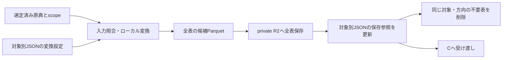

# 選定済み原典から作る取り込み表を管理する

担当者: wwwyo / Codex
更新日: `2026-10-11`
状態: Accepted（保存経路を実装済み。旧経路と移行済みの旧表は削除した）。2026-10-11 に取り込み表の形をノードの表と金額の表へ改め、管理JSONの PDF の表を移行した（ADR 0020）

## Summary

原典はsource_selectionの非公開R2領域に保存し、取り込みParquetは原典対象と方向ごとの固定keyに保存する。Gitでは同じ対象の変換設定と保存済み表を一つのJSONで管理する。構造はJSON Schema、ファイルの配置・表の所有者・原典との対応は実行時の検査で強制する。

変換は受け取ったCSV/PDFと対象情報を使う。全表をローカルで準備し、全アップロード成功後にJSONを更新する。その後、対象と方向が同じ領域の不要な表を削除する。現在版だけを保存し、別年度・別補正号は別対象として保持する。

## Goals / Non-Goals

- 原典、使用する会計・頁範囲、変換コード、保存された表を対応付ける。
- 複数ファイル・複数会計・複数表を一つの対象に登録できるようにする。
- 未完成の保存、重複する表ID、対象外の原典・保存先を検査で拒否する。
- dbtのモデル、全年度の収録完了はこの設計に含めない。

## Background

対象と原典の選定は [source_selection/schema.ts](../../../pipeline/source_selection/schema.ts) が管理する。対象は団体・年度・資料区分・補正号、会計と方向と物理頁は原典ファイルのscopeである。Bは選定を再判断せず、選定済みかつ保存済みの原典を使う。

dbt（C）へ保存済みParquetを渡す入力連携は `pipeline/dbt/scripts/prepare.py` が行う。対象別JSONと保存済みParquetを読み、SHA・行数を検査して warehouse の `ingestion` schema に置く（[dbt の設計](../fiscal-dbt-models/dd.md)）。取り込みのCLIは対象別JSONの検査と保存済みParquetの復元（`ingestion:restore`）を行う。

## Design



### 対象のJSONと書式のコードを近くに置く

```text
pipeline/ingestion/
  lib/                           # CSV、座標、OCR（scan_ocr）、Parquet
  selection.ts                   # 上流の選定とローカル原典の照合
  fiscal/
    manifest.schema.json         # 管理JSONの正本
    manifest.py                  # schemaと対象間の制約、fingerprint
    run.py                       # 変換、保存、復元、掃除、合計検査、指紋の更新の入口
    refresh.py                   # 指紋が古い表を再変換し、保存済みの表と中身で比べる
    storage.py                   # private R2への入出力
    layouts/
      csv/                       # convert.py + options.schema.json
      statement/                 # 見開き表の共通読み取り
    jurisdictions/
      132071/
        README.md
        layouts/<書式>/          # 団体固有のコード・訂正・宣言
        2025/settlement/expenditure.json
```

対象別JSONは原典対象と方向の組ごとに作る。設定用 `config.toml` は必須にしない。JSONの `conversions` に使用する変換コード、入力SHA、書式設定、期待する表をまとめ、`tables` に保存参照を持つ。列名・型はParquetから取得し、管理JSONへ複製しない。

### 取り込み表はノードの表と金額の表の組で保存する

PDFの取り込みの表（表ID）一つは、原典に印字された項目を1行とするノードの表と、印字された金額を1行とする金額の表の組である。CSVの原典は対象外で、原文の行と1対1の表のまま保存する（[ADR 0020](../../adr/0020-ingestion-outputs-node-tables.md)）。末端の行に祖先の名称・金額を反復する横持ちの表は、新しい出力にしない。列の定義と、後段（dbt）が求める条件は [dbt モデルの設計](../fiscal-dbt-models/dd.md#取り込みの出力-ノードの表と金額の表) を正本とする。

- ノードの表は、親ノード、分解の軸（項目が印字された欄の原典の見出し）、軸の中での深さ、段の見出しの印字、番号・名称の原文、物理頁と印字範囲の座標を持つ。座標は表示頁の左上を原点とする PDF の point 単位に揃える。款・項・目のノードは同じ会計の各表に含め、各表を款を根とする木にする。
- 金額の表は、属するノード、金額が印字された欄の原典の見出し（上位から「／」で連結。必須）、金額と単位の原文、物理頁と印字範囲の座標を持つ。見開きでは、金額が属するノードと違う頁に印字されることがある。
- 同じ支出の独立した分解（節の一覧と事業の説明など）は、別の軸の枝にする。

表の単位で決まる事実は、Parquetの行に反復せず管理JSONの `tables[]` に置く。対象・方向・表ID・保存参照（SHA・サイズ・行数）に加えて、表が属する原典の会計名（`ingestion:check` で選定のscopeと照合する）と、原典由来の注記（`notes`）、読み取れなかった金額と所属を確認できない項目の件数を持つ。一つの表は原典ファイル一つから作る。原典ファイルのSHAは変換の `inputs` にあり、表へ複製しない。変換が複数の原典を受け取る場合は、表ごとにどの原典から作ったかを管理JSONに持つ。分冊をまたいで続く款・項・目は、各分冊の表に同じノードを置き、dbtで一つにまとめる。原典にない関係、単位の換算倍率、段の名前・金額の段階への対応、共通分類、集計方法は取り込みに入れず、dbtの宣言で扱う（[ADR 0021](../../adr/0021-level-and-phase-map-in-dbt-seed.md)）。

PDF の表は 2026-10-11 にノードの表と金額の表へ移行済みで、横持ちの表は使わない（[ADR 0020](../../adr/0020-ingestion-outputs-node-tables.md)）。横持ちの表と metadata からノードの表と金額の表を作る共通の変換は残し、新しい変換器はノードの表と金額の表を直接出す。CSV の原文の表は単一の `object` のままで、ノードの形への変換は dbt の intermediate で行う。管理JSONのschemaは旧形式を受け入れつつ、新形式では `nodes`・`amounts` にそれぞれ `object`（key・SHA・サイズ）と `row_count` を持つ。表には `account`・`notes`・`unread_amount_count`・`unresolved_parent_count` を置く。旧形式の `object`・`row_count`・`metadata` と新形式の2参照は混在させない。

管理形式は `schema_version: 1`。`expected_tables` は管理側が採用する表IDだけを持ち、変換器が生成した余分な補助表は採用しない。期待した表の欠落は停止する。支出額の集計に使わない補助表は管理JSONから外すが、R2の実体の削除は別の操作にする。後工程の `declaration`・`definition_files`・`legacy_path` はschemaで拒否する。`inputs` は原典SHAだけを保持する。形式・会計・ページ範囲はselectionから解決し、抽出をさらに絞る設定は変換器のoptionsに置く。取り込みfingerprintは原典・変換設定・取り込みコードから作り、dbtの宣言やモデルを含めない。

書式は年度・会計ごとに増やさない。設定値の違いで対応できる場合は同じコードを使う。別団体で同じ規則を使えることを確認した書式は `fiscal/layouts/` へ置く。団体固有の処理はその団体の `layouts/` に置き、歳入・歳出で規則が異なる場合は別の書式や設定を選ぶ。

### 構造と対象間の制約を保存前に検査する

管理JSONの正本は [manifest.schema.json](../../../pipeline/ingestion/fiscal/manifest.schema.json)、追加の制約は [manifest.py](../../../pipeline/ingestion/fiscal/manifest.py) である。変換器ごとに同じフォルダの `options.schema.json` で設定を検査する。JSONにschemaのパスを重複指定しない。skillに型の別定義を作らない。

JSON Schemaは未知の管理項目、型、識別子の文字を検査する。実行時にはJSONの正規配置、変換IDと表IDの重複、表の所有者、使用するコードの範囲、原典SHAの選定への所属と方向に対応するscope、R2 key、期待する全表の存在を検査する。表の保存情報は空、または期待した全表が揃った状態に限る。別のstatus項目は持たない。0行の表は現在対応しない。

一つの変換に複数の原典を渡してよく、複数の変換が同じ原典を使ってもよい。ただし一つの表は原典ファイル一つから作る。表IDは対象と方向の中で一意にし、同じ表を二つの変換へ所属させない。会計の区別が必要な表IDは安定した会計識別子と役割を含め、列挙順や原典SHAから毎回振り直さない。

手編集そのものをファイルシステムで禁止する仕組みではない。CLIとCIの `ingestion:check` が違反した登録を拒否する。これらの構造検査は、名称・金額・階層が原典通りであることの認定とは別である。

### 変換器は渡された原典からローカルの表を作る

変換器の入口は `convert(inputs, destination, options)` で、表IDとParquetのパスの対応を返す。新しい変換器は、表IDごとにノードの表と金額の表のパスと、表の会計名・notesを返す。移行前の横持ちの表を出す変換器は、パスの代わりに `{"path": path, "metadata": metadata}` を返せる。管理側はschemaと実際のParquet列への参照を検査し、表の保存情報へmetadataを含める。パスだけを返す既存の変換器も使える。再変換でmetadataを省略した場合、入力fingerprintとParquet SHAがともに同じなら既存metadataを保持し、変わっていれば古い情報を引き継がず、新しいmetadataの提出を要求して保存前に止める。入力には選定から解決した原典参照とscope、受け取った対象・方向、SHA照合済みのローカルパスが入る。変換器は原典の選定、Gitへの登録、R2への保存を行わない。

CSVは [csv/convert.py](../../../pipeline/ingestion/fiscal/layouts/csv/convert.py) を使う。金額のカンマや空文字を含め原文を保持する。text PDFとscan PDFは書式別のコードで表を組み立て、[conversion.py](../../../pipeline/ingestion/lib/conversion.py) と [parquet.py](../../../pipeline/ingestion/lib/parquet.py) を使う。scan PDFの文字・位置の取得は共通入口の [scan_ocr](../../../pipeline/ingestion/lib/scan_ocr.md) に任せる。既定はApple Visionで（[ADR 0019](../../adr/0019-freeze-scan-ocr-observations.md)）、PaddleOCR smallは `backend="paddle"` で選ぶ（[ADR 0018](../../adr/0018-paddle-small-for-scan-pdf.md)）。OCRは変換器の外で取得し、凍結した観測を補助入力として変換器へ渡す（[ADR 0019](../../adr/0019-freeze-scan-ocr-observations.md)。補助入力の保存・取得は未実装で、現在のscan PDFの変換器はローカルの凍結観測をパスで受け取る）。

ヘッダー付きCSVは変換後に原典を再読し、列名・順序・VARCHAR型、全セル値、行順・重複・空文字、追加の物理行範囲列をParquetと照合する。不一致では変換を失敗にし、検査で拒否した新規Parquetを除去して保存前に停止する。原典SHAは管理入口で変換前後に照合する。検査結果は候補dirの `<表ID>.checks.json` に再生成し、管理JSONのschemaは変更しない。この保持検査でCSVの取り込みを完了とし、合計一致や独立した再抽出を必須条件にしない。年度・会計・単位・段階の解釈は後段で確認する。PDFは同じ軸で子の金額の和と親の金額を全段で照合する。未読・所属未確認・構造の不整合・合計不一致がある表は保存しない。原典で金額の印字がない箇所は比較の対象から外す。注記金額は支出済額に足さず、備考欄の金額として保持する。

### 原典と現在の取り込み表をprivate R2で分ける

```text
fudoki-inputs/
  fiscal/source-selection/<団体>/<年度>/
    initial.csv
    settlement-1.pdf
    settlement-2.pdf
    supplementary-<号>.pdf
  fiscal/ingestion/<団体>/<年度>/<initial|settlement|supplementary-号>/
    expenditure/<表ID>-nodes.parquet
    expenditure/<表ID>-amounts.parquet
    revenue/<表ID>-nodes.parquet
    revenue/<表ID>-amounts.parquet
    # CSVと移行前のPDFは <方向>/<表ID>.parquet
```

原典のkeyはsource_selectionの保存記録を使い、Bで作り直さない。表は同じ役割の固定keyへ上書きする。方向が違えば同じ表IDでも衝突しない。表の保存参照にはSHA・サイズ・行数を記録する。列名・型はParquetから取得する。使用した原典のSHAは `conversions.inputs` で管理し、表ごとに複製しない。OCR・bbox・描画キャッシュは `.cache/` または `.agent/` に置き、Gitへ追加しない。

現在の保存実装はParquetごとの単一ファイルアップロードを使い、PDFの一つの表IDでは2ファイルを保存する。保存直前にも木の検査・単位の確かめ（款の和と印字の歳出合計、一般会計の桁。[ADR 0028](../../adr/0028-unit-check-in-the-save-gate.md)）・印字された数字の網羅の検査を行う（網羅は text PDF のみ）。移行後の横持ちの表の削除は自動では行わず、検査済みの2表を採用してから別に実行する。300MBを超えるParquetは保存前に停止する。multipartのR2保存は未実装である。scan PDFのOCR観測は、表より先に同じ領域の `ocr/<id>.json.gz` へ保存する（[ADR 0019](../../adr/0019-freeze-scan-ocr-observations.md)）。網羅検査の語の対象範囲（`<表ID>.coverage.json`）はローカルの候補に残し、R2へは保存しない。

### fingerprintで入力条件の変更を検知する

fingerprintは、対象・方向、使用した原典SHAとscope、変換設定、参照するコード・設定ファイルのハッシュから計算する。同じ原典でもコードや設定が変われば表を古いものと判定する。関連するローカルimportとコードに明記した設定ファイルを辿る。手動の依存指定は現在提供しない。

実行環境は管理JSONとfingerprintに含めない。OS・Python・DuckDBの版だけが変わっても再変換の判定は変わらない。

fingerprintは変更検知の仕組みである。固定keyへの上書きと保存参照の置換により、同じ入力の再実行で表が重複しない。OCRの出力が常に同じバイト列になることは保証しない。

fingerprintは「変わったかもしれない」という合図であり、表の中身が変わった証拠ではない。古いときは `ingestion:refresh` が変換をローカルでやり直し、保存済みの表と中身（列・型・行とその順序・値と、変換が管理JSONへ書くメタデータ）を比べる。全表が同じなら管理JSONの `input_fingerprint` だけを書き換え、保存済みのParquetとその `sha256`・サイズ、R2は変えない。違う表が1つでもあれば管理JSONは書き換えず、増えた・消えた・変わった行の数と例を出す。保存前の関門は `storage.prepare_save` を共有して当て直す。中身が違う表は、これまでどおり `ingestion:convert --remote` で全表を保存し直す。表を作らず合否だけを決める検査のコード（`tree_checks.py`・`coverage_checks.py`・`fiscal/unit_checks.py`）は `*_checks.py` と名付けて指紋の対象外とし、書き込みの関数・呼び出しがあれば `manifest.dependencies` が停止する。検査の戻り値で段のパターンを選ぶ汎用の組み立てだけは、`manifest.RESULT_SHAPES_TABLE` で `tree_checks.py` を指紋に残す。検査を厳しくしたときは保存済みの表が古く見えないので、`ingestion:verify --remote` を保存済みの全表に当てて確かめる。共有のコードを直す PR は、この比べ直しで指紋を更新した管理JSONを含める。判断は [ADR 0027](../../adr/0027-refresh-fingerprints-by-table-content.md)。

### 全表を保存してから管理情報を更新する

同じ対象・方向の変換、保存、読み取りは逐次実行する。局所再処理でも変更しない表の参照を残し、その入力条件が現在のままであることを確認する。

1. 全表をローカルで用意し、行数・列型・空表・期待する表集合を検査する。
2. 入力条件が変わっていないことを確認し、全表を固定keyへアップロードする。
3. 全保存成功後にGitの管理JSONを置換する。
4. 現在の管理JSONが変わっていないことを確認し、同じ対象と方向の領域を全ページ一覧取得する。参照されていない直下のParquetだけを削除する。
5. 後段は全表の存在・fingerprintと取得した表のSHAを検査して読む。

途中のアップロード失敗では管理JSONを更新せず、削除もしない。ただしR2の一部のkeyは上書き済みになり得る。後段は止め、同じ条件で全表を再保存する。更新の完了と掃除の完了は分け、掃除だけ失敗した場合は `ingestion:cleanup` を再実行する。世代切替や分散ロックを省くため、同時更新と読み取り中の更新には対応しない。

## Alternatives Considered

| 案 | 利点 | 採否 |
| --- | --- | --- |
| 内容ハッシュkeyと一つの入力一覧 | 全入力を一覧で固定できる | 対象ごとの現在版管理と掃除が難しいため採用しない |
| 世代ごとのkeyとcurrent切替 | 複数表の切替を原子的にできる | privateかつ逐次実行の範囲では管理が増えるため採用しない |
| 設定と保存情報を別JSONにする | 更新主体を分離できる | 対象ごとに確認する情報を一つにまとめる |
| 団体・年度ごとにコードを複製する | 例外を閉じやすい | 同じ書式の修正が分散するため、差を設定で表せる限り再利用する |

## Cross-Cutting Concerns

R2は非公開とし、認証を設定ファイルやGitへ平文で書かない。CLIは渡されたkeyを検査し、掃除の範囲を対象と方向で制限する。保存完了後の全ファイル読み戻しは必須にせず、アップロード前と利用時にSHA・サイズを確認する。

LLMのcontextへ表やOCRの全量を出さず、詳細はファイルへ、CLIの結果は件数とパスだけにする。CSV・PDF・scan PDFは入力形式の選択肢であり、順番に通す処理ではない。

## Validation / Rollout

`ingestion:check` をCIで実行し、全管理JSONの構造・選定との対応・保存済み表の入力条件と、合計検査の宣言の型を確認する。PDF表の合計は `ingestion:verify` で、R2の表を復元できる環境で確かめる（CIでは回さない）。変換テストでは複数原典、原文保持、対象・key・所有者の違反、局所再実行の欠落、アップロード失敗を検査する。

### text PDF の網羅検査の単位と非採用範囲

網羅の照合は原典PDFごとに行う。同じ原典の同じ物理頁を読む表は、同じ変換でも別の変換でも、採用した全表のノード・金額の印字位置を集めて照らす。木の検査は各表に個別に当てる。処理する語の範囲と金額欄の境界は表ごとの sidecar に残し、金額欄のある書式では既存の欄境界を使う。自由な位置に印字される説明の金額で欄境界がない場合は、金額行の範囲を使った帯であることを `bands_from` に明示する。

読んだが採用しない表・ブロックは、変換器の既存の読み分け（観測用の総括・節一覧・本文・経費内訳など）から実行時に語の頁・矩形を出す。人が定めるのは表の種類と採用しない理由だけで、検査から外す頁・x・yを手書きしない。種類の語彙は `node_tables.EXCLUSION_KINDS` に集約し、未知の種類・空の理由・不正な範囲は停止する。新しい非採用の判断は共通処理から自動で増やさない。非採用の範囲と重なる採用金額・項目の表示を先に照合し、非採用の件数と種類別内訳も検査結果に残す。

名称の中でも桁区切りや円の付いた金額の表記は、名称として網羅済みにしない。枠に重なる数字の断片がはみ出す場合は、同じ印字の断片をつないだ数字が採用金額と完全に一致する場合だけ照合済みにする。隣接するだけの数字は網羅済みにしない。分割された議決番号・年度や、数値のすぐ上の％の単位は、印字の位置と共通の非金額の書式が一致する場合に限って照合する。未網羅の数字は引き続き金額帯で保存を止め、帯の外では件数と例を報告する（後段の Jev の聞き直しが金額と読んだ数字は止める。[ADR 0026](../../adr/0026-jev-recheck-printed-digits-stop-only.md)）。

ラベルのない合計行は、同じ採用表で同じ親・軸・段に属する金額が同じ見出し・単位ごとに持つ和と照合する。全ての子の印字より後の行で、0以外の和が2列以上で一致するときだけ、その行の一致した列を網羅済みにする。1列だけの一致、0だけの一致、不一致の列は停止したままにする。独立した表の木を混ぜて合計を推測しない。

自由配置の金額で `bands_from=rows` を使う表は、列ごと落ちた金額を網羅の検査では検出できない。この場合も説明の軸の親子の和を木の検査で確認し、表ごとに帯の生成方法を報告する。

合計の和は、同じ親の全ての子、または同じ親の同じ頁の子で確かめる。2列以上で確かめた合計の直後に折り返された0以外の金額も、同じ和と一致する場合だけ網羅済みにする。「計」「合計」「小計」の印字が金額の左にある場合は、同じ親の採用金額の和と一致する0以外の列を照合する。0だけの一致で合計と認定しない。

Jev の聞き直しは、弱い規則で非金額として通した数字と、帯の外で報告だけに残った数字の2種類だけを、「表の項目の金額として取り込むべき値か」と聞く（`ingestion/lib/digit_recheck.py`、[ADR 0026](../../adr/0026-jev-recheck-printed-digits-stop-only.md)）。採用した金額・ノード・合計・宣言した非採用の範囲で説明がつく数字は聞かず、帯の中で止まっている数字は通さない。答えは入力の fingerprint と確率だけを `<方向>.digit-recheck.jsonl` に Git で保存し、再実行では API を呼ばない。答えも API key も無いときは止める。

金額の注記は「注記」軸のノードに原文を持たせ、金額の表に金額・単位・印字位置を保持する。`pipeline/shared/fiscal_annotation_map.csv` で種類を解き、「注記金額」にphaseは付けない。木の親子合計・支出済額の選択に加算せず、stagingでは行を保ち、歳出のintermediateの対象から外す（[ADR 0024](../../adr/0024-monetary-annotations-without-phase.md)）。
