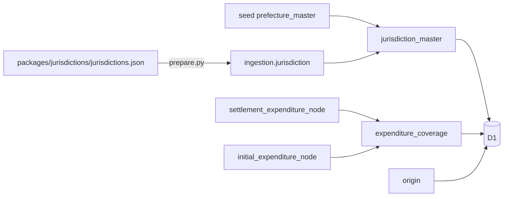

# 団体と収録範囲の参照の設計

要件は [PRD](prd.md) に置く。配信の構成（marts を D1 に写し、Worker が REST と MCP に出す）は [ADR 0022](../../adr/0022-serve-marts-via-worker-d1-rest-and-mcp.md)、団体マスタは [ADR 0015](../../adr/0015-jurisdiction-master.md) に従う。

## データ

収録範囲は API の要求のたびに木の表を集計せず、dbt の marts で作って木の表と同じ同期で D1 に写す。提供用データの正本は marts にあり、「何を収録範囲とするか」の判断を API と二重に持たないためである。同じ warehouse から同じ同期で入れ替えるので、返る収録範囲は同じ時点の明細の検索で返る範囲と一致する。

- `jurisdiction_master`（`pipeline/dbt/models/marts/jurisdiction/`）: 団体マスタの全団体。都道府県の名称はマスタに無いので、JIS X 0401 の seed（`prefecture_master`）を団体コードの先頭2桁で引く。検査数字と OCD ID の整合は `tests/jurisdiction_master_codes.sql` が見る。5桁での指定を先頭5桁の一致で引くので、検査数字の規則が崩れたら構築を止める。
- `expenditure_coverage`（`pipeline/dbt/models/marts/fiscal/`）: 木の表の (団体, 年度, 資料区分, 会計名, 会計の種類, origin_id) の組。原典の選定結果は使わない。主キーは組から作る `coverage_id`（同期の照合が1列の主キーを前提にするため）。`jurisdiction_code` は団体マスタへの relationships で検査し、マスタに無い団体の明細があれば構築が止まる（その団体は団体の一覧に出ないため）。
- 団体マスタは収録の無い団体も持つので、D1 の `jurisdiction_master` から引けば全団体を返せる。

検討して採らなかった案:

| 案 | 採らなかった理由 |
| --- | --- |
| API で木の表を `GROUP BY` する | 判断の置き場が API と marts に分かれる。要求ごとに全行を走査する |
| 団体マスタを Worker に bundle する | 団体マスタは deploy、収録範囲は同期で別々に変わり、同じ時点のものにならない |
| 団体ごとの収録範囲を JSON の文字列の列で持つ | 列の型と説明（columns.json）で契約を表せない |

## 操作

`list_jurisdictions`（REST は `GET /v1/jurisdictions`）を `apps/api/src/operations.ts` に1つ定義する。

- 応答は団体を単位にする。団体ごとに `coverage` を年度・資料区分の配列で持ち、その中に会計、会計の中に原典（`origin_id`・標題・URL・形式）を入れる。返した `jurisdiction_code`・`fiscal_year`・`document_kind`・`account_name` は、そのまま歳出の検索の条件に使える。原典は会計ごとに入れる（一つの原典が複数の会計を載せていても繰り返す）。標題と URL を辿れることを優先し、重複の削減より読みやすさを取った。
- 並びは団体コード順、年度の昇順、同じ年度は当初予算・決算の順、会計は一般会計を先にして会計名の順。
- 団体名は部分一致（SQLite の `instr`）。入力は NFKC と前後の空白の除去で揃える。部分一致にしたのは、「府中」から東京都と広島県の府中市の両方を候補に出せ、「武蔵野市」のような完全な名前でも同じ結果になるため。ヶとケのような表記の揺れは揃えない。
- 団体コードは 5 桁か 6 桁の数字だけを受ける。5 桁は先頭 5 桁の一致で引く（検査数字は先頭 5 桁で決まるので一つに決まる）。
- 名前とコードは AND。どちらも無ければ全団体を返す。
- ページは団体を単位に切り、一つの団体の収録範囲をページで分けない。`page_size` は 1〜100、既定 20。62 団体の全量は既定で 4 ページになる。既定を小さめにしたのは、団体ごとの収録範囲が年度・会計の数に比例して増え、1 回の応答が AI の文脈を圧迫しないようにするため。`page_token` は既存の操作と同じ形式（位置と、`page_size` 以外の入力の指紋）で、条件を変えた token は 400 にする。
- 団体のページと、その団体の収録範囲（`origin` と結合）を1つの batch（D1 のトランザクション）で読む。

## MCP Apps の View

MCP Apps（`io.modelcontextprotocol/ui`、仕様 2026-01-26）に対応した host には、tool の結果を表で見せる。

- `list_jurisdictions`・`search_expenditure_nodes`・`get_expenditure_node` の tool に `_meta.ui.resourceUri` を付け、旧キー `ui/resourceUri` も併記する（ext-apps の `registerAppTool` と同じ。仕様では deprecated）。列の説明だけを返す `describe_expenditure_columns` には付けない。ChatGPT も同じキーを読むので、`openai/outputTemplate` は付けない。
- 仕様はサーバが client の対応を見てから UI 付きの tool を登録すること（SHOULD）を求めるが、stateless の handler は 2025 年代の client の `initialize` を要求ごとに見られないので、常に付ける。非対応の client は `_meta` を無視し、`structuredContent` と text の応答はこれまでと同じである。
- View は `ui://fudoki/view-<HTML の SHA-256 の先頭 12 桁>.html` の1つのリソースで、`text/html;profile=mcp-app` で返す。host は URI でキャッシュするので、中身を変えたら URI が変わるようにした。
- host の既定の CSP は inline の script だけを許し、外部の script と通信を許さない。そこで `@modelcontextprotocol/ext-apps` の `App` を `ui/view.ts` から Bun.build で bundle し、HTML に inline した `src/view.generated.ts` を commit する（`bun run --cwd apps/api view` で作り直し、`view.test.ts` が最新かを検査する）。約 560KB で、大半は ext-apps が同梱する MCP の SDK と zod。追加のデータ（次のページ・内訳）は fetch せず、host 経由で同じ tool を呼ぶ。
- 明細の原典へのリンクは、PDF なら URL に `#page=<source_page>`（金額は `amount_source_page`）を付け、リンクの横に「◯ページ」と書く。`#page` は Chrome・Edge・Firefox・Acrobat の PDF ビューアでは効くが、Safari やダウンロード扱いの PDF では効かないため。頁が NULL の明細と CSV の原典（頁ではなく行）には `#page` を付けない。CSV は「◯行目」と書く。収録範囲の原典は頁なしのリンクにする。PDF を View に埋め込むことはしない（原典の配り方を決めてから別に扱う）。
- リンクは iframe の中から直接開けないことがあるので、host に `ui/open-link` で開かせる。
