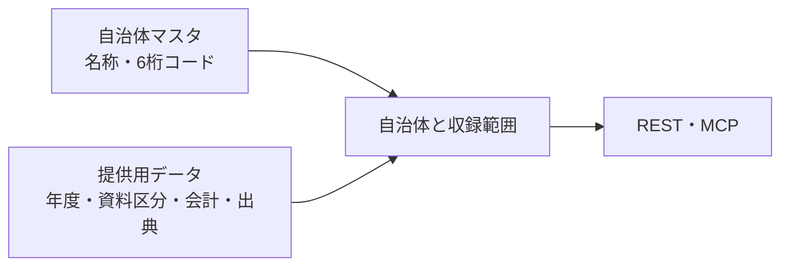

# 自治体と収録範囲の参照

## Problem

API・MCP の利用者（人と AI）は、どの自治体のどの年度・資料が収録されているかを知る手段を持たない。返るのは6桁の自治体コードだけで名称が無く、自治体名からコードを引けない。コードが5桁か6桁かも利用者には分からない。そのため、検索の条件を組む前の「何があるか」で止まり、年度の範囲を総当たりするしかない。

## 導出

Story の「自治体をまたいで、または年をまたいで比べる」は、比べられる自治体・年度・資料が揃っているかを先に知れることを前提にする。「出典と合っているかを確かめる」も、対象の出典に辿り着ければ始められる。[財政データのAPI](../budget-api/prd.md) が返す明細の手前に、その入口を置く。

## Overview

利用者は自治体名・自治体コードで自治体を探し、1回の問い合わせで、その自治体の名称・コードと、収録している年度・資料区分・会計と出典を受け取る。収録が無い自治体は、収録範囲が空の自治体として返る。

### Goals

- 利用者が、自治体コードの桁や表記を知らなくても、名称から自治体を特定できる。
- 利用者が、検索を投げる前に、比べたい自治体・年度・資料が収録されているかを知れる。

### Non-Goals

- 収録していない理由の区別（出典を見つけたがまだ収録していないのか、出典が無いのか）。
- 歳入・支出（取引）・補正予算など、API が明細を返していないデータの収録範囲。資料区分は当初予算と決算に限る。
- 改称・合併の履歴の管理（[ADR 0015](../../adr/0015-jurisdiction-master.md) の範囲外のまま）。
- 収録対象の自治体を増やすこと。対象は自治体マスタが定める。

## Glossary

**収録範囲（coverage）**:
自治体ごとに、提供用データとして明細を返せる年度・資料区分・会計と、その出典を表したもの。明細があることを示し、会計全体・全事業を収録し終えたことは保証しない。

## Domain Model

自治体の情報と収録範囲は、配信のときに自治体単位で一つにまとめて返す。定義は分けたまま保つ。

- 自治体の名称・コードは自治体マスタが正本である（[ADR 0015](../../adr/0015-jurisdiction-master.md)）。収録範囲は自治体マスタに書き込まない。
- 返す自治体は自治体マスタの全自治体とする。収録が無い自治体も、収録範囲が空の自治体として返す。
- 収録範囲は、提供用データに明細があるかで決める。利用者が検索できるのは配信に載せた時点の提供用データであり、収録範囲もそれと同じ時点のものを返す。
- 一つの年度・資料区分でも、収録している会計が一部だけのことがある（一般会計だけ、など）。収録している会計が分かるようにする。同じ会計の中でも、出典が主な事業だけを載せているなど、全事業を収録していないことがある。
- 自治体コードは6桁（検査数字付きの全国地方公共団体コード）を正とする。5桁は検査数字を除いた同じコードであり、利用者が5桁で指定しても同じ自治体として扱う。
- 自治体名は全国では一意でない（府中市は東京都と広島県にある）。名前で探したときに同名の自治体があれば、すべてを候補として返し、利用者がコードと都道府県で区別できるようにする。

## Acceptance Criteria

- 利用者が自治体名（例: 武蔵野市）で問い合わせると、6桁の自治体コードと、その自治体が収録している年度・資料区分・会計を1回の応答で得られる。同名の自治体があれば、それぞれを区別できる形で得られる。
- 利用者が5桁と6桁のどちらの自治体コードで問い合わせても、同じ自治体の結果を得られる。
- 利用者は収録している年度・資料区分・会計について、その明細の出典である出典すべての標題・URLを得られ、その条件で明細の検索を始められる。
- 利用者は自治体マスタのどの自治体に収録が無いかを、収録範囲が空であることで知れる。
- 利用者が絞り込まずに問い合わせても、自治体マスタの全自治体を欠落なく取得できる。一度に返らない場合も、残りを続けて取得できる。
- 返る収録範囲は、同じ時点の明細の検索で返る範囲と一致する。

## Non-Functional Requirements

- 既存の API・MCP と同じく、認証なし・読み取り専用で返す。

## Success Metrics

自治体名や比較の条件から始まる問い（「武蔵野市と三鷹市の2024年度決算を目で比べたい」など）を AI に MCP 経由で解かせたとき、自治体コードの取り違えや年度の総当たりなしに、収録範囲を確かめてから検索に進めること。
