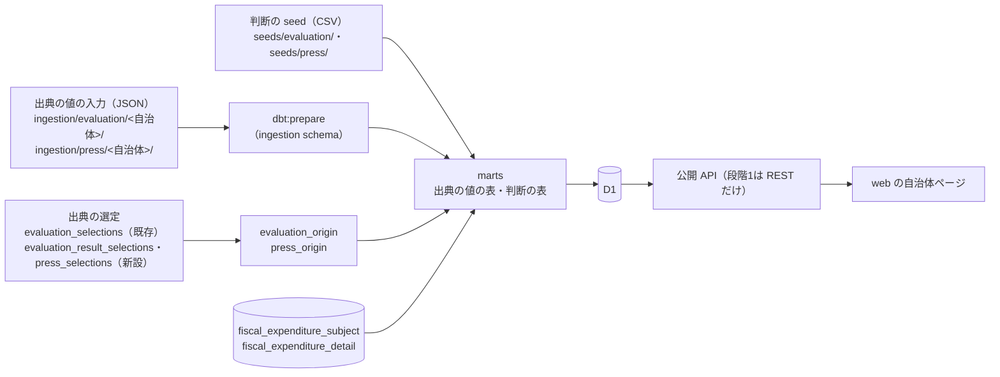
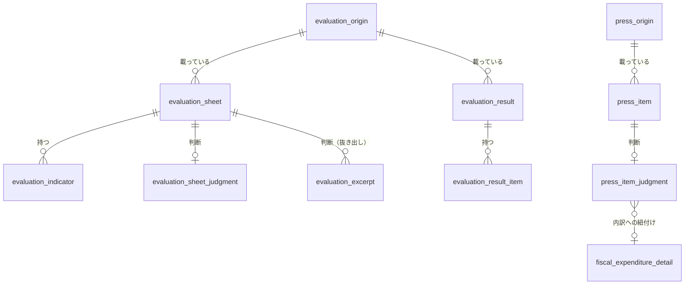

# 自治体ページの全節を、D1 の表と公開 API から組み立てる — 設計

担当者: wwwyo / Claude
更新日: `2026-11-08`
状態: Draft（別の agent のレビューを反映済み）

## Summary

品川区のページ（`/tokyo/shinagawa`）のうち、金額の節（概要・お金の流れ・いちばんお金がかかるのは？）は公開 API から組み立てている。一方、次の部分は web の中の手書きの定数（`apps/web/jurisdiction/profiles.ts` 3,865行・`budget-press.ts` 3,389行）から出している。

- 事業評価から取った節: 新しく何を始めた？・やめたこと・見直したことは？
- プレス発表から取った節: 新しく何を始める？
- header の都市像

この定数は品川区にしかない。ほかの自治体へ広げるときにも、MCP や REST の利用者に同じデータを渡すときにも使えない。

この設計では、手書きの定数を次の流れに移し、web が API だけで今のページを再現できるようにする。

> pipeline の入力（宣言・seed）→ dbt の marts → D1 → 公開 API

1. 事業評価とプレス発表を、出典の種類ごとの表にする。
   - `evaluation_sheet`（評価シート）
   - `evaluation_indicator`（指標）
   - `evaluation_result`・`evaluation_result_item`（評価の結果）
   - `press_item`（予算のプレス発表の施策）
2. 出典に無い値は **風土記の判断** として、出典の値と別の表に置く。対象は、分かりやすい言い換え、事実の抜き出し、COFOG、予算書の内訳への紐付け。判断は Git の seed から作る。
3. 公開 API に、上の表を引く検索の操作を足す。web は `profiles.ts`・`budget-press.ts` を消し、ページを API の結果だけで組み立てる。
4. 移す順は **再現 → 自動化 → 横展開** にする。段階1では、手書きの値を、今持っている粒度のまま入力に移す。そして、ページの出力が今と同じになることを確かめる。PDF からの取り込みと、規則による算出は段階2で行う。

レビューで決めたいことは次の4つである。

1. 出典の値と風土記の判断を、表を分けて持つこと（列で分けない）。
2. 段階1では、手書きの値を今の粒度のまま入れること。たとえば、指標は選んだ1件だけ、「新しくできた事業」の印と COFOG は手で付けた値のまま入れる。規則による算出と目への紐付けは段階2に回す。
3. 段階1では、新しい操作を REST にだけ登録し、MCP の tool にはしないこと。段階1の評価シートは品川 R6 の新しい事業と取り組みの約25枚だけで、利用者が「評価シートはこれだけ」と読み違えるため。
4. 評価シートを決算の目へ紐付けて保存すること。これは [evaluation-search](../evaluation-search/dd.md) の Non-Goal（決算書の科目と評価の事業の対応を、風土記の判断として保存しない）を改めることになる。段階2に入る前に、ADR で線引きを決める（[ADR が要る判断](#adr-が要る判断)）。

## Goals / Non-Goals

- Goal: 品川区のページの全節を、D1 の表と公開 API だけで今と同じに出せる。web の中に自治体ごとのデータを置かない。
- Goal: 出典の値と風土記の判断を、表の単位で区別できる。判断の行には根拠（方法・確信度）を持たせる。
- Goal: 2つ目の自治体を足すときに、web のコードを変えずに済む。
- Non-Goal: 評価シートの PDF からの取り込み。段階2で別に設計する。
- Non-Goal: 品川区以外の自治体のデータ。表の形は、ほかの自治体の様式も入るように決める（[調査](#ほかの自治体の評価シートでも入る形にする)）が、データは足さない。
- Non-Goal: 画面の変更。見た目・文言・節の順・年度の切り替えは今のまま。
- Non-Goal: 評価シートの文章（目的・取組・課題）の全文の配布。利用条件が転載を禁じているため（[利用条件](#cross-cutting-concerns)）。
- Non-Goal: 紋章。Wikimedia Commons の画像ファイルで、データではなく静的な資産なので、今のまま web の `public/` に置く。

## Background

### 今のページの節とデータの出どころ

| 節・部品 | 今の出どころ | 移す先 |
| --- | --- | --- |
| header（名前・都道府県・人口・公式サイト） | API `list_jurisdictions` | 移行済み |
| header の都市像（基本構想） | `profiles.ts` の `vision.text` | `jurisdiction` の列 |
| 区は何をしている？・お金の流れ・いちばんお金がかかるのは？ | API（科目・内訳の表） | 移行済み |
| 新しく何を始めた？（評価のある年度） | `profiles.ts` の `projects`・`initiatives` | `evaluation_sheet` ほか |
| 新しく何を始める？（評価の無い年度） | `budget-press.ts` | `press_item` ほか |
| やめたこと・見直したことは？ | `profiles.ts` の `scrap` | `evaluation_result` ほか |
| 資料の一覧（決算書・予算書） | `profiles.ts` の `documents` | API `list_jurisdictions`（`view=FULL`）の出典 |
| ほかの自治体も見る | API `list_jurisdictions` | 移行済み |

`profiles.ts` の `tags`（常に空）と `vision.source`（描画していない）は移さずに消す。

### 手書きの値の中身（品川区）

| 年度 | 評価シートの新しい事業 | 既存の事業の中で始めた取り組み | やめた事業 | A〜C の一覧 | プレス発表の施策 |
| --- | --- | --- | --- | --- | --- |
| 2024（R6） | 15 | 10 | 6 | 起こしていない | — |
| 2025（R7） | 0 | 0 | 6 | 起こしていない | 新規の印 53 |
| 2026（R8） | 0 | 0 | 26 | 16・339・271 | 新規の印 40 |

各値の性質は、`profiles.ts`・`budget-press.ts` の冒頭のコメントと型の説明による。

- **出典の値**:
  - 評価シート: 小事業名・決算額・指標の名前と目標と実績・最終評価の区分の記号（A〜D）・今後の方向性・頁
  - 評価の結果: 捻出額・目標額・評価の件数・区分ごとの件数・やめた事業の名前と結果
  - プレス発表: 見出し・事業名・予算額・新規の印・POINT
- **風土記の判断**:
  - 小事業の言い換え（`title`）と、目的・概要の要約（`what`）
  - 取り組みを書いた一文の選び出し。`quote` 自体は出典の文そのもので、どの文を選ぶかが判断になる。
  - 評価シートの事業への COFOG の付与。手で付けた値で、大分類だけの値（"10"・"09"）と中分類の値が混ざる。
  - プレス発表の施策の予算書の内訳への紐付け（名前の一致、または Jev の確信度0.6以上）
  - 「その年度に新しくできた事業」の選び出し。規則（事業期間の開始年度・前年度の行政コスト・前年度までの指標の実績）を手で当てた結果で、規則の入力の値は `profiles.ts` に無い。
- **画面の固定文言**: 区分の記号の言い換え（A 広げる／B 続ける／C 見直す／D 終える）は、評価シートの原文（「C 改善・見直しする事業」など）ではない。`ScrapSection` は同じ言い換えを固定文言で持っている。

### 関連する設計

- 科目・内訳の表と公開 API: [fiscal-serving-tables](../fiscal-serving-tables/dd.md)（[ADR 0038](../../adr/0038-split-serving-tables-by-grain.md)）
- 評価資料の全文検索: [evaluation-search](../evaluation-search/dd.md)。評価シートの出典は `pipeline/source_selection/<自治体>.json` の `evaluation_selections` に固定済み。品川は 2023・2024 年度のシートが選定済みである。
- プレス発表の施策の紐付けの手順: `.agents/skills/web-frontend-ops/references/link-to-budget-detail.md`
- 評価シートの様式の比較と利用条件: [調査記録](../../survey/evaluation-sheet-formats.md)
- ライセンスの層: [ADR 0006](../../adr/0006-license-per-layer.md)

## Design

### 全体の流れ

段階2では、出典の値の入力（JSON）を PDF の取り込みの表に置き換える。判断の seed は段階2以降も Git に残る。

### 出典の値と判断を表で分ける

判断の列を出典の表に混ぜると、利用者は列ごとに「これは出典にあるか」を読み分けなければならない。fiscal-serving-tables では、判断（`breakdown`・`cofog_code`）を列の説明で区別した。しかしここでは判断の量が多く、言い換え・要約のような文も入る。そこで、出典の値の表と判断の表を分け、判断の表は出典の表の行を ID で指す。

- 出典の表は、出典を開けば同じ値が見つかる列だけを持ち、頁を添える。
- 判断の表は、判断の内容と根拠を持つ。根拠の列は、どの表も `method`・`confidence` にそろえる。
  - `method` の値: `manual`（手）・`rule`（規則）・`code`（コードの照合）・`name`（名前の一致）・`jev`（Jev の選択）。今の `via` の値 `name`・`jev` をそのまま使う。
  - 判断を作り直しても、出典の表は変わらない。
- 判断の表から科目・内訳の表への紐付けには、dbt の relationships テストを掛ける。取り込みのやり直しで `detail_id` などが変わり、紐付け先の無い判断が出たら、そこで止める。

### 入力の置き場と形

pipeline の既存の規約に合わせて分ける。

- **出典の値で、入れ子を持つもの**: `pipeline/ingestion/evaluation/<自治体>/<年度>.json`、`pipeline/ingestion/press/<自治体>/<年度>.json`。
  - 型は JSON Schema（`ingestion/fiscal/manifest.schema.json` と同じ形）で定め、`ingestion:check` で検査する。
  - `dbt:prepare`（`dbt/scripts/prepare.py`）が読み、`ingestion` schema に入れる。自治体マスタの JSON と同じ扱いになる。
- **判断（平らな行）**: dbt の seed（`pipeline/dbt/seeds/evaluation/`、`pipeline/dbt/seeds/press/`）。今の `fiscal_detail_breakdown.csv`・`cofog_rules.csv` と同じ扱いにする。
- **都市像**: `jurisdiction` の入力（`packages/jurisdictions/jurisdictions.json`）に `vision` を足す。出典の選定の `official_url` と同じく、`jurisdiction` の列（`vision`）に載せる。

入力と seed は、自然キーで行を書く。評価シートなら（自治体・年度・資料の種類・頁）で、出典の sha256 は使わない。品川には、サイトの再保存で sha256 が変わった実例があり、sha256 で書くと出典を差し替えたときに全行が外れる。ID は dbt で自然キーから導出する。

段階1の入力は、`profiles.ts`・`budget-press.ts` から一度きりの script で書き出す。書き出しの script も同じ PR に残す（生成物には生成手段を残す規約）。

### 出典の選定と保存

段階1で、次の PDF を選定に足し、`archive.ts` で非公開 R2 に保存する。

| 資料 | 品川の年度 | 選定の key |
| --- | --- | --- |
| 評価シート | 2023・2024 は選定済み。2024 の評価の結果に対応するシートを足す | `evaluation_selections`（既存） |
| 評価の結果 | R5評価・R6評価・R7評価の結果の PDF | `evaluation_result_selections`（新設） |
| 予算のプレス発表 | R7・R8 | `press_selections`（新設） |

既存の `evaluation_selections` は、1つの target に1件しか持てない。保存先の slot も `evaluation-settlement` に固定されている。そのため、評価の結果とプレス発表は別の key・別の slot にする（`evaluation-result[-n].pdf`・`press[-n].pdf`）。AI Search の索引（`evaluation_search/plan.py`）の対象は、今の `evaluation_selections` だけのままにし、新しい key は索引に入れない。

### 表の構成

表名は「領域_中身」（ADR 0038）にそろえる。領域は `evaluation` と `press` である。すべての表は、単一の主キー `<表>_id` を持つ。主キーの値は `sha256(to_json([<自然キー>]))` で導出する（`serving/sync_d1.py` は、単一の主キーの先頭1文字ごとに表を突き合わせる）。配列・オブジェクトの列は、marts で `to_json(...)::varchar` にして文字列で持つ（`serving/columns.py` の型は LIST・STRUCT を持たない）。API は、配列・オブジェクトに戻して返す。

以下の列は、段階1で埋まるものだけを挙げる。予算科目・事業期間・前年度のコストなど、段階2の取り込みで埋まる列は、段階2で足す（schema は最小形から）。

#### `evaluation_origin` と `press_origin`（金額以外の出典）

金額の出典（`fiscal_origin`）は、検査済みの金額の木と1対1である。選定の規則も違うので、金額以外の出典は別の表にする。

| 列 | 意味 |
| --- | --- |
| `origin_id` | 選定のファイルの sha256 から導出する（`fiscal_origin` と同じ規則） |
| `sha256` / `url` / `landing_url` / `title` / `format` | 選定の値 |
| `jurisdiction_code` / `fiscal_year` | 評価は評価した事業を実施した年度（`evaluation_selections` の target と同じ）、プレス発表は予算の年度 |
| `document_type` | `evaluation_origin` だけ。`sheets`（評価シート）・`result`（評価の結果） |

#### `evaluation_sheet`（評価シート1枚）

1行は評価シート1枚で、品川では小事業1件にあたる。自然キーは（自治体・年度・頁）。

| 列 | 意味 |
| --- | --- |
| `evaluation_sheet_id` | 主キー |
| `origin_id` / `page` | 出典と物理頁 |
| `jurisdiction_code` / `fiscal_year` | 実施年度 |
| `name` | 小事業名（印字のまま） |
| `settled_yen` | 決算額（円）。出典の千円を円にする |
| `grade_code` | 最終評価の区分の記号（`A`〜`D`） |
| `direction` | 今後の方向性（原文） |

#### `evaluation_indicator`（指標）

1行は シート × 指標 × 年度。自然キーは（シート・指標の順・年度）。

| 列 | 意味 |
| --- | --- |
| `evaluation_indicator_id` / `evaluation_sheet_id` | |
| `indicator_order` / `name` / `unit` / `year` | |
| `target` / `actual` | 印字の表記の文字列（「44,351」「-」） |
| `is_headline` | その年度の目標と実績が両方ある、順の最初の指標か。ページの「目標と実績」はこの1件を出す |

段階1では、手書きの値にある1件（その年度の行）だけが入り、`is_headline` は常に真になる。段階2で全指標・全年度が入ったら、dbt が規則で `is_headline` を決める。

#### `evaluation_sheet_judgment`（評価シートへの判断）

1行は評価シート1枚。seed の自然キーは（自治体・年度・頁）。

| 列 | 意味 |
| --- | --- |
| `evaluation_sheet_id` | 主キー |
| `title` | 言い換え |
| `summary` | 目的と概要の要約。評価シートの文をなぞらず、事実（何を・誰に・いくつ）を書き直したもの |
| `cofog_code` | 段階1は手で付けた値（`method = 'manual'`） |
| `is_new_project` | 「その年度に新しくできた事業」か。段階1は手で当てた結果（`method = 'manual'`） |
| `method` / `confidence` | |

段階2では、`cofog_code` を、シートを目に紐付けてその目の `cofog_code` から写す形に変える。その前に、25枚について、手で付けた値と目の値を照合する。食い違えば、事業が別の分野の枠に移るため、判断で上書きを許すかを決める。`is_new_project` は規則（`rule`）で決める形に変える。

#### `evaluation_excerpt`（シートから抜き出した一文）

今の「既存の事業の中で始めた取り組み」。1行は シート × 抜き出した一文。seed の自然キーは（自治体・年度・頁・順）。

| 列 | 意味 |
| --- | --- |
| `evaluation_excerpt_id` / `evaluation_sheet_id` | |
| `kind` | 今は `initiative` だけ |
| `quote` | 出典の文そのもの（空白だけ詰める）。所在を示す抜粋として150文字までにする（評価検索の抜粋と同じ上限）。今の10件は33〜88文字で、すべて収まる |
| `title` | 言い換え |
| `cofog_code` | 段階1は手で付けた値 |
| `method` / `confidence` | |

#### `evaluation_result` と `evaluation_result_item`（評価の結果）

`evaluation_result` は、評価の回ごとに1行。自然キーは（自治体・評価した事業を実施した年度）。

| 列 | 意味 |
| --- | --- |
| `evaluation_result_id` | 主キー |
| `origin_id` | 評価の結果の PDF |
| `sheets_origin_id` | 同じ評価の評価シートの PDF。事業ごとの頁はこの PDF の頁 |
| `jurisdiction_code` / `evaluated_year` / `budget_year` | 評価した事業を実施した年度と、結果を反映した予算の年度 |
| `raised_yen` / `target_yen` / `evaluated_count` | 捻出額・区の目標額（無ければ NULL）・評価した事業の数 |
| `grade_counts` | 区分の記号 → 件数（JSON の文字列） |
| `has_graded_list` | A〜C の事業の一覧を `evaluation_result_item` に起こしたか。偽なら、一覧が無いのか、起こしていないのかを区別しない |

品川では、R8 の予算に R7 の評価（R6 実施分）が反映される。ページは予算の年度で「やめたこと」を出すので、`budget_year` を持つ。

`evaluation_result_item` は、結果の表の1事業ごとに1行。自然キーは（評価の回・区分の記号・順）。列は `evaluation_result_item_id`・`evaluation_result_id`・`name`・`grade_code`・`result`・`page` である。`result` は、D は「廃止・移管・統合・完了・廃止を検討」、A〜C は「今後の方向性」の原文を入れる。

`has_graded_list` が偽の年度の画面の文言（「この年度は A〜C の事業の一覧を出していません」）は、区が出していないのか、風土記が起こしていないのかを確かめて直す。これは段階1の作業に含める。

#### `press_item` と `press_item_judgment`（予算のプレス発表）

`press_item` は1頁1施策。自然キーは（自治体・年度・頁）。

| 列 | 意味 |
| --- | --- |
| `press_item_id` / `origin_id` / `page` | |
| `jurisdiction_code` / `fiscal_year` | 予算の年度 |
| `title` / `budget_yen` / `is_new` | 見出し・予算額・新規の印 |
| `names` / `points` | 事業名の欄・POINT の箇条書き（JSON の文字列） |

`press_item_judgment` は1施策1行。

| 列 | 意味 |
| --- | --- |
| `press_item_id` | 主キー |
| `detail_id` | 紐付けた予算書の内訳（`fiscal_expenditure_detail` の当初予算の行） |
| `cofog_code` | 内訳が属する目の COFOG。今の `budget-press.ts` の値と同じになることを検査する |
| `method` / `confidence` | `name` か `jev` |

紐付かない施策は行を持たない。ページでは「その他」の枠に入る。今のデータでは、紐付かない施策の確信度は残っていない。

### ページの組み立ての規則

画面の規則は今の web の規則のまま、データの出どころだけを API に変える。

- **年度の一覧**: 決算・当初予算の年度に、評価シート・抜き出し・評価の結果・プレス発表のどれかに行がある年度を足す。今は profile の年度のキーを足している。
- **「新しく何を始めた？」の節を出す年度**: 上のどれかに行がある年度だけ出す。行がどれも無い年度には、今と同じく節を出さない。
- **評価とプレス発表の切り替え**: その年度に `is_new_project` の評価シートか抜き出しが1件でもあれば、評価から出す。どちらも無ければ、`is_new` のプレス発表の施策を出す。今の `withPress` と同じ規則で、決算の有無では決めない（2025 年度は決算があるが、評価の行が無いのでプレス発表を出している）。
- **やめたこと・見直したことは？**: `evaluation_result.budget_year` がその年度の行。
- **「事業評価」のリンク**: その年度の評価シートの出典の `landing_url`。
- **資料の一覧**: `list_jurisdictions` の `view=FULL` が返す、一般会計の出典の一覧から作る。分冊の順（予算書1・予算書2）がこの応答の順で再現できるかは、段階1で確かめる。再現できなければ、`fiscal_origin` に冊の順の列を足す。

### 公開 API

既存の評価資料の全文検索は、`search_evaluations`（`POST /v1/evaluations:search`）である。新しい操作は、パスを同じ `/v1/evaluations/` の下に置き、表の名前を操作の名前に入れて区別する。検索の条件の書き方（`where` の `eq`・`prefix` など）は、科目・内訳の検索と同じにする。`jurisdiction_code` と年度は必須にする。

| 操作 | REST | 中身 |
| --- | --- | --- |
| `search_evaluation_sheets` | `POST /v1/evaluations/sheets:search` | 評価シートの検索。行に `headline_indicator`（`is_headline` の1件）と `judgment`（言い換え・要約・COFOG・新しい事業か）を添える |
| `search_evaluation_excerpts` | `POST /v1/evaluations/excerpts:search` | 抜き出した一文の検索。行に、シートの名前・決算額・区分の記号・方向性・出典と、判断の COFOG を添える |
| `search_evaluation_results` | `POST /v1/evaluations/results:search` | 評価の結果と、その事業の一覧。`budget_year` か `evaluated_year` で引く |
| `search_press_items` | `POST /v1/press/items:search` | プレス発表の施策と判断 |
| `list_jurisdictions`（既存） | `GET /v1/jurisdictions` | `vision` を足す |

- 応答は、既存の検索と同じく `origins` を一度だけ付ける。行は `origin_id` と `page` で出典を指す。
- 判断の値は行の `judgment` の下にまとめ、出典の値と同じ階層に置かない。
- 段階1では、上の4つの操作を REST にだけ登録する。MCP の tool にするのは、段階2で品川の全シートが入ってからにする。そのときに、tool の説明に収録範囲を書く。
- 1枚の詳細を引く操作（`get_evaluation_sheet`）は、web が使わないので段階1では作らない。

### web の組み立てと cache

web は、自治体の頁の memo（`page-<自治体>-<最新の決算年度>`）の中で、年度ごとに4つの検索を呼び、結果を今の `ProfileYear` の形に組み立てる。今の profile は memo の外で定数を足しているので、評価の呼び出しを memo の中に入れることになる。

- 評価の API が失敗したときは、金額の API の失敗と同じく、頁全体を失敗にする。節だけを落とした頁を memo に1時間残さないため。
- `PageData` の形が変わるので、同じ PR で memo の版（`jurisdiction-vN`）を上げる。上げ忘れると、本番で古い形が最大2時間残る。

### ほかの自治体の評価シートでも入る形にする

2026-11-06 に、11自治体の評価シートの項目を比べた（[調査記録](../../survey/evaluation-sheet-formats.md)）。事業ごとのシートを出す自治体（品川・杉並・府中・荒川・青梅・豊島・中央・墨田）は、次の項目をほぼ共通に持つ。

- 事業名・担当
- 予算科目
- 指標の計画と実績
- 予算額と決算額
- 評価の区分

段階2で足す予算科目の列（`kan_*`・`kou_*`・`moku_*`・`project_*` のコードと名前）は、この共通の項目に合わせる。

- 予算科目のコードを印字する自治体がある（杉並の款05 項01 目04 事業008、府中の会計・款・項・目・予算事業コード）。コードがあれば、目への紐付けは判断ではなく照合になる（`method = 'code'`）。
- 杉並 R7「耐震化の促進」と府中 R7「保健センター費」は、シートの決算額が、科目・内訳の表の金額と1円まで一致した。紐付けの検査に、決算額の一致を使える。
- 施策ごとの評価（港）と、評価の語の一覧だけの自治体（板橋）は、`evaluation_sheet` の1行にならない。この設計では扱わない。

### ADR が要る判断

評価シートを決算の目に紐付けて保存することは、[evaluation-search](../evaluation-search/dd.md) の Non-Goal と矛盾する。この Non-Goal は「決算書の科目と評価の事業の対応を、風土記の判断として保存しない」である。段階1は目への紐付けを作らない（COFOG は手の値のまま）ので、この矛盾は段階2で表に出る。段階2に入る前に ADR を書き、次の線引きを決める。

- コードの照合（`code`）と、決算額の一致で決まる紐付けは、出典どうしの照合として保存する。
- 名前の一致・Jev による紐付けは、判断として `method`・`confidence` 付きで保存する。保存しない選択もありうる。

プレス発表の施策から予算書の内訳への紐付けは、すでに web の定数で配っている。ADR では、こちらも同じ線引きに含める。

## Alternatives Considered

### 今のまま web の定数に置く

一番手間が少ない。しかし、MCP・REST の利用者は評価の事業を引けず、2つ目の自治体を足すたびに web のコードが増える。風土記の「同じデータを出典つきで配る」に合わないので採らない。

### ページ専用の集約 API（`GET /v1/jurisdictions/{code}/page?year=`）

web の呼び出しは1回で済む。しかし、操作が画面の節の形に縛られ、MCP の利用者には使いにくい。節を変えるたびに API の契約が変わる。呼び出しの回数は web の memo で抑えられるので、汎用の検索を組み合わせる。

### 判断を出典の表の列にする（fiscal-serving-tables と同じ）

表の数は減る。しかし、言い換え・要約のような文の判断が出典の値と同じ行に並ぶと、利用者が出典の文と取り違えやすい。また、判断を作り直したときに、出典の表の行まで変わる。そのため表を分ける。

### 段階1で PDF から必要な列を起こす

段階1で、予算科目・事業期間・全指標を PDF から手で起こす。そうすれば、規則による `is_new_project` と目からの COFOG を最初から使える。しかし、作業は25枚 × 列の数の手起こしになる。目から写した COFOG が手の値と違えば、事業の分野の枠も変わる。その結果「出力が今と同じ」の確かめが成り立たず、ページの差の原因を移行と判断の変更とに切り分けられない。段階1は今の粒度のまま移し、列と規則は段階2の取り込みと一緒に入れる。

### 金額以外の出典を `fiscal_origin` に入れる

表は増えない。しかし、`fiscal_origin` は金額の木の出典で、`fiscal_coverage`・出典 PDF の中継（`/v1/fiscal/origins/{id}/pdf`）と結び付いている。評価資料を中継に載せることは利用条件が禁じる（evaluation-search の決定）。混ぜると、この区別を列で守ることになる。

## Cross-Cutting Concerns

- **出典の利用条件**: 2026-11-06 に10自治体のサイトの条件を見た（[調査記録](../../survey/evaluation-sheet-formats.md)）。どの自治体も、サイト全体を CC BY などで開いていない（CC BY はオープンデータとして載せたデータだけ）。転載の扱いは次のとおりである。
  - 無断の転載を禁止: 杉並・荒川・豊島・中央・墨田・北・中野（荒川は引用も禁止）
  - 無断の転載を遠慮するよう依頼: 府中
  - 利用を非営利に限定: 青梅
  - 品川: 旧ページは無断の引用・転載・複製を禁じていた。現行ページでは該当の記述を見つけられていない

  そのため、配る列は次のものに限る。
  - 事実の記録（名前・金額・指標・区分の記号・件数）
  - 所在を示す短い抜粋（`quote` は150文字まで、POINT は1行）

  目的・取組・課題の文章そのものは配らない。`summary` は事実を書き直したもので、文をなぞった要約にしない。評価資料・プレス発表は、ADR 0006 の配布物の `licenses` に載せない。法的な判断は専門家に確かめていない。
- **判断の表示**: 判断の値（言い換え・要約・COFOG・新しい事業か・紐付け）は、API の応答で `judgment` の下に置き、列の説明に「風土記の判断」と書く。画面の扱いは今のまま。
- **費用**: 段階1の行数は品川で数百行。段階2で全シートを入れても、1年度に約650枚とその指標で、科目・内訳の表より十分小さい。検索は自治体と年度を必須にするので、走査は1自治体・1年度に収まる。
- **プライバシー**: 評価シートの担当者の個人名（荒川の課長名・担当者名など）は列にしない。品川のシートは部課名だけである。

## Validation / Rollout

### 段階1: 手書きの値を入力に移し、API から再現する

1. 評価の結果・プレス発表の PDF を選定に足し、`archive.ts` で保存する。
2. 入力の JSON Schema と seed の形を定める。`profiles.ts`・`budget-press.ts` から入力と seed を書き出す script を作る。
3. dbt の staging・marts を足す。配信の契約として、`serving/columns.py` の表・主キー・index と `_models.yml` を更新し、`serving:columns` を作り直す。`serving/sync_d1.py` の `TABLE_ORDER` も更新する。
4. 公開 API に、REST だけの4つの操作を足す。`list_jurisdictions` に `vision` を足す。
5. web の組み立てを API に移し、`profiles.ts`・`budget-press.ts` を消す。memo の版を上げる。

確かめ方:

- 移行の前後で、品川区の全年度の `PageData`（`profile` を含む）を JSON で書き出して比べ、一致させる。
- `press_item_judgment.cofog_code` が今の `budget-press.ts` の値と一致することを、dbt の検査にする。
- 画面を、PC とスマホのスクリーンショットで比べる。

本番への切り替えは、fiscal-serving-tables と同じ順にする。merge の前に、本番の D1 へ新しい表を同期する（表が増えるだけ）。その後、merge で api と web を deploy する。本番の D1 への書き込みは、yuito の確認を取ってから行う。

### 段階2: 品川の評価シートを PDF から取り込む

- 評価シートの出典の値を、入力の JSON から PDF の取り込みに置き換える。
  - 予算科目・事業期間・前年度の行政コスト・全指標・全年度の列を足す。
  - 指標の表は、`pdftotext -bbox` の列の x 座標で年度を対応付ける。`-layout` の文字列では列がずれる（[調査記録](../../survey/evaluation-sheet-formats.md)）。
- `is_new_project` と `is_headline` を、dbt の規則で決める形に変える。
- 抜き出し（`evaluation_excerpt`）は、規則で候補を絞り、小さいモデルに該当の一文と頁を返させる。結果は判断の seed として Git に固定する。
- ADR を書いてから、目への紐付けを入れ、COFOG を目から写す形に変える。
- 品川の全シートが入ったら、操作を MCP の tool にも登録する。

確かめ方:

- 段階1の値と取り込みの値が一致すること。
- シートの決算額と、紐付けた目・内訳の金額の一致率を出す。

取り込みの設計は、別の dd にする。

### 段階3: ほかの自治体

コードと決算額がそろう杉並を2つ目にする。web のコードを変えずにページの節が出ることを確かめる。

## Open Questions

- `summary`（今の `what`）を、REST・MCP で返すか。事実の書き直しでも、表現が出典に近いと翻案に当たりうる。web は REST で読むので、返さないなら web 専用の経路が要る。段階1は REST だけなので、MCP に出す段階2までに決める。
- 資料の一覧の分冊の順が、`list_jurisdictions` の `view=FULL` で再現できるか（段階1で確かめる）。
