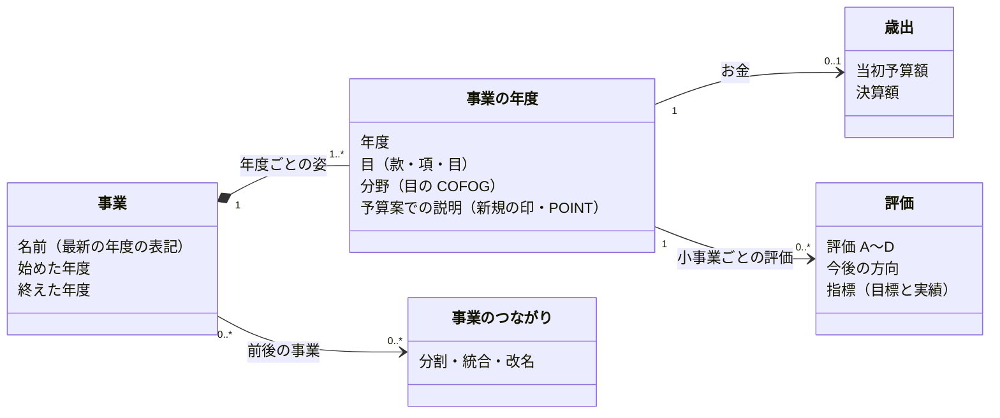

# 事業をオブジェクトとして扱う — ドメインモデル

状態: Draft（2026-11-09）。この文書はモデルの案で、`project_*` の表はまだ事業そのものを持たない。

## なぜ事業をオブジェクトにするか

住民が知りたいのは「この事業はいつ始まり、いくら使い、どう評価され、続くのか」で、答えは資料ごとに散らばっている。今の `project_*` の表は資料の行をそのまま持ち、予算書・決算書の内訳（`detail_id`）を指すだけなので、年度や資料をまたいで「同じ事業」をたどれない。事業を中心に置き、お金と評価をその年度ごとに付ける。

## エンティティは3つ

| エンティティ | 何か | 出どころ |
| --- | --- | --- |
| 事業 | 自治体が年度をまたいで続ける1つの取り組み | 予算書・決算書の内訳（事業）と評価シートの予算科目から、風土記が判断する |
| 歳出 | 事業の1年度のお金（当初予算額・決算額） | 予算書・決算書の内訳（事業） |
| 評価 | 事業の1年度の評価（指標の目標と実績、A〜D、今後の方向） | 事務事業評価シート |

- **事業**の属性は名前・始めた年度・終えた年度だけで、金額は持たない。同じ事業かどうかは出典に書かれていないので、事業の識別は **風土記の判断** である。
- **事業の年度**は事業の1年度の姿で、属する目と分野（その目の COFOG）を持つ。目は組織の改正で年度ごとに変わることがある。
- **歳出**は、事業の年度に当たる予算書・決算書の内訳の金額である。
- **評価**は評価シート1枚に当たる。シートは小事業の単位なので、1つの事業の年度に複数付くことがある。
- **予算案での説明**（予算案のプレス発表の施策の新規の印・POINT）は、エンティティにせず事業の年度の値にする。1つの施策が複数の事業にまたがるときは、それぞれの事業の年度に同じ説明を付ける。
- **事業のつながり**は、事業が分かれる・まとまる・名前が変わるときに、1つの事業として無理につなげず前後を結ぶもの。風土記の判断。

### エンティティにしないもの

- **評価の結果**（区がその年の評価をまとめた表）: 評価した数・A〜D の件数・捻出額だけで、どの事業の話でもない。自治体の年度の集計値として持つ。件数は評価を数えれば出せるので照合に使い、新しい情報は捻出額だけになる。
- **出典（PDF）**: エンティティではなく、各値の出どころ。どの値をどの資料の何頁から取ったかを辿るために持つ。

## 集約

| 集約 | 根 | 中に持つもの | ID で参照する集約 | 守ること |
| --- | --- | --- | --- | --- |
| 事業 | 事業 | 事業の年度、予算案での説明 | 自治体、財政の資料（目・内訳） | 1つの年度に事業の年度は1つ |
| 評価 | 評価（小事業の1年度） | 指標、指標の年度ごとの目標と実績 | 事業（と年度） | 評価の区分（A〜D）がある |
| 事業のつながり | つながり | 分割・統合・改名の種類 | 事業（前と後の2つ） | 前と後は別の事業 |
| 財政の資料（既存） | 予算書・決算書の1冊 | 科目、内訳、印字の位置 | 自治体 | 末端の科目の和が総額。内訳は科目と足さない |

- 歳出は財政の資料の内訳そのものなので、新しい集約を作らず、事業の年度から内訳を ID で参照する。
- 評価は事業の年度の行を直接指さず、事業と年度で参照する。
- 自治体と COFOG などのマスタは、共通の参照先として扱う。

## 今の表との対応

| モデル | 今の表 | 状態 |
| --- | --- | --- |
| 事業・事業の年度・事業のつながり | なし | 案（下の「表の案」） |
| 歳出 | `fiscal_expenditure_detail`（`breakdown='事業'`） | あり |
| 評価 | `project_evaluation_sheet`・`project_evaluation_indicator`・`project_evaluation_indicator_value` | あり。`detail_id` で内訳を指す |
| 予算案での説明 | `project_budget_initiative` | あり。施策1件1行で `detail_id` を指す |
| 評価の結果（集計値） | `project_evaluation_result` | あり |
| 出典 | `project_origin`・`fiscal_origin` | あり |

品川の R6 で測った数（2026-11-09）:

- 事業に紐付いた評価シート 630 枚のうち、1つの事業に1枚だけ付くのは 292 事業。残りの 97 事業には2〜10枚付く。シートの決算額が内訳の額と合うのは 289 枚で、残りは小事業の和が事業の額になる。
- 施策は 135 件が 134 の事業に紐付き、2件が同じ事業に付いたのは1組だけ。
- 予算書の「事業」の内訳は入れ子になっている（R8 当初は深さ1〜5）。事業の年度が指すのは、評価シートや施策が紐付いた深さの行とする。

## 年度をまたいで同じ事業と決める

1. **同じ年度の中**: 当初予算の内訳と決算の内訳を、同じ目の下の同じ名前（末尾の【所管課】を除く）で結ぶ。
2. **前の年度と**: 同じ会計・款・目の下に同じ名前の内訳が1つだけあれば、同じ事業とする。品川の当初予算では、名前と目の組の約75%がこれで前年度の1行に決まった（R7: 2,971 組のうち 2,184、R8: 3,001 組のうち 2,244）。
3. **残り**: 前年度に同じ名前の行が無い組（R7: 660、R8: 620）は、新しい事業か、名前や目が変わった事業である。施策の紐付けと同じく、単語の Dice 係数で前年度の候補を12件に絞り、Jev に「どれでもない」を含めて選ばせ、確信度 0.6 以上だけを同じ事業とする。外れたものは新しい事業として始める。
4. 判断は seed に置き、取り込みのときに一度だけ作る（施策の紐付けの seed と同じ扱い）。

評価と予算案での説明は、紐付いた `detail_id` から事業とその年度を得る。予算書に事業の内訳が無い自治体（節だけの自治体）は、評価シートの予算科目の事業名を事業の年度の根拠にする。

## 表の案

| 表 | 1行 | 主な列 |
| --- | --- | --- |
| `project` | 事業1つ | `project_id`・`jurisdiction_code`・`name`・`first_year`・`last_year` |
| `project_year` | 事業の1年度 | `project_id`・`fiscal_year`・`subject_id`・`budget_detail_id`・`settlement_detail_id`・`cofog_code` |
| `project_lineage` | 事業のつながり1つ | `from_project_id`・`to_project_id`・`kind`（split・merge・rename） |

`project_evaluation_sheet` と `project_budget_initiative` には列を足さず、`detail_id` から `project_year` を引いて事業と年度を得る。施策を多対多にするときは `project_budget_initiative_link` に行を足す。

`project_id` は最初の年度の `project_year` の内訳から作る。年度をまたぐ判断を直すと事業の識別子が変わるので、公開 API で `project_id` を出す前に、識別子を固定する方法を決める。

## まだ決めていないこと

- `project_id` を公開するか。出すなら、判断を直したときに識別子をどう保つか。
- 事業の年度が指す内訳の深さ。評価シートも施策も無い事業では、どの深さを事業とするか（今は深さを決めず、紐付いた行に従う）。
- 評価の結果を表として残すか、捻出額だけを自治体の年度の値として持つか。
- 品川の R5 決算書を取り込むか。取り込まないと R5 の評価シートは事業に入らない。
