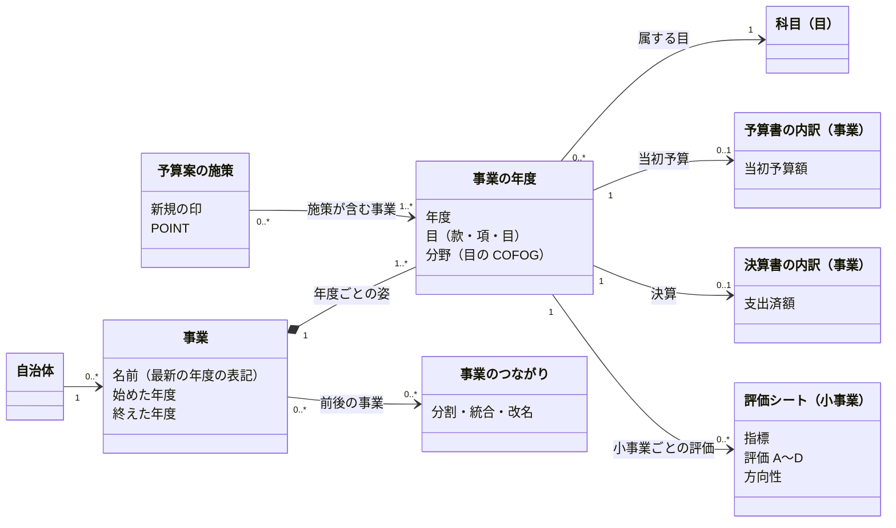

# 事業をオブジェクトとして扱う — ドメインモデル

状態: Draft（2026-11-09）。この文書はモデルの案で、`project_*` の表はまだ事業そのものを持たない。

## なぜ事業をオブジェクトにするか

住民が知りたいのは「この事業はいつ始まり、いくら使い、どう評価され、続くのか」で、答えは資料ごとに散らばっている。

- 予算書・決算書の内訳（事業）: いくら計上し、いくら使ったか
- 事務事業評価シート: 何を目指し（指標）、どう評価したか（A〜D・方向性）
- 予算案のプレス発表の施策: 新しく何を始めるか
- 将来: 首長の公約、議会の議案

今の `project_*` の表は、資料の行をそのまま持ち、予算書・決算書の内訳（`detail_id`）を指すだけである。`detail_id` は1つの資料の1行なので、年度や資料をまたいで「同じ事業」をたどれない。事業を、年度と資料をまたぐ1つのオブジェクトとして置く。

## モデル

### 事業（Project）

自治体が年度をまたいで続ける1つの取り組み。属性は名前（最新の年度の資料の表記）・始めた年度・終えた年度だけで、金額は持たない。同じ事業かどうかは出典に書かれていないので、事業の識別は **風土記の判断** である。

### 事業の年度（ProjectYear）

事業の1年度の姿。金額・評価・施策はここに付く。年度ごとに属する目（`fiscal_expenditure_subject`）と分野（その目の COFOG）が決まる。目は年度で変わることがある（組織の改正で款や項が付け替わる）。

### 資料の記録

資料の行は今の表のまま持ち、事業の年度を指す。

| 資料の記録 | 今の表 | 事業の年度との関係 |
| --- | --- | --- |
| 予算書の内訳（事業） | `fiscal_expenditure_detail`（当初、`breakdown='事業'`） | 0..1。事業の年度の金額の正 |
| 決算書の内訳（事業） | `fiscal_expenditure_detail`（決算、`breakdown='事業'`） | 0..1 |
| 評価シート | `project_evaluation_sheet` | 0..*。シートは小事業の単位で、1つの事業に複数付く |
| 予算案の施策 | `project_budget_initiative` | 多対多。1つの施策が複数の事業にまたがることがある |

品川の R6 で測った数（2026-11-09）:

- 事業に紐付いた評価シート 630 枚のうち、1つの事業に1枚だけ付くのは 292 事業。残りの 97 事業には2〜10枚付く。シートの決算額が内訳の額と合うのは 289 枚で、残りは小事業の和が事業の額になる。
- 施策は 135 件が 134 の事業に紐付き、2件が同じ事業に付いたのは1組だけ。今の紐付けは施策1件に事業1つだが、モデルは多対多にしておく。
- 予算書の「事業」の内訳は入れ子になっている（R8 当初は深さ1〜5）。事業の年度が指すのは、評価シートや施策が紐付いた深さの行とする。

### 事業のつながり（Lineage）

事業が分かれる・まとまる・名前が変わるとき、1つの事業として無理につなげず、前後の事業をつながりで結ぶ。つながりも風土記の判断。

## 年度をまたいで同じ事業と決める

1. **同じ年度の中**: 当初予算の内訳と決算の内訳を、同じ目の下の同じ名前（末尾の【所管課】を除く）で結ぶ。
2. **前の年度と**: 同じ会計・款・目の下に同じ名前の内訳が1つだけあれば、同じ事業とする。品川の当初予算では、名前と目の組の約75%がこれで前年度の1行に決まった（R7: 2,971 組のうち 2,184、R8: 3,001 組のうち 2,244）。
3. **残り**: 前年度に同じ名前の行が無い組（R7: 660、R8: 620）は、新しい事業か、名前や目が変わった事業である。施策の紐付けと同じく、単語の Dice 係数で前年度の候補を12件に絞り、Jev に「どれでもない」を含めて選ばせ、確信度 0.6 以上だけを同じ事業とする。外れたものは新しい事業として始める。
4. 判断は seed に置き、取り込みのときに一度だけ作る（施策の紐付けの seed と同じ扱い）。

評価シートと施策は、紐付いた `detail_id` から事業の年度に入る。予算書に事業の内訳が無い自治体（節だけの自治体）は、評価シートの予算科目の事業名を事業の年度の根拠にする。

## 表の案

| 表 | 1行 | 主な列 |
| --- | --- | --- |
| `project` | 事業1つ | `project_id`・`jurisdiction_code`・`name`・`first_year`・`last_year` |
| `project_year` | 事業の1年度 | `project_id`・`fiscal_year`・`subject_id`・`budget_detail_id`・`settlement_detail_id`・`cofog_code` |
| `project_lineage` | 事業のつながり1つ | `from_project_id`・`to_project_id`・`kind`（split・merge・rename） |

`project_evaluation_sheet` と `project_budget_initiative` には列を足さず、`detail_id` から `project_year` を引く。施策を多対多にするときは `project_budget_initiative_link` に行を足す。

`project_id` は最初の年度の `project_year` の内訳から作る。年度をまたぐ判断を直すと事業の識別子が変わるので、公開 API で `project_id` を出す前に、識別子を固定する方法を決める。

## まだ決めていないこと

- `project_id` を公開するか。出すなら、判断を直したときに識別子をどう保つか。
- 事業の年度が指す内訳の深さ。評価シートも施策も無い事業では、どの深さを事業とするか（今は深さを決めず、紐付いた行に従う）。
- 品川の R5 決算書を取り込むか。取り込まないと R5 の評価シートは事業に入らない。
