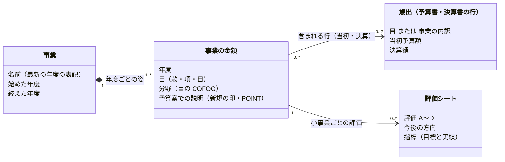

# 事業をオブジェクトとして扱う — ドメインモデル

状態: Draft（2026-11-09）。この文書はモデルの案で、`project_*` の表はまだ事業そのものを持たない。

## なぜ事業をオブジェクトにするか

住民が知りたいのは「この事業はいつ始まり、いくら使い、どう評価され、続くのか」で、答えは資料ごとに散らばっている。今の `project_*` の表は資料の行をそのまま持ち、予算書・決算書の内訳（`detail_id`）を指すだけなので、年度や資料をまたいで「同じ事業」をたどれない。事業を中心に置き、お金と評価をその年度ごとに付ける。

## エンティティは3つ

| エンティティ | 何か | 出どころ |
| --- | --- | --- |
| 事業 | 自治体が年度をまたいで続ける1つの取り組み | 予算書・決算書の内訳（事業）と評価シートの予算科目から、風土記が判断する |
| 歳出の行 | 予算書・決算書の1行のお金（目、または目の下の事業の内訳）。事業の金額はこの行に含まれる | 予算書・決算書 |
| 事業評価 | 自治体の1年度分の事務事業評価。評価シート（小事業ごとの指標の目標と実績、A〜D、今後の方向）と捻出額を持つ | 事務事業評価シート・評価結果 |



- **事業**の属性は名前・始めた年度・終えた年度だけで、金額は持たない。同じ事業かどうかは出典に書かれていないので、事業の識別は **風土記の判断** である。
- **事業の金額**は事業の1年度のお金で、属する目と分野（その目の COFOG）を持つ。目は組織の改正で年度ごとに変わることがある。
- **歳出の行**は予算書・決算書の行で、粒度は自治体の資料で決まる。事業の内訳（品川など）があればその行、無ければ目までしか無い。事業の金額は、当初予算と決算それぞれで、それを含むいちばん細かい行を指す（多対1。1つの行に複数の事業が入ることがある）。歳出の行を事業ごとに分ける根拠が資料に無いときは分けない。
- 事業ごとの額が要るときは、評価シートに印字された予算額・決算額（小事業の額）を使う。これは評価シートの値で、歳出の行とは足さない。
- **事業評価**は自治体の1年度分の事務事業評価で、評価シート全部と評価結果の資料（捻出額）を持つ。評価シートは小事業の単位なので、1つの事業の金額に複数付くことがある。シートの数・A〜D の数は持たずに数えて出し、評価結果の資料の件数と照合する。
- **予算案での説明**（予算案のプレス発表の施策の新規の印・POINT）は、エンティティにせず事業の金額の値にする。1つの施策が複数の事業にまたがるときは、それぞれの事業の金額に同じ説明を付ける。

### エンティティにしないもの

- **事業のつながり**（分割・統合・改名の前後）: 持たない。前年度と結べなかった事業は新しい事業として始める。後継を画面で見せるときに足す。
- **出典（PDF）**: エンティティではなく、各値の出どころ。どの値をどの資料の何頁から取ったかを辿るために持つ。

## 集約

| 集約 | 根 | 中に持つもの | ID で参照する集約 | 守ること |
| --- | --- | --- | --- | --- |
| 事業 | 事業 | 事業の金額、予算案での説明 | 自治体、歳出（事業の金額を含む目・内訳） | 1つの年度に事業の金額は1つ |
| 事業評価 | 事業評価（自治体×事業を行った年度） | 評価シート、指標、指標の年度ごとの目標と実績 | 自治体、事業（と年度） | シートの数・A〜D の数が評価結果の資料の件数と合う |
| 歳出（既存） | 1つの資料の1つの会計の歳出全体（自治体・年度・資料区分〔当初・補正号・決算〕・会計） | 歳出の行（科目＝款・項・目、内訳）、印字の位置 | 自治体 | 末端の科目の和が総額。内訳は科目と足さない |

- 事業の金額は、歳出の集約の中の歳出の行（目・内訳）を ID で参照する。集約の名前は「歳出」、中の1行は「歳出の行」と呼び分ける。根は `fiscal_expenditure_subject` と同じ粒度（自治体・年度・資料区分・会計）で、出典の予算書・決算書はその値の出どころとして持つ。
- 評価シートは事業の金額の行を直接指さず、事業と年度で参照する。表では列を持たず、評価シートの `detail_id`（または `subject_id`）から事業と年度を導出する。
- 自治体と COFOG などのマスタは、共通の参照先として扱う。

## 集約ごとの型

既存の集約（自治体・歳出・人口・事業評価）と、案の事業の中身を型の形で書く。厳密な TypeScript ではなく、項目と値の範囲を読むためのもの。既存の集約の項目は今の表の列に合わせている。

```ts
// ===== 自治体（root）
type 自治体 = {
  自治体コード: 自治体コード          // PK。この集約の ID。全国地方公共団体コード（6桁）
  名前: 文字                  // 武蔵野市
  都道府県: '北海道' | … | '沖縄県' // FK。47の決まった値（都道府県マスタ）
  公式サイト: URL
}

// ===== 歳出（root）: 1つの資料の1つの会計の歳出全体
type 歳出 = {
  自治体: 自治体コード             // PK・FK
  年度: 年度                  // PK
  資料区分: '当初予算' | '決算'     // PK。補正予算（第n号）は未収録
  会計: 会計                  // PK
  出典: 出典                  // 値を取った予算書・決算書
  科目: 科目[]                // 款の行。その下に項・目と内訳が続く（ここから下が「歳出の行」）
}
type 出典 = {
  資料名: 文字                // 例: 令和7年度 品川区予算書
  URL: URL                    // 公式サイトの公開 URL（ファイルそのもの）
  形式: 'PDF' | 'CSV' | 'Excel'
  SHA256: 文字                // 風土記が保存したファイルの指紋。ファイル本体は非公開の保管場所に置く
}
type 出典の頁 = {
  出典: 出典
  頁: 数
}
type 会計 = {
  名前: 文字                  // 出典の表記（一般会計・国民健康保険事業会計…）
  種類: 会計の種類
}
type 会計の種類 = '一般会計' | '国民健康保険' | '介護保険' | '後期高齢者医療' | '土地区画整理' | '駐車場' | '用地' | '財産区' | … // 約40種（対応表 account_kind_map が正）。風土記の判断。自治体をまたぐ比較に使う
type 科目 = {
  科目ID: 科目ID              // PK。表の subject_id
  階層: '款' | '項' | '目'
  番号?: 文字                 // 資料に印字された款・項・目の番号（例: 「2 総務費」の 2）。同じ親の中でだけ重ならない
  名前: 文字
  金額: 円                    // PDF は印字の額、CSV の親は子の和。子の科目の和と合う（取り込みで検査し、資料の印字が合わないところは宣言済みのずれとして残す）
  分野?: COFOG              // FK。目だけ（風土記の判断）
  分野の確かさ?: '確定' | '暫定' | '分類できない' | '対象外' // 目だけ
  繰出先?: 会計の種類         // 他の会計への繰出金のとき（風土記の判断）
  子の科目: 科目[]            // 款→項→目
  内訳: 内訳[]                // 目（と目の無い項）の下。科目と足さない
  印字の位置?: 印字の位置
}
type 内訳 = {
  内訳ID: 内訳ID              // PK。表の detail_id
  分け方: '事業' | '節' | 'その他' // 風土記の判断
  段の名前: 文字              // 内訳1・事項・節・細節…（印字の見出し）
  名前: 文字                  // 資料のまま
  所管課?: 文字              // 名前の末尾の【】
  法定の節?: 歳出の節             // FK。分け方が節のとき（節マスタ）
  繰出先?: 会計の種類         // 他の会計への繰出金のとき（風土記の判断）
  金額: 円
  内訳の内訳: 内訳[]          // 深さは資料しだい
  印字の位置?: 印字の位置
}
type 印字の位置 = {           // 名前と金額が出典のどこに印字されているか
  頁: 数                    // PDF はファイルの中で1から数えた頁。CSV は行番号
  名前の枠?: 枠             // PDF だけ
  金額の頁?: 数
  金額の枠?: 枠             // PDF だけ。1つの印字が全額のときだけ
}
type 枠 = { 左: 数, 上: 数, 右: 数, 下: 数 } // 頁の左上を原点にした pt
// 末端の科目の和 = 総額。分け方の違う内訳どうしは足さない

// ===== 人口（root）
type 人口 = {
  自治体: 自治体コード             // PK・FK
  基準日: 日付                 // PK
  男: 人数
  女: 人数
  総数: 人数
  世帯数: 数
  出典: 出典                  // 総務省の住民基本台帳の集計（Excel）
}

// ===== 事業評価（root）: 自治体の1年度分の事務事業評価（評価結果の資料と評価シート全部）
type 事業評価 = {
  自治体: 自治体コード      // PK・FK
  事業を行った年度: 年度    // PK。評価した事業を実施した年度
  評価した年度: 年度
  反映した予算の年度: 年度  // 評価の結果を反映した予算の年度
  捻出額: 円                // 評価結果の資料にだけ載る（シートからは出せない）
  出典: 出典の頁            // 評価結果の資料
  シート: 評価シート[]
}
type 評価シート = {         // 1枚 = 小事業の1年度
  評価シートID: 評価シートID // PK。表の sheet_id
  事業: 事業ID と 年度           // FK。★案。今は予算書の内訳から導く
  事業名: 文字                // 小事業の名前。資料のまま
  所管課: 文字
  事業期間: 始めた年度〜終わる年度
  予算額: 円                  // 小事業の額。歳出の行とは足さない
  決算額: 円
  評価: 'A' | 'B' | 'C' | 'D'
  評価の名前?: 文字           // シートの表記（例: 改善・見直しする事業）
  今後の方向?: 文字          // シートの表記（例: 手法等の改善）
  指標: 指標[]
  出典: 出典の頁
}
type 指標 = {
  名前: 文字
  単位?: 文字
  定義?: 文字
  最終目標?: 文字
  年度: 指標の年度[]
}
type 指標の年度 = {
  年度: 年度                  // PK
  目標?: 文字
  実績?: 文字
}
// 評価シートの数・A〜D の数が、評価結果の資料の件数と合う

// ===== 事業（root・★案）: 年度をまたいで続く1つの取り組み（風土記の判断）
type 事業 = {
  事業ID: 事業ID              // PK。★案
  自治体: 自治体コード             // FK
  名前: 文字                  // 最新の年度の表記
  始めた年度: 年度
  終えた年度?: 年度
  金額: 事業の金額[]           // 年度ごと
}
type 事業の金額 = {
  年度: 年度                  // PK
  当初予算の行?: 科目ID または 内訳ID // FK。この事業を含むいちばん細かい行
  決算の行?: 科目ID または 内訳ID    // FK
  予算案での説明: 予算案での説明[]
}
type 予算案での説明 = {         // 値（エンティティにしない）
  施策名: 文字
  新規: はい | いいえ          // 新規の印
  ポイント: 文字[]
  予算額?: 円
  出典: 出典の頁
}
// 1つの年度に 事業の金額 は1つ

```

## 今の表との対応

| モデル | 今の表 | 状態 |
| --- | --- | --- |
| 事業・事業の金額 | なし | 案（下の「表の案」） |
| 歳出 | `fiscal_expenditure_subject`（目）・`fiscal_expenditure_detail`（`breakdown='事業'`） | あり |
| 事業評価 | `project_evaluation_result`（root）・`project_evaluation_sheet`・`project_evaluation_indicator`・`project_evaluation_indicator_value` | あり。シートは `detail_id` で内訳を指す |
| 予算案での説明 | `project_budget_initiative` | あり。施策1件1行で `detail_id` を指す |
| 出典 | `fiscal_origin`・`project_origin`・`population_origin` | あり。`population_origin` は資料名・形式・SHA256 を持たない（基準日と URL だけ）。`project_origin` は形式を持たない（事業の資料は PDF だけ） |

品川の R6 で測った数（2026-11-09）:

- 事業に紐付いた評価シート 630 枚のうち、1つの事業に1枚だけ付くのは 292 事業。残りの 97 事業には2〜10枚付く。シートの決算額が内訳の額と合うのは 289 枚で、残りは小事業の和が事業の額になる。
- 施策は 135 件が 134 の事業に紐付き、2件が同じ事業に付いたのは1組だけ。
- 予算書の「事業」の内訳は入れ子になっている（R8 当初は深さ1〜5）。事業の金額が指すのは、評価シートや施策が紐付いた深さの行とする。

## 年度をまたいで同じ事業と決める

1. **同じ年度の中**: 当初予算の内訳と決算の内訳を、同じ目の下の同じ名前（末尾の【所管課】を除く）で結ぶ。
2. **前の年度と**: 会計・款・目と名前（末尾の【所管課】を除く）の組を単位にする。今年度と前年度の両方でその組の行が1つだけなら、同じ事業とする。
3. **残り**: 次の2つは、施策の紐付けと同じく、単語の Dice 係数で前年度の候補を12件に絞り、Jev に「どれでもない」を含めて選ばせ、確信度 0.6 以上だけを同じ事業とする。外れたものは新しい事業として始める。
   - 前年度に同じ組が無い（新しい事業か、名前や目が変わった事業）
   - 今年度か前年度に同じ組の行が複数ある（同じ目の下に同じ名前の内訳が複数印字されている）
4. 判断は seed に置き、取り込みのときに一度だけ作る（施策の紐付けの seed と同じ扱い）。

品川の当初予算の組の数（2026-11-09）:

| 予算の年度 | 組 | 手順2で決まる | 前年度に同じ組が無い | 同じ組の行が複数 |
| --- | --- | --- | --- | --- |
| R7 | 2,971 | 2,184（74%） | 660 | 127 |
| R8 | 3,001 | 2,244（75%） | 620 | 137 |

評価シートと予算案での説明は、紐付いた `detail_id` から事業とその年度を得る。予算書に事業の内訳が無い自治体（目と節だけの自治体）は、評価シートの予算科目（目と事業名）を事業の金額の根拠にし、年度をまたぐ判定も評価シートの事業名で行う。この場合、事業の金額が指す歳出は目になる。

## 表の案

| 表 | 1行 | 主な列 |
| --- | --- | --- |
| `project` | 事業1つ | `project_id`・`jurisdiction_code`・`name`・`first_year`・`last_year` |
| `project_year` | 事業の1年度 | `project_id`・`fiscal_year`・`subject_id`（含む目）・`budget_detail_id`・`settlement_detail_id`（含む内訳。無ければ空）・`cofog_code` |

`project_evaluation_sheet` と `project_budget_initiative` には列を足さず、`detail_id` から `project_year` を引いて事業と年度を得る。施策を多対多にするときは `project_budget_initiative_link` に行を足す。

`project_id` は最初の年度の `project_year` の内訳から作る。年度をまたぐ判断を直すと事業の識別子が変わるので、公開 API で `project_id` を出す前に、識別子を固定する方法を決める。

## まだ決めていないこと

- `project_id` を公開するか。出すなら、判断を直したときに識別子をどう保つか。
- 事業の金額が指す内訳の深さ。評価シートも施策も無い事業では、どの深さを事業とするか（今は深さを決めず、紐付いた行に従う）。
- 品川の R5 決算書を取り込むか。取り込まないと R5 の評価シートは事業に入らない。
