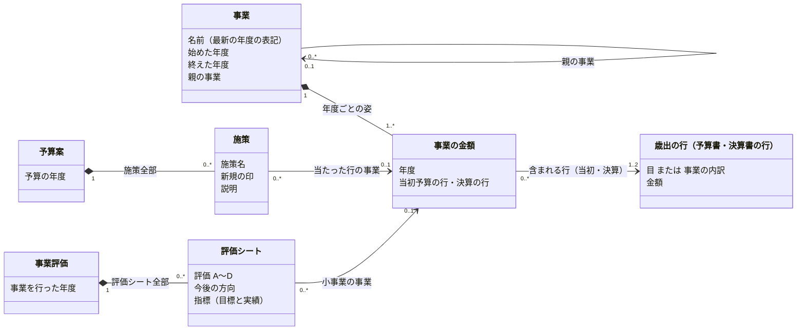

# 事業をオブジェクトとして扱う — ドメインモデル

状態: Draft（2026-11-10）。この文書はモデルの案で、`project_*` の表はまだ事業そのものを持たない。

## なぜ事業をオブジェクトにするか

住民が知りたいのは「この事業はいつ始まり、いくら使い、どう評価され、続くのか」で、答えは資料ごとに散らばっている。今の `project_*` の表は資料の行をそのまま持ち、予算書・決算書の内訳（`detail_id`）を指すだけなので、年度や資料をまたいで「同じ事業」をたどれない。事業を中心に置き、お金と評価をその年度ごとに付ける。

## エンティティ

| エンティティ | 何か | 出どころ |
| --- | --- | --- |
| 事業 | 自治体が年度をまたいで続ける1つの取り組み。予算書に印字された事業の行を1つずつ事業にし、親の事業を持つ木にする。最小単位は末端の事業 | 予算書・決算書の内訳（事業）を土台に、年度をまたぐつながりを風土記が判断する |
| 歳出の行 | 予算書・決算書の1行のお金（目、または目の下の事業の内訳）。事業の金額はこの行に含まれる | 予算書・決算書 |
| 事業評価 | 自治体の1年度分の事務事業評価。評価シート（小事業ごとの指標の目標と実績、A〜D、今後の方向）と評価結果の資料を持つ | 事務事業評価シート・評価結果 |
| 予算案 | 自治体の1年度分の予算案のプレス発表。資料に載った施策を全部持つ | 予算案のプレス発表の資料 |



- **事業**は、予算書に印字された事業の行を1つずつ事業にし、年度をまたいでつないだもの。予算書の入れ子のとおりに親の事業を持つ（木）。最小単位は末端の事業で、品川は1年度に約2,450件。目の直下の事業（約460件）が木の根になる。属性は名前・始めた年度・終えた年度・親の事業だけで、金額は持たない。年度をまたいで同じ事業かどうかは出典に書かれていないので、事業の識別は **風土記の判断** である。
- **始めた年度・終えた年度**は収録した資料の範囲でしか決まらない。収録の最初の年度にある事業は「収録の前から」で、その年度に始めたとはしない。最新の年度にある事業は「最新の年度にある」で、終えたとはしない。次の年度の資料が無い（収録の欠け）ときも終えたとはしない。新しくできた事業は、始めた年度が確定していて、その年度と一致するものだけである。
- **事業の金額**は事業の1年度のお金で、その年度の当初予算と決算の行を指す。どちらか1つは必ずある。目と分野（その目の COFOG）は指す行から導けるので持たない。
- **歳出の行**は予算書・決算書の行で、粒度は自治体の資料で決まる。事業の内訳（品川など）があれば、事業の金額は当初予算と決算それぞれで、その事業の行を指す（1対1。1つの内訳は高々1つの事業の年度に入る）。事業の内訳が無い自治体は目までしか無いので、事業の金額は目（目の無い項を含む）を指す（多対1。1つの目に複数の事業が入る）。歳出の行を事業ごとに分ける根拠が資料に無いときは分けない。
- 金額を足すときは事業の木を使わず、資料ごとに末端の内訳（`fiscal_expenditure_detail.is_leaf`）を足す。当初予算にだけ・決算にだけある事業があるので、事業の木で末端を決めると資料によって数え漏れる。
- 事業ごとの額が要るときは、評価シートに印字された予算額・決算額（小事業の額）を使う。これは評価シートの値で、歳出の行とは足さない。
- **事業評価**は自治体の1年度分の事務事業評価で、評価シート全部と評価結果の資料を持つ。評価結果の資料に載る捻出額（予算の削減額）は、何の額か資料から確かめられず誤解を招くので持たない。評価シートは事業の年度を任意で参照する。シートの予算科目（目と事業名）で決算書の事業の行を決め、さらにその子孫にシートの事業名（小事業名）と同じ名前の事業が1つだけあれば、そちらに付ける。小事業の単位なので、1つの事業の年度に複数付くことがある。評価結果の資料に載る件数（評価した数・A〜D の数）は資料の値として持ち、シートを取り込んだ年度はシートを数えた数と照合する（品川の R4 実施分は評価結果の資料だけでシートが無い）。シートに印字された事業期間は持たず、事業の期間は事業の始めた年度・終えた年度で表す。新しくできた事業かどうかも評価シートには持たず、事業の始めた年度で決める。評価した年度と反映した予算の年度は事業を行った年度から決まる（品川はそれぞれ +1・+2）ので持たない。
- **予算案**は自治体の1年度分の予算案のプレス発表で、資料に載った施策（施策名・事業名・新規の印・説明・予算額）を全部持つ。施策は事業の年度を任意で参照する。当初予算書の事業の行に当たった施策は、その行の事業の年度を指す（1つの事業の年度に複数付くことがある）。当たらない施策は参照を空にして予算案の中に残し、事業は作らない。

### エンティティにしないもの

- **事業のつながり**（分割・統合・改名の前後）: 持たない。前年度と結べなかった事業は新しい事業として始める。後継を画面で見せるときに足す。
- **出典（PDF）**: エンティティではなく、各値の出どころ。どの値をどの資料の何頁から取ったかを辿るために持つ。

## 集約

| 集約 | 根 | 中に持つもの | ID で参照する集約 | 守ること |
| --- | --- | --- | --- | --- |
| 事業 | 事業 | 事業の金額 | 自治体、歳出（事業の行。内訳の無い自治体は目）、親の事業 | 1つの年度に事業の金額は1つ。親の事業をたどって自分に戻らない。1つの内訳は高々1つの事業の年度に入る |
| 事業評価 | 事業評価（自治体×事業を行った年度） | 評価シート、指標、指標の年度ごとの目標と実績 | 自治体、事業（と年度） | シートを取り込んだ年度は、シートの数・A〜D の数が評価結果の資料の件数と合う |
| 予算案 | 予算案（自治体×予算の年度） | 施策 | 自治体、事業（と年度） | 施策が指す事業の年度は、同じ予算の年度の当初予算の行を持つ |
| 歳出（既存） | 1つの資料の1つの会計の歳出全体（自治体・年度・資料区分〔当初・補正号・決算〕・会計） | 歳出の行（科目＝款・項・目、内訳）、印字の位置 | 自治体 | 末端の科目の和が総額。内訳は科目と足さない |

- 事業の金額は、歳出の集約の中の歳出の行（目・内訳）を ID で参照する。集約の名前は「歳出」、中の1行は「歳出の行」と呼び分ける。根は `fiscal_expenditure_subject` と同じ粒度（自治体・年度・資料区分・会計）で、出典の予算書・決算書（分冊なら全部の冊）はその値の出どころとして持つ。
- 評価シートと施策は事業の金額の行を直接指さず、事業と年度で参照する。表では列を持たず、`detail_id` から事業と年度を導出する。内訳の無い自治体では目（`subject_id`）だけでは事業が決まらないので、目と評価シートの事業名で事業を決めた判断を seed に置き、シートはその判断を引く。
- 自治体と COFOG などのマスタは、共通の参照先として扱う。

## 集約ごとの型

既存の集約（自治体・歳出・人口・事業評価）と、案の事業の中身を TypeScript の型で書く（`--lib es2022` の下で `tsc --strict` を通る）。場合で形が変わる所は任意の項目にせず union で分ける。任意（`?`）は、出典に無いことがある値だけに付ける。既存の集約の項目は今の表の列に合わせている。

```ts
// ----- 基本の型
type 文字 = string
type 数 = number
type 円 = number                 // 整数
type 人数 = number
type 年度 = number               // 会計年度の西暦（R7年度 = 2025）
type 日付 = string               // YYYY-MM-DD
type URL = string
type 自治体コード = string       // 全国地方公共団体コード（6桁）
type 科目ID = string             // 表の subject_id
type 内訳ID = string             // 表の detail_id
type 事業ID = string             // ★案
type COFOG = string              // COFOG分類マスタのコード
type 歳出の節 = string           // 歳出の節マスタの ID
type 都道府県 = '北海道' | '青森県' | '岩手県' | '宮城県' | '秋田県' | '山形県' | '福島県' | '茨城県' | '栃木県' | '群馬県' | '埼玉県' | '千葉県' | '東京都' | '神奈川県' | '新潟県' | '富山県' | '石川県' | '福井県' | '山梨県' | '長野県' | '岐阜県' | '静岡県' | '愛知県' | '三重県' | '滋賀県' | '京都府' | '大阪府' | '兵庫県' | '奈良県' | '和歌山県' | '鳥取県' | '島根県' | '岡山県' | '広島県' | '山口県' | '徳島県' | '香川県' | '愛媛県' | '高知県' | '福岡県' | '佐賀県' | '長崎県' | '熊本県' | '大分県' | '宮崎県' | '鹿児島県' | '沖縄県'
type 会計の種類 = '一般会計' | 'と場' | 'テレビ共同受信' | '下水道' | '中小企業設備導入等資金' | '介護サービス事業' | '介護保険' | '公債費' | '国民健康保険' | '土地区画整理' | '地方消費税清算' | '地方独立行政法人病院貸付' | '小笠原諸島生活再建資金' | '工業用水道清算' | '市営住宅' | '市場' | '市街地再開発' | '後期高齢者医療' | '心身障害者扶養年金' | '林業・木材産業改善資金' | '母子父子寡婦福祉資金貸付' | '沿岸漁業改善資金' | '災害復旧' | '特別区財政調整' | '用地' | '病院事業' | '病院施設' | '空港整備' | '競走事業' | '競輪事業' | '老人保健施設' | '臨海都市基盤整備' | '財産区' | '連続立体化' | '都営住宅' | '都営住宅保証金' | '都市開発資金' | '都民の森' | '食肉センター' | '駐車場' | '不明' // 対応表 account_kind_map が正。風土記の判断。自治体をまたぐ比較に使う
type 出典<形式 extends 'PDF' | 'CSV' | 'Excel' = 'PDF' | 'CSV' | 'Excel'> = {
  資料名: 文字                // 例: 令和7年度 品川区予算書
  URL: URL                    // 公式サイトの公開 URL（ファイルそのもの）
  形式: 形式
  SHA256: 文字                // 風土記が保存したファイルの指紋。ファイル本体は非公開の保管場所に置く
}

// ===== 自治体（root）
type 自治体 = {
  自治体コード: 自治体コード  // PK。この集約の ID
  名前: 文字                  // 武蔵野市
  都道府県: 都道府県          // FK。都道府県マスタ
  公式サイト: URL
}

// ===== 歳出（root）: 1つの資料の1つの会計の歳出全体
type 歳出 = {
  自治体: 自治体コード        // PK・FK
  年度: 年度                  // PK
  資料区分: '当初予算' | '決算' // PK。補正予算（第n号）は未収録
  会計: 会計                  // PK
  出典: 出典<'PDF' | 'CSV'>[] // 値を取った予算書・決算書。分冊は冊ごと
  款: 款[]                    // ここから下が「歳出の行」
}
type 会計 = {
  名前: 文字                  // 出典の表記（一般会計・国民健康保険事業会計…）
  種類: 会計の種類
}
type 科目の共通 = {           // 款・項・目に共通の項目
  科目ID: 科目ID              // PK
  番号?: 文字                 // 資料に印字された款・項・目の番号（例: 「2 総務費」の 2）。同じ親の中でだけ重ならない
  名前: 文字
  金額: 円                    // PDF は印字の額、CSV の親は子の和。子の科目の和と合う（取り込みで検査し、資料の印字が合わないところは宣言済みのずれとして残す）
  印字の位置: 印字の位置
}
type 款 = 科目の共通 & {
  項: 項[]
}
type 項 = 科目の共通 & {
  目: 目[]                    // 目の無い項は空
  内訳: 内訳[]                // 科目と足さない
}
type 目 = 科目の共通 & {
  分野: 分野                  // 風土記の判断
  繰出先?: 会計の種類         // 他の会計への繰出金のとき（風土記の判断）
  内訳: 内訳[]                // 科目と足さない
}
type 分野 = 分類した分野 | 分類しない分野
type 分類した分野 = {
  確かさ: '確定' | '暫定'
  COFOG: COFOG                // FK
}
type 分類しない分野 = {
  確かさ: '分類できない' | '対象外'
}
type 内訳 = 事業の内訳 | 事業でない内訳 // 分け方は風土記の判断
type 内訳の共通 = {
  内訳ID: 内訳ID              // PK
  段の名前: 文字              // 内訳1・事項・節・細節…（印字の見出し）
  名前: 文字                  // 資料のまま
  法定の節?: 歳出の節         // FK。節マスタに当たった行だけ
  繰出先?: 会計の種類         // 他の会計への繰出金のとき（風土記の判断）
  金額: 円
  内訳の内訳: 内訳[]          // 深さは資料しだい
  印字の位置: 印字の位置
}
type 事業の内訳 = 内訳の共通 & {
  分け方: '事業'
  所管課?: 文字               // 名前の末尾の【】
}
type 事業でない内訳 = 内訳の共通 & {
  分け方: '節' | 'その他'
}
type 印字の位置 = PDFの位置 | CSVの位置 // 名前と金額が出典のどこに印字されているか。出典の形式で形が違う
type PDFの位置 = {
  出典: 文字                  // 歳出.出典 のどの冊か（SHA256）
  名前の頁: 数                // ファイルの中で1から数えた頁
  名前の枠: 枠
  金額の頁?: 数
  金額の枠?: 枠               // 1つの印字が全額のときだけ
}
type CSVの位置 = {
  出典: 文字                  // 歳出.出典 のどの冊か（SHA256）
  名前の行: 数                // ファイルの中の行番号
  金額の行?: 数
}
type 枠 = {                   // 頁の左上を原点にした pt
  左: 数
  上: 数
  右: 数
  下: 数
}
// 守ること: 末端の科目の和 = 総額。分け方の違う内訳どうしは足さない

// ===== 人口（root）
type 人口 = {
  自治体: 自治体コード        // PK・FK
  基準日: 日付                // PK
  男: 人数
  女: 人数
  総数: 人数
  世帯数: 数
  出典: 出典<'Excel'>         // 総務省の住民基本台帳の集計
}

// ===== 事業評価（root）: 自治体の1年度分の事務事業評価（評価結果の資料と評価シート全部）
type 事業評価 = {
  自治体: 自治体コード        // PK・FK
  事業を行った年度: 年度      // PK。評価した事業を実施した年度
  出典: 出典<'PDF'>           // 評価結果の資料
  件数: 評価の件数            // 評価結果の資料に載る数
  シート: 評価シート[]        // シートを取り込んでいない年度は空
}
type 評価の件数 = {
  評価した数: 数
  A: 数
  B: 数
  C: 数
  D: 数
}
type 評価シート = {           // 1枚 = 小事業の1年度。出典と頁で1枚が決まる
  事業?: 事業の年度の参照     // FK。★案。今は決算書の内訳から導く。決算書の無い年度など紐付かないシートもある
  事業名: 文字                // 小事業の名前。資料のまま
  予算科目: 予算科目          // シートに印字された予算科目。事業に紐付けた根拠
  部?: 文字                   // 担当部署。シートの表記
  課?: 文字                   // 担当課。シートの表記
  予算額: 円                  // 小事業の額。歳出の行とは足さない
  決算額: 円
  評価: 'A' | 'B' | 'C' | 'D'
  評価の名前?: 文字           // シートの表記。読めない欄は空（例: 改善・見直しする事業）
  今後の方向?: 文字           // シートの表記。読めない欄は空（例: 手法等の改善）
  指標: 指標[]
  出典: 出典<'PDF'> & { 頁: 数 } // PK
}
type 予算科目 = {             // 読めない欄は空
  会計?: 文字
  款?: 文字
  項?: 文字
  目?: 文字
  事業?: 文字
}
type 事業の年度の参照 = {
  事業: 事業ID
  年度: 年度
}
type 指標 = {
  名前: 文字
  単位?: 文字
  定義?: 文字
  最終目標?: 文字             // シートの表記のまま
  最終目標の年度?: 文字       // シートの表記のまま（例: 令和8年度）
  年度: 指標の年度[]
}
type 指標の年度 = {
  年度: 年度                  // PK
  目標?: 文字
  実績?: 文字
}
// 守ること: シートを取り込んだ年度は、評価シートの数・A〜D の数が 件数 と合う

// ===== 予算案（root）: 自治体の1年度分の予算案のプレス発表
type 予算案 = {
  自治体: 自治体コード        // PK・FK
  予算の年度: 年度            // PK
  出典: 出典<'PDF'>           // プレス発表の資料
  施策: 施策[]
}
type 施策 = {                 // 資料の1施策。出典と頁で1件が決まる
  事業?: 事業の年度の参照     // FK。★案。今は当初予算書の内訳から導く。当たらない施策は空
  施策名: 文字
  事業名: 文字[]              // 資料の事業名の欄。複数のことがある
  新規: boolean               // 新規の印
  説明: 文字                  // 資料の説明文（品川は「ポイント」の箇条書き）
  予算額?: 円
  頁: 数                      // PK
}
// 守ること: 事業 を指す施策は、その事業の 予算の年度 の当初予算の行に当たっている

// ===== 事業（root・★案）: 予算書の事業の行を1つずつ事業にし、年度をまたいでつないだ木（つなぎは風土記の判断）。最小単位は末端の事業
type 事業 = {
  事業ID: 事業ID              // PK。代理キー。一度振ったら変えない
  自治体: 自治体コード        // FK
  名前: 文字                  // 最新の年度の表記
  始めた年度: 始めた年度
  終えた年度: 終えた年度
  親の事業?: 事業ID           // FK。予算書の入れ子の1つ上の事業。目の直下の事業は持たない
  金額: 事業の金額[]          // 年度ごと
}
type 始めた年度 = 始めた年度が確定 | 収録の前から
type 始めた年度が確定 = {
  種類: '確定'
  年度: 年度                  // 前の年度の資料があり、そこに無かった
}
type 収録の前から = {
  種類: '収録の前から'
  最初に見えた年度: 年度      // 収録の最初の年度
}
type 終えた年度 = 終えた年度が確定 | 最新の年度にある | 終えたか分からない
type 終えた年度が確定 = {
  種類: '確定'
  最後の年度: 年度            // 次の年度の資料があり、そこに無かった
}
type 最新の年度にある = {
  種類: '最新の年度にある'
}
type 終えたか分からない = {
  種類: '分からない'
  最後に見えた年度: 年度      // 次の年度の資料（その会計）が収録に無い
}
type 事業の金額 = 当初予算と決算 | 当初予算だけ | 決算だけ
type 事業の金額の共通 = {
  年度: 年度                  // PK
}
type 当初予算と決算 = 事業の金額の共通 & {
  資料: '両方'
  当初予算の行: 歳出の行の参照 // FK
  決算の行: 歳出の行の参照    // FK
}
type 当初予算だけ = 事業の金額の共通 & {
  資料: '当初予算'
  当初予算の行: 歳出の行の参照 // FK
}
type 決算だけ = 事業の金額の共通 & {
  資料: '決算'                // 補正で作った事業など
  決算の行: 歳出の行の参照    // FK
}
type 歳出の行の参照 = 内訳の参照 | 目の参照
type 内訳の参照 = {           // その事業の行
  種類: '内訳'
  内訳ID: 内訳ID
}
type 目の参照 = {             // 事業の内訳が無い自治体。目の無い項を含む
  種類: '目'
  科目ID: 科目ID
}
// 守ること: 1つの年度に 事業の金額 は1つ。1つの内訳は高々1つの事業の年度に入る。金額は事業の木で足さず、資料ごとに末端の内訳を足す
```

## 今の表との対応

| モデル | 今の表 | 状態 |
| --- | --- | --- |
| 事業・事業の金額 | なし | 案（下の「表の案」） |
| 歳出 | `fiscal_expenditure_subject`（目）・`fiscal_expenditure_detail`（`breakdown='事業'`） | あり |
| 事業評価 | `project_evaluation_result`（root。事業を行った年度は表の `fiscal_year`）・`project_evaluation_sheet`（`sheet_id` は出典と頁から作る列で、指標の表から引くために持つ）・`project_evaluation_indicator`・`project_evaluation_indicator_value` | あり。シートは `detail_id` で内訳を指す |
| 予算案 | `project_origin`（`document_type='press'`。root）・`project_budget_initiative`（施策） | あり。施策1件1行で、当たった内訳を `detail_id` で指す（当たらなければ空）。説明（`description`）は資料の箇条書きを改行でつないだ文字 |
| 出典 | `fiscal_origin`・`project_origin`・`population_origin` | あり。`population_origin` は資料名・形式・SHA256 を持たない（基準日と URL だけ）。`project_origin` は形式を持たない（事業の資料は PDF だけ） |

品川で測った数（2026-11-10）:

- 当初予算の事業の行は R6 3,152件・R7 3,200件・R8 3,223件で、深さ5まである。末端は R6 2,416件・R7 2,452件・R8 2,471件。目の直下は R6 462件・R7 463件・R8 462件（一般会計は 355〜361件）。
- R6 の評価シート 652枚のうち 630枚が決算書の事業の行に紐付く。319枚は予算科目の事業の子孫にシートの事業名と同じ名前の事業が1つだけあり、そちらに付く（うち 317枚は決算額の差が 1,000円未満）。残りの 311枚は予算科目の事業（目の直下）に付く。付いた事業は 614件で、1枚だけ付くのが 604件、2〜6枚付くのが 10件。1枚だけ付く事業のうち 592件は、シートの決算額と事業の額の差が 1,000円未満。
- 予算案の施策は R7・R8 の 160件のうち 135件が事業の行（深さ1〜4。多くは2〜3）に紐付く。目の直下までさかのぼると 105 の事業の下にある。紐付かないのは 25件（R7 11件・R8 14件）。

## 事業を作る

1. **土台**: 年度ごとに、当初予算の事業の行を1つずつ、事業の1年度とする。親の事業は予算書の入れ子の1つ上の行の事業。
2. **同じ年度の決算**: 決算書の事業の行を、会計・款・項・目と親からの名前の並びが同じ当初予算の行に結ぶ。名前は手順3と同じく【所管課】から後ろを除いて比べる。並びが当初予算と決算の両方に1つずつあるときだけ結ぶ。同じ親の下に同じ名前が複数あるとき（品川の R7 当初で4組。学校維持管理費など）は、両方を印字順に並べて同じ順番どうしを結ぶ。品川の R6 の目の直下は 462件のうち 457件が結べる。決算書にだけある事業（R6 の目の直下は7件。補正で作った事業など）は、決算の行だけを持つ事業の年度にする。
3. **前の年度と**: 上の段から順に結ぶ。候補は前の年度の事業の年度すべて（当初予算か決算の行があるもの）。目の直下は、会計・款・項・目と名前の組が今年度と前年度の両方に1つずつあれば同じ事業とする。その下の段は、親が同じ事業と決まった中で、名前が両方に1つずつあれば同じ事業とする。名前は【所管課】から後ろ（所管課と、人数・基金の見込額などの注記）を除く。前の年度に無く、2年以上前にあった事業は結ばず、新しい事業にする。
4. **残り**: 手順3で決まらない事業（新しい事業か、名前や目が変わった事業）は、施策の紐付けと同じく、単語の Dice 係数で前年度の候補を12件に絞り、Jev に「どれでもない」を含めて選ばせ、確信度 0.6 以上だけを同じ事業とする。目の直下より下の段の候補は、親が同じ事業の中だけから取る。前年度の事業は今年度の1つの事業にだけ結ぶ。手順3で結んだ前年度の事業は候補から除き、同じ候補を複数の事業が選んだら確信度が最も高い1つだけを結ぶ（同点なら Dice 係数の高い方、それも同じなら今年度の行の印字順で先の方）。外れたものは新しい事業として始める。
5. **始めた年度・終えた年度**: 収録の最初の年度にある事業は「収録の前から」。それより後に始まった事業は「確定」。最新の年度にある事業は「最新の年度にある」。途中で消えた事業は、次の年度にその自治体・会計の資料があれば「確定」、無ければ「分からない」。
6. **評価シートと施策を付ける**: 評価シートは `detail_id` の行（予算科目の事業、またはその子孫で事業名が1つだけ当たる事業）の事業の年度に、施策は紐付いた行の事業の年度に付ける。紐付かない施策は事業に付けず、予算案の中に残す。
7. **seed**: 手順2〜4の判断は seed に置き、取り込みのときに一度だけ作る（施策の紐付けの seed と同じ扱い）。seed は `detail_id` ではなく、自治体・年度・資料区分・会計・款・項・目と親からの名前の並びで行を引く（`detail_id` は名前を含む hash なので、取り込みを直すと変わる）。事業ID は seed で一度だけ振り、判断を直しても、収録の年度を足しても変えない。

品川の当初予算で、手順3で決まる数（2026-11-10）。下の段は、会計・款・項・目と親からの名前の並びが前年度に1つだけある行を数えた。

| 予算の年度 | 段 | 事業の行 | 手順3で決まる | 手順4に回る |
| --- | --- | --- | --- | --- |
| R7 | 目の直下 | 463 | 437（94%） | 26 |
| R7 | 全部の段 | 3,200 | 2,363（74%） | 837 |
| R7 | 末端だけ | 2,452 | 1,704（69%） | 748 |
| R8 | 目の直下 | 462 | 448（97%） | 14 |
| R8 | 全部の段 | 3,223 | 2,402（75%） | 821 |
| R8 | 末端だけ | 2,471 | 1,733（70%） | 738 |

目の直下では、同じ組の行が複数ある事業は無い。手順4に回る目の直下の事業のうち、目を除いて名前だけで前年度に当たるのは R7 で7件（目が変わった事業）で、残りは新しい事業か改名（例: 歩行喫煙防止推進経費 → 路上等喫煙防止推進経費）。下の段で手順4に回る約800件を Jev でどこまで結べるかは未実測。

予算書に事業の内訳が無い自治体（目と節だけの自治体）は、評価シートの予算科目（目と事業名）を事業の年度の根拠にし、年度をまたぐ判定も評価シートの事業名で行う。この場合、事業の金額が指す歳出は目になる。

## 表の案

| 表 | 1行 | 主な列 |
| --- | --- | --- |
| `project` | 事業1つ | `project_id`（代理キー）・`jurisdiction_code`・`name`・`first_year`・`first_year_kind`（`confirmed`・`before_coverage`）・`last_year`・`last_year_kind`（`confirmed`・`latest`・`unknown`。`latest` のとき `last_year` は空）・`parent_project_id` |
| `project_year` | 事業の1年度 | `project_id`・`fiscal_year`・`budget_detail_id`・`settlement_detail_id`（その事業の行。内訳のある自治体）・`budget_subject_id`・`settlement_subject_id`（目。内訳の無い自治体だけ。目の無い項を含む） |

- `project_year` は資料ごとに、内訳か目のどちらか1つを持ち、当初予算と決算の少なくとも一方を持つ。目と分野は内訳から導けるので、内訳のある自治体では持たない。
- `budget_detail_id`・`settlement_detail_id` は、空でなければ表の中で重ならない（unique test）。
- `project_evaluation_sheet` と `project_budget_initiative` には列を足さず、`detail_id` から `project_year` を引いて事業と年度を得る。評価シートの `detail_id` は決算書の内訳なので `settlement_detail_id` に、施策の `detail_id` は当初予算書の内訳なので `budget_detail_id` に当てる。内訳の無い自治体は、評価シートは目と事業名で、施策は目と施策名で事業を決めた判断を seed に置いて引く。

## まだ決めていないこと

- `project_id` を公開するか。
- 下の段の年度またぎの精度。規則で決まるのは約7割で、残り約800件/年度を Jev で結んだ結果をまだ測っていない。
- 他の自治体の入れ子。入れ子の作りは自治体ごとに違うので、2つ目の自治体で確かめる。
- 内訳の無い自治体では、事業の年度を評価シートから作るので、事業が事業評価の中身に依存する。当初予算の目をどう決めるかも含めて、2つ目の自治体で確かめる。
- 紐付かない施策（品川は 25件）を、全部の段の事業を候補にして紐付け直せるか（未実測）。
- 品川の R5 当初予算書・決算書を取り込むか。取り込まないと、R6 にある事業は全部「収録の前から」になり R6 の新規を出せず、R5 の評価シートも事業に入らない。
