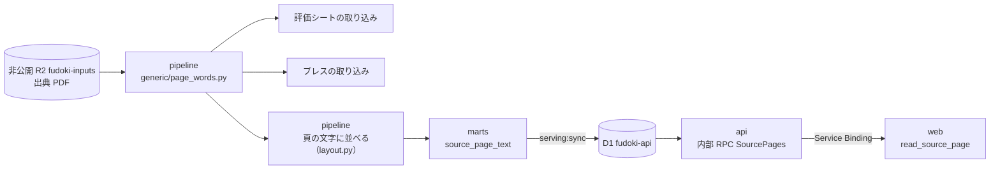

# 頁の語の層を、取り込みとアシスタントで共通にする — 設計

担当者: wwwyo / Claude
更新日: `2026-11-12`
状態: Draft

## Summary

出典 PDF の頁から「語と位置」を取る処理を1つにし、取り込み（評価シート・予算案のプレス発表）と、web のアシスタントが読む頁の文字の両方がそこから作られるようにする。今は同じ PDF を4通りの方法で読んでいるので、OCR や語の取り方の直しが、それぞれの読み方に別々に要る。

あわせて、アシスタント用の頁の文字の置き場を、ほかのデータと同じ経路にする。pipeline が marts の表まで作って D1 に写し、api が fudoki 用の内部の口からだけ読ませる。R2 の `source-text/` と、api の R2 binding はやめる。

## 今の形

| 読む人 | 語の取り方 | コード |
| --- | --- | --- |
| 歳出（fiscal）の取り込み | Poppler の `pdftotext -bbox`。見えない複製を落とし、character map を当て、罫線も取る。スキャンの頁は固定した OCR の観測 | `ingestion/generic/observe.py`・`mixed.py`・`scan.py` |
| 評価シートの取り込み | Poppler の `pdftotext -layout` の頁の文字。品川だけ pdfplumber の `extract_words` | `ingestion/project/sheet/`・`layouts/shinagawa_sheet.py` |
| プレス発表の取り込み | pdfplumber（pdfminer）。`extract_words`（字の大きさ・`fontname`）、`extract_text` の行、`find_tables`・`extract_tables` の表 | `ingestion/project/press/`・`layouts/*_press.py`（個別の規則 36） |
| アシスタントの頁の文字 | `pdftotext -bbox` を自前で呼び、行と列に並べて非公開 R2 の `source-text/<sha256>.json` に置く。api の内部 RPC（`SourcePages`）が読む | `source_text/` |

困っていること:

- 直しが伝わらない。fiscal の `observe.py` は見えない複製を落とすことや character map を持つが、評価シート・プレス・アシスタントの読み方はどれもそれを使っていない。
- スキャンの資料が読めない。fiscal には固定した OCR の観測があるが、評価シートとアシスタントは文字の層の無い頁を空として扱う。
- 頁の文字だけが、marts → D1 の経路の外（R2 の別の prefix）にある。api の R2 binding（`SOURCE_TEXT`）は非公開の `fudoki-inputs` 全体を指しているので、仕組みの上では元の PDF も読める。

## Goals / Non-Goals

- Goal: 頁の語と位置を取るコードを1か所にする。語の取り方の直しは、そこを直せば評価シート・プレス・アシスタントに効く。
- Goal: 評価シート・プレスの取り込みは、その語の層から読む。移す前の取り込み結果と突き合わせ、変わらないことを確かめる。
- Goal: 頁の文字は marts の表にし、`serving:sync` で D1 に写す。api は公開の REST・MCP には出さず、fudoki の web だけが呼べる内部の口から返す（[source-reading の設計](../source-reading/dd.md)の Goal を引き継ぐ）。公開か内部かは api のインターフェースが決め、データの側には持たせない。
- Goal: api から R2 の binding を外す。api が元の PDF に触れる口を無くす。
- Non-Goal: fiscal の取り込みを語の層へ移すこと。fiscal は今の `observe.py` のまま使う。
- Non-Goal: 予算書・決算書の頁の文字（#560 で外した）。元の PDF を配ること（中継は公式 URL から取るまま、[origin-pdf-viewer](../origin-pdf-viewer/dd.md)）。
- Non-Goal: 事業の出典に OCR をかけること。スキャンの評価資料・プレスの OCR の観測をどこに宣言し保存するかは、語の層ができたあとに決める（fiscal の `scan.read_pages` は管理 JSON の `ocr_inputs` を前提にしている）。

## Design

### 語の層

新しいモジュール `ingestion/generic/page_words.py` を共通の入口にする。fiscal の変換器はこれを import しないので、ここを直しても fiscal の表の指紋は古くならない（fiscal の指紋は変換器が import する `generic/*.py` の AST を辿る。`manifest.py` の `fingerprints`）。`observe.py` は触らない。

- `page_words.pages(pdf) -> list[Page]`。`Page` は `number`・`width`・`height`・`words`。`Word` は `text`・`x0`・`y0`・`x1`・`y1`・`size`・`font`（このモジュールの型。`observe.Word` は変えない）。
- 語は `observe.words`（固定版の Poppler の `pdftotext -bbox`、character map）と `observe.drop_hidden_copies` で取る。`observe` の直しは語の層にも効く。
- `size`・`font` は pdfplumber の文字（`page.chars`）を語の箱に当て、箱に入る文字の大きさ・フォント名の最頻値にする。
- `page_words.lines(page)` が行を組む。縦の位置で行にまとめ、左端の位置まで空白で寄せる。評価シートの正規表現が当たる並びにする（`pdftotext -layout` に近い形）。
- 文字の層の無い頁は空のまま（OCR は Non-Goal）。

### 取り込み

- 評価シート（`sheet/`）: `pages()` を `page_words.lines` に替える。品川の `shinagawa_sheet.py` も `page_words.pages` の語に替える。宣言の正規表現が合わない団体は宣言を直す。
- プレス（`press/`・`layouts/*_press.py`）:
  - `extract_words` は `page_words` の `Word`（`size`・`font` を含む）に替える。
  - `extract_text` の行は `page_words.lines` に替える。
  - 表（`find/table.py`・`fuchu_press.py` の `find_tables`、`inagi_press.py` の `extract_tables`）は、この段では pdfplumber のまま残す。語の層の罫線から表を組む形は、残った規則を移すときに別に決める。
  - 36 の個別の規則は1団体ずつ移して確かめる。
- 指紋: `sheet.modules()`・`press.modules()` に `page_words.py` と `observe.py` を足す（今の `run.py` の `code_fingerprint` は project のモジュールだけを hash している）。

### 頁の文字を marts の表にする

- 今の `source_text/layout.py` の並べ方（行にまとめる・列を揃える・語のつなぎ方・見開きを分ける）は、入力を `page_words.pages` の語に替えて pipeline に残す。
- 事業の取り込み（`ingestion/project/run.py`）と同じ流れで、事業評価・プレスの出典ごとに頁の文字を作り、warehouse の入力の表にする。読んだ結果は今の事業の取り込みと同じく、出典の sha256、語の層と並べ方のコードの指紋、固定した Poppler の版（`mise.toml`）でキャッシュする（`.cache/`）。
- marts の表 `source_page_text`（`marts/source/`）:

  | 列 | 型 | 説明 |
  | --- | --- | --- |
  | `page_id` | VARCHAR（主キー） | sha256 と頁から作る |
  | `sha256` | VARCHAR | 出典 PDF の sha256（評価・予算案の `origin_id` と同じ値） |
  | `page` | INTEGER | 物理頁（1始まり） |
  | `text` | VARCHAR | 頁の文字。列を空白で揃えた形。文字の無い頁は空文字 |

  index は `(sha256, page)`。タイトルと公式の URL は今と同じく `evaluation_origin`・`budget_proposal_origin` から引く。
- 対象は D1 に出典の記録がある事業評価・プレスの出典だけにする（marts で出典の表と結ぶ）。
- `serving:columns` が `columns.json` に表を足し、`serving:sync` がほかの表と同じく差分で D1 に写す。

### api の公開と内部の区別

公開か内部かは api のインターフェースだけが知る。D1・marts・`columns.json` には公開・内部の区別を持たせない。

- 公開の REST・MCP は、route・tool ごとに読む表を名前で指している（`columns.ts`）。`source_page_text` を読むのは内部の RPC（`source-pages.ts`）だけにする。
- 区別は apps/api の試験で守る。`source_page_text` の表名を参照するモジュールが `source-pages.ts` だけであること（公開の route・MCP の tool から辿れないこと）を確かめる。
- `readSourcePage` は R2 の代わりに D1 の `source_page_text` を `(sha256, page)` で引く。出典の照合（`evaluation_origin`・`budget_proposal_origin`）と、返す文字の上限 `MAX_PAGE_CHARS`（12,000字）は今のまま。
- R2 の binding `SOURCE_TEXT` と `SourceTextBucket` の型は消す。web の `read_source_page` と Service Binding は変えない。

## Alternatives Considered

- 頁の文字を R2 に置き、web だけに binding を持たせ、並べ方を web（TypeScript）に移す: api を通らずに済む。一方で、保存の経路が marts → D1 と別にもう1本でき、web にデータの binding を持たせない規約（`pipeline/verify/boundaries.ts`）に例外が要る。並べ方の移植と、Python との突き合わせも要る。
- 今のまま R2 の `source-text/` に置き、api が読む: 変更は小さい。api の R2 binding が元の PDF のバケット全体を指したまま残る。
- `observe.py` に `size` を足して共通の入口にする: fiscal の全表の指紋が古くなり、全表 refresh が要る。
- 評価シート・プレスも fiscal の汎用の変換器（木の組み立て）に載せる: 書式が違いすぎる。語の層を共通にするだけで目的は足りる。
- 取り込みは今の読み方のまま、AI 用だけ語の層から作る: OCR や語の取り方の直しが取り込みに伝わらない問題が残る。

## Cross-Cutting Concerns

- 利用条件: 頁の文字は資料の文章そのもの。公開の REST・MCP・画面に出さない。
- 容量: 今の source-text は全 4,245件で 402MB（中央値 25KB）。評価・プレスはその一部で、D1 の上限（10GB）に収まる。最初に全件の合計を測ってから写す。
- D1 の書き込み: D1 は書いた行の数（index の分を含む）で数える。初回は評価・プレス 1,674件、平均50頁として約8万頁、index 込みで20万行前後。Workers Paid の込み枠（月 5,000万行）の 0.5% 程度で、以降は `serving:sync` の差分だけ。本番 D1 への書き込みは確認を取ってから。
- 1行の大きさ: 頁の文字は 12,000字を超えるものがある。D1 の1行の上限（2MB）と1文の上限（100KB、`sync_d1.py` の `MAX_STATEMENT_BYTES`）に収まるかを確かめ、収まらない頁は分けて持つか切る。
- Poppler の版: 語は版で変わるので、取り込みと頁の文字は mise で固定した版を確かめる（`ingestion/lib/poppler.py` の `require`）。

## Validation / Rollout

0. 移す前の基準を取る。評価シート（全欄）と施策（全欄、`page`・`position` を含む）の全件を、今のコードで書き出す。施策の紐付けの seed（`dbt/seeds/project/budget_measure_link.csv`）は `(origin_id, page, position)` を key にしているので、position がずれれば紐付けが黙って外れる。
1. `page_words.py` を作る。`ingestion:refresh --plan` で fiscal の表が古くならないことを確かめる。
2. 評価シートを語の層へ移し、基準と全件で突き合わせる（取り込みの PR）。
3. プレスを語の層へ移し、基準と全件で突き合わせる。個別の規則は1団体ずつ（取り込みの PR、団体ごとに分けてよい）。
4. 頁の文字を語の層から作り、今の R2 の `source-text/` と数百頁を突き合わせる。語の取り方が生の `-bbox` から `page_words`（見えない複製を落とす）に替わる分の差は、種類を確かめて許す。品川の評価シート 211頁が `目標 258 324 390 418 418 / 実績 236 310 364` になることも確かめる。
5. marts `source_page_text` を足し、本番 D1 に写す（確認を取ってから）。
6. api の `readSourcePage` を D1 に切り替え、R2 の binding を外す（api の PR）。web は変えないので、deploy の順は問わない。
7. R2 の `source-text/` を消す（確認を取ってから）。
