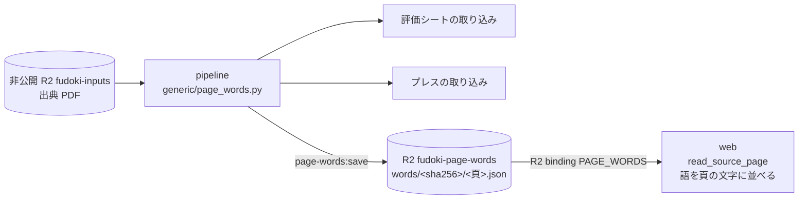

# 頁の語の層を、取り込みとアシスタントで共通にする — 設計

担当者: wwwyo / Claude
更新日: `2026-11-12`
状態: Draft

## Summary

出典 PDF の頁から「語と位置」を取る処理を1つにし、取り込み（評価シート・予算案のプレス発表）と、web のアシスタントが読む頁の文字の両方がそこから作られるようにする。今は同じ PDF を4通りの方法で読んでいるので、OCR や語の取り方の直しが、それぞれの読み方に別々に要る。

あわせて、アシスタント用の頁の文字の持ち主を整理する。pipeline が持つのは語の層（取り込みの成果物）までにする。それをアシスタント向けの文に並べるのは、読む側の web が受け持つ。

## 今の形

| 読む人 | 語の取り方 | コード |
| --- | --- | --- |
| 歳出（fiscal）の取り込み | Poppler の `pdftotext -bbox`。見えない複製を落とし、character map を当て、罫線も取る。スキャンの頁は固定した OCR の観測 | `ingestion/generic/observe.py`・`mixed.py`・`scan.py` |
| 評価シートの取り込み | Poppler の `pdftotext -layout` の頁の文字。品川だけ pdfplumber の `extract_words` | `ingestion/project/sheet/`・`layouts/shinagawa_sheet.py` |
| プレス発表の取り込み | pdfplumber（pdfminer）。`extract_words`（字の大きさ・`fontname`）、`extract_text` の行、`find_tables`・`extract_tables` の表 | `ingestion/project/press/`・`layouts/*_press.py`（個別の規則 36） |
| アシスタントの頁の文字 | `pdftotext -bbox` を自前で呼び、行と列に並べて非公開 R2 の `source-text/<sha256>.json` に置く。api の内部 RPC（`SourcePages`）が読む | `source_text/` |

困っていること:

- 直しが伝わらない。fiscal の `observe.py` は見えない複製を落とすことや character map を持つが、評価シート・プレス・アシスタントの読み方はどれもそれを使っていない。
- スキャンの資料が読めない。fiscal には固定した OCR の観測があるが、評価シートとアシスタントは文字の層の無い頁を空として扱う。
- 頁の文字は web だけが使うのに、作って置くのは pipeline、配るのは api になっている。api の R2 binding（`SOURCE_TEXT`）は非公開の `fudoki-inputs` 全体を指しているので、仕組みの上では元の PDF も読める。

## Goals / Non-Goals

- Goal: 頁の語と位置を取るコードを1か所にする。語の取り方の直しは、そこを直せば評価シート・プレス・アシスタントに効く。
- Goal: 評価シート・プレスの取り込みは、その語の層から読む。移す前の取り込み結果と突き合わせ、変わらないことを確かめる。
- Goal: アシスタントの頁の文字は、web が語の層を並べて作る。pipeline は語の層を R2 に置くまでを受け持つ。
- Goal: 語の層は web からだけ読める。公開の REST・MCP、画面、会話の保存には出さない（[source-reading の設計](../source-reading/dd.md)の Goal を引き継ぐ）。web は元の PDF のバケットに binding を持たない。
- Non-Goal: fiscal の取り込みを語の層へ移すこと。fiscal は今の `observe.py` のまま使う。
- Non-Goal: 予算書・決算書の頁の文字（#560 で外した）。元の PDF を配ること（中継は公式 URL から取るまま、[origin-pdf-viewer](../origin-pdf-viewer/dd.md)）。
- Non-Goal: 事業の出典に OCR をかけること。スキャンの評価資料・プレスの OCR の観測をどこに宣言し保存するかは、語の層ができたあとに決める（fiscal の `scan.read_pages` は管理 JSON の `ocr_inputs` を前提にしている）。

## Design

### 語の層

新しいモジュール `ingestion/generic/page_words.py` を共通の入口にする。fiscal の変換器はこれを import しないので、ここを直しても fiscal の表の指紋は古くならない（fiscal の指紋は変換器が import する `generic/*.py` の AST を辿る。`manifest.py` の `fingerprints`）。`observe.py` は触らない。

- `page_words.pages(pdf) -> list[Page]`。`Page` は `number`・`width`・`height`・`words`。`Word` は `text`・`x0`・`y0`・`x1`・`y1`・`size`・`font`（このモジュールの型。`observe.Word` は変えない）。
- 語は `observe.words`（固定版の Poppler の `pdftotext -bbox`、character map）と `observe.drop_hidden_copies` で取る。`observe` の直しは語の層にも効く。
- `size`・`font` は pdfplumber の文字（`page.chars`）を語の箱に当て、箱に入る文字の大きさ・フォント名の最頻値にする。
- `page_words.lines(page)` が行を組む。縦の位置で行にまとめ、左端の位置まで空白で寄せる。評価シートの正規表現が当たる並びにする（`pdftotext -layout` に近い形）。
- 文字の層の無い頁は空のまま（OCR は Non-Goal）。

### 取り込み

- 評価シート（`sheet/`）: `pages()` を `page_words.lines` に替える。品川の `shinagawa_sheet.py` も `page_words.pages` の語に替える。宣言の正規表現が合わない団体は宣言を直す。
- プレス（`press/`・`layouts/*_press.py`）:
  - `extract_words` は `page_words` の `Word`（`size`・`font` を含む）に替える。
  - `extract_text` の行は `page_words.lines` に替える。
  - 表（`find/table.py`・`fuchu_press.py` の `find_tables`、`inagi_press.py` の `extract_tables`）は、この段では pdfplumber のまま残す。語の層の罫線から表を組む形は、残った規則を移すときに別に決める。
  - 36 の個別の規則は1団体ずつ移して確かめる。
- 指紋: `sheet.modules()`・`press.modules()` に `page_words.py` と `observe.py` を足す（今の `run.py` の `code_fingerprint` は project のモジュールだけを hash している）。アシスタント向けの並べ方は web にあるので、それを直しても取り込みは古くならない。

### 語の層を R2 に置く

`bun run --cwd pipeline page-words:save`（今の `source-text:save` を置き換える）が、事業評価・プレスの出典ごとに語の層を作り、専用のバケット `fudoki-page-words` に置く。

- key: `words/<sha256>/<物理頁>.json`。1頁1 object にし、1頁を読むたびに資料全体を読まない。資料ごとの `words/<sha256>/index.json` に `title`・`url`・`page_count` を置く。`url` は利用者に示す公式の URL（Wayback の写しなら `landing_url`）。
- 頁の中身: `{schema_version, number, width, height, words: [[text, x0, y0, x1, y1, size]]}`。位置は 0.1pt に丸める。
- 対象: 出典の選定の `evaluation_selections`・`press_selections`（`pdf_type: text`）と、事業の取り込みの `results`。どれも風土記が選定した出典なので、D1 に取り込み前の出典もここに入る。
- 作り直し: 語の層のコードの指紋、Poppler の版、または `title`・`url` が変わった出典だけを作り直す。`index.json` に作ったときの指紋・Poppler の版・`title`・`url` を書いて比べる。`index.json` は `page_count` 頁の object をすべて書いたあとに最後に書き、途中で止まった出典は次の実行で作り直される。
- 既存の `source-text/` は、web が新しいバケットを読むようになってから消す（消すときに確認を取る）。

### web が頁の文字を作る

- `apps/web/void.config.ts` に R2 binding `PAGE_WORDS`（バケット `fudoki-page-words`）を足す。preview も同じバケットを読む（中身は本番と同じで、コードは読むだけ）。
- `pipeline/verify/boundaries.ts`: `WEB_CLOUDFLARE_KEYS` に R2 の key を足し、R2 の binding は名前 `PAGE_WORDS`・バケット `fudoki-page-words` の1つだけを許す検査を足す。`apps/AGENTS.md` と `void.config.ts` の冒頭の注記の「web はデータの binding を持たない」も、この例外を書き足す。
- binding は Workers の仕様で put・delete もできる。コードの型は `get` だけを持たせ、書き込み・削除を呼ぶコードを置かない。
- `server/source-pages.ts` は Service Binding（`SOURCES`）をやめ、`words/<sha256>/index.json` と `words/<sha256>/<頁>.json` を get する。入力は出典の sha256（評価・予算案の `origin_id` は sha256 と同じ値）と物理頁。sha256 の形と頁の整数を検査してから key を組み立て、ほかの object は読めない。
- 語を頁の文字に並べる処理（今の `source_text/layout.py`: 行にまとめる・列を揃える・語のつなぎ方・見開きを分ける）を TypeScript に移す（`apps/web/server/page-text.ts`）。返す文字の上限 `MAX_PAGE_CHARS`（12,000字）もここへ移す。
- 目で確かめる手順（`.agents/skills/pipeline/references/source-text.md`）: `page-words:preview <pdf> [頁…]`（pipeline）が語の JSON を出し、`bun run --cwd apps/web page-text:preview <語の JSON>` が並べる。
- apps/api の `SourcePages`・`source-pages.ts`・R2 の binding `SOURCE_TEXT` は、web の切り替えを本番で確かめたあとに消す。

## Alternatives Considered

- pipeline が語の層から頁の文字まで作って置く（今の形の入力だけを替える）: 変更は小さい。web だけが使う文の並べ方を pipeline が持ち続け、並べ方を直すたびに全件を作り直す。
- 取り込みは今の読み方のまま、AI 用だけ語の層から作る: OCR や語の取り方の直しが取り込みに伝わらない問題が残る。
- `observe.py` に `size` を足して共通の入口にする: fiscal の全表の指紋が古くなり、全表 refresh が要る。fiscal は変えずに済む新しいモジュールにする。
- 評価シート・プレスも fiscal の汎用の変換器（木の組み立て）に載せる: 書式が違いすぎる。語の層を共通にするだけで目的は足りる。
- 資料ごとに1つの JSON: 1頁を読むたびに全頁を `JSON.parse` することになり、大きい資料で Worker の CPU に響く。
- 頁の文字を api が作る: api は配るデータの担い手で、これは配らないデータなので持たせない。

## Cross-Cutting Concerns

- 利用条件: 語の層も資料の文章そのもの。公開の REST・MCP・画面に出さない。
- 容量: 語ごとに位置を持つので、今の頁の文字より数倍大きくなる見込み。最初に50件で測ってから全件を置く。
- 費用: R2 の読み取り（Class B）が1頁あたり2回（index と頁）。会話の段数の上限（`MAX_STEPS`）がそのまま上限になる。
- Poppler の版: 語は版で変わるので、`page-words:save` と取り込みは mise で固定した版を確かめる（`ingestion/lib/poppler.py` の `require`）。

## Validation / Rollout

0. 移す前の基準を取る。評価シート（全欄）と施策（全欄、`page`・`position` を含む）の全件を、今のコードで書き出す。施策の紐付けの seed（`dbt/seeds/project/budget_measure_link.csv`）は `(origin_id, page, position)` を key にしているので、position がずれれば紐付けが黙って外れる。
1. `page_words.py` を作る。`ingestion:refresh --plan` で fiscal の表が古くならないことを確かめる。
2. 評価シートを語の層へ移し、基準と全件で突き合わせる（取り込みの PR）。
3. プレスを語の層へ移し、基準と全件で突き合わせる。個別の規則は1団体ずつ（取り込みの PR、団体ごとに分けてよい）。
4. `page-words:save` を作り、50件で容量を測ってから全件を置く。
5. `page-text.ts` を作る。今の `source-text/` の評価・プレスから数百頁を選び、Python の `layout.py` の出力を基準に TS の出力と差を取る。語の取り方が生の `-bbox` から `page_words`（見えない複製を落とす）に替わる分の差は、種類を確かめて許す。品川の評価シート 211頁が `目標 258 324 390 418 418 / 実績 236 310 364` になることも確かめる。
6. web に binding を足して `read_source_page` を新しいバケットへ切り替える（web の PR。api は変えない）。本番で事業の詳細を聞いて読めることを確かめる。
7. apps/api の `SourcePages` と binding を消す（api の PR）。`deploy-web.yml` は api も変わった push では deploy-api を待ってから web を出すので、6 と同じ PR にすると、web が消えた entrypoint を呼ぶ時間ができる。
8. R2 の `source-text/` を消す（確認を取ってから）。
