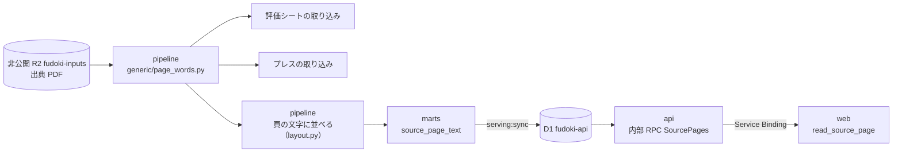

# 頁の bbox を、取り込みとアシスタントで共通にする — 設計

担当者: wwwyo / Claude
更新日: `2026-11-12`
状態: In Progress（手順 1〜6 済み、7〜8 を実装中）

## Summary

出典 PDF の頁から「語と位置」を取る処理を1つにし、取り込み（評価シート・予算案のプレス発表）と、web のアシスタントが読む頁の文字の両方がそこから作られるようにする。今は同じ PDF を4通りの方法で読んでいるので、OCR や語の取り方の直しが、それぞれの読み方に別々に要る。

あわせて、アシスタント用の頁の文字の置き場を、ほかのデータと同じ経路にする。pipeline が marts の表まで作って D1 に写し、api が fudoki 用の内部の口からだけ読ませる。R2 の `source-text/` と、api の R2 binding はやめる。

## 今の形

| 読む人 | 語の取り方 | コード |
| --- | --- | --- |
| 歳出（fiscal）の取り込み | Poppler の `pdftotext -bbox`。見えない複製を落とし、character map を当て、罫線も取る。スキャンの頁は固定した OCR の観測 | `ingestion/generic/observe.py`・`mixed.py`・`scan.py` |
| 評価シートの取り込み | Poppler の `pdftotext -layout` の頁の文字。品川だけ pdfplumber の `extract_words` | `ingestion/project/sheet/`・`layouts/shinagawa_sheet.py` |
| プレス発表の取り込み | pdfplumber（pdfminer）。`extract_words`（字の大きさ・`fontname`）、`extract_text` の行、`find_tables`・`extract_tables` の表 | `ingestion/project/press/`・`layouts/*_press.py`（個別の規則 36） |
| アシスタントの頁の文字 | `pdftotext -bbox` を自前で呼び、行と列に並べて非公開 R2 の `source-text/<sha256>.json` に置く。api の内部 RPC（`SourcePages`）が読む | `source_text/` |

困っていること:

- 直しが伝わらない。fiscal の `observe.py` は見えない複製を落とすことや character map を持つが、評価シート・プレス・アシスタントの読み方はどれもそれを使っていない。
- スキャンの資料が読めない。fiscal には固定した OCR の観測があるが、評価シートとアシスタントは文字の層の無い頁を空として扱う。
- 頁の文字だけが、marts → D1 の経路の外（R2 の別の prefix）にある。api の R2 binding（`SOURCE_TEXT`）は非公開の `fudoki-inputs` 全体を指しているので、仕組みの上では元の PDF も読める。

## Goals / Non-Goals

- Goal: 頁の語と位置を取るコードを1か所にする。語の取り方の直しは、そこを直せば評価シート・プレス・アシスタントに効く。
- Goal: 評価シート・プレスの取り込みは、その bbox から読む。移す前の取り込み結果と突き合わせ、変わらないことを確かめる。
- Goal: 頁の文字は marts の表にし、`serving:sync` で D1 に写す。api は公開の REST・MCP には出さず、fudoki の web だけが呼べる内部の口から返す（[source-reading の設計](../source-reading/dd.md)の Goal を引き継ぐ）。公開か内部かは api のインターフェースが決め、データの側には持たせない。
- Goal: api から R2 の binding を外す。api が元の PDF に触れる口を無くす。
- Non-Goal: fiscal の取り込みを bbox へ移すこと。fiscal は今の `observe.py` のまま使う。
- Non-Goal: 予算書・決算書の頁の文字（#560 で外した）。元の PDF を配ること（中継は公式 URL から取るまま、[origin-pdf-viewer](../origin-pdf-viewer/dd.md)）。
- Non-Goal: 事業の出典に OCR をかけること。スキャンの評価資料・プレスの OCR の観測をどこに宣言し保存するかは、 bbox ができたあとに決める（fiscal の `scan.read_pages` は管理 JSON の `ocr_inputs` を前提にしている）。

## Design

### bbox（語と位置）

新しいモジュール `ingestion/generic/page_words.py` を共通の入口にする。fiscal の変換器はこれを import しないので、ここを直しても fiscal の表の指紋は古くならない（fiscal の指紋は変換器が import する `generic/*.py` の AST を辿る。`manifest.py` の `fingerprints`）。`observe.py` は触らない。

- `page_words.pages(pdf) -> list[Page]`。`Page` は `number`・`width`・`height`・`words`。`Word` は `text`・`x0`・`y0`・`x1`・`y1`（このモジュールの型。`observe.Word` は変えない）。
- 語は `observe.words`（`pdftotext -bbox`）と `observe.drop_hidden_copies` で取る。`observe.words` は Poppler の版を確かめないので、`page_words` が `poppler.require()` を呼ぶ。
- bbox に効く `observe` の直しは、`observe.words` と `drop_hidden_copies` の中の直しだけ。character map（fiscal の様式ごとの宣言 `text_layer.character_map` から渡す）、見えない文字を落とす処理（`repair.py`）、CropBox で切る処理（`observe.cropped`）は `observe.words` の外にあり、事業の出典には宣言の置き場も無い。使うかどうかは、事業の出典で要る例が出たときに決める。
- `page_words.fonts(pdf, page) -> list[tuple[float, str]]` が、語ごとの字の大きさ・フォント名を返す。pdfplumber の文字（`page.chars`）を語の箱に当て、箱に入る文字の最頻値にする。プレスの規則が要るときだけ呼び、頁の文字の生成では呼ばない（全頁を pdfplumber で読むと重いため）。回転した頁・CropBox の原点が 0 でない頁では、Poppler と pdfplumber の座標を合わせてから当てる。
- `page_words.lines(page) -> list[str]` が行を組む。縦の位置で行にまとめ（`page_words.rows`）、行の中の語を左からつなぐ。すき間の狭い語は片方が全角なら詰め（「保育園費」「1,221万4千円」）、半角どうし（数・英字）とすき間の広い語の間には空白を1つ入れる（`page_words.joins`。頁の文字の `layout.py` と同じ行まとめと詰め方）。評価シートは今も `pdftotext -layout` の行の空白を1つに詰めて読み（`sheet/__init__.py`）、プレスは pdfplumber の `extract_text`（列を空白で揃えない形）を読んでいるので、どちらもこの形に合わせる。列を空白で揃えるのは、頁の文字の並べ方（`layout.py`）だけにする。
- 文字の層の無い頁は空のまま（OCR は Non-Goal）。

### 取り込み

- 語の形が pdfplumber の dict（`top` など）から属性（`y0` など）に変わり、語の切れ方も Poppler のものになる。語の切れ方や固定した閾値に頼る読み方（品川の `shinagawa_sheet.py` など）は書き直す。
- 評価シート（`sheet/`）: `pages()` を `page_words.lines` に替える。品川の `shinagawa_sheet.py` も `page_words.pages` の語に替える。宣言の正規表現が合わない団体は宣言を直す。
- 評価の結果（`layouts/shinagawa_result.py`、`extract_text(layout=True)`）も評価シートと同じ段で `page_words.lines` に替える。
- プレス（`press/`・`layouts/*_press.py`）:
  - この段で bbox に替えるのは、語（`extract_words`、字の大きさ・フォント名は `page_words.fonts`）と行（`extract_text`）だけ。
  - それ以外の pdfplumber の使い方は、この段では pdfplumber のまま残す。今あるのは `find_tables`（`find/table.py`・`fuchu_press.py`）、`extract_tables`（`inagi_press.py`）、`extract_text_lines`（`kiyose_press.py`）、`page.chars`（`setagaya_press.py`・`sumida_press.py`）、`page.rects`（`ota_press.py`）、`crop().extract_text`（`fuchu_press.py`）。規則ごとの一覧は移す PR に載せ、 bbox の罫線から組む形は残った規則を移すときに別に決める。
  - 36 の個別の規則は1団体ずつ移して確かめる。
- 指紋: `run.py` の `code_fingerprint` は、読む経路（`workflow` の宣言か個別の `layout`）を問わず `page_words.py` と `observe.py` を hash に足し、`poppler.pinned()` の版も足す。今の `code_fingerprint` は import を辿らずファイルの中身だけを hash し、個別の `layout` の出典は様式のファイルしか入れていないため、`sheet.modules()`・`press.modules()` に足すだけでは品川と36の規則のキャッシュが古くならない。

### 頁の文字を marts の表にする

- 今の `source_text/layout.py` の並べ方（行にまとめる・列を揃える・語のつなぎ方・見開きを分ける）は、入力を `page_words.pages` の語に替えて pipeline に残す。
- 事業の取り込み（`ingestion/project/run.py`）と同じ流れで、事業評価・プレスの出典ごとに頁の文字を作り、warehouse の入力の表にする。読んだ結果は `.cache/` にキャッシュし、key は出典の sha256、 bbox と並べ方のコードの指紋、`poppler.pinned()` の版にする（今の事業の取り込みのキャッシュの key は Poppler の版を含まない）。
- 文字が1字も無い出典（スキャンなど）は行を作らない。行が無ければ api は今と同じく `unavailable` を返し、公式の資料を案内させる。文字のある出典は全頁の行を作る（文字の無い頁は空文字）ので、頁数は `max(page)` で引ける。
- marts の表 `source_page_text`（`marts/source/`）:

  | 列 | 型 | 説明 |
  | --- | --- | --- |
  | `page_id` | VARCHAR（主キー） | sha256 と頁から作る |
  | `jurisdiction_code` | VARCHAR | 出典の自治体。`serving:sync --jurisdiction` で絞るため |
  | `sha256` | VARCHAR | 出典 PDF の sha256（評価・予算案の `origin_id` と同じ値） |
  | `page` | INTEGER | 物理頁（1始まり） |
  | `text` | VARCHAR | 頁の文字。列を空白で揃えた形。12,000字（api が返す上限）で切る |
  | `truncated` | BOOLEAN | 12,000字で切ったか |

  index は `(sha256, page)`。`page_id` に unique の検査を付ける。タイトルと公式の URL は今と同じく `evaluation_origin`・`budget_proposal_origin` から引く。
- 対象は D1 の `evaluation_origin`・`budget_proposal_origin` にある出典だけにする（marts で出典の表と結ぶ）。取り込みの宣言（`origins.json`）のある自治体の分だけになり、今の `source-text:save` の対象（選定の全件）より狭くなる。api の照合は今も D1 の出典の記録を要るので、アシスタントが読める範囲は変わらない。同じ sha256 が評価とプレスの両方にあるときは、sha256 ごとに1つにまとめる。
- 1行は最大 12,000字×3バイトで約 36KB になり、`sync_d1.py` の1文の上限 `MAX_STATEMENT_BYTES`（60,000バイト。D1 の上限 100KB の内側）に収まる。
- D1 に写すために手で直すもの: `serving/columns.py` の `MODELS`（marts の dir に `source` を足す）・`TABLES`・`PRIMARY_KEYS`・`INDEXES`、`serving/sync_d1.py` の `TABLE_ORDER`。そのうえで `serving:columns` が `columns.json` を作り直し、`serving:sync` がほかの表と同じく差分で D1 に写す。
- 差分の同期は D1 の行を全列読み戻して比べ、1回の呼び出しで `READ_ROWS_PER_CALL`（4,000行）を読む。頁の文字では1回が百MB を超えうるので、`sync_d1.py` で表ごとに読み戻す行数を変えられるようにし、`source_page_text` は1回が数MB に収まる行数にする。

### api の公開と内部の区別

公開か内部かは api のインターフェースだけが知る。D1・marts・`columns.json` には公開・内部の区別を持たせない。

- 公開の REST・MCP は、route・tool ごとに読む表を名前で指している（`columns.ts`）。`source_page_text` を読むのは内部の RPC（`source-pages.ts`）だけにする。表名の定数は `columns.ts` に置かず、`source-pages.ts` に書く。
- 区別は apps/api の試験で守る。`src` の本番の `.ts`（`*.test.ts`・`testing.ts`・`gen/` を除く）のうち、`source_page_text` の表名を含むのが `source-pages.ts` だけであることと、`columns.json` の全部の表をなめるコードが本番に無いことを確かめる。
- `readSourcePage` は R2 の代わりに D1 の `source_page_text` を `(sha256, page)` で引き、`page_count` は `max(page)` で引く。出典の照合（`evaluation_origin`・`budget_proposal_origin`）は今のまま。本文は marts で切ってあるので、`truncated` は api で数え直さず D1 の列をそのまま返す。
- R2 の binding `SOURCE_TEXT` と `SourceTextBucket` の型は消す。`pipeline/verify/boundaries.ts` に、api が R2 の binding を持たないことの検査を足す。web の `read_source_page` と Service Binding は変えない。

## Alternatives Considered

- 頁の文字を R2 に置き、web だけに binding を持たせ、並べ方を web（TypeScript）に移す: api を通らずに済む。一方で、保存の経路が marts → D1 と別にもう1本でき、web にデータの binding を持たせない規約（`pipeline/verify/boundaries.ts`）に例外が要る。並べ方の移植と、Python との突き合わせも要る。
- 今のまま R2 の `source-text/` に置き、api が読む: 変更は小さい。api の R2 binding が元の PDF のバケット全体を指したまま残る。
- `observe.py` に `size` を足して共通の入口にする: fiscal の全表の指紋が古くなり、全表 refresh が要る。
- 評価シート・プレスも fiscal の汎用の変換器（木の組み立て）に載せる: 書式が違いすぎる。 bbox を共通にするだけで目的は足りる。
- 取り込みは今の読み方のまま、AI 用だけ bbox から作る: OCR や語の取り方の直しが取り込みに伝わらない問題が残る。
- 頁を分けて12,000字を超える分も持つ: api は12,000字までしか返さないので、持っても使わない。

## Cross-Cutting Concerns

- 利用条件: 頁の文字は資料の文章そのもの。公開の REST・MCP・画面に出さない。marts や `columns.json` からまとめて書き出す配布（自治体別 CSV・Fiscal Data Package）を作るときは、この表を入れない。
- 容量: 今の source-text は全 4,245件で 402MB（中央値 25KB）で、予算書・決算書の分を含む。D1 に写す前に、評価・プレスだけの合計と今の D1 の大きさを測る。
- D1 の書き込み: D1 は書いた行の数（index の分を含む）で数える。対象を最大の 1,674件、平均50頁とすると約8万頁、index 込みで20万行前後。Workers Paid の込み枠（月 5,000万行）の 0.5% 程度で、以降は `serving:sync` の差分だけ。本番 D1 への書き込みは確認を取ってから。
- Poppler の版: 語は版で変わるので、取り込みと頁の文字は mise で固定した版を確かめる（`ingestion/lib/poppler.py` の `require`）。
- 公開の ID: `measure_id`（`budget_measure.sql`）・指標の ID（`evaluation_indicator.sql`）は `(origin_id, page, position)` から、`sheet_id` は `(origin_id, page)` から作る。取り込みの位置がずれると公開の ID が変わり、紐付けの seed も外れて `project:link-measures` が Jev で紐付け直す。

## Validation / Rollout

頁の文字の移し替え（1〜5）は取り込みの移し替え（6〜8）を待たない。先に済ませて R2 の binding を外す。

1. `page_words.py` を作る。`ingestion:refresh --plan` で fiscal の表が古くならないことを確かめる。
2. 頁の文字を bbox から作り、今の R2 の `source-text/` と数百頁を突き合わせる。語の取り方が生の `-bbox` から `page_words`（見えない複製を落とす）に替わる分の差は、種類を確かめて許し、`drop_hidden_copies` が落とした語の数を報告に出す。品川の評価シート 211頁が `目標 258 324 390 418 418 / 実績 236 310 364` になることも確かめる。
3. marts `source_page_text` と `sync_d1.py` の表ごとの読み戻し行数を足し、本番 D1 に写す（確認を取ってから）。
4. api の `readSourcePage` を D1 に切り替え、R2 の binding を外す（api の PR）。api は main に入ると deploy されるので、3 で本番 D1 に入ったことを確かめてから merge する。同じ PR で `apps/AGENTS.md`・`pipeline/AGENTS.md`・`pipeline/package.json` の `source-text:save`（目で確かめる `source-text:preview` は頁の文字を作る入口に移して残す。`source_text/` を移すなら `pipeline/pyproject.toml` の `module-name` も直す）・`.agents/skills/pipeline/references/source-text.md`・`docs/prd/source-reading/dd.md`・`apps/web/void.config.ts` のコメント・`apps/api/src/db.ts`・`apps/api/cloudflare.config.ts` を直す。
5. R2 の `source-text/` を消す（確認を取ってから）。
6. 取り込みを移す前の基準を取る。評価シート・指標・指標の値・評価の結果・施策の全件を、ID の元になる列（`origin_id`・`page`・`position`）を含めて、移す前の commit のコードで読む（`project:baseline --base <commit>`。その commit を作業ツリーに取り出して読み、今のコードの結果と全行で突き合わせる）。紐付けの seed（`dbt/seeds/project/budget_measure_link.csv`）の行が必ず `project_budget_measure` に当たることを確かめる dbt の検査を足す。足す前に `dbt:build` で当たらない行を数え、あれば取り込みを移す前に片付ける。
7. 評価シート・評価の結果を bbox へ移し、基準と ID の列を含む全件が一致することを確かめる（取り込みの PR）。品川の評価シート（`shinagawa_sheet.py`）と評価の結果（`shinagawa_result.py`）は移した。品川の評価シートと評価の結果は全件一致した。指標は、令和5年度の冊で今まで拾えていなかった191件が増え、単位・定義・目標年度の欠けも埋まった（今までの指標で無くなったものは0件）。宣言（正規表現）で読む評価シートも bbox の行で読むようにし、字の間を空けて組んだ見出し（「事 務 事 業 名」）は詰めてから宣言を当てる。行の組み方が変わってずれた10団体は宣言を書き直し、今までの結果と全件で突き合わせた。評価シートは 13,571 行から 13,641 行になった。無くなった行は0件で、増えた70行は今まで頁を見つけられなかったシートだった。変わった行は、今まで読めなかった欄が取れたもの・折り返した名前や所管課が続けて取れたもの・隣の欄の数字とくっついていた金額が直ったものだった。前に入っていた値が空になったのは、多摩の合体カルテ1枚の科目コードだけだった（コードが別の行に分かれて組まれ、どれか1つに決められない）。日の出町の令和6年度実施分は、実施年度の次の年度の欄を読んでいたので直した。
8. プレスを bbox へ移し、同じく全件で突き合わせる。個別の規則は1団体ずつ（取り込みの PR、団体ごとに分けてよい）。宣言（`workflow`）で読む団体は、頁の行を bbox から組むようにした。表・札で見つける様式（`find/table.py`・`find/card.py`）は罫線と字の位置が要るので、その頁だけ今も pdfplumber で読む。行の組み方が変わってずれた4団体（中野・江戸川・狛江・日の出）は宣言を書き直した。日の出町は、頁の番号を印字しない行の事業49件を今まで落としていたのと、前年度の予算額を読んでいた7件が直った。個別の規則で読む団体は、行だけを読む6団体（町田・東大和・檜原・小平・三鷹・西東京）を移した。差は、名前の半角と全角の間の空白が減ったもの（西東京「若者向けPR動画の作成」）と、東大和の説明の頭に付いていた字の間を空けた所管課（「( 企 画 政 策 課 )」）が外れたものだけ。数と全角の字の間を詰めるように `page_words.joins` を変えたので、評価シートは国立市の宣言を1か所直し、全件一致を確かめた（頁の文字もこの分だけ変わる）。
