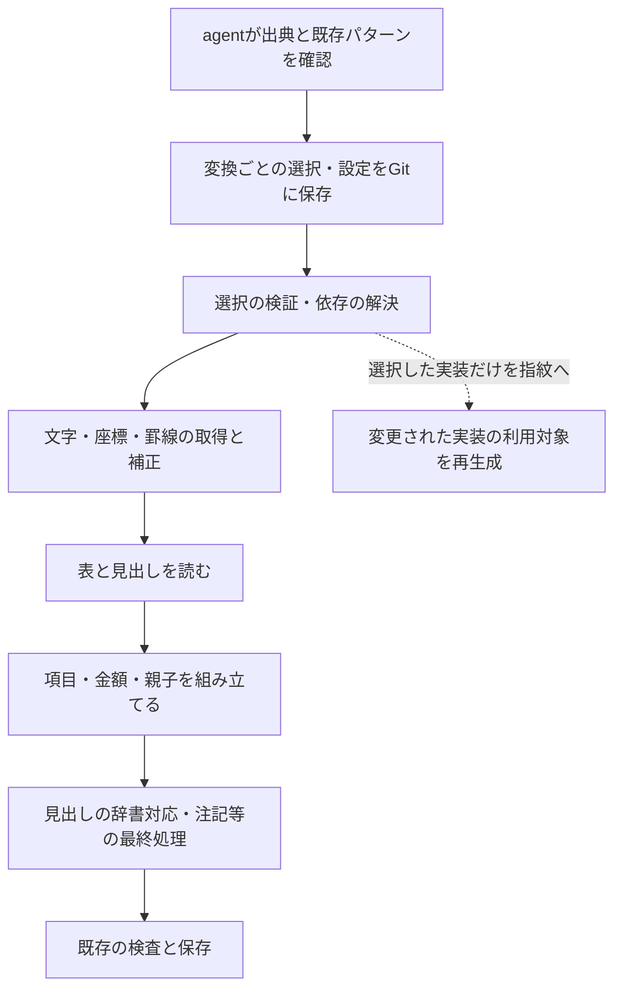

# PDFの取り込みを、選択した書式パターンの組み合わせで再現する

担当者: wwwyo / Codex
更新日: `2026-10-25`
状態: Done（実装・全量の内容比較完了）

## Summary

PDFの書式を調べるagentが、表・見出し・科目階層・内訳の読み方を選び、変換ごとの設定としてGitに保存する。通常の取り込みは選択された実装だけを使う。パターンの変更時には、その実装に依存する変換だけを再実行する。

途中結果の新しい保存・キャッシュは作らない。再生成の単位は既存の `conversion` とし、対象となった変換は最初から最後まで実行する。既存の文字観測キャッシュと固定済みOCR観測は引き続き利用する。

現在の処理の結び付きを保ち、共通処理を無理に選択式にしない。特に、表の境界と見出しの位置、項目の切り出しと親子の構築は、必要な情報を共有できるまとまりとして残す。

## Goals / Non-Goals

- Goal: パターンBの追加・変更で、Bを選んでいない変換の指紋を変えない。
- Goal: agentによる書式の判断を設定として固定し、再実行で選び直さない。
- Goal: 既存の出典、OCR観測、取り込み表の形、保存前の検査を保って段階的に移行する。
- Non-Goal: 工程途中の表の保存、工程単位の再開、関数単位の依存追跡。必要性は再生成コストを見て判断する。
- Non-Goal: 出典選定、OCRエンジン、CSV、dbt、配信方式の再設計。
- Non-Goal: 未確認の書式に備えたパターンの先行作成や、任意の処理グラフを実行する汎用エンジン。

## Background

### 現在のコードには分割の材料がある

| 現在の場所 | 役割と今回の扱い |
|---|---|
| `generic/observe.py`、`lib/scan_ocr.py` | 文字・座標・罫線の取得。共通処理と文字PDF／固定済みOCRの入口として残す |
| `generic/repair.py`、`generic/mixed.py`、`generic/scan.py` | 文字層の修復、混在頁、OCR観測の読み込み。通常処理と明示選択する補正を分ける |
| `generic/layout.py` | 表の枠、列、見出しセル、欄の役割、見開きを扱う。幾何と見出しの結び付きを保つ |
| `generic/tree.py` | 項目・金額の切り出し、科目と内訳の階層、金額の所属を扱う。共通の組み立てから書式差分を切り出す |
| `generic/headers.py`、`convert.canonical_headings` | 読み取った金額見出しを辞書の見出しに対応させる。ノードの軸が必要なため、組み立て後の処理を保つ |
| `generic/build.py::choose_pattern` | 科目の `bands / names / indent` と、内訳の `indent / shape / position` を試し、合計の一致から選ぶ |
| `generic/convert.py`、`generic/scan.py::build_table` | 文字PDF・画像PDFの実行順と最終処理。選択設定を受ける共通の実行経路へ寄せる |
| `fiscal/manifest.py::dependencies / fingerprints` | import先をファイル単位で再帰的に指紋へ含める。選択された実装の依存を解決する形へ拡張する |

現在の `.layout.json` は、補正、欄、見開き、見出し、内訳の設定を持つ。ただし、設定は対象全体で読み込まれ、文字PDFでは会計別の上書きも行う。指紋には設定全体が入るため、別会計の設定変更も波及する。

文字PDFと画像PDFには細部の違いがある。例えば、文字PDFの入口は会計別設定をマージするが、画像PDFの `build_table` は同じマージをしていない。移行時に設定を一律に適用し直すと表が変わりうるため、各経路で実際に効いていた設定を移す。

共有の変換コードの修正は、多くの表を古い扱いにする。`ingestion:refresh` はその変換を再実行し、保存済みの表と同じなら指紋だけ更新する。保存し直さなくても再変換の負担は残る。

判断の記録: [ADR 0035](../../adr/0035-fixed-pdf-workflow-patterns.md)。関連する設計: [汎用のノード生成](../generic-node-builder/dd.md)、[文書ごとの組版設定](../generic-node-builder/layout-settings.md)、[内容比較による指紋更新](../../adr/0027-refresh-fingerprints-by-table-content.md)。既存設計の試作時の件数・所要時間は、今回の現状測定には使わない。

## Design

### 共通の実行順に、選択された読み方を渡す



選択設定は呼び出す処理を決めるためのものとし、処理順を自由に並べ替えるDSLにはしない。同じ見出しパターンが、表を読むときと最終処理の両方で使われてもよい。

### 最初に分離するパターンと、共通のまま残す処理

| まとまり | 初期の整理 | 共通のまま残す部分 |
|---|---|---|
| 読み取り補正 | `opening_cell / overprint / split_at_rules / stacked_rows` 等の既存の明示選択を実装ごとに分離する | 座標系の統一、通常の文字取得、固定済みOCR観測の参照 |
| 表・欄 | 現行の罫線中心の読み方を最初の `ruled` パターンにする。見開き等はこのパターンの設定として移す | 頁・原位置の保持、行や罫線を扱う小さな共通関数 |
| 見出し | 現行の通常の読み方と、`kind_by_characters` で有効になる追加の読み方を分離する | 辞書参照、原文との対応、欄の役割と矛盾したときの停止 |
| 科目の構築 | 現在の `bands / names / indent` の選択を明示する | ノードの形式、順序、継続頁の状態管理、金額の保持 |
| 内訳の構築 | 現在の `indent / shape / position` を軸ごとに明示する。`marks` や折り返し等は選択した読み方の設定へ移す | 科目への所属、独立した軸、親子や金額を表へ載せる処理 |

表のパターンは、最初からA・B・Cを用意しない。現在の実例に違うアルゴリズムが必要な箇所だけを別のパターンにする。値の違いは設定で表し、アルゴリズムの違いはコードを分ける。

`tree.py` の項目分割、折り返し、金額の持ち主、階層は相互に参照している。工程ごとの独立した表にすることを先行させず、共通の組み立てに、選んだ科目・内訳の処理を渡す。選択していない処理が同じ巨大なファイルに残れば指紋の波及は減らないため、分岐の入口だけでなく、そのパターンだけが使う処理も移す。

### 設定はconversionが所有する

`conversions[].options.workflow` に読み方を持たせる。自治体・年度・会計・出典SHA・出典範囲は既存の宣言を使い、重複して書かない。別の会計の設定や、選択していないパターンの設定を指紋へ入れない。

設定は次の形で保存する。パターン名と実装の対応は `patterns/catalog.json` に置く。

```yaml
workflow:
  layout:
    pattern: ruled
  headers:
    pattern: standard
  hierarchy:
    subject:
      pattern: bands
    breakdown:
      節:
        pattern: indent
      備考:
        pattern: indent
        options:
          marks: {"□": "説明", "○": 1}
```

移行後の変換は、設定したパターンだけを実行する。未指定を自動探索で補わない。科目と内訳の選択が必要で、該当する軸の設定が無い場合や、未知のパターン・使わない設定がある場合は止める。共通の通常処理まで明示的なパターン名で埋める必要はない。

一つのPDFで会計・表の書式が違う場合は、既存の会計・表を処理するconversionごとに設定する。処理範囲の分割が必要なら選定のscope内で既存の頁指定を使う。同一の木が頁をまたいで続く場合は、その状態を途中で切らない。特定頁の読み方の上書きは、実例で必要になった段階で追加する。

`.layout.json` は移行期間だけ旧経路で読む。移行済みconversionは、解決済みの設定をすべて自身の `workflow` に持ち、実行時に `.layout.json` を重ねない。全利用対象の移行が終わった設定ファイルを削除し、二つの設定を正本にしない。

### 見出しの処理は実際の依存に合わせて差し込む

`layout.page_bands` は見出しの位置を使って本文の語を分け、`logical_pages` は見出しと本文から欄の役割を決める。ここを単純に「レイアウトの完了→見出しの開始」と切ると、今の処理を保てない。

表の枠・見出しセルの候補を作る処理、見出しを読む処理、欄と見開きを確定する処理の順を保つ。`layout` は選択された `headers` の処理を受け取り、未選択の見出し実装はimportしない。新しい中間ファイルは作らず、必要なセル情報は呼び出し中のメモリ上で渡す。

`canonical_headings` はノードの軸・段を使うため、組み立て後に置く。選択された見出し実装にこの処理も束ね、実行経路が選択と違う読み方へ暗黙に切り替わることを避ける。

画像PDFでは、OCR訂正の対象が金額欄・科目欄にあるかを確かめる処理も、組み立て前に `_layout / page_bands / groups` を呼ぶ。最終の組み立てだけを選択式にすると、この先読みが従来のパターンを使い続ける。先読みを含めて同じ選択を渡し、その実行コードも依存に含める。無理に一方向の独立工程へ直さない。

### パターンの探索と通常の変換を分ける

`choose_pattern` の全候補実行・合計による比較を、設定作成時の補助へ移す。agentは代表頁だけでなく、書式の変わり目、続きの頁、対象範囲全体で選択を確かめる。合計一致だけで選択を確定しない。

通常の変換には、選択された科目と内訳の処理を直接渡す。合計不一致で別のパターンを自動選択するfallbackは置かない。新しいパターンが必要なら、実例に対するコード・設定・検査を追加した後で選択を更新する。

パターンの内部で親子を決めるために必要な和の計算は残せる。その処理は表の中身を変える依存である。保存可否だけを判定する共通検査とは区別し、前者の変更は指紋に反映する。

### 指紋は「共通処理＋選択された実装＋その依存」から作る

実行と指紋計算は、同じ選択解決処理を使う。指紋へ含めるものは次とする。

- 出典のSHA・scope、固定済みOCR観測の参照、既存の対象・方向・変換設定。
- そのconversionの `workflow` と、選択したカタログ項目。
- 共通の実行処理と、選択した各パターンの実装、そのimport先・辞書等の依存。

選択解決の結果は、実行する処理、実装をたどる入口、データファイルの参照、選択したカタログ項目を一つにまとめる。実行側と指紋側で別の選択一覧を作らない。

パターン一覧は名前から実装への静的なカタログとし、任意のPythonパスを設定から実行させない。実装は選択されたものだけをロードする。依存の再帰探索は現行の仕組みを再利用するが、全パターンをimportするregistryを探索の入口にしない。

現行の依存探索が自動で拾う設定ファイルはJSON・TOML・Swift等に限られ、CSV辞書の参照を一律には拾わない。共有の金額見出し辞書や `lib/text_repairs.csv` など、表の中身へ影響する非Python入力も追跡対象にする。選択実装とその共通依存が使う辞書のパスを静的に宣言し、その内容を指紋へ含める。データの参照はpipeline内の正規化した相対パスで解決し、`ingestion/` 外の `shared/` も扱う。パターンから使うデータを変換宣言へ重複して列挙させない。

カタログ全体をハッシュせず、選んだ項目の対応を指紋へ含める。カタログは選択解決の入力として扱い、通常のAST探索がJSON全体を依存に足す経路から分ける。未選択パターンの追加で利用対象を古くしない。パターン名の検証はカタログを使い、追加のたびに全対象共通のschemaのenumを書き換える構成を避ける。パターン固有の設定検査も選択した実装が所有する。

依存から外す仕組みを一般化しない。共通処理が未選択の実装をimportする、選択実装が別パターンを暗黙に呼ぶ、といった漏れは依存検査で検出する。選択解決を変更した場合も、実行するコードが変われば指紋が変わるようにする。

| 変更 | 再変換の範囲 |
|---|---|
| 見出しBの実装・固有辞書 | Bを選択するconversion |
| 新しいパターンCを追加 | 既存の選択先を変えなければ既存対象は変えない |
| 一つの会計の設定 | その設定を持つconversion |
| BからAへ選び直す | 選び直したconversion |
| A・Bが使う共通の組み立て | 共通処理に依存する全conversion |
| 合否だけを決める検査 | 原則は既存表への検査の当て直し。表の選び方にも使う検査は利用対象の再変換 |

再変換はconversion全体を実行し、指紋更新・保存は既存の `refresh / convert` の境界を使う。指紋の比較だけで対象を絞れるようにし、対象外の変換器は呼ばない。現行の `refresh --dry-run` は再変換まで行うため、影響範囲を確認するだけの操作と取り違えない。

### コードの配置

```text
pipeline/ingestion/generic/
  workflow.py               選択の検証と共通の実行経路
  patterns/
    catalog.json            名前と選択実装の対応
    repairs/                選択したときだけ使う既存の補正
    layout/                 罫線等の表の読み方
    headers/                見出しの読み方と最終的な辞書対応
    subject/                bands / names / indent
    breakdown/              indent / shape / position
  discovery.py              設定作成時のパターン候補比較
  observe.py / mixed.py     共通の観測・混在頁の扱い
  layout.py / tree.py       共通の幾何と木の組み立て
  convert.py / scan.py      現行CLIへつなぐ入口・観測のアダプタ
```

共通のデータ形式は現在の `Page / Band / Logical / Item / Built` を起点に整理する。パターン間で共有する形だけを取り出し、全処理が全パターンのimportへつながらないようにする。ディレクトリの細分化自体を目的にせず、初期実装が一つしかない処理には不要なクラス階層を作らない。

## Alternatives Considered

| 案 | 利点 | 採らない理由・残す範囲 |
|---|---|---|
| 現行の汎用処理に分岐を追加 | 既存の変換を変えずに拡張しやすい | 共有ファイルへの依存が増え、再変換の波及を抑えられない |
| PDF／自治体ごとに変換器を複製 | 個別変更の範囲は狭い | 同じ修正が分散する。既存の専用変換器は当面残すが、新しい整理の基本形にはしない |
| 全工程を独立させて途中表を保存 | 下流だけを再実行できる | 保存形式・互換性・掃除の管理が増える。今回は利用対象を絞る効果を先に確かめる |
| 毎回agentが読み方を選ぶ | 設定を手入れする負担が小さい | 同じ入力でも選択が変わりうる。agentの判断は設定作成時に固定する |

## Cross-Cutting Concerns

- 金額・親子・座標・注記の意味を変えず、現在のノードの表・金額の表を保つ。財政値の訂正は整理と分けて差分を説明する。
- 木・数字の網羅・単位・科目構造の保存前の検査を維持する。AIの選択が合計一致を理由に検査を迂回する仕組みは作らない。
- agentが見る出典は現行の責任範囲で扱う。この計画で新しいAIサービスへの接続や、実行ごとのモデル呼び出しは追加しない。
- 新しい非公開R2の領域や保存形式は追加しない。ローカルの比較結果は再生成可能な領域に置き、出典・全量DBを複製しない。
- 共通処理の変更では広い再変換が残る。目標は全再生成の廃止ではなく、書式固有の変更の波及を利用対象に限定すること。

## Validation / Rollout

### 1. 選択の棚卸しと共通の形を確定する

現在の管理JSON・`.layout.json`・`report.pattern` を突き合わせ、文字PDF・画像PDF・混在PDFで効いている設定と選択結果を整理する。保存済み表だけから選択を確定できなければ、対象を絞って旧経路を実行する。資料の再取得・OCRの再取得はしない。

`report.pattern.detail` は比較できた軸だけを記録し、旧経路は未記載の軸を `indent` として読む。reportをそのまま転記せず、旧経路が実際に組み立てる内訳の軸を列挙し、この暗黙の選択も明示設定へ展開する。

完了条件は、各設定の移動先、共通のまま残す処理、パターンだけが使う処理を一覧にできること。機械的に確定しない選択はagentが出典で確認する。

### 2. 選択設定と依存解決を先に作る

`options.workflow` の検証、カタログ、選択実装のロード、指紋への依存追加を作る。旧変換は従来の指紋計算方式を使い、workflowを持つ変換だけ新しい選択解決を使う。新経路が移行前の巨大なモジュールへ依存する間は、波及が減ったと扱わない。

共有モジュールの切り出しや共通schemaの変更は、旧経路の指紋も変える。この移行では一度、広い範囲の再変換・内容比較が必要になる。コードの整理と対象を絞った新旧比較を先に終え、共有変更をまとめてから広域の `refresh` を回す。古い指紋を無条件で追認したり、必要な依存を指紋から外したりして回避しない。

workflowへの切り替えはconversionごとに比較・採用する。段階移行は新方式の採用範囲を絞るためであり、共有コードを変更した旧対象の再検証を省くためではない。

### 3. 既存パターンを切り出し、自動探索を実行経路から外す

見出し・明示補正、科目と内訳、表の読み方の順を基本に、実際の依存を見ながら切り出す。項目と関係を無理に分割しない。分割後は `tree.py / layout.py` に未選択パターンの分岐やimportが残っていないかを確認する。

文字PDF、固定済みOCRの画像PDF、両者の混在、別会計の書式差を持つ対象で新旧を比較する。各パターンと特殊な設定の実例を含め、単純な1表だけで移行可としない。

### 4. 指紋の波及と財政値の不変を検査する

必要な自動検査は次に絞る。

- Bの変更・追加がAだけを使う変換の指紋を変えず、Bの利用対象では変わる。
- 共通処理・選択実装のimport先・辞書の変更を取り逃さない。
- 別会計の設定が混ざらず、選択変更が該当conversionに効く。
- 未知のパターン、不適合な設定、必要な軸の選択漏れで止まる。
- 通常の取り込みで全候補比較や未選択実装を呼ばない。

実データの比較では、列・型・順序・値・親子・座標・単位・表のメタデータを確認する。保存済みの取り込み表だけでなく、旧経路で作った候補と新経路の候補も比べ、古い表との差と今回の整理の差を区別する。

初期移行では、旧経路が暗黙に使った `indent` を明示した場合だけ、管理JSONの読み方を説明するnotesにもその軸を追加する。この書き換えは `migrate_workflows.py` が設定の展開と一緒に行う。金額や出典の表のメタデータは変更しない。その他のreceiptの表現は維持する。既存の `refresh` は説明の差も `different` とするため、移行で意図した説明の差と、再生成した表の差を分けて検査する。

保存前の検査を両経路へ当てる。木の検査等で通らなければ止め、パターンの追加を理由に許容幅を広げない。

### 5. 利用対象を移し、不要になった旧設定・探索を片付ける

新旧の結果が確認できたconversionから `workflow` を採用する。結果が同一なら内容比較による指紋更新を使い、表が変わる場合は既存の保存し直しの手順を使う。移行のためだけにR2へ同じ表を再保存しない。

既存の専用変換器は、新パターンで同じ表を再現できたものから移す。汎用パターンへの移行が済むまでは従来の依存判定を保ち、専用変換器の未移行を理由に新方式の導入を止めない。

全対象を移した旧処理・設定だけを削除する。問題があればそのconversionの旧設定・旧入口に戻せるよう、比較完了まで旧経路を残す。agentは本書の設定例とカタログを使い、候補比較で確認した読み方を変換の宣言へ固定する。

この段階で、パターン別の利用対象・再生成時間・共通処理の変更頻度を測る。途中結果の保存が必要かは、その実測後に判断する。

### 実装の入口

`python -m ingestion.fiscal.migrate_workflows` は保存済みの選択結果・ノードの軸・旧設定を照合して移行案を出す。`--write` は設定と上記の説明を書き、全汎用PDF conversionを移行した旧 `.layout.json` の取り込み設定を除く。出典内の不整合の宣言は残す。指紋は更新しない。内容比較が終わるまでは `ingestion:check` が古い指紋として止める。

`ingestion:refresh --plan` は指紋の比較だけで再変換対象を列挙する。出典・取り込み表の読み込み、変換、指紋更新を行わない。実際の内容比較をする `--dry-run` と区別し、`--remote / --dry-run / --output` とは併用しない。

候補比較用の `generic/build.py` の入口は既存の試作・専用変換器・検査の呼び出しのために残す。固定済みの汎用変換は `runtime.py / workflow.py` を通り、`discovery.py` を依存に含めない。


### 初期移行の検証結果（2026-10-25）

汎用PDFの242変換を明示設定へ移した。既存の実効設定はすべて一致し、暗黙の字下げ軸を説明へ補った18表以外のメタデータは維持した。不要になった旧設定を除き、出典内の不整合の宣言は残した。

最終コードで全73管理JSONの314表を再変換し、保存済みの表と内容が一致した。不一致・保存前検査による停止は0件で、R2の表は保存し直していない。Pythonの627テストはOK（1件skip）。指紋の波及と、選択外の実装・自動探索を実行しないことも確認した。


### 自治体別の変換を共有ルールへ移す

[ADR 0036](../../adr/0036-shared-coupled-pdf-readings.md) に従い、採用中の自治体別変換48件を、共有の読み方12種類へ移す。表の境界・科目・金額の所属が結び付いた処理は一つの読み方に保ち、独立できる処理を10種類の部品へ切り出す。自治体側の `layouts/` には実測した列境界、見出し、文字の訂正などのJSON宣言を置く。

```text
pipeline/ingestion/
  fiscal/jurisdictions/.../expenditure.json
    └─ options.workflow
       ├─ reading.pattern ──→ generic/patterns/readings/<pattern>.py
       ├─ reading.profile ──→ fiscal/jurisdictions/.../layouts/.../reading.json
       └─ components[] ─────→ generic/patterns/components/<component>.py
  fiscal/layouts/workflow_text/convert.py ──→ generic/reading.py
```

従来の層別workflowは `generic_text / generic_scan`、追加のまとまった読み方は `workflow_text` を入口とする。読み方は自由なPythonパスでなく、既存カタログから選ぶ。宣言の項目・型、変換オプションは選択した読み方のschemaで検査し、読み方が要求する部品の関数が過不足なくそろうことも検査する。誤った入口との組み合わせは開始前に止める。

例えば杉並区の文字PDFは次の選択になる。

```yaml
workflow:
  reading:
    pattern: parallel_breakdowns
    profile: fiscal/jurisdictions/131156/layouts/text_settlement/reading.json
  components: [scoped_text, marker_boundary]
```

| 共有の読み方 | 主な読み取り方 | 選択する部品 |
|---|---|---|
| `marked_businesses` | 記号付きの事業と本文内の表 | `marked_subjects`, `embedded_businesses` |
| `facing_columns` | 見開きの科目・内訳欄 | なし |
| `parallel_breakdowns` | 並行する節と備考の内訳 | `scoped_text`, `marker_boundary` |
| `clipped_columns` | 文字層の切り出しを伴う欄 | `clipped_words` |
| `narrative_results` | 本文中の科目・事業と実績額 | `narrative_subjects`, `narrative_projects` |
| `merged_breakdowns` | 結合された内訳欄 | なし |
| `rotated_columns` | 回転した表と続き行 | `carried_totals` |
| `staggered_execution` | ずれた支出済額と内訳 | なし |
| `profiled_budget` | 実測プロファイルによる予算表 | `page_context` |
| `enterprise_expenses` | 企業会計の費用・節・備考 | `enterprise_hierarchy` |
| `banded_projects` | 帯ごとの事業 | なし |
| `offset_projects` | 位置のずれた事業欄 | なし |

ルールは自治体名ではなく読み取り方で識別する。一つの自治体だけが使うルールも許す。別資料で再利用できるかは、固定した入力と保存前検査で確かめてから選択する。似た処理でも所属や文字の保持が異なる場合は、同じルールに統合しない。

新経路の指紋には、選択した読み方・部品・そのimport先、選択した読み方のオプションschema・宣言schema、参照するJSON宣言を含める。`statement_profile` が別のJSONを参照する場合はそれも含める。宣言は `ingestion/` 内のJSONに限り、実行コードは置かない。共有コードや同じ宣言を使う変換には変更が波及するが、未選択のルールへは波及しない。

採用中の自治体別 `convert.py` は48件の参照を移した後で削除する。自治体側の独立検査と、未採用資料の変換・調査コードは保持する。本文中の表などの強く結び付いた部分を、既存の層別workflowへ無理に置き換えない。これらの文字抽出に依存する追加の読み方は、OCR観測には適用しない。
