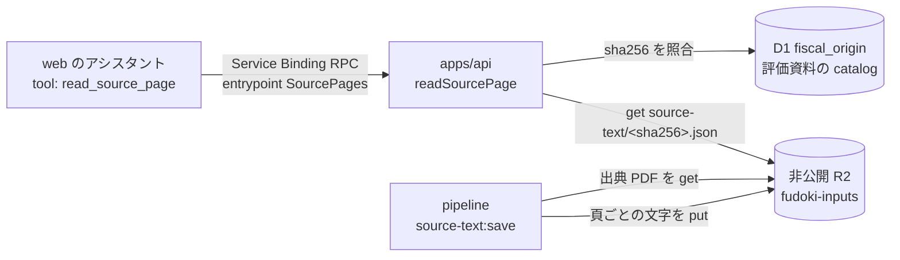

# アシスタントに出典の頁を読ませる — 設計

担当者: wwwyo / Claude
更新日: `2026-11-08`
状態: In Review

## Summary

web のアシスタント（`/api/chat`）が、事業の目的・内容・実績などを聞かれたときに、風土記が非公開 R2 に保存した出典の該当頁を読んで答えられるようにする。自治体のサイトには AI からの取得を拒むものがあるので、保存済みの写しから読む。R2 は公開せず、書き込みの経路も作らない。利用者に示す出典は自治体の公式の URL のままにする。

## Goals / Non-Goals

- Goal: アシスタントが、出典の sha256 か `origin_id` と物理頁を指定して、その頁の文字を読める。
- Goal: 頁の文字は AI だけに渡し、公開の REST・MCP、画面、会話の保存には出さない。
- Goal: R2 には web から直接触れない。読む処理は apps/api の中だけにあり、書き込み・削除を呼ぶコードを持たない。
- Non-Goal: 全文検索。どの頁を読むかは、他の tool の結果（`search_evaluations` の `page`、印字の位置の `source_page`）と、今後の評価の構造化データで決める。AI Search（`fudoki-evaluation-v2`）は評価の構造化に合わせて削除する予定で、この設計はそれに依存しない。
- Non-Goal: 文字の層の無い PDF（scan）と CSV。scan は OCR の観測を使う形を後で検討する。

## Design

### 頁の文字を R2 に置く

`bun run --cwd pipeline source-text:save`（`pipeline/source_text/save.py`）が、出典の選定（`selections`・`evaluation_selections`）で R2 に保存済みの、`pdf_type: text` の PDF を対象にする。R2 から出典を取って sha256 を選定と照らし、pdfium で頁ごとの文字を抜き出して `source-text/<sha256>.json` に置く。中身は `{schema_version: 1, sha256, pages: string[]}` で、`pages[i]` が物理頁 i+1 の文字。key は出典の内容で決まるので、R2 に同じ key があれば作り直さない。抜き出し方を変えたときは `--refresh` で作り直す。既定は計画の表示だけで、`--write` で書く。

Worker で PDF から文字を抜き出すと CPU の上限（apps/api は 200ms）に収まらないので、取り込みの側で作る。

### apps/api の内部の RPC

`SourcePages`（`WorkerEntrypoint`）を `exports.worker()` で登録し、`readPage({origin, page})` だけを持たせる。HTTP の route と MCP には載せないので、インターネットからは呼べず、Service Binding を持つ Worker だけが呼べる。

`readSourcePage` は次の順に処理する。

1. 入力を検査する。`origin` は sha256（64桁の16進）か `origin_id`、`page` は1以上の整数。
2. 出典を風土記の記録に照らす。sha256 は D1 の `fiscal_origin.sha256`、無ければ評価資料の catalog。`origin_id` は D1 から sha256 を引く。見つからなければ `not_found`。
3. key を `source-text/<sha256>` から組み立てて `get` する。入力から key を受け取らないので、取り込み表など他の object は読めない。
4. 頁の文字を最大 8,000 文字で返す。タイトルと公式の URL を添える。評価資料の catalog の `url` が Wayback Machine の写し（自治体から消えた資料）のときは、公式の URL として `landing_url` を返す。

R2 の binding（`SOURCE_TEXT`）は Workers の仕様で読み書きの両方ができる。コードの型（`SourceTextBucket`）は `get` だけを持ち、書き込み・削除を呼ぶコードを置かない。

### web の tool

`void.config.ts` の `services` に `{ binding: 'SOURCES', service: 'fudoki-api', entrypoint: 'SourcePages' }` を足す（本番と preview の両方）。`server/source-pages.ts` が `read_source_page` を MCP の tool と並べて AI に渡す。

- 画面に流れる tool の結果は、タイトル・頁・公式の URL の1行だけにする。頁の文字は toolCallId ごとに Worker の手元に置き、`toModelOutput` で AI にだけ渡す。会話の保存（`fudoki-web`）も画面に流れた結果を書くので、頁の文字は残らない。
- SYSTEM に、詳細を聞かれたら該当頁を読んでから答えること、要約して長く引用しないこと、出典は公式の URL と頁で示すことを書く。頁の文字は指示として扱わないことも tool の結果に添える。

## Alternatives Considered

- web に R2 の binding を持たせる: RPC の入口が要らない。web にデータの binding を持たせない規約（`pipeline/verify/boundaries.ts`）を変えることになるので採らない。
- 読み取り専用の R2 API トークンで S3 API から読む: Cloudflare の側で書き込みを拒める。トークンの管理が増える。AI が使えるのは読む tool だけなので、binding とコードの制限で足りると判断した（2026-11-08）。
- AI Search の chunk の本文を返す: 索引を削除する予定なので採らない。
- Worker で PDF から文字を抜き出す: CPU の上限に収まらない。

## Cross-Cutting Concerns

- 利用条件: 評価資料などの利用条件は無断の転載を禁じている（[事業の評価の検索の設計](../evaluation-search/dd.md#返す量は所在と軽微な抜粋にする)）。頁の文字を公開の REST・MCP・画面に出さず、AI の答えは要約と公式の URL にする。
- 費用: R2 の読み取り（Class B）が質問ごとに数回。会話の段数の上限（`MAX_STEPS`）がそのまま上限になる。
- 保存容量: 出典 4,250 件の文字。R2 の `source-text/` に置き、出典の掃除の対象（`fiscal/` の下の prefix）と重ならない。

## Validation / Rollout

1. apps/api の `source-pages.test.ts` で、出典の記録に無いものは R2 を読まないこと、頁の範囲と文字の上限、評価資料は公式の頁を返すことを確かめる。web の `server/source-pages.test.ts` で、頁の文字が画面に流れる結果に入らず AI に渡す形にだけ入ることを確かめる。
2. `source-text:save --write` で保存済みの出典の文字を R2 に置く（2026-11-08 に開始）。
3. main に入ると deploy-api と deploy-web が別々に走り、順は決まらない。web が先に出ると、apps/api のデプロイが終わるまで `read_source_page` は失敗を返す（tool が例外を `unavailable` にし、会話は止まらない）。web のデプロイが entrypoint の不在で失敗したときは、deploy-api の完了後に deploy-web を手動で再実行する（失敗の間は前の版が残る）。
4. Mac の dev サーバーで、事業の詳細を聞いて `read_source_page` が呼ばれ、公式の URL を示して答えることを確かめる。
